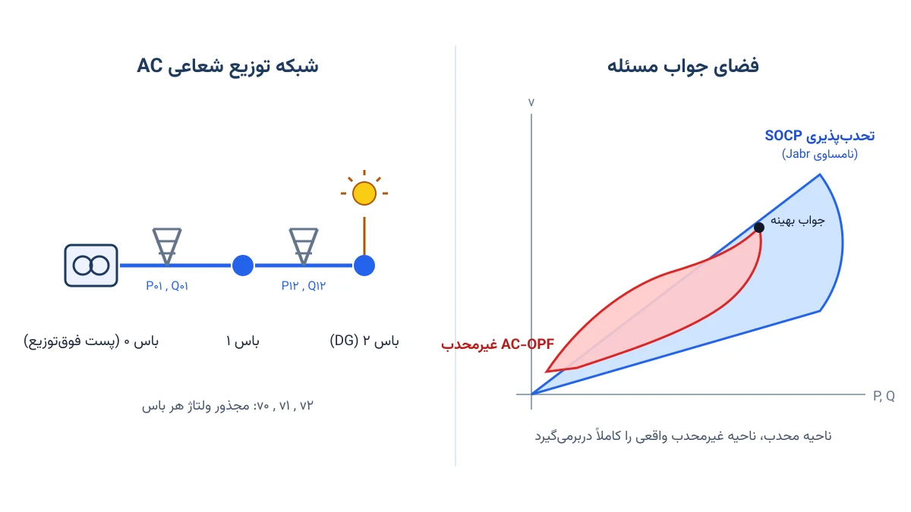
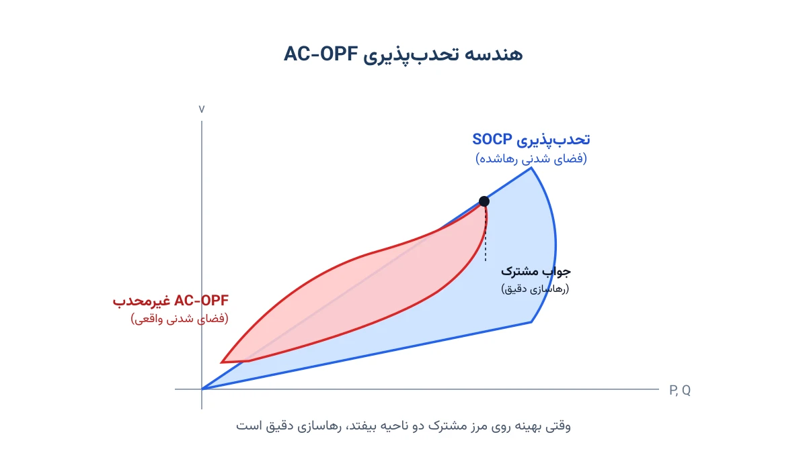

هر اپراتور شبکه برق هر چند دقیقه یک‌بار تصمیم می‌گیرد هر نیروگاه چقدر تولید کند. این تصمیم باید هزینه تولید را کم کند. همزمان باید ولتاژ هر باس را در محدوده مجاز نگه دارد. مسئله‌ای که این تصمیم را مدل می‌کند، پخش بار بهینه جریان متناوب یا AC Optimal Power Flow نام دارد. به اختصار آن را AC-OPF می‌نامند.

نسخه ساده‌شده این مسئله، پخش بار بهینه جریان مستقیم (DC-OPF)، در صنعت بسیار محبوب است. دلیلش سادگی ریاضی و سرعت حل آن است. اما DC-OPF فرض می‌کند ولتاژ همه باس‌ها ثابت و تلفات شبکه صفر است. این فرض‌ها برای شبکه انتقال فشار قوی قابل قبول‌اند. برای شبکه توزیع با منابع تولید پراکنده، همین فرض‌ها جواب را به‌شدت نادرست می‌کنند. برای دیدن فهرست کامل مسائلی که دقیقاً به همین دلیل به مدل AC نیاز دارند، یادداشت [مطالعات پخش بار AC](/notes/ac-studies/) را ببینید.



## فرمول‌بندی ریاضی مسئله

برای توضیح ساده‌تر، به‌جای فرمول‌بندی کامل تزریق توان هر باس، از مدل جریان شاخه (Branch Flow Model) استفاده می‌کنیم. این مدل برای شبکه‌های شعاعی توزیع برق رایج‌تر و شهودی‌تر است. فرض کنید شبکه شعاعی با باس‌های $i=0,1,\dots,n$ داریم، که باس صفر پست فوق‌توزیع است. هر خط بین باس $i$ و $j$ مقاومت $r_{ij}$ و راکتانس $x_{ij}$ دارد. توان اکتیو و راکتیو عبوری از این خط را با $P_{ij}$ و $Q_{ij}$ نشان می‌دهیم. مجذور دامنه ولتاژ باس $i$ را $v_i$ و مجذور دامنه جریان خط را $\ell_{ij}$ می‌نامیم.

معادلات جریان شاخه، توان و ولتاژ هر باس را به باس بالادستی‌اش مرتبط می‌کنند:

$$
P_{ij} - r_{ij}\,\ell_{ij} = p_j^{d} - p_j^{g} + \sum_{k:\, j \to k} P_{jk}
$$

$$
Q_{ij} - x_{ij}\,\ell_{ij} = q_j^{d} - q_j^{g} + \sum_{k:\, j \to k} Q_{jk}
$$

$$
v_j = v_i - 2\left(r_{ij} P_{ij} + x_{ij} Q_{ij}\right) + \left(r_{ij}^2 + x_{ij}^2\right) \ell_{ij}
$$

در این معادلات، $p_j^{d}$ و $q_j^{d}$ بار مصرفی باس $j$ هستند. $p_j^{g}$ و $q_j^{g}$ هم تولید محلی آن باس، مثل یک پنل خورشیدی، را نشان می‌دهند. این سه معادله خطی‌اند و مشکلی ایجاد نمی‌کنند. مشکل اصلی، تعریف دقیق $\ell_{ij}$ است:

$$
\ell_{ij} = \frac{P_{ij}^2 + Q_{ij}^2}{v_i}
$$

این تساوی غیرخطی و غیرمحدب است. دقیقاً همین یک معادله، کل مسئله AC-OPF را سخت می‌کند. ایده اصلی تحدب‌پذیری Jabr این است که این تساوی را به یک نامساوی تبدیل کنیم:

$$
\ell_{ij} \geq \frac{P_{ij}^2 + Q_{ij}^2}{v_i} \quad \Longleftrightarrow \quad \left\lVert \begin{bmatrix} 2P_{ij} \\ 2Q_{ij} \\ \ell_{ij} - v_i \end{bmatrix} \right\rVert_2 \leq \ell_{ij} + v_i
$$

سمت راست این نامساوی، یک محدودیت مخروط درجه دوم (Second-Order Cone) استاندارد است. چنین محدودیتی محدب است و سالورهای تجاری و رایگان آن را به‌خوبی می‌شناسند. به همین دلیل، این بازنویسی را تحدب‌پذیری مخروط درجه دوم یا SOCP Relaxation می‌نامند.

نکته مهم این است که این یک تقریب نیست. این یک رها‌سازی (Relaxation) است. فضای جواب نامساوی، فضای جواب تساوی اصلی را کاملاً دربرمی‌گیرد. اگر جواب بهینه این مسئله رها‌شده دقیقاً روی مرز مخروط بیفتد، جواب به‌دست‌آمده برای AC-OPF اصلی هم دقیق و بهینه است. برای شبکه‌های شعاعی توزیع بدون بازگشت توان، این اتفاق در اغلب موارد عملی رخ می‌دهد.

## اهمیت این موضوع

اهمیت این بحث را بهتر می‌شود با واقعیت شبکه‌های امروزی توضیح داد. تا چند سال پیش، بیشتر مطالعات پخش بار با فرض DC انجام می‌شدند. امروز پنل خورشیدی خانگی، باتری‌های ذخیره‌ساز و شارژ خودروی برقی گسترده شده‌اند. این فرض‌های ساده دیگر کافی نیستند. اپراتورهای شبکه باید هم‌زمان ولتاژ، جریان خط، و ظرفیت ترانسفورماتور را دقیق کنترل کنند.

شرکتی مثل PJM Interconnection در آمریکا، بازار برق چندین ایالت را اداره می‌کند. این شرکت هر روز هزاران بار مسئله پخش بار بهینه را حل می‌کند. در سطح انتقال، اغلب تقریب DC کافی است. اما وقتی بحث شبکه‌های توزیع هوشمند و منابع تولید پراکنده مطرح می‌شود، دقت مدل AC دیگر اختیاری نیست. شرکت‌های توزیع برق که امروز هزاران نیروگاه خورشیدی پشت‌بامی را مدیریت می‌کنند، دقیقاً با همین چالش تحدب‌پذیری AC-OPF روبه‌رو هستند.

## ظرفیت پژوهشی و آکادمیک

تحدب‌پذیری AC-OPF یکی از فعال‌ترین زمینه‌های پژوهشی سیستم قدرت در دهه اخیر است. فراتر از SOCP، پژوهشگران رویکرد قوی‌تری هم معرفی کرده‌اند: تحدب‌پذیری نیمه‌معین (Semidefinite Programming Relaxation) یا SDP. رها‌سازی SDP معمولاً دقیق‌تر از SOCP است. اما از نظر محاسباتی برای شبکه‌های بزرگ بسیار سنگین‌تر است. سوال پژوهشی جذاب اینجاست: در چه شرایطی SOCP ساده‌تر، همان دقت SDP پیچیده‌تر را می‌دهد؟

یک مسیر پژوهشی دیگر، شرط‌های دقیق بودن (Exactness Conditions) رها‌سازی است. برای شبکه شعاعی بدون محدودیت کران بالای ولتاژ، می‌توان دقیق بودن SOCP را اثبات کرد. اما وقتی محدودیت کران بالا یا پیکربندی حلقوی (Meshed) اضافه شود، رها‌سازی ممکن است دیگر دقیق نباشد. موضوعات داغ دیگر هم وجود دارند. یکی ترکیب رها‌سازی محدب با عدم‌قطعیت تولید خورشیدی و بادی است. به آن AC-OPF مقیدِ احتمالاتی می‌گویند. موضوع دیگر، طراحی الگوریتم‌های تنگ‌سازی برای کاهش فاصله بین جواب رها‌شده و جواب واقعی است. هر کدام از این مسیرها ظرفیت خوبی برای پایان‌نامه ارشد یا دکتری دارند.



## پیاده‌سازی با پایتون

خبر خوب این‌جاست که برای حل این مدل، به هیچ سالور تجاری گران‌قیمتی نیاز ندارید. چون فرم نهایی SOCP محدب است، سالورهای رایگان و متن‌باز هم می‌توانند جواب سراسری بهینه را با اطمینان پیدا کنند. کتابخانه [Pyomo](http://www.pyomo.org/) امکان نوشتن محدودیت مخروطی را به‌صورت طبیعی فراهم می‌کند. برای حل مدل، می‌توان از سالور غیرخطی رایگان [Ipopt](https://coin-or.github.io/Ipopt/) استفاده کرد. اگر مسئله را به فرم استاندارد SOCP بنویسید، کتابخانه [cvxpy](https://www.cvxpy.org/) با سالورهای رایگان Clarabel یا SCS هم گزینه خوبی است.

برای مثال ملموس، یک فیدر شعاعی سه‌باسه با یک منبع تغذیه و دو بار مصرفی در نظر می‌گیریم. باس صفر پست فوق‌توزیع با ولتاژ ثابت است. باس‌های یک و دو هرکدام یک بار مصرفی دارند. هدف، کمینه کردن تلفات توان اکتیو در خطوط است، درحالی‌که ولتاژ هر باس در محدوده مجاز بماند.

```python
import pyomo.environ as pyo

model = pyo.ConcreteModel()

buses = [0, 1, 2]
lines = [(0, 1), (1, 2)]

# مجذور دامنه ولتاژ هر باس (v_i) و مجذور جریان هر خط (l_ij)
model.v = pyo.Var(buses, within=pyo.NonNegativeReals, bounds=(0.9**2, 1.1**2))
model.l = pyo.Var(lines, within=pyo.NonNegativeReals)
model.P = pyo.Var(lines, within=pyo.Reals)
model.Q = pyo.Var(lines, within=pyo.Reals)

# نامساوی Jabr: نسخه محدب معادله غیرمحدب ell = (P^2+Q^2)/v
def jabr_rule(m, i, j):
    return m.P[i, j]**2 + m.Q[i, j]**2 <= m.l[i, j] * m.v[i]

model.jabr_cone = pyo.Constraint(lines, rule=jabr_rule)

# ادامه قیود (تعادل توان هر باس، افت ولتاژ طول خط) و تابع هدف تلفات
# به همین شیوه تعریف می‌شوند.
```

نکته کلیدی در این مدل، تابع `jabr_rule` است. این محدودیت، معادله غیرخطی و غیرمحدب اصلی را به یک نامساوی محدب تبدیل می‌کند. Pyomo این نامساوی را به‌صورت یک محدودیت درجه دوم می‌شناسد و آن را مستقیم به سالور Ipopt می‌دهد. پس از حل مدل کامل، می‌توان با بررسی فاصله دو طرف نامساوی Jabr، دقیق بودن جواب را هم ارزیابی کرد.

برای مقایسه نتیجه با پخش بار دقیق AC (بدون رها‌سازی)، کتابخانه‌های رایگان [pandapower](https://www.pandapower.org/) و [PyPSA](https://pypsa.org/) گزینه‌های خوبی هستند. هر دو امکان اجرای پخش بار AC کامل و غیرمحدب را هم دارند. می‌توان نتیجه رها‌سازی را با آن‌ها مقایسه کرد.

اگر می‌خواهید مسائل سیستم قدرت مثل AC-OPF و SOCP را از پایه یاد بگیرید، دوره [سیستم قدرت پیشرفته](/courses/advanced-power-system/) گزینه مناسبی است. اگر هم برای پیاده‌سازی این مدل روی شبکه واقعی خودتان به کمک نیاز دارید، صفحه [مشاوره](/consultation/) نقطه شروع خوبی است.

## سوالات متداول

<h3>آیا رها‌سازی SOCP همیشه جواب دقیق AC-OPF اصلی را می‌دهد؟</h3>
<p>خیر، همیشه دقیق نیست. برای اغلب شبکه‌های توزیع شعاعی بدون محدودیت فعال کران بالای ولتاژ، رها‌سازی معمولاً دقیق است. برای شبکه‌های حلقوی یا شرایط خاص، ممکن است فاصله کوچکی بین جواب رها‌شده و جواب واقعی باقی بماند.</p>

<h3>چرا به‌جای حل مستقیم مسئله غیرمحدب، از رها‌سازی محدب استفاده می‌کنیم؟</h3>
<p>چون سالورهای محدب تضمین می‌دهند جواب به‌دست‌آمده، بهینه سراسری مسئله رها‌شده است. سالورهای غیرخطی معمولی روی مسئله غیرمحدب، فقط به یک بهینه محلی می‌رسند. این بهینه محلی می‌تواند بسیار دورتر از بهترین جواب ممکن باشد.</p>

<h3>برای یادگیری مدل‌سازی AC-OPF و تحدب‌پذیری از کجا شروع کنم؟</h3>
<p>دوره <a href="/courses/advanced-power-system/" style="color:#2563EB; font-weight:bold;">سیستم قدرت پیشرفته</a> فرمول‌بندی کامل AC-OPF، DC-OPF و رویکردهای تحدب‌پذیری را از پایه آموزش می‌دهد. این دوره پایه خوبی برای کار با شبکه‌های توزیع هوشمند و منابع تولید پراکنده هم فراهم می‌کند.</p>

<h3>آیا می‌توان این مدل را روی داده واقعی شبکه توزیع خودمان پیاده‌سازی کرد؟</h3>
<p>بله، قطعاً. چون ابزارهایی مثل Pyomo، Ipopt و cvxpy کاملاً رایگان و متن‌باز هستند، نیازی به لایسنس گران‌قیمت نیست. اگر برای پیاده‌سازی این مدل روی شبکه واقعی خودتان به راهنمایی نیاز دارید، از طریق صفحه <a href="/consultation/" style="color:#2563EB; font-weight:bold;">مشاوره</a> می‌توانید با ما در ارتباط باشید.</p>
