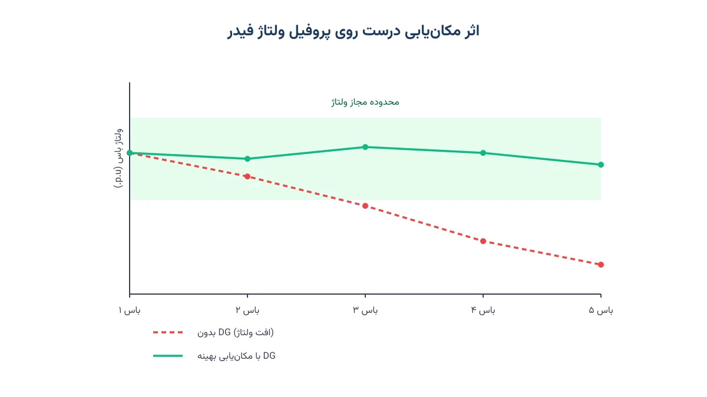

هر سال واحدهای تولید پراکنده بیشتری، از پنل خورشیدی روی پشت‌بام تا توربین بادی کوچک، به شبکه توزیع متصل می‌شوند. این اتصال رایگان نیست. هر واحد جدید، جریان توان را در فیدر عوض می‌کند و روی پروفیل ولتاژ اثر می‌گذارد. سوال اصلی این است: این واحد را دقیقاً کجا نصب کنیم، و با چه ظرفیتی؟ جواب درست می‌تواند تلفات شبکه را کم کند. همچنین می‌تواند نیاز به تقویت خط را عقب بیندازد. جواب غلط هم می‌تواند ولتاژ را از محدوده مجاز خارج کند.

## مسئله واقعی چیست؟

یک شرکت توزیع برق را تصور کنید که چند متقاضی اتصال مولد خورشیدی یا توربین بادی کوچک دارد. هر متقاضی روی یک باس مشخص از فیدر قرار می‌گیرد. شرکت باید تصمیم بگیرد کدام باس‌ها برای اتصال مناسب‌ترند. باید سقف ظرفیت مجاز روی هر باس هم مشخص شود. این تصمیم باید سه چیز را همزمان در نظر بگیرد. اول تلفات توان در خطوط، دوم افت یا بالازدگی ولتاژ، و سوم ظرفیت حرارتی هر خط. مسئله مکان‌یابی و اندازه‌گذاری تولید پراکنده (DG Siting and Sizing) دقیقاً همین تصمیم را به زبان بهینه‌سازی ترجمه می‌کند.

نکته مهم این است که مکان و اندازه از هم جدا نیستند. یک واحد کوچک در جای درست می‌تواند مفیدتر از یک واحد بزرگ در جای نامناسب باشد. به همین دلیل این دو تصمیم باید همزمان حل شوند، نه پشت سر هم. حل جداگانه‌ی آن‌ها معمولاً به یک جواب نسبتاً ضعیف می‌رسد.

## فرمول‌بندی ریاضی مسئله

برای هر باس $i$ در شبکه، متغیر دودویی $y_i$ نشان می‌دهد آیا واحد DG در آن باس نصب می‌شود یا نه. متغیر پیوسته $P_i^{DG}$ ظرفیت نصب‌شده را نشان می‌دهد. متغیرهای $P_{ij}$ و $Q_{ij}$ هم توان اکتیو و راکتیو عبوری از هر خط را می‌دهند. متغیر $V_i$ هم اندازه ولتاژ هر باس است.

تابع هدف، مجموع تلفات توان در خطوط به‌علاوه هزینه نصب واحدهاست:

$$\min \sum_{(i,j) \in L} R_{ij}\,\frac{P_{ij}^2 + Q_{ij}^2}{V_0^2} \;+\; \sum_{i \in N} c_i\, P_i^{DG}$$

موازنه توان در هر باس، با فرمول‌بندی ساده‌شده شبکه شعاعی (LinDistFlow)، این‌طور نوشته می‌شود:

$$\sum_{k:(k,i)\in L} P_{ki} - \sum_{j:(i,j)\in L} P_{ij} + P_i^{DG} - P_i^{load} = 0 \qquad \forall i \in N$$

افت ولتاژ روی هر خط، تقریب خطی معروفی دارد:

$$V_j = V_i - \frac{R_{ij} P_{ij} + X_{ij} Q_{ij}}{V_0} \qquad \forall (i,j) \in L$$

و در نهایت سه دسته قید دیگر: محدوده مجاز ولتاژ، سقف ظرفیت حرارتی خطوط، و پیوند بین متغیر دودویی و اندازه نصب‌شده:

$$V^{min} \le V_i \le V^{max}, \qquad 0 \le P_i^{DG} \le P^{max}\, y_i, \qquad \sum_{i \in N} y_i \le N_{max}$$

قید آخر، سقفی روی تعداد واحدهای قابل‌نصب می‌گذارد. این سقف معمولاً به بودجه یا ظرفیت بازرسی اپراتور شبکه بستگی دارد. اگر توان راکتیو $Q_{ij}$ هم آزاد باشد، مدل غیرخطی می‌شود. در آن حالت باید با سالورهای NLP یا MINLP حل شود. در نسخه ساده‌تر، $Q_{ij}$ را ثابت یا صفر می‌گیریم. این کار مدل را به یک MILP نزدیک‌تر می‌کند.

به‌عنوان یک قاعده کلی، تعداد باس‌های کاندید معمولاً خیلی کمتر از کل باس‌های شبکه است. فقط باس‌هایی که متقاضی واقعی دارند یا فنی مناسب‌اند وارد مجموعه $N$ می‌شوند. این کار اندازه مدل را به‌شدت کوچک‌تر و حل آن را سریع‌تر می‌کند.

## اهمیت این موضوع

با رشد سریع برق خورشیدی پشت‌بامی، بسیاری از فیدرهای توزیع به نقطه‌ای رسیده‌اند. جریان توان دیگر فقط از پست به سمت مشترک نیست؛ بخشی از آن برمی‌گردد. این پدیده به «جریان معکوس» معروف است. جریان معکوس می‌تواند تنظیم ولتاژ سنتی را بی‌اثر کند. شرکتی مثل Southern California Edison در کالیفرنیا سال‌هاست مطالعات «ظرفیت میزبانی» (Hosting Capacity) انجام می‌دهد. هدف این مطالعات این است که بفهمند هر فیدر چقدر تولید پراکنده جدید را بدون مشکل تحمل می‌کند.

مدل مکان‌یابی و اندازه‌گذاری، دقیقاً همین پرسش را به شکل کمّی پاسخ می‌دهد. به‌جای بررسی تک‌تک سناریوهای اتصال با شبیه‌سازی دستی، بهینه‌سازی می‌تواند ترکیب بهینه مکان و ظرفیت را در یک اجرا پیدا کند. این موضوع برای شرکت‌های توزیع، مشاوران طراحی شبکه، و حتی توسعه‌دهندگان نیروگاه‌های خورشیدی کوچک اهمیت عملی مستقیم دارد.



## ظرفیت کار آکادمیک و پژوهشی

این مسئله یکی از پرکارترین حوزه‌های پژوهش سیستم قدرت در دو دهه اخیر بوده است. نسخه‌های کلاسیک آن با الگوریتم‌های فراابتکاری مثل ژنتیک یا PSO حل می‌شدند. دلیلش این بود که مدل کامل جریان توان AC غیرمحدب است. نسخه‌های جدیدتر از تبدیل محدب (SOCP) یا تقریب‌های خطی مثل LinDistFlow استفاده می‌کنند. این کار اجازه می‌دهد از سالورهای دقیق MILP هم بهره بگیریم.

زمینه‌های باز زیادی هم باقی مانده‌اند. مدل‌سازی عدم‌قطعیت تولید خورشیدی و بادی با رویکرد دومرحله‌ای تصادفی یکی از آن‌هاست. ترکیب مکان‌یابی DG با مکان‌یابی ذخیره‌ساز انرژی، زمینه‌ی دیگری است. ترکیب آن با بازآرایی شبکه توزیع هم یک مسیر پژوهشی جذاب است. بسیاری از پایان‌نامه‌های ارشد و دکتری حول همین ترکیب‌ها شکل می‌گیرند. علتش این است که هم داده واقعی فراوان است، و هم ادبیات علمی غنی.

## پیاده‌سازی با پایتون

خبر خوب این است که می‌توان این مسئله را کاملاً با ابزارهای متن‌باز پایتون حل کرد. نیازی به نرم‌افزار تجاری گران‌قیمت نیست. برای نسخه خطی‌شده، [Pyomo](https://www.pyomo.org/) به همراه سالورهای رایگان مثل [HiGHS](https://highs.dev/) یا [CBC](https://github.com/coin-or/Cbc) کاملاً کافی است. اگر بخواهید مدل جریان توان کامل و غیرخطی را نگه دارید، گزینه دیگری هم هست. [IPOPT](https://coin-or.github.io/Ipopt/) یا حتی [pandapower](https://www.pandapower.org/) برای محاسبه پخش بار، گزینه‌های مناسبی‌اند.

پیش از این یادداشت [سه روش عملی استفاده از Solverها در Pyomo](/notes/pyomo-solvers/) را هم ببینید. این کار به انتخاب درست سالور کمک می‌کند. اگر با مفاهیم پایه مدل‌سازی هنوز راحت نیستید، یک دوره کامل هم وجود دارد. دوره [مدل‌سازی و تصمیم‌گیری پیشرفته سیستم قدرت](/courses/advanced-power-system/) این مسیر را از صفر تا یک مدل کامل جلو می‌برد.

اسکلت اولیه مدل در Pyomo این‌طور شروع می‌شود:

```python
import pyomo.environ as pyo

model = pyo.ConcreteModel()
model.N = pyo.Set(initialize=buses)
model.L = pyo.Set(initialize=lines, dimen=2)

model.y = pyo.Var(model.N, within=pyo.Binary)
model.P_dg = pyo.Var(model.N, within=pyo.NonNegativeReals)
model.V = pyo.Var(model.N, bounds=(v_min, v_max))

model.link_size = pyo.ConstraintList()
for i in model.N:
    model.link_size.add(model.P_dg[i] <= p_max[i] * model.y[i])
# ادامه قیود موازنه توان، افت ولتاژ و تابع هدف به همین شیوه تعریف می‌شوند.
```

## سوالات متداول

<h3>چرا نمی‌شود فقط بزرگ‌ترین باس را برای نصب DG انتخاب کرد؟</h3>
<p>چون اثر هر باس روی تلفات و ولتاژ به فاصله‌اش از پست و بار اطرافش بستگی دارد، نه فقط به اندازه بار آن باس. بدون مدل بهینه‌سازی، این اثر متقابل به‌سادگی قابل حدس زدن نیست.</p>

<h3>آیا این مدل برای شبکه‌های حلقوی هم کار می‌کند؟</h3>
<p>فرمول‌بندی LinDistFlow بالا مخصوص شبکه‌های شعاعی توزیع است. برای شبکه حلقوی باید معادلات موازنه توان اصلاح شود؛ موضوعی که در دوره <a href="/courses/advanced-power-system/" style="color:#2563EB; font-weight:bold;">مدل‌سازی پیشرفته سیستم قدرت</a> با جزئیات بیشتر پوشش داده می‌شود.</p>

<h3>اگر بخواهم این مدل را روی شبکه واقعی شرکت خودم پیاده کنم چه کار کنم؟</h3>
<p>هر فیدر واقعی داده‌های توپولوژی، بار و محدودیت‌های خاص خودش را دارد و مدل باید با آن تطبیق داده شود. برای این مرحله می‌توانید از <a href="/consultation/" style="color:#2563EB; font-weight:bold;">مشاوره</a> کمک بگیرید.</p>
