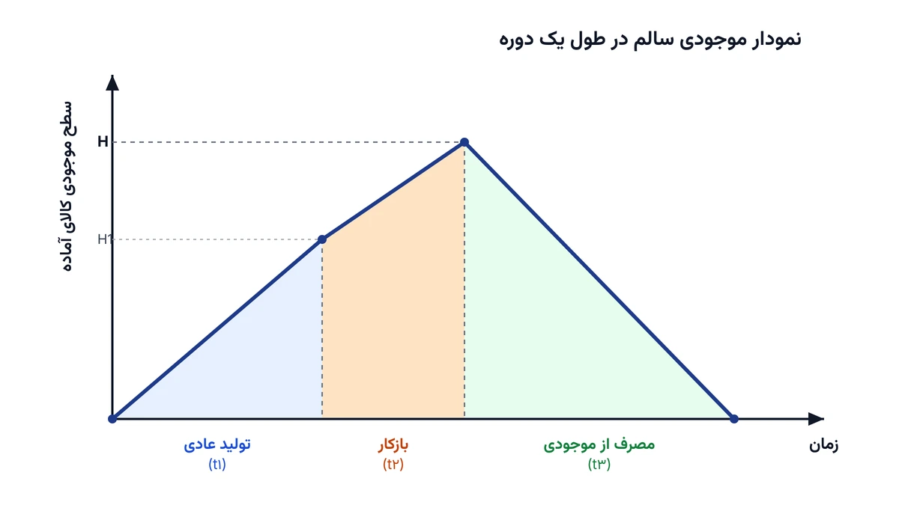

هر خط تولیدی، حتی با بهترین تجهیزات، درصدی قطعه معیوب تحویل می‌دهد. این قطعات همیشه دورریختنی نیستند. در بسیاری از کارخانه‌ها، معیوب‌ها به یک ایستگاه جداگانه می‌روند، دوباره کار می‌شوند و به‌عنوان کالای سالم به انبار برمی‌گردند. اما همین یک تصمیم ساده، اندازه دسته تولید اقتصادی (Economic Production Quantity یا EPQ) را کاملاً تغییر می‌دهد. فرمول کلاسیک EPQ فرض می‌کند هر واحد تولیدشده، همان ابتدا سالم و قابل‌فروش است. وقتی این فرض درست نباشد، باید مدل را از نو ساخت.

در این یادداشت یک مدل کامل برای این تصمیم می‌سازیم. هدف، یافتن اندازه دسته‌ای است که چهار هزینه را کمینه کند: راه‌اندازی، نگهداری موجودی سالم، نگهداری موجودی معیوب، و بازکار.

## اهمیت این موضوع

تصمیم «بازکار یا دورریز» یک تصمیم روزمره در صنعت است، نه یک استثنا. شرکتی مثل بوش (Bosch) در خط تولید قطعات دقیق خودرو را در نظر بگیرید. همیشه درصدی از قطعات، در بازرسی اولیه رد می‌شوند اما قابل‌اصلاح‌اند. دورریختن این قطعات یعنی هدررفت مواد اولیه و ظرفیت تولید. بازکار آن‌ها هم رایگان نیست: به زمان، نیروی کار و گاهی تجهیزات جداگانه نیاز دارد.

مسئله دقیقاً همین‌جا بهینه‌سازی می‌خواهد. اگر اندازه دسته تولید خیلی بزرگ باشد، هم موجودی سالم و هم موجودی معیوبِ در صف بازکار، مدت طولانی‌تری روی زمین می‌مانند. در نتیجه، هزینه نگهداری بالا می‌رود. اگر خیلی کوچک باشد، باید بیشتر راه‌اندازی کرد و هزینه ثابت هر بار بالا می‌رود. نرخ بازکار هم اغلب محدود است؛ معمولاً پایین‌تر از نرخ تولید خط اصلی. این محدودیت، شکل نمودار موجودی را از یک دندانه‌ی ساده به یک منحنی سه‌مرحله‌ای تبدیل می‌کند.

نکته دیگر این است که هزینه بازکار، بخش زیادی‌اش به نرخ خرابی وابسته است، نه به اندازه دسته. در ادامه با عدد نشان می‌دهیم که وقتی نرخ خرابی از ۲ درصد به ۳۰ درصد می‌رسد، هزینه سالانه چند برابر می‌شود. با این حال، اندازه دسته بهینه تغییر چندانی نمی‌کند. این یافته، پیام مدیریتی روشنی دارد: اهرم اصلی کاهش هزینه، بهبود کیفیت تولید است، نه فقط تنظیم اندازه دسته.



## فرمول‌بندی ریاضی مدل

فرض می‌کنیم هر دسته تولید به اندازه $Q$ واحد است. نسبت $\theta$ از این $Q$ واحد، معیوب درمی‌آید ($0 \le \theta < 1$). همه معیوب‌ها قابل‌بازکارند و بعد از بازکار، سالم و قابل‌فروش می‌شوند؛ یعنی دورریز نداریم. نرخ تولید خط اصلی $P$ و نرخ بازکار $P_r$ هر دو ثابت فرض می‌شوند، و نرخ تقاضا $D$ هم ثابت و معلوم است.

هر چرخه تولید از سه فاز پشت‌سرهم تشکیل می‌شود:

**فاز ۱ (تولید عادی):** خط اصلی با نرخ $P$ کار می‌کند. طول این فاز برابر $t_1 = Q/P$ است. از این مقدار، $(1-\theta)Q$ واحد سالم مستقیم به انبار می‌رود و $\theta Q$ واحد معیوب به صف بازکار می‌رود. در این فاز، موجودی سالم با نرخ خالص $P(1-\theta) - D$ بالا می‌رود.

**فاز ۲ (بازکار):** تولید عادی متوقف می‌شود و ایستگاه بازکار، معیوب‌های انباشته‌شده را با نرخ $P_r$ به کالای سالم تبدیل می‌کند. طول این فاز برابر $t_2 = \theta Q / P_r$ است. در این فاز، موجودی سالم با نرخ خالص $P_r - D$ بالا می‌رود.

**فاز ۳ (مصرف از موجودی):** نه تولیدی در جریان است و نه بازکاری؛ موجودی سالم فقط با نرخ تقاضا $D$ کم می‌شود تا صفر شود.

سطح موجودی سالم در پایان فاز اول و دوم، یعنی $H_1$ و $H$، و طول فاز سوم $t_3$ برابرند با:

$$
H_1 = \big[P(1-\theta) - D\big]\, t_1
$$

$$
H = H_1 + (P_r - D)\, t_2
$$

$$
t_3 = \frac{H}{D}
$$

چون در هر چرخه، در نهایت همه $Q$ واحد سالم می‌شوند و با نرخ $D$ مصرف می‌شوند، طول کل چرخه ساده است:

$$
T = \frac{Q}{D}
$$

هزینه نگهداری موجودی سالم، متناسب است با مساحت زیر نمودار ذوزنقه‌ای سه‌فازی (شکل بالا)، تقسیم بر طول چرخه:

$$
\text{میانگین موجودی سالم} = \frac{1}{T}\left[\tfrac{1}{2}H_1 t_1 + \tfrac{1}{2}(H_1+H)t_2 + \tfrac{1}{2}H t_3\right]
$$

موجودی معیوبِ در صف بازکار هم از صفر تا $\theta Q$ در فاز ۱ بالا می‌رود و در فاز ۲ دوباره به صفر می‌رسد؛ میانگینش در این دو فاز تقریباً $\theta Q/2$ است:

$$
\text{میانگین موجودی معیوب} = \frac{1}{T}\left[\tfrac{1}{2}\theta Q (t_1+t_2)\right]
$$

با $K$ به‌عنوان هزینه راه‌اندازی هر دسته، $h$ هزینه نگهداری سالانه هر واحد سالم، $h_d$ هزینه نگهداری سالانه هر واحد معیوب، و $C_r$ هزینه بازکار هر واحد معیوب، تابع هزینه کل سالانه این می‌شود:

$$
TC(Q) = K\frac{D}{Q} + h \cdot \text{میانگین موجودی سالم} + h_d \cdot \text{میانگین موجودی معیوب} + C_r\, \theta D
$$

جمله آخر، یعنی $C_r \theta D$، جالب توجه است: مستقل از $Q$ است، چون در یک سال، تقریباً $\theta D$ واحد معیوب تولید و بازکار می‌شود، صرف‌نظر از اینکه دسته‌ها بزرگ باشند یا کوچک. همین جمله، عامل اصلی رشد هزینه با افزایش نرخ خرابی است.

برای یک کارخانه با $D=10{,}000$ واحد در سال، $P=30{,}000$، $P_r=20{,}000$، $\theta=0.05$، $K=500{,}000$ تومان، $h=8{,}000$، $h_d=3{,}000$ و $C_r=12{,}000$ تومان، حل عددی مدل، اندازه دسته بهینه $Q^\*\approx 1{,}381$ واحد را می‌دهد؛ یعنی چیزی حدود هفت دسته تولید در سال، با هزینه سالانه بهینه نزدیک به ۱۳.۲ میلیون تومان. جالب است که همین مثال، اگر با فرمول کلاسیک EPQ (بدون در نظر گرفتن بازکار) حل شود، جواب $Q\approx 1{,}369$ می‌دهد؛ خیلی نزدیک به جواب درست، اما نه دقیقاً برابر.

## پیاده‌سازی با پایتون

چون تابع هزینه $TC(Q)$ غیرخطی و نسبتاً پیچیده است (شامل چند جمله ضرب‌شونده در هم)، مشتق‌گیری دستی برای یافتن $Q^\*$ خطاپذیر و وقت‌گیر است. روش عملی‌تر، نوشتن همین تابع در پایتون و حل آن با یک سالور بهینه‌سازی تک‌بعدی مثل [SciPy](https://scipy.org/) است؛ یا اگر بخواهیم بعداً قیدهای دیگری هم اضافه کنیم (مثل محدودیت فضای انبار)، می‌توان همان را با [Pyomo](https://www.pyomo.org/) و یک سالور NLP مثل [Ipopt](https://coin-or.github.io/Ipopt/) مدل کرد. برای آشنایی با نحوه انتخاب و نصب سالورهای رایگان Pyomo، یادداشت [سه روش عملی استفاده از سالورها در Pyomo](/notes/pyomo-solvers/) نقطه شروع خوبی است.

```python
from scipy.optimize import minimize_scalar

# پارامترهای مسئله
D = 10_000      # نرخ تقاضای سالانه
P = 30_000      # نرخ تولید خط اصلی
Pr = 20_000     # نرخ بازکار
theta = 0.05    # نسبت قطعات معیوب
K = 500_000     # هزینه راه‌اندازی هر دسته
h = 8_000       # هزینه نگهداری هر واحد سالم در سال

def total_cost(Q):
    t1 = Q / P
    t2 = theta * Q / Pr
    H1 = (P * (1 - theta) - D) * t1
    # ادامه محاسبه H، t3، میانگین موجودی‌ها و برگرداندن TC(Q)
    # به همین شیوه تعریف می‌شود...
```

نکته کلیدی این است که این مدل اصلاً نیازی به یک سالور تجاری گران‌قیمت ندارد. تابع `total_cost` را می‌توان مستقیم با `scipy.optimize.minimize_scalar` در یک بازه معقول از $Q$ کمینه کرد، دقیقاً همان روشی که برای تولید عدد $Q^\*=1{,}381$ در مثال بالا استفاده شد.

## ظرفیت کار آکادمیک/پژوهشی

مدل EPQ با بازکار، یکی از فعال‌ترین زیرشاخه‌های پژوهش در کنترل موجودی است و ظرفیت گسترش زیادی دارد. چند مسیر طبیعی برای ادامه این کار: فرض اینکه بخشی از معیوب‌ها اصلاً قابل‌بازکار نیستند و باید دورریز شوند (نرخ ضایعات بعد از بازکار)؛ مدل‌کردن $\theta$ به‌صورت تصادفی به‌جای یک عدد ثابت؛ افزودن امکان کمبود موجودی برنامه‌ریزی‌شده (Shortage) در فاز سوم؛ و در نهایت، گسترش مدل به چند محصول روی یک خط مشترک، جایی که هم تصمیم توالی تولید مطرح است و هم تصمیم بازکار. مقایسه این مدل پیوسته با رویکردهای شبیه‌سازی گسسته-پیشامد هم، برای کسی که می‌خواهد روی رفتار سیستم در شرایط غیرقطعی کار کند، یک مسیر پژوهشی جذاب است.

## جمع‌بندی

وقتی تولید کامل بدون نقص نیست، فرمول ساده EOQ یا EPQ دیگر جواب درستی نمی‌دهد. مدل EPQ با بازکار، با تقسیم هر چرخه به سه فاز (تولید عادی، بازکار، مصرف از موجودی)، هزینه راه‌اندازی، هزینه نگهداری دو نوع موجودی و هزینه بازکار را در یک تابع واحد جمع می‌کند و بهترین اندازه دسته تولید را پیدا می‌کند. دیدیم که این تابع را می‌توان به‌سادگی با پایتون و [SciPy](https://scipy.org/) حل کرد، بدون نیاز به هیچ نرم‌افزار گران‌قیمتی. و دیدیم که بخش بزرگی از هزینه اضافه، نه از انتخاب اندازه دسته، بلکه از خودِ نرخ خرابی می‌آید؛ یافته‌ای که مستقیماً به تصمیم‌های کیفیت در کارخانه مربوط می‌شود.

اگر مسئله شما شکل پیچیده‌تری دارد، مثلاً چند محصول، چند ایستگاه بازکار، یا عدم‌قطعیت در نرخ خرابی، و می‌خواهید مدل اختصاصی آن ساخته شود، صفحه [مشاوره](/consultation/) نقطه شروع خوبی است.

## سوالات متداول

<h3>چه فرقی بین EPQ کلاسیک و EPQ با بازکار وجود دارد؟</h3>
<p>در EPQ کلاسیک فرض می‌شود همه واحدهای تولیدی بی‌نقص و بلافاصله قابل‌فروش‌اند. در EPQ با بازکار، بخشی از تولید معیوب درمی‌آید و قبل از فروش باید یک فاز اضافه، یعنی بازکار، طی کند. همین فاز اضافه، شکل نمودار موجودی و تابع هزینه را عوض می‌کند.</p>

<h3>آیا همیشه بازکار از دورریختن ارزان‌تر است؟</h3>
<p>نه لزوماً. اگر هزینه بازکار هر واحد، نزدیک یا بیشتر از هزینه ساخت یک واحد نو باشد، وضعیت فرق می‌کند. در این حالت، دورریختن و تولید مجدد ممکن است ارزان‌تر تمام شود. تصمیم درست، مقایسه $C_r$ با هزینه کامل تولید یک واحد جدید است، نه یک حدس کلی.</p>

<h3>چرا سالور من روی این مدل به جواب منفی یا نامعقول می‌رسد؟</h3>
<p>معمولاً یعنی یکی از دو شرط $P(1-\theta) > D$ یا $P_r > D$ برقرار نیست. در این حالت، موجودی سالم اصلاً در طول فاز تولید یا بازکار بالا نمی‌رود و مدل از پایه بی‌معنا می‌شود. پیش از حل، همیشه این دو نامساوی را با اعداد واقعی خودتان چک کنید.</p>

<h3>برای یادگیری ساخت این مدل‌ها از صفر، از کجا شروع کنم؟</h3>
<p>شاید بخواهید مهارت مدل‌سازی زنجیره تأمین و کنترل موجودی را کامل و پروژه‌محور یاد بگیرید. دوره <a href="/courses/vrp-python/" style="color:#2563EB; font-weight:bold;">بهینه‌سازی زنجیره تأمین و حمل‌ونقل با پایتون</a> مسیر ساخت‌یافته‌ای برای همین هدف است.</p>

<h3>اگر مدل کارخانه من چند محصول یا چند ایستگاه بازکار دارد، چه کنم؟</h3>
<p>مدل بالا نسخه پایه و تک‌محصولی است. برای حالت‌های واقعی‌تر و پیچیده‌تر، بهتر است مدل اختصاصی کسب‌وکار شما از صفر ساخته شود. برای این کار می‌توانید از صفحه <a href="/consultation/" style="color:#2563EB; font-weight:bold;">مشاوره</a> شروع کنید.</p>
