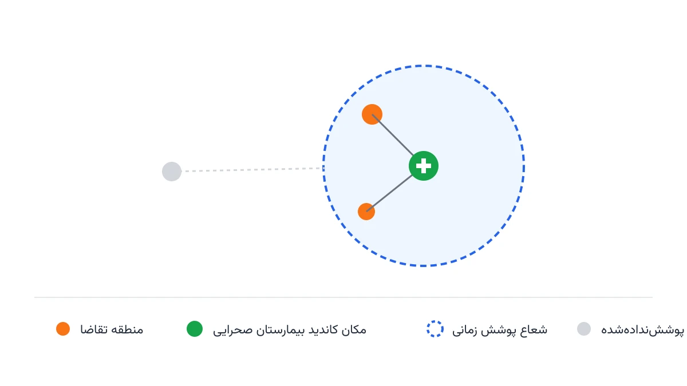

چند ساعت بعد از یک زلزله بزرگ، بیمارستان‌های شهر آسیب‌دیده پر می‌شوند. بخشی از ساختمان‌های درمانی هم ممکن است غیرقابل‌استفاده شده باشند. در این لحظه، تیم‌های امداد باید چند بیمارستان صحرایی موقت را در بهترین نقاط ممکن برپا کنند. سؤال ساده اما حیاتی این است: این چادرهای درمانی را کجا بزنیم؟ باید بیشترین مجروح، در کمترین زمان ممکن، به مراقبت پزشکی برسد. این یادداشت، این مسئله را به زبان بهینه‌سازی ریاضی ترجمه می‌کند و آن را با پایتون حل می‌کند.

## چرا مکان‌یابی بیمارستان صحرایی یک مسئله بهینه‌سازی است؟

تصمیم مکان‌یابی در شرایط بحران، شبیه تصمیم‌های روزمره نیست. منابع شدیداً محدودند؛ معمولاً فقط چند واحد بیمارستان صحرایی سیار در دسترس است. زمان هم طلاست؛ هر دقیقه تأخیر در رسیدن مجروح شدید به مراقبت، می‌تواند جان او را تهدید کند. از طرفی، شبکه جاده‌ای پس از بلایا اغلب آسیب دیده و زمان واقعی سفر، دیگر با نقشه عادی شهر یکی نیست. مسئله مکان‌یابی بیمارستان صحرایی، همین سه محدودیت را هم‌زمان در نظر می‌گیرد. تعداد محدود واحدها، آستانه زمانی پاسخ، و ظرفیت درمانی هر واحد.

این مسئله از نظر ساختار ریاضی، ترکیبی از دو خانواده شناخته‌شده است. یکی مسئله [مکان‌یابی پوششی حداکثری](/notes/ambulance-location-mclp/) است که قبلاً برای ایستگاه آمبولانس دیدیم، و دیگری مکان‌یابی تسهیلات ظرفیت‌دار. تفاوت اصلی اینجا این است که هر منطقه آسیب‌دیده، وزنی متناسب با شدت تقاضا دارد. این وزن مثلاً برابر تعداد مجروح با اولویت قرمز در تریاژ است. هر بیمارستان صحرایی هم سقف مشخصی از بیمار را در روز می‌تواند بپذیرد.

## اهمیت این موضوع

سازمان‌هایی مانند پزشکان بدون مرز (MSF) و هلال‌احمر، پس از زلزله‌های بزرگ یا بحران‌های انسانی فعال می‌شوند. آن‌ها معمولاً ظرف چند روز اول، چند بیمارستان صحرایی یا کلینیک سیار برپا می‌کنند. تصمیم اینکه این واحدها در کدام نقطه مستقر شوند، تحت فشار زمانی شدید گرفته می‌شود. این تصمیم معمولاً با اطلاعات ناقص هم همراه است. یک مدل بهینه‌سازی ساده، حتی با داده‌های تقریبی، کمک‌کننده است. می‌تواند در همان ساعات اول، چند گزینه مکانی معقول پیش‌روی تیم میدانی بگذارد.

این موضوع فقط به زلزله محدود نمی‌شود. سیل، جنگ، و موج اول یک بیماری همه‌گیر، همین الگو را تکرار می‌کنند. در همه این حالت‌ها، ظرفیت درمانی ثابت موجود کافی نیست. باید سریع، ارزان و در نقطه درست، ظرفیت موقت اضافه شود. مدلی که در این یادداشت می‌سازیم، با تغییر کوچک در پارامترها، برای هر سه این سناریوها قابل استفاده است.

## فرمول‌بندی ریاضی مسئله

مجموعه مناطق آسیب‌دیده را با اندیس $I$ و مجموعه مکان‌های کاندید برای استقرار بیمارستان صحرایی را با اندیس $J$ نشان می‌دهیم. وزن $w_i$ نشان‌دهنده تقاضای درمانی تریاژ‌شده منطقه $i$ است؛ یعنی تعداد مجروح ضرب در ضریب اولویت تریاژشان. پارامتر $t_{ij}$ زمان واقعی سفر از منطقه $i$ تا مکان کاندید $j$ است، با احتساب آسیب‌های جاده‌ای. آستانه زمانی قابل‌قبول را $r$ و ظرفیت روزانه هر بیمارستان صحرایی در مکان $j$ را $C_j$ می‌نامیم. حداکثر تعداد واحدهای قابل‌استقرار هم با $p$ مشخص می‌شود.

متغیر دودویی $x_j$ یعنی آیا بیمارستان صحرایی در مکان $j$ برپا می‌شود یا نه. متغیر دودویی $z_{ij}$ یعنی آیا منطقه $i$ به بیمارستان $j$ تخصیص داده می‌شود یا نه. این تخصیص فقط وقتی مجاز است که $t_{ij} \le r$ باشد. مدل کامل به این صورت نوشته می‌شود:

$$
\max \; \sum_{i \in I} \sum_{j \in J_i} w_i \, z_{ij}
$$

که در آن $J_i = \{ j \in J : t_{ij} \le r \}$ است. این یعنی فقط مکان‌های داخل آستانه زمانی منطقه $i$ در نظر گرفته می‌شوند. قیدهای مدل:

$$
z_{ij} \le x_j \qquad \forall i \in I, \; j \in J_i
$$

$$
\sum_{j \in J_i} z_{ij} \le 1 \qquad \forall i \in I
$$

$$
\sum_{i: j \in J_i} w_i \, z_{ij} \le C_j \, x_j \qquad \forall j \in J
$$

$$
\sum_{j \in J} x_j \le p
$$

$$
x_j, z_{ij} \in \{0, 1\}
$$

قید دوم می‌گوید هر منطقه حداکثر به یک بیمارستان صحرایی وصل می‌شود، نه به چند واحد هم‌زمان. قید سوم، سقف ظرفیت درمانی هر واحد را رعایت می‌کند. دقیقاً همین قید، این مدل را از MCLP ساده پیچیده‌تر و واقعی‌تر می‌کند. بدون این قید، مدل ممکن است همه تقاضا را به یک بیمارستان صحرایی نزدیک اما کوچک بسپارد. چنین جوابی در عمل قابل‌اجرا نیست.



## پیاده‌سازی با پایتون

نکته خوب این است که حل این مدل به نرم‌افزار تجاری گران‌قیمت نیاز ندارد. این موضوع حتی در مقیاس یک شهرستان با چند ده منطقه آسیب‌دیده هم صادق است. کتابخانه متن‌باز [OR-Tools](https://developers.google.com/optimization) گوگل، به‌خصوص ماژول [CP-SAT](https://developers.google.com/optimization/cp/cp_solver) آن، برای این نوع مدل‌های دودویی با قیدهای منطقی و ظرفیتی بسیار مناسب است. برای محاسبه زمان سفر واقعی روی شبکه جاده‌ای آسیب‌دیده، کتابخانه [NetworkX](https://networkx.org/) هم ابزار خوبی برای ساخت گراف و حذف لبه‌های قطع‌شده است.

ورودی مدل معمولاً یک فایل اکسل یا CSV ساده است. یک ستون آن، مناطق تقاضا و وزن تریاژی‌شان را نگه می‌دارد. ستون‌های دیگر هم فاصله یا زمان سفر تا مکان‌های کاندید را مشخص می‌کنند. این ساختار ساده، امکان می‌دهد تیم میدانی خودش داده‌ها را به‌روزرسانی کند و مدل را دوباره اجرا کند.

```python
from ortools.sat.python import cp_model

model = cp_model.CpModel()

# متغیر باز بودن هر مکان کاندید برای بیمارستان صحرایی
x = {j: model.NewBoolVar(f"open_{j}") for j in candidate_sites}

# متغیر تخصیص هر منطقه آسیب‌دیده به یک مکان در شعاع پوشش
z = {
    (i, j): model.NewBoolVar(f"assign_{i}_{j}")
    for i in demand_zones
    for j in coverage[i]
}

# ادامه قیدهای ظرفیت، سقف تعداد واحدها و تابع هدف به همین شیوه تعریف می‌شوند
```

بعد از اجرای سالور، خروجی مستقیماً قابل استفاده است. این خروجی فهرستی از مکان‌های انتخاب‌شده را نشان می‌دهد. برای هر منطقه آسیب‌دیده هم مشخص می‌شود به کدام بیمارستان صحرایی وصل شده است. همچنین روشن می‌شود کدام مناطق اصلاً پوشش داده نشده‌اند. این خروجی را می‌توان مستقیماً روی نقشه منطقه ریخت و به تیم عملیاتی نشان داد.

## ظرفیت کار آکادمیک و پژوهشی

این مسئله ظرفیت پژوهشی قابل‌توجهی دارد، چون چند بعد عدم‌قطعیت واقعی هم‌زمان در آن وجود دارد. تعداد واقعی مجروحان پس از بلایا، معمولاً ساعت‌ها طول می‌کشد تا روشن شود. یک پژوهش خوب می‌تواند همین عدم‌قطعیت تقاضا را مدل کند. ابزار مناسب برای این کار، برنامه‌ریزی تصادفی دومرحله‌ای یا بهینه‌سازی استوار است. بعد دوم پژوهشی، شبکه جاده‌ای است. زمان سفر واقعی بعد از زلزله، با باز شدن تدریجی راه‌ها تغییر می‌کند. یک مدل پویا و چندمرحله‌ای می‌تواند همین تغییر را دنبال کند.

جهت پژوهشی سوم، ترکیب این مدل با مسیریابی آمبولانس و بیمارستان‌های دائمی شهر است. چنین مدلی یکپارچه، هم محل بیمارستان صحرایی و هم مقصد انتقال بیماران را مشخص می‌کند. این مدل می‌تواند موضوع یک پایان‌نامه کارشناسی ارشد یا مقاله کامل در نشریات مدیریت بحران و تحقیق در عملیات باشد.

## سوالات متداول

<h3>تفاوت این مدل با مکان‌یابی ایستگاه آمبولانس چیست؟</h3>
<p>هر دو مدل از خانواده پوشش حداکثری هستند. اما این مدل، سقف ظرفیت درمانی هر واحد را هم به‌صورت یک قید جداگانه در نظر می‌گیرد. این تفاوت باعث می‌شود مدل، واقعی‌تر و نزدیک‌تر به محدودیت‌های عملیاتی میدانی باشد.</p>

<h3>آیا می‌توان این مدل را برای بحران‌های غیر از زلزله هم استفاده کرد؟</h3>
<p>بله. با تغییر نحوه محاسبه وزن تقاضا و زمان سفر، همین ساختار قابل استفاده می‌ماند. این انعطاف برای سیل، جنگ، یا موج اول یک بیماری همه‌گیر هم صادق است. برای یادگیری ساخت این نوع مدل‌ها از پایه، دوره <a href="/courses/health-opt/" style="color:#2563EB; font-weight:bold;">بهینه‌سازی سیستم‌های سلامت با پایتون</a> نقطه شروع مناسبی است.</p>

<h3>اگر داده دقیق از میزان آسیب در دسترس نباشد چه باید کرد؟</h3>
<p>در ساعات اول، حتی تخمین تقریبی تیم میدانی هم بهتر از تصمیم کاملاً شهودی است. مدل را می‌توان با چند سناریوی مختلف از شدت آسیب اجرا کرد و نتایج را مقایسه کرد.</p>

<h3>برای پیاده‌سازی این مدل روی داده واقعی شهر یا سازمان خودم چه کنم؟</h3>
<p>هر شهر و سازمان امدادی، محدودیت‌ها و داده‌های خاص خودش را دارد و مدل باید متناسب با آن تنظیم شود. برای این نوع پیاده‌سازی اختصاصی، <a href="/consultation/" style="color:#2563EB; font-weight:bold;">مشاوره</a> می‌تواند مسیر را کوتاه‌تر کند.</p>

## جمع‌بندی

مکان‌یابی بیمارستان صحرایی پس از بلایا، نمونه‌ای روشن از ارزش بهینه‌سازی ریاضی در لحظات حیاتی است. دیدیم چطور این مسئله، ترکیبی از پوشش حداکثری و مکان‌یابی ظرفیت‌دار است. فرمول‌بندی کامل آن را نوشتیم و با OR-Tools پیاده‌سازی کردیم. اگر به دنبال یادگیری ساخت این مدل‌ها برای مسائل واقعی حوزه سلامت هستید، این مسیر برایتان مناسب است. دوره [بهینه‌سازی سیستم‌های سلامت با پایتون](/courses/health-opt/) از مبانی تا پروژه‌های عملی را پوشش می‌دهد.
