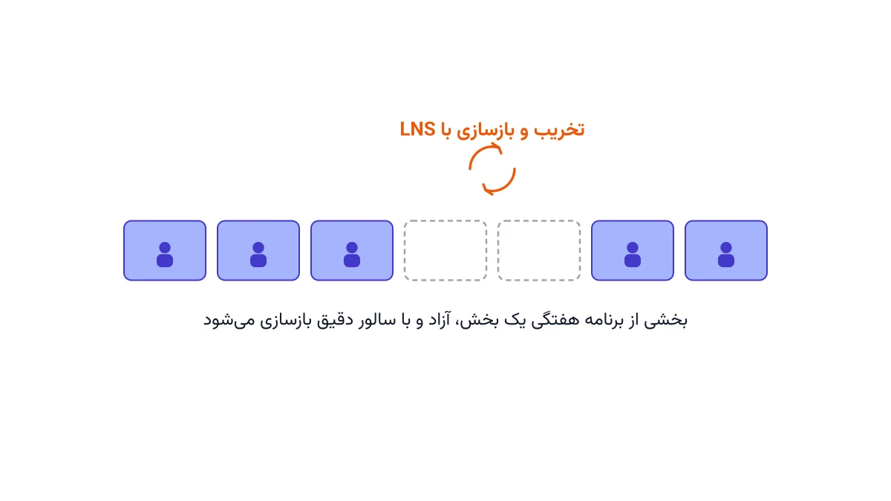

هر سرپرستار یک بخش کوچک، چیدن برنامه هفتگی شیفت‌ها را می‌شناسد. حالا این مسئله را به کل بیمارستان گسترش بدهید. اورژانس، جراحی، بخش عمومی و آی‌سی‌یو، هر کدام قوانین و نیاز خودشان را دارند. صدها پرستار و یک افق برنامه‌ریزی یک‌ماهه، یعنی هزاران تصمیم تخصیص شیفت. مدلی که برای یک بخش کوچک در چند ثانیه جواب می‌داد، حالا شاید ساعت‌ها اجرا شود و باز هم جواب خوبی ندهد. اینجا دقیقاً همان جایی است که جستجوی همسایگی بزرگ (Large Neighborhood Search یا LNS) وارد میدان می‌شود.

## اهمیت این موضوع

بیمارستان‌های بزرگ، هر روز با زمان‌بندی نیروی کار در مقیاس واقعی روبه‌رو هستند. شبکه‌های بیمارستانی بزرگ، مثل NHS در بریتانیا، ده‌ها هزار پرستار را در صدها بیمارستان زمان‌بندی می‌کنند. نرم‌افزارهای e-Rostering سال‌هاست در چنین شبکه‌هایی به کار می‌روند. افق برنامه‌ریزی از دو هفته به یک ماه گسترش پیدا می‌کند. دامنه مسئله هم از یک بخش به کل بیمارستان می‌رسد. در نتیجه، تعداد متغیرهای تصمیم به‌سرعت رشد می‌کند. یک مدل دقیق که همه این متغیرها را هم‌زمان حل کند، اغلب در زمان معقول جواب نمی‌دهد. مدیر پرستاری نمی‌تواند ساعت‌ها منتظر سالور بماند؛ او برنامه‌ای قابل‌قبول در چند دقیقه می‌خواهد. دوره [بهینه‌سازی و تصمیم‌گیری سیستم‌های سلامت با پایتون](/courses/health-opt/) دقیقاً همین دسته از مسائل زمان‌بندی واقعی را پوشش می‌دهد.

## فرمول‌بندی مسئله و ایده LNS

مدل پایه، همان مسئله آشنای زمان‌بندی پرستاران است. متغیر دودویی $x_{n,d,s}$ برابر یک است اگر پرستار $n$ در روز $d$ شیفت $s$ را کار کند. هدف، کمینه‌کردن مجموع کمبود پوشش و نارضایتی پرستاران است.

$$ \min \sum_{d,s} \text{Shortfall}_{d,s} + \lambda \sum_{n} \text{Unfairness}_n $$

قیدهای پوشش، استراحت قانونی، و سقف شیفت متوالی، همگی مثل مدل کوچک برقرار می‌مانند. تفاوت اصلی در مقیاس است. حالا $n$ روی صدها پرستار، و $d$ روی سی یا سی‌ویک روز تعریف می‌شود. ایده LNS ساده است: یک جواب اولیه، حتی ضعیف، برای کل بیمارستان ساخته می‌شود. سپس فقط یک بخش کوچک، مثلاً یک بخش خاص در یک بازه چند روزه، آزاد می‌شود.

$$ x_{n,d,s} = x^{k}_{n,d,s} \quad \forall (n,d,s) \notin D $$

بقیه متغیرها، طبق جواب فعلی $x^{k}$، ثابت نگه داشته می‌شوند. سالور دقیق، فقط روی زیرمجموعه آزادشده $D$ دوباره حل می‌کند. اگر جواب جدید بهتر بود، جایگزین می‌شود؛ وگرنه، زیرمجموعه بعدی انتخاب می‌شود. این چرخه، بارها و بارها، روی بخش‌های مختلف بیمارستان تکرار می‌شود. برای آشنایی کامل‌تر با این تکنیک، [جستجوی همسایگی بزرگ](/notes/large-neighborhood-search-guide/) را ببینید.



## پیاده‌سازی با پایتون

این روش را می‌توان مستقیماً با [OR-Tools](https://developers.google.com/optimization) و ماژول CP-SAT پیاده کرد. ابتدا یک مدل کامل، برای کل بیمارستان، ساخته می‌شود. سپس یک جواب اولیه، با یک محدودیت زمانی کوتاه، گرفته می‌شود. در هر تکرار، متغیرهای یک بخش یا یک بازه زمانی خاص آزاد، و بقیه قفل می‌شوند.

```python
from ortools.sat.python import cp_model

# فرض: model با متغیرهای x[nurse][day][shift] برای کل بیمارستان ساخته شده
current = solve_with_time_limit(model, seconds=30)  # یک جواب اولیه، حتی ضعیف
wards = ["emergency", "surgery", "general", "icu"]

for iteration in range(max_iterations):
    target_ward = random.choice(wards)
    free_vars = [v for v in all_vars if belongs_to(v, target_ward)]
    for v in all_vars:
        if v not in free_vars:
            model.Add(v == current[v])  # قفل‌کردن بقیه بخش‌ها

    # ادامه: حل زیرمسئله یک بخش، مقایسه هزینه و به‌روزرسانی جواب به همین شیوه انجام می‌شود
```

نیازی به خرید سالور تجاری گران‌قیمت نیست. همین حلقه با سالورهای متن‌باز مثل [CBC](https://github.com/coin-or/Cbc) هم قابل اجراست. البته CP-SAT معمولاً برای این نوع مسائل ترکیبیاتی سریع‌تر عمل می‌کند.

## ظرفیت کار آکادمیک و پژوهشی

این حوزه، زمینه پژوهشی فعالی است. انتخاب هوشمند بخش یا بازه زمانی برای آزادسازی، به‌جای انتخاب تصادفی، یک جهت پژوهشی مهم است. نسخه تطبیقی، یا Adaptive LNS، می‌تواند یاد بگیرد کدام بخش بیشتر نیاز به بازنگری دارد. ترکیب این روش با یادگیری ماشین، برای پیش‌بینی بهبود هر زیرمسئله، جهت دیگری است. عدالت بین پرستاران در طول زمان، وقتی زمان‌بندی تکه‌تکه حل می‌شود، هم چالش جالبی برای پایان‌نامه است.

اگر به [انجام پروژه بهینه‌سازی](/consultation/) برای زمان‌بندی نیروی کار بیمارستان خود نیاز دارید، این صفحه نقطه شروع خوبی است.

## سوالات متداول

<h3>آیا LNS برای بیمارستان‌های کوچک‌تر هم لازم است؟</h3>
<p>نه لزوماً. برای یک بخش کوچک با چند پرستار، سالور معمولاً مستقیماً جواب دقیق می‌دهد. LNS زمانی ارزش پیدا می‌کند که مقیاس مسئله از یک بخش به کل بیمارستان برسد.</p>

<h3>چه دوره‌ای این نوع مسائل زمان‌بندی سلامت را پوشش می‌دهد؟</h3>
<p>دوره <a href="/courses/health-opt/" style="color:#2563EB; font-weight:bold;">بهینه‌سازی و تصمیم‌گیری سیستم‌های سلامت با پایتون</a> این دسته از مسائل زمان‌بندی واقعی را آموزش می‌دهد.</p>

<h3>آیا امکان پیاده‌سازی این مدل برای بیمارستان یا شبکه درمانی ما وجود دارد؟</h3>
<p>بله. برای طراحی مدل زمان‌بندی متناسب با ساختار بخش‌ها و قوانین کاری شما، می‌توانید از <a href="/consultation/" style="color:#2563EB; font-weight:bold;">مشاوره</a> استفاده کنید.</p>
