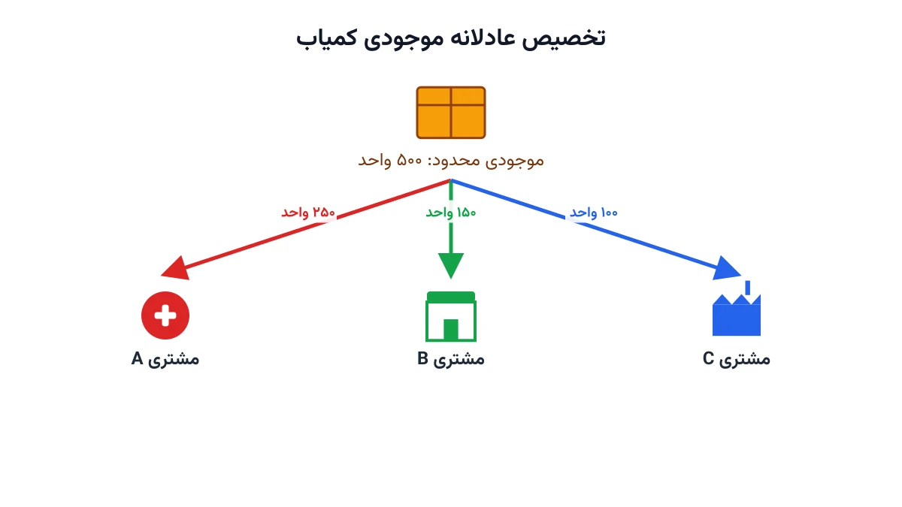

تصور کنید مدیر زنجیره تأمین یک شرکت بزرگ هستید. یک محموله از کالای پرتقاضا به انبار مرکزی می‌رسد. اما این محموله کوچک‌تر از چیزی است که همه مشتری‌ها سفارش داده‌اند. حالا باید تصمیم بگیرید: این مقدار محدود، دقیقاً بین کدام مشتری‌ها و به چه نسبتی تقسیم شود؟ این مسئله، با مدل‌های معمول «چقدر سفارش بدهیم» فرق اساسی دارد. اینجا دیگر حرف از سفارش‌دادن نیست؛ کالا همین الان، محدود و در دست شماست.

## این تصمیم با مدل‌های موجودی معمولی فرق دارد

مدل‌های رایج موجودی، مثل نیوزبوی یا نقطه سفارش مجدد، به این سؤال پاسخ می‌دهند که چقدر باید سفارش داد. اما مسئله تخصیص موجودی کمیاب (Inventory Rationing) یک گام جلوتر است. فرض می‌کنیم موجودی از قبل مشخص و ثابت است. پرسش این است: این مقدار ثابت، چطور بین متقاضیان مختلف تقسیم شود؟

مشتری‌ها هم یکسان نیستند. برخی مشتری‌ها استراتژیک‌اند و از دست دادن‌شان هزینه بلندمدت دارد. برخی دیگر حساسیت کمتری به تأخیر دارند. یک فروشگاه زنجیره‌ای بزرگ، یک بیمارستان در حال درمان بیماران حاد، یا یک خط تولید متوقف‌شده، همگی اولویت متفاوتی دارند. مدل تخصیص باید این تفاوت اولویت را به‌صورت عددی در نظر بگیرد، نه با قضاوت شخصی مدیر انبار.

## اهمیت این موضوع

این مسئله فقط یک تمرین نظری نیست. شرکتی مثل یونیلیور (Unilever) در دوران اختلال زنجیره تأمین جهانی، بارها مجبور شد محصولات پرتقاضا را جیره‌بندی کند. سهم خرده‌فروشان بزرگ و کوچک باید جداگانه تعیین می‌شد. صنعت نیمه‌هادی هم نمونه‌ای مشابه را تجربه کرد. شرکت‌هایی مثل تویوتا (Toyota) باید تصمیم می‌گرفتند کدام خط تولید خودرو، تراشه محدود را زودتر دریافت کند.

در صنعت دارو، این تصمیم حتی حساس‌تر است. وقتی یک داروی حیاتی کمیاب می‌شود، توزیع‌کننده باید بین بیمارستان‌های مختلف اولویت‌بندی کند. تصمیم اشتباه اینجا فقط هزینه مالی ندارد؛ می‌تواند جان بیماران را هم تحت تأثیر قرار دهد. به همین دلیل، تصمیم تخصیص باید شفاف، قابل‌دفاع و مبتنی بر یک مدل ریاضی روشن باشد، نه یک انتخاب احساسی و لحظه‌ای.

اگر تخصیص فقط بر اساس «اولین درخواست، اولین تحویل» انجام شود، مشتریان استراتژیک ممکن است آسیب ببینند. اگر فقط بر اساس وزن یا سابقه خرید انجام شود، مشتریان کوچک‌تر همیشه بازنده‌اند. مدل بهینه‌سازی، راهی میانه و قابل‌تنظیم بین این دو افراط ارائه می‌دهد.



## فرمول‌بندی ریاضی مسئله

فرض کنید $n$ مشتری یا منطقه تقاضا داریم، با اندیس $i=1,\dots,n$. تقاضای هر مشتری را $d_i$ می‌نامیم. موجودی کل در دسترس برای تخصیص، پارامتر $S$ است. هر مشتری یک وزن اهمیت $w_i$ دارد؛ هرچه این وزن بزرگ‌تر باشد، کمبود برای آن مشتری پرهزینه‌تر تلقی می‌شود. متغیر تصمیم $x_i$ نشان می‌دهد چه مقدار از کالا واقعاً به مشتری $i$ تخصیص می‌یابد.

$$
\min \; \sum_{i=1}^{n} w_i \,(d_i - x_i)
$$

با محدودیت‌های زیر:

$$
\sum_{i=1}^{n} x_i \le S
$$

$$
0 \le x_i \le d_i \qquad \forall i=1,\dots,n
$$

$$
x_i \ge \ell_i \, d_i \qquad \forall i=1,\dots,n
$$

تابع هدف، مجموع وزن‌دار کمبود هر مشتری را کمینه می‌کند. محدودیت اول سقف کل موجودی موجود را اعمال می‌کند. محدودیت دوم می‌گوید تخصیص هر مشتری نباید از تقاضای واقعی‌اش بیشتر شود. محدودیت سوم یک کف انصاف (Fairness Floor) تعریف می‌کند. پارامتر $\ell_i$ حداقل کسری از تقاضای هر مشتری است که باید تضمین شود، حتی اگر وزن اهمیتش پایین باشد.

## نسخه چنددوره‌ای و سیاست سطح بحرانی

در دنیای واقعی، موجودی معمولاً در طول زمان و به‌صورت پلکانی می‌رسد. در این حالت، تصمیم پیچیده‌تر می‌شود: آیا باید موجودی فعلی را الان مصرف کرد یا بخشی از آن را برای تقاضای حیاتی‌تر آینده نگه داشت؟ به این رویکرد، سیاست سطح بحرانی (Critical Level Policy) می‌گویند. در این سیاست، یک آستانه موجودی تعریف می‌شود. زیر این آستانه، فقط به مشتریان با بالاترین اولویت سرویس داده می‌شود. این توسعه، مدل را به یک مسئله برنامه‌ریزی پویا یا چنددوره‌ای نزدیک می‌کند.

## ظرفیت کار آکادمیک و پژوهشی

تخصیص موجودی کمیاب یکی از قدیمی‌ترین و در عین حال زنده‌ترین شاخه‌های نظریه موجودی است. یک مسیر پژوهشی مهم، مدل‌سازی تقاضای تصادفی به‌جای تقاضای قطعی است. در این حالت، تصمیم تخصیص باید قبل از مشخص‌شدن تقاضای واقعی گرفته شود.

مسیر دوم، تعریف دقیق‌تر معیار انصاف است. به‌جای یک کف ساده مثل $\ell_i$، می‌توان از معیارهایی مثل کمینه‌سازی حداکثر نارضایتی (Max-Min Fairness) استفاده کرد. این معیارها از ادبیات تخصیص منابع شبکه هم وام گرفته شده‌اند.

مسیر سوم، ترکیب تخصیص با تصمیم حمل‌ونقل است. بعد از تعیین سهم هر مشتری، باید مسیر و وسیله حمل هم بهینه شود. مسیر چهارم، تحلیل واکنش استراتژیک مشتریان به سیاست جیره‌بندی شرکت است؛ موضوعی که به نظریه بازی‌ها نزدیک می‌شود. هر چهار مسیر، گزینه‌های پژوهشی مناسبی برای پایان‌نامه یا مقاله در حوزه مدیریت عملیات هستند.

## پیاده‌سازی با پایتون

این مدل یک برنامه‌ریزی خطی ساده است و نیازی به سالور تجاری گران‌قیمت ندارد. کتابخانه متن‌باز [PuLP](https://coin-or.github.io/pulp/) برای نوشتن سریع آن کافی است. سالور رایگان [CBC](https://github.com/coin-or/Cbc) این مدل را در کسری از ثانیه حل می‌کند. برای شبکه‌هایی با صدها مشتری و منطقه، سالور [HiGHS](https://highs.dev/) گزینه سریع‌تری است.

اگر پیش از این با مدل‌های پایه‌تر موجودی آشنا نیستید، یادداشت [مدل EOQ با تخفیف پلکانی](/notes/eoq-quantity-discount/) نقطه شروع خوبی است. داده ورودی این مسئله معمولاً در یک فایل اکسل یا دیتابیس ساده نگه‌داری می‌شود. این داده شامل تقاضا، وزن اهمیت و کف انصاف هر مشتری است. این داده را می‌توان مستقیم با pandas خواند. اسکلت اولیه مدل در PuLP به این شکل شروع می‌شود:

```python
import pulp

customers = ["A", "B", "C", "D"]
demand = {"A": 300, "B": 150, "C": 220, "D": 90}   # تقاضای هر مشتری
weight = {"A": 5, "B": 2, "C": 8, "D": 1}          # وزن اهمیت هر مشتری
supply = 500

model = pulp.LpProblem("Scarce_Inventory_Rationing", pulp.LpMinimize)

x = {i: pulp.LpVariable(f"alloc_{i}", lowBound=0, upBound=demand[i]) for i in customers}

# ادامه قید سقف موجودی کل، کف انصاف و تابع هدف به همین شیوه تعریف می‌شوند.
```

بعد از حل مدل، می‌توان نتیجه را با یک نمودار میله‌ای ساده نمایش داد. تقاضای هر مشتری در کنار مقدار واقعاً تخصیص‌یافته به او قرار می‌گیرد. این نمایش، تصمیم نهایی را برای مدیران ارشد قابل‌دفاع‌تر می‌کند. پیش از اجرای نهایی، بهتر است وزن‌های $w_i$ را چند بار تغییر دهید و تأثیرش روی سهم هر مشتری را ببینید. این تحلیل حساسیت، اعتماد تیم تجاری به مدل را بالا می‌برد.

اگر برای پیاده‌سازی این مدل روی داده واقعی شرکت خودتان راهنمایی لازم دارید، صفحه [مشاوره](/consultation/) نقطه شروع مناسبی است.

## سوالات متداول

<h3>تفاوت این مدل با مدل نیوزبوی چیست؟</h3>
<p>مدل نیوزبوی به این سؤال پاسخ می‌دهد که چقدر باید سفارش داد. این مدل فرض می‌کند موجودی از قبل مشخص و محدود است و فقط نحوه تقسیم آن بین مشتریان را تعیین می‌کند.</p>

<h3>وزن اهمیت $w_i$ را چطور باید تعیین کرد؟</h3>
<p>این وزن معمولاً از ترکیب حاشیه سود هر مشتری، ارزش بلندمدت رابطه تجاری و هزینه از دست دادن او به دست می‌آید. در موارد حیاتی مثل دارو، این وزن می‌تواند بر اساس شدت نیاز درمانی تعیین شود.</p>

<h3>برای یادگیری مدل‌سازی این نوع مسائل زنجیره تأمین از کجا شروع کنم؟</h3>
<p>دوره <a href="/courses/vrp-python/" style="color:#2563EB; font-weight:bold;">مسیریابی و بهینه‌سازی زنجیره تأمین با پایتون</a> پایه محکمی برای این نوع مدل‌سازی فراهم می‌کند. اگر برای پیاده‌سازی این مدل روی کسب‌وکار خودتان راهنمایی لازم دارید، از طریق صفحه <a href="/consultation/" style="color:#2563EB; font-weight:bold;">مشاوره</a> می‌توانید با ما در ارتباط باشید.</p>

<h3>آیا این مدل برای شرکت‌های کوچک هم کاربرد دارد؟</h3>
<p>بله. حتی با چند مشتری و یک محموله کوچک، همین ساختار ریاضی ساده کمک می‌کند تصمیم تخصیص شفاف‌تر و قابل‌دفاع‌تر باشد.</p>

## جمع‌بندی

در این یادداشت دیدیم تخصیص موجودی کمیاب، تصمیمی جدا از «چقدر سفارش بدهیم» است. دیدیم چطور وزن اهمیت مشتری و یک کف انصاف ساده، در یک مدل برنامه‌ریزی خطی کنار هم می‌نشینند. همچنین دیدیم این مدل چگونه به سمت سیاست سطح بحرانی و نسخه چنددوره‌ای قابل‌گسترش است.

برای مرور یک مدل پایه‌تر از تصمیم‌گیری موجودی، یادداشت [مدل EOQ با تخفیف پلکانی](/notes/eoq-quantity-discount/) می‌تواند مکمل خوبی برای این مطلب باشد.
