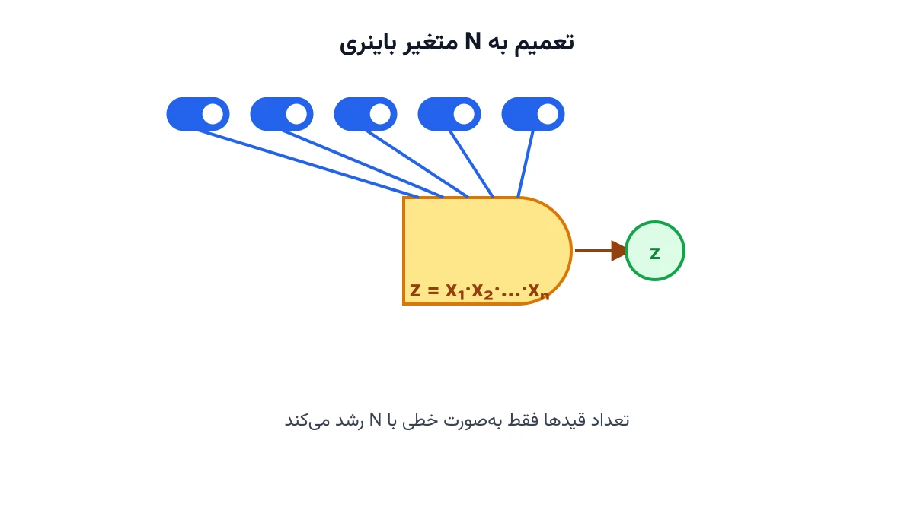

خیلی وقت‌ها، وسط نوشتن یک مدل بهینه‌سازی، به یک جمله می‌رسید. جمله‌ای که در آن دو یا چند متغیر باینری در هم ضرب می‌شوند. مثلاً «این قید فقط وقتی فعال است که هم محصول A انتخاب شده باشد، هم محصول B». یا حتی ضرب یک متغیر باینری در یک متغیر پیوسته، مثل «توان تولیدی فقط وقتی غیرصفر است که واحد روشن باشد». مشکل این‌جاست: ضرب دو متغیر تصمیم، مدل را غیرخطی می‌کند. سالورهای MILP با این فرم مستقیماً کنار نمی‌آیند. خوشبختانه، برای این حالت‌ها فرمول‌های خطی‌سازی استاندارد و اثبات‌شده‌ای وجود دارد.

## چرا اصلاً به خطی‌سازی نیاز داریم؟

یک سالور برنامه‌ریزی خطی عدد صحیح مختلط (MILP)، فقط با عبارت‌های خطی راحت است. جمع و تفریق وزن‌دار متغیرها مشکلی ندارد. اما به‌محض این‌که دو متغیر تصمیم در هم ضرب شوند، قید یا تابع هدف غیرخطی می‌شود. این یعنی یا باید از یک سالور غیرخطی استفاده کنید. یا باید عبارت ضربی را با یک متغیر کمکی و چند قید خطی جایگزین کنید.

گزینه دوم تقریباً همیشه بهتر است. سالورهای MILP بسیار بالغ‌تر و سریع‌تر از سالورهای غیرخطی عمومی‌اند. برای همین، یاد گرفتن این فرمول‌های خطی‌سازی، یکی از پرکاربردترین مهارت‌های مدل‌سازی ریاضی است. اگر با مفهوم پایه‌ای مدل‌سازی هنوز آشنا نیستید، یادداشت [مدل‌سازی ریاضی و اهمیت آن](/notes/mathematical-modeling-art/) را ببینید.

## اهمیت این موضوع

این الگو همه‌جا تکرار می‌شود. در طراحی تخفیف‌های بسته‌ای، شرکتی مثل پی‌اند‌جی (P&G) با این تصمیم روبه‌روست. آیا سه محصول خاص با هم در یک بسته تخفیفی عرضه شوند یا نه؟ تخفیف فقط وقتی فعال است که هر سه محصول هم‌زمان انتخاب شده باشند؛ یعنی دقیقاً ضرب سه متغیر باینری.

در صنعت برق هم این الگو به شکل دیگری ظاهر می‌شود. شرکتی مثل ای‌بی‌بی (ABB) در پروژه‌های شبکه توزیع، با چنین قیدی سروکار دارد. توان تخصیص‌یافته به یک فیدر، فقط وقتی غیرصفر است که آن فیدر روشن و فعال باشد. این دقیقاً ضرب یک متغیر باینری (روشن یا خاموش) در یک متغیر پیوسته (مقدار توان) است. بدون خطی‌سازی درست، این مدل‌ها یا اصلاً حل نمی‌شوند یا جواب نادرست می‌دهند.

## ضرب دو متغیر باینری

فرض کنید $x$ و $y$ دو متغیر باینری هستند و می‌خواهید متغیر $z$ را برابر حاصل‌ضرب آن‌ها تعریف کنید.

$$
z = x \cdot y \qquad x,y,z \in \{0,1\}
$$

این رابطه با سه قید خطی زیر، دقیقاً معادل‌سازی می‌شود:

$$
z \le x, \qquad z \le y, \qquad z \ge x + y - 1
$$

منطق این سه قید ساده است. دو قید اول می‌گویند $z$ نمی‌تواند یک باشد مگر این‌که هم $x$ و هم $y$ یک باشند. قید سوم هم تضمین می‌کند وقتی هر دو یک هستند، $z$ مجبور است یک باشد. می‌توانید این سه قید را برای هر چهار حالت ممکن $x$ و $y$ امتحان کنید. در هر چهار حالت، $z$ دقیقاً برابر $x \cdot y$ خواهد شد.



## ضرب سه متغیر باینری

حالا فرض کنید سه متغیر باینری $x$، $y$ و $w$ دارید. می‌خواهید $z = x \cdot y \cdot w$ را تعریف کنید. الگوی قبلی به‌سادگی تعمیم پیدا می‌کند:

$$
z \le x, \qquad z \le y, \qquad z \le w, \qquad z \ge x + y + w - 2
$$

همان منطق قبلی برقرار است. سه قید اول اجازه نمی‌دهند $z$ یک شود مگر این‌که هر سه متغیر یک باشند. قید آخر هم تضمین می‌کند وقتی هر سه متغیر واقعاً یک هستند، $z$ هم مجبور به یک‌شدن می‌شود.

## ضرب N متغیر باینری: فرمول کلی

این الگو برای هر تعداد متغیر باینری تعمیم‌پذیر است. برای $N$ متغیر باینری $x_1,\dots,x_N$ و $z=\prod_{i=1}^{N} x_i$، قیدهای خطی‌سازی این‌طور نوشته می‌شوند:

$$
z \le x_i \qquad \forall i=1,\dots,N
$$

$$
z \ge \sum_{i=1}^{N} x_i - (N-1)
$$

تعداد قیدها به‌صورت خطی با $N$ رشد می‌کند، نه نمایی. این یعنی حتی برای ضرب ده‌ها متغیر باینری، خطی‌سازی هنوز کاملاً عملی و سریع است.

## ضرب یک متغیر باینری در یک متغیر پیوسته

حالت دیگری که خیلی زیاد پیش می‌آید، ضرب یک متغیر باینری $b$ در یک متغیر پیوسته‌ی $c$ است. کران بالا و پایین $c$ هم مشخص است: $c_{\min} \le c \le c_{\max}$. می‌خواهیم $z = b \cdot c$ را تعریف کنیم.

$$
z \le c_{\max}\, b, \qquad z \ge c_{\min}\, b
$$

$$
z \le c - c_{\min}(1-b), \qquad z \ge c - c_{\max}(1-b)
$$

وقتی $b=0$ باشد، دو قید اول $z$ را به صفر می‌چسبانند. دو قید دوم هم بی‌اثر می‌شوند، چون سمت راستشان به‌اندازه‌ی کافی باز است. وقتی $b=1$ باشد، دو قید اول بی‌اثر می‌شوند و دو قید دوم، $z$ را دقیقاً برابر $c$ می‌کنند. در حالت خاصی که $c_{\min}=0$ باشد، که در بیشتر مسائل صنعتی واقعی همین‌طور است، فرمول به دو قید ساده‌تر کاهش می‌یابد: $z \le c_{\max}\, b$ و $z \ge c - c_{\max}(1-b)$، به همراه $0 \le z \le c$.

## ظرفیت کار آکادمیک و پژوهشی

این فرمول‌ها دقیق‌ترین حالت ممکن از خطی‌سازی را ارائه می‌دهند؛ یعنی چندوجهی تعریف‌شده توسط آن‌ها، دقیقاً پوش محدب مسئله اصلی است. یک مسیر پژوهشی مهم، تحلیل سفتی (Tightness) این قیدها در مقایسه با روش‌های دیگر مثل Big-M است. مسیر دیگر، تعمیم به حالتی است که هر دو متغیر ضرب‌شده پیوسته باشند. آن‌جا باید از پوش‌های مک‌کورمیک (McCormick Envelopes) استفاده کرد؛ این پوش‌ها تقریبی‌تر و کم‌دقیق‌تر عمل می‌کنند.

زمینه سوم، بررسی رفتار این قیدها در ترکیب با برنامه‌ریزی محدودیت (CP) است. سالور CP-SAT گوگل، برای ضرب متغیرهای باینری، دستور بومی `AddMultiplicationEquality` را هم ارائه می‌دهد. مقایسه کارایی این دستور در برابر فرمول‌بندی خطی دستی، زمینه پژوهشی جالبی برای مقاله یا پایان‌نامه است.

## پیاده‌سازی با پایتون

این خطی‌سازی‌ها را می‌توان با هر سالور MILP متن‌باز پیاده‌سازی کرد. کتابخانه [PuLP](https://coin-or.github.io/pulp/) برای نوشتن سریع این قیدها مناسب است. سالور رایگان [CBC](https://github.com/coin-or/Cbc) یا [HiGHS](https://highs.dev/) این مدل‌ها را به‌سرعت حل می‌کنند. اگر مسئله شما کاملاً باینری و منطقی است، سالور [CP-SAT](https://developers.google.com/optimization/cp/cp_solver) در کتابخانه‌ی [OR-Tools](https://developers.google.com/optimization) گزینه‌ی دیگری است.

اسکلت اولیه خطی‌سازی ضرب دو متغیر باینری در PuLP به این شکل است:

```python
import pulp

model = pulp.LpProblem("Binary_Product_Linearization", pulp.LpMaximize)

x = pulp.LpVariable("x", cat="Binary")
y = pulp.LpVariable("y", cat="Binary")
z = pulp.LpVariable("z", cat="Binary")

model += z <= x
model += z <= y
model += z >= x + y - 1

# ادامه مدل، شامل تابع هدف و بقیه قیدهای مسئله، به همین شیوه اضافه می‌شود.
```

برای حالت ضرب باینری در متغیر پیوسته، کافی است `y` را از نوع `Continuous` تعریف کنید؛ با کران بالا و پایین مشخص. سپس چهار قید معرفی‌شده در بخش قبل را جایگزین سه قید بالا کنید.

پیش از اعتمادکردن به مدل نهایی، حتماً چند مقدار دستی برای $x$ و $y$ امتحان کنید. مطمئن شوید $z$ در هر حالت، دقیقاً همان مقداری است که از ضرب مستقیم انتظار دارید.

اگر در فرمول‌بندی یا خطی‌سازی مدل بهینه‌سازی خودتان به راهنمایی نیاز دارید، صفحه [مشاوره](/consultation/) نقطه شروع مناسبی است.

## سوالات متداول

<h3>آیا این قیدها همیشه $z$ را دقیقاً برابر ضرب می‌کنند؟</h3>
<p>بله، به شرطی که $x$ و $y$ (یا $b$ و $c$) واقعاً مقادیر مجازشان را بگیرند. این فرمول‌بندی، پوش محدب دقیق رابطه ضربی است، نه یک تقریب.</p>

<h3>چرا به‌جای این قیدها از Big-M استفاده نکنیم؟</h3>
<p>برای ضرب دو متغیر باینری، این فرمول خودش از جنس یک نسخه‌ی بسیار دقیق Big-M است. تفاوت اصلی وقتی مهم می‌شود که با Big-M عددی بزرگ‌تر از حد لازم انتخاب شود؛ آن‌جا جواب شل می‌شود. برای مقایسه دقیق‌تر این دو رویکرد، یادداشت [only_enforce_if در برابر Big-M](/notes/cpsat-only-enforce-if-vs-big-m/) را ببینید.</p>

<h3>برای یادگیری این‌جور تکنیک‌های مدل‌سازی از کجا شروع کنم؟</h3>
<p>دوره <a href="/courses/optimization-modeling/" style="color:#2563EB; font-weight:bold;">مدل‌سازی بهینه‌سازی</a> این تکنیک‌ها را همراه با مثال‌های عملی آموزش می‌دهد. برای بررسی مسئله اختصاصی خودتان هم می‌توانید از طریق صفحه <a href="/consultation/" style="color:#2563EB; font-weight:bold;">مشاوره</a> با ما در ارتباط باشید.</p>

<h3>اگر بیش از صد متغیر باینری در ضرب داشته باشم چه؟</h3>
<p>فرمول عمومی $N$ متغیره هنوز هم کار می‌کند، چون تعداد قیدها به‌صورت خطی رشد می‌کند. در عمل، سالورهای مدرن این حجم از قید را بدون مشکل مدیریت می‌کنند.</p>

## جمع‌بندی

ضرب دو، سه یا $N$ متغیر باینری، و نیز ضرب یک باینری در یک پیوسته، همگی قابل خطی‌سازی‌اند. این فرمول‌ها نه‌تنها دقیق‌اند، بلکه مدل را در دامنه‌ی راحت یک سالور MILP نگه می‌دارند. یادگیری همین چند فرمول، می‌تواند بسیاری از مدل‌های به‌ظاهر غیرخطی را به یک مسئله‌ی کاملاً خطی و قابل‌حل تبدیل کند.
