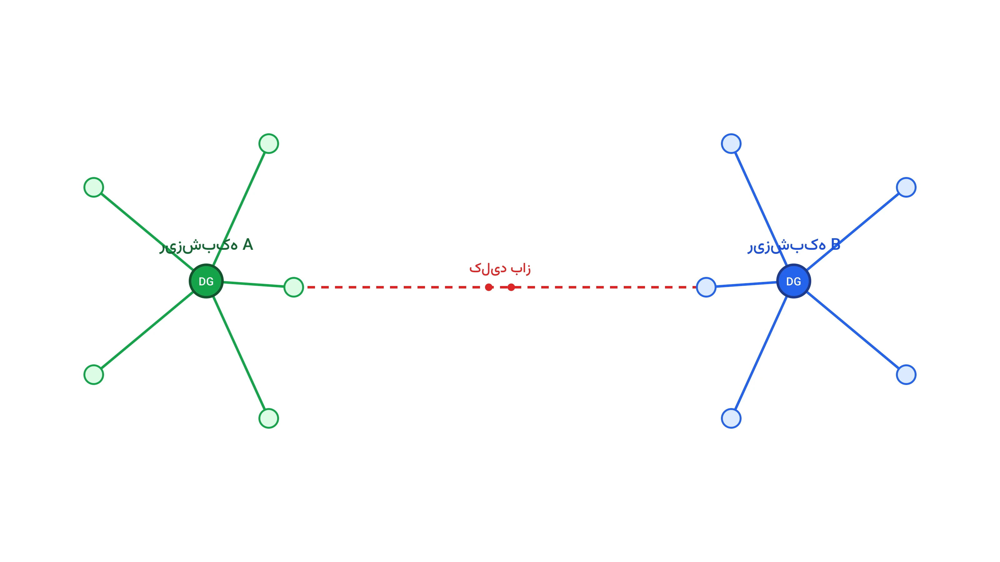

چند ساعت پس از یک توفان یا زلزله بزرگ، بخشی از شبکه توزیع برق یک شهر کاملاً خاموش می‌شود. تیم‌های تعمیر هنوز در راه‌اند و ممکن است ساعت‌ها یا حتی روزها طول بکشد تا خط آسیب‌دیده بازسازی شود. در همین فاصله، یک بیمارستان، یک مرکز تصفیه آب یا یک پایگاه آتش‌نشانی هم بدون برق مانده‌اند. سؤال اصلی این نیست که «چه زمانی برق برمی‌گردد»، بلکه این است: «تا آن زمان، چطور حیاتی‌ترین مصرف‌کننده‌ها را برق‌دار نگه داریم؟»

پاسخ مدرن به این سؤال، تشکیل ریزشبکه است. شبکه توزیعِ قطع‌شده را می‌توان با چند کلید کنترل از راه دور به چند بخش کوچک‌تر تقسیم کرد. هر بخش، به‌جای اتصال به پست اصلی، توسط یک منبع تولید پراکنده محلی تغذیه می‌شود. این منبع می‌تواند یک ژنراتور دیزل سیار باشد یا یک سیستم خورشیدی و باتری. به این بخش‌های خودکفا و موقت، ریزشبکه اضطراری گفته می‌شود. تصمیم اصلی این است: کدام کلیدها باز و کدام بسته بمانند، و ظرفیت محدود هر منبع تولید به کدام بارها اختصاص یابد؟

## چرا بازآرایی شبکه و حذف بار بهینه کافی نیستند

سایت پیش‌تر دو مسئله نزدیک به این موضوع را بررسی کرده است. [بازآرایی شبکه توزیع](/notes/dist-reconfiguration/) درباره کاهش تلفات در یک شبکه سالم و متصل به پست است. حذف بار بهینه هم درباره قطع سریع بخشی از مصرف، آن‌هم در سطح فرکانس کل شبکه، صحبت می‌کند. تشکیل ریزشبکه اما شرایط سوم را حل می‌کند: شبکه از پست اصلی کاملاً جدا شده است. اینجا دیگر فرکانس کل شبکه مطرح نیست؛ تعادل تولید و مصرف باید درون هر جزیره، جداگانه و با منابع محلی برقرار شود. این تفاوت ساختاری، مسئله را به یک مدل تازه تبدیل می‌کند.

این مسئله سه تصمیم را هم‌زمان می‌گیرد. اول، وضعیت باز یا بسته هر کلید، که باید توپولوژی شبکه را به چند زیردرخت بدون حلقه تبدیل کند. دوم، میزان تولید هر منبع پراکنده، در چارچوب ظرفیت محدودش. سوم، اینکه کدام بار داخل هر جزیره واقعاً تغذیه شود، چون معمولاً ظرفیت تولید محلی از کل تقاضای آن ناحیه کمتر است. هدف نهایی، بیشینه‌کردن ارزش بار بازیابی‌شده است؛ نه صرفاً تعداد مشترکین، بلکه وزن اهمیت هرکدام.

## فرمول‌بندی ریاضی مسئله

فرض کنید $x_{ij} \in \{0,1\}$ نشان دهد کلید خط بین گره $i$ و $j$ بسته است یا باز. متغیر $y_i \in \{0,1\}$ هم نشان می‌دهد آیا گره $i$ برق‌دار شده یا نه. اگر $w_i$ وزن اهمیت بار گره $i$ باشد، تابع هدف این‌طور نوشته می‌شود:

$$ \max \sum_{i} w_i \cdot d_i \cdot y_i $$

که در آن $d_i$ تقاضای گره $i$ است.

توان هر منبع تولید پراکنده $g$ باید در بازه مجازش بماند:

$$ 0 \le P_g \le P_g^{max} \qquad \forall g $$

در هر جزیره، تولید باید دقیقاً با مصرف برابر باشد؛ این رابطه با احتساب تلفات ساده‌شده نوشته می‌شود:

$$ \sum_{g \in \text{جزیره } k} P_g = \sum_{i \in \text{جزیره } k} d_i \cdot y_i $$

مهم‌ترین و پیچیده‌ترین قید، قید رادیال‌بودن است. هر جزیره باید یک درخت متصل و بدون حلقه باشد، با دقیقاً یک منبع تولید به‌عنوان ریشه. این قید معمولاً با یک متغیر جریان کمکی مدل می‌شود. همان تکنیکی که در یادداشت بازآرایی شبکه توزیع هم دیدیم. تفاوت اینجا این است که هر درخت یک ریشه محلی دارد، نه یک پست مشترک.

## اهمیت این موضوع

تغییرات اقلیمی، توفان‌های شدیدتر و آتش‌سوزی‌های گسترده را رایج‌تر کرده‌اند. بسیاری از شرکت‌های توزیع برق، بازیابی سریع را دیگر یک گزینه نمی‌دانند، بلکه یک الزام رگولاتوری می‌بینند. شرکتی مثل ComEd در شیکاگو، در پروژه‌ای به نام ریزشبکه برانزویل، دقیقاً همین ایده را پیاده کرده است. این پروژه یک محله را به چند جزیره خودکفا تقسیم می‌کند. در زمان قطعی گسترده، هر جزیره مستقل از شبکه اصلی کار می‌کند. این سرمایه‌گذاری فقط زمانی ارزش خودش را نشان می‌دهد که الگوریتم تخصیص بار درست عمل کند. باید اولویت به بیمارستان و تأسیسات حیاتی داده شود، نه به هر مصرف‌کننده‌ای که صرفاً نزدیک‌تر است.

ارزش اقتصادی این موضوع هم قابل توجه است. هزینه هر ساعت خاموشی برای یک بیمارستان یا یک کارخانه، معمولاً چندین برابر هزینه نگهداری یک ژنراتور اضطراری است. با بهینه‌سازی درست تخصیص بار، همان چند ژنراتور موجود، ارزش به‌مراتب بیشتری از بازیابی سرویس ایجاد می‌کنند. به همین دلیل، این مدل دیگر صرفاً یک تمرین دانشگاهی نیست. بخشی از برنامه سرمایه‌گذاری تاب‌آوری بسیاری از شرکت‌های برق دنیا شده است.

## ظرفیت کار آکادمیک و پژوهشی

این حوزه هنوز جای زیادی برای کار پژوهشی دارد. یک مسیر، مدل‌سازی تصادفی زمان تعمیر است؛ چون معمولاً معلوم نیست خط آسیب‌دیده دقیقاً کِی تعمیر می‌شود. مسیر دیگر، هماهنگی چندجزیره‌ای در طول زمان است، وقتی تولید خورشیدی در طول روز تغییر می‌کند. ترکیب این مسئله با خودروهای برقی به‌عنوان باتری‌های سیار هم موضوع تازه‌ای است؛ خودروها می‌توانند موقتاً نقش ذخیره‌ساز انرژی ایفا کنند. مسیر پژوهشی دیگر، ترکیب تشخیص محل خطا با تصمیم کلیدزنی در یک مدل واحد است، به‌جای حل جداگانه این دو مسئله. هرکدام از این مسیرها می‌تواند موضوع یک مقاله یا پایان‌نامه کارشناسی ارشد باشد.

## پیاده‌سازی با پایتون

خبر خوب این است که نیازی به نرم‌افزار گران‌قیمت برای حل این مسئله نیست. مدل‌سازی شبکه توزیع را می‌توان با [pandapower](https://www.pandapower.org/) انجام داد؛ کتابخانه‌ای متن‌باز که توپولوژی فیدر، خطوط و بارها را نگه می‌دارد. برای خود مدل بهینه‌سازی، [Pyomo](https://www.pyomo.org/) یا [PuLP](https://coin-or.github.io/pulp/) گزینه‌های مناسبی هستند؛ هر دو امکان نوشتن متغیرهای باینری و قیدهای جریان را به‌سادگی می‌دهند. برای حل نهایی مدل، سالورهای متن‌باز مثل [HiGHS](https://highs.dev/) یا [CBC](https://github.com/coin-or/Cbc) کاملاً کافی‌اند؛ چون این مسئله برای یک فیدر معمولی، ابعاد بزرگی ندارد.

داده‌ی ورودی مدل را می‌توان از یک فایل اکسل یا CSV ساده خواند. این فایل می‌تواند شامل فهرست خطوط، ظرفیت هر خط، موقعیت منابع تولید پراکنده و وزن اهمیت هر بار باشد. پس از حل مدل، خروجی سالور مشخص می‌کند کدام کلید باز بماند و هر منبع تولید چقدر کار کند. همچنین مشخص می‌کند کدام بار، در کدام جزیره، برق‌دار شود. این خروجی را می‌توان مستقیماً به اپراتور پخش فرستاد تا کلیدهای واقعی را فرمان دهد.

اگر به [انجام پروژه بهینه‌سازی](/consultation/) برای مسئله خودتان نیاز دارید یا می‌خواهید [مدل‌سازی ریاضی](/courses/optimization-modeling/) را از پایه یاد بگیرید، این دو صفحه نقطه شروع خوبی هستند.

## سوالات متداول

<h3>آیا این مدل فقط برای شبکه‌های بزرگ کاربرد دارد؟</h3>

نه، حتی یک فیدر کوچک با چند ده مشترک هم از این مدل سود می‌برد. اندازه مدل معمولاً کوچک است و روی یک لپ‌تاپ معمولی هم در چند ثانیه حل می‌شود.

<h3>تفاوت این مسئله با زمان‌بندی تعمیرات چیست؟</h3>

این مدل درباره تأمین برق موقت تا پایان تعمیر است، نه ترتیب خود تعمیرات. برای آشنایی با زمان‌بندی گروه‌های تعمیر، یادداشت جداگانه‌ای هم در این سایت منتشر شده است.

<h3>این مباحث در کدام دوره سایت پوشش داده می‌شوند؟</h3>

مباحث MILP سیستم قدرت، از جمله مدل‌های مشابه این مطلب، در دوره <a href="/courses/advanced-power-system/" style="color:#2563EB; font-weight:bold;">بهینه‌سازی پیشرفته سیستم قدرت</a> با جزئیات کامل آموزش داده می‌شوند.

<h3>اگر بخواهم این مدل را برای شبکه واقعی شرکتم پیاده‌سازی کنم چه کار کنم؟</h3>

چون داده هر شبکه توزیع واقعی شرایط خاص خودش را دارد، بهتر است این موضوع را با جزئیات بیشتر بررسی کنیم. برای این کار می‌توانید جزئیات پروژه‌تان را در یک جلسه <a href="/consultation/" style="color:#2563EB; font-weight:bold;">مشاوره</a> مطرح کنید.

