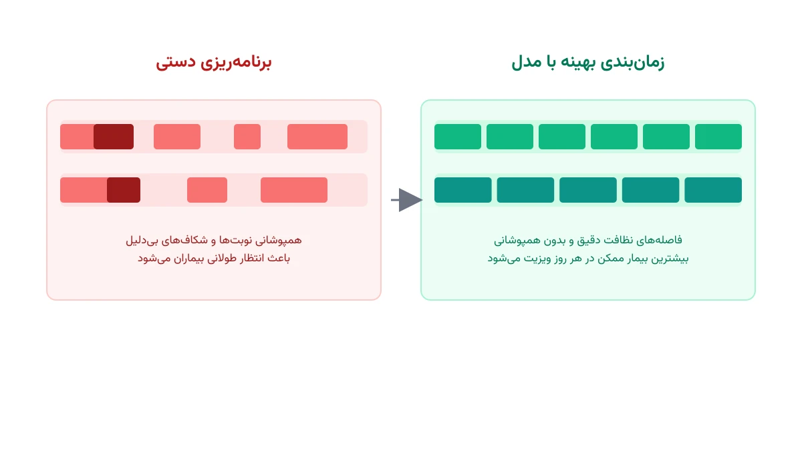

یک دستگاه MRI میلیون‌ها دلار قیمت دارد. اکثر بیمارستان‌ها فقط یکی دو دستگاه از آن دارند. دستگاه CT هم ارزان‌تر است، اما باز هم محدود است. وقتی این دو منبع گران‌قیمت محدودند، هر دقیقه بیکاری‌شان هزینه واقعی دارد. مدیر رادیولوژی هر روز باید ده‌ها بیمار سرپایی، بستری و اورژانسی را روی همین چند دستگاه جا بدهد.

چالش فقط چیدن نوبت‌ها در کنار هم نیست. هر بیمار بسته به نوع تصویربرداری، زمان متفاوتی روی دستگاه می‌گذراند. یک سی‌تی‌اسکن ساده شاید ده دقیقه طول بکشد. یک MRI با تزریق ماده حاجب می‌تواند تا پنجاه دقیقه زمان ببرد. بعد از هر بیمار هم، دستگاه باید تمیز و برای بیمار بعدی آماده شود؛ این فاصله نظافت را نمی‌توان نادیده گرفت.

روی همه این‌ها، بیمار اورژانسی هم اضافه می‌شود. وقتی بخش اورژانس یک تصویربرداری فوری می‌خواهد، برنامه از پیش‌چیده‌شده باید همان لحظه دوباره مرتب شود. مسئله واقعی، یافتن برنامه‌ای است که همه این محدودیت‌ها را همزمان رعایت کند.

## فرمول‌بندی ریاضی مسئله

روز کاری را به بازه‌های زمانی کوتاه، مثلاً پنج‌دقیقه‌ای، تقسیم می‌کنیم. این بازه‌ها را با $t = 1, \dots, H$ نشان می‌دهیم. بیمارستان مجموعه‌ای از دستگاه‌ها دارد که با $m \in M$ مشخص می‌شوند. هر بیمار $i$ یک مدت‌زمان تصویربرداری $p_i$ و یک فاصله نظافت ثابت $c$ دارد.

متغیر تصمیم دودویی $y_{i,t,m}$ برابر یک است، اگر تصویربرداری بیمار $i$ دقیقاً در بازه $t$ روی دستگاه $m$ آغاز شود. هر بیمار باید دقیقاً یک بار، روی یکی از دستگاه‌های سازگار با نوع تصویربرداری‌اش، شروع شود.

$$
\sum_{m \in M_i} \sum_{t=1}^{H} y_{i,t,m} = 1 \quad \forall i
$$

در این رابطه، $M_i$ زیرمجموعه‌ای از دستگاه‌هاست که توانایی انجام همان نوع خاص تصویربرداری را دارند. برای مثال، برخی بررسی‌ها فقط با MRI امکان‌پذیرند و با CT قابل انجام نیستند.

مهم‌ترین قید مسئله، جلوگیری از همپوشانی روی هر دستگاه است. در هر بازه زمانی $\tau$، حداکثر یک بیمار می‌تواند روی دستگاه $m$ در حال تصویربرداری یا نظافت باشد.

$$
\sum_i \sum_{t=\tau-p_i-c+1}^{\tau} y_{i,t,m} \leq 1 \quad \forall m, \tau
$$

تابع هدف می‌تواند کمینه‌کردن مجموع زمان انتظار بیماران نسبت به زمان آمادگی‌شان $r_i$ باشد.

$$
\min \sum_i \sum_{m \in M_i} \sum_{t=1}^{H} (t - r_i)\, y_{i,t,m}
$$

بیمار اورژانسی هم با $r_i$ برابر لحظه ورودش، و با وزنی خیلی بالاتر در تابع هدف، وارد مدل می‌شود. این وزن بالا، سالور را مجبور می‌کند زودترین بازه ممکن را به او بدهد. حتی اگر برنامه چند بیمار دیگر کمی جابه‌جا شود، این جابه‌جایی در تابع هدف لحاظ شده است.

## اهمیت این موضوع

بیمارستانی که زمان‌بندی دستگاه‌هایش را دستی انجام می‌دهد، معمولاً ساعت‌های خالی پنهانی دارد. این ساعت‌ها نتیجه نظافت نامرتب یا فاصله نادرست بین بیماران است. حتی بیمارستان‌هایی با تجهیزاتی از شرکتی مثل جنرال الکتریک (GE HealthCare) هم از این مشکل مصون نیستند. گلوگاه واقعی، خودِ دستگاه نیست؛ نظم زمان‌بندی روزانه است.

هزینه این بی‌نظمی را هم بیمار و هم بیمارستان می‌پردازند. بیمار سرپایی گاهی هفته‌ها منتظر نوبت MRI می‌ماند. بیمارستان هم از ظرفیت گران‌قیمتی که خریده، کمتر از توانش استفاده می‌کند. یک مدل بهینه‌سازی، بدون خرید هیچ دستگاه جدیدی، همین ظرفیت پنهان را آشکار می‌کند.

فایده دوم مدل، واکنش سریع به موارد اورژانسی است. مدیر رادیولوژی دیگر لازم نیست دستی برنامه را بازچینی کند. سالور در چند ثانیه، جای خالی بعدی را برای بیمار اورژانسی پیدا می‌کند. سپس بقیه نوبت‌ها را با کمترین جابه‌جایی ممکن تنظیم می‌کند.

فایده سوم، شفافیت در گفت‌وگو با بیمار است. وقتی مدل همه قیدها را از قبل بررسی کرده، پرسنل پذیرش می‌توانند با اطمینان بیشتری تاریخ دقیق بدهند. این اطمینان، هم رضایت بیمار را بالا می‌برد و هم تعداد لغو و جابه‌جایی‌های بعدی را کم می‌کند.



## ظرفیت کار آکادمیک و پژوهشی

این مسئله، نسخه‌ای از زمان‌بندی ماشین‌های موازی با محدودیت سازگاری است. هر بیمار فقط با زیرمجموعه‌ای از دستگاه‌ها سازگار است، نه با همه آن‌ها. همین محدودیت، مسئله را از زمان‌بندی ماشین‌های موازی ساده پیچیده‌تر می‌کند و زمینه خوبی برای پژوهش در زمان‌بندی ترکیبیاتی فراهم می‌آورد.

یک مسیر پژوهشی باز، مدل‌سازی عدم‌قطعیت در مدت‌زمان واقعی هر اسکن است. گاهی بیمار بی‌قرار است و اسکن بیشتر از زمان برنامه‌ریزی‌شده طول می‌کشد. پژوهش در بهینه‌سازی استوار یا زمان‌بندی پویا می‌تواند این نوع عدم‌قطعیت را پوشش دهد.

مسیر دوم، طراحی سیاستی برای رزرو ظرفیت اورژانسی است. اگر بیمارستان همیشه چند بازه خالی برای اورژانس نگه دارد، هزینه فرصت از‌دست‌رفته‌ای می‌پردازد. اگر هیچ بازه‌ای هم نگه ندارد، اورژانس باعث تأخیر زنجیره‌ای در کل برنامه می‌شود. یافتن تعادل درست بین این دو حالت، موضوع جالبی برای مقاله یا پایان‌نامه در تحقیق در عملیات سلامت است.

مسیر سوم، تخصیص عادلانه بین چند بخش بیمارستانی است. بخش‌های سرپایی، بستری و اورژانس هر کدام برای سهم بیشتری از زمان دستگاه رقابت می‌کنند. ترکیب این سه هدف در یک مدل چندهدفه، پرسش پژوهشی جذابی درباره عدالت در تخصیص منابع بالینی مطرح می‌کند.

## پیاده‌سازی با پایتون

خبر خوب این است که این مسئله ساختار ساده‌ای دارد. با متغیرهای بازه‌ای (Interval Variables) در قالب CP-SAT از کتابخانه [OR-Tools](https://developers.google.com/optimization) به‌خوبی قابل مدل‌سازی است. این کتابخانه کاملاً متن‌باز و رایگان است و هیچ نیازی به خرید سالور تجاری گران‌قیمت نیست. به‌جای صدها متغیر دودویی زمان-بازه، برای هر بیمار فقط یک بازه زمانی اختیاری روی هر دستگاه سازگار تعریف می‌شود.

محدودیت عدم‌همپوشانی هم با یک تابع آماده روی هر دستگاه نوشته می‌شود. همین تابع خودش تضمین می‌کند دو بازه روی یک دستگاه هم‌زمان نشوند. برای بیمار اورژانسی هم کافی است وزن تأخیر او در تابع هدف را خیلی بزرگ‌تر از بقیه بیماران در نظر بگیریم. آشنایی بیشتر با منطق مدل‌سازی محدودیت‌محور را می‌توانید در یادداشت [زمان‌بندی صندلی‌های دیالیز](/notes/dialysis-chair-scheduling/) هم ببینید، که از همین رویکرد بازه‌ای استفاده می‌کند.

این مدل، برخلاف فرمول‌بندی زمان-گسسته بالا، نیازی به تعریف صریح متغیر برای هر بازه پنج‌دقیقه‌ای ندارد. سالور CP-SAT خودش زمان شروع را به‌صورت یک عدد صحیح پیوسته جست‌وجو می‌کند. این تفاوت باعث می‌شود مدل، حتی برای روزهای شلوغ با چند ده بیمار، در کسری از ثانیه حل شود.

```python
from ortools.sat.python import cp_model

model = cp_model.CpModel()
horizon = 96  # بازه‌های پنج‌دقیقه‌ای در یک روز کاری دوازده‌ساعته

# برای هر بیمار و هر دستگاه سازگار، یک بازه اختیاری تعریف می‌شود
intervals_per_machine = {m: [] for m in machines}
for i in patients:
    for m in compatible_machines[i]:
        start = model.NewIntVar(0, horizon, f"start_{i}_{m}")
        presence = model.NewBoolVar(f"presence_{i}_{m}")
        duration = patient_duration[i] + cleaning_time
        interval = model.NewOptionalIntervalVar(
            start, duration, start + duration, presence, f"interval_{i}_{m}"
        )
        intervals_per_machine[m].append(interval)

# ادامه قیود عدم‌همپوشانی و تابع هدف به همین شیوه تعریف می‌شوند
```

دوره [بهینه‌سازی و تصمیم‌گیری سیستم سلامت با پایتون](/courses/health-opt/) این نوع مسائل زمان‌بندی منابع محدود بیمارستانی را با جزئیات کامل پوشش می‌دهد.

اگر به [انجام پروژه بهینه‌سازی](/consultation/) برای مسئله خاص بیمارستان یا مرکز تصویربرداری خودتان نیاز دارید، می‌توانید از همان صفحه شروع کنید.

## سوالات متداول

<h3>چرا نمی‌شود فقط با یک جدول اکسل ساده این برنامه را چید؟</h3>
<p>چون تعداد ترکیب‌های ممکن بین بیماران، دستگاه‌ها و بازه‌های زمانی خیلی زیاد است. وقتی اورژانس هم اضافه شود، بازچینی دستی دیگر عملی نیست. سالور در چند ثانیه، بهترین ترکیب را از بین هزاران حالت ممکن پیدا می‌کند.</p>

<h3>آیا این مدل فقط برای MRI و CT کاربرد دارد؟</h3>
<p>نه، ساختار مدل برای هر منبع گران‌قیمت و مشترک بیمارستانی کاربرد دارد. اتاق عمل، دستگاه آندوسکوپی یا حتی صندلی شیمی‌درمانی هم با همین منطق زمان‌بندی می‌شوند. دوره <a href="/courses/health-opt/" style="color:#2563EB; font-weight:bold;">بهینه‌سازی و تصمیم‌گیری سیستم سلامت با پایتون</a> چند نمونه دیگر از این نوع مسائل را هم پوشش می‌دهد.</p>

<h3>حل این مدل برای یک روز کاری شلوغ چقدر طول می‌کشد؟</h3>
<p>برای یک یا دو دستگاه و چند ده بیمار در روز، سالور CP-SAT معمولاً خیلی سریع جواب می‌دهد. اغلب در کمتر از چند ثانیه، جواب بهینه یا نزدیک به بهینه پیدا می‌شود. این سرعت بالا دقیقاً همان چیزی است که برای واکنش آنی به یک بیمار اورژانسی لازم است.</p>

<h3>برای پیاده‌سازی این مدل با قوانین دقیق مرکز تصویربرداری خودمان چه کار کنیم؟</h3>
<p>هر مرکز تعداد دستگاه، ترکیب بیماران و سیاست پذیرش اورژانس خودش را دارد. برای طراحی مدلی متناسب با شرایط واقعی شما، می‌توانید از طریق <a href="/consultation/" style="color:#2563EB; font-weight:bold;">مشاوره</a> جزئیات کار را مطرح کنید.</p>
