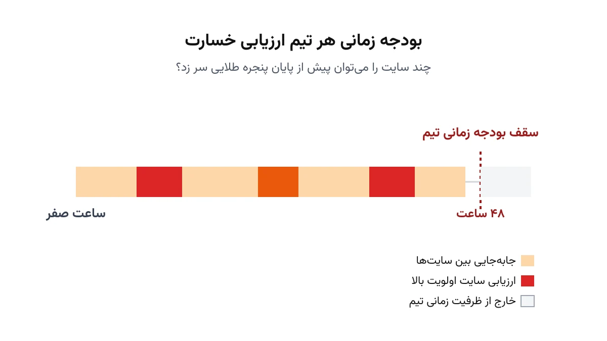

چند ساعت پس از یک زلزله بزرگ، هیچ‌کس دقیق نمی‌داند کدام محله بیشترین خسارت را دیده است. امدادرسانی بدون این اطلاع، فقط حدس زدن است. به همین دلیل، قبل از توزیع گسترده کمک، تیم‌های کوچک ارزیابی میدانی به نقاط مختلف اعزام می‌شوند. هر تیم باید سریع برود، وضعیت را ثبت کند، و به سایت بعدی برسد. این یادداشت یک مدل ریاضی برای همین تصمیم می‌سازد: کدام سایت، به چه ترتیبی، توسط کدام تیم بازدید شود؟

نکته مهم این است که معمولاً زمان کافی برای بازدید همه نقاط آسیب‌دیده وجود ندارد. تیم‌ها محدودند، جاده‌ها شلوغ یا آسیب‌دیده‌اند، و یک «پنجره طلایی» چندساعته یا چندروزه برای جمع‌آوری اطلاعات اولیه وجود دارد. پس سوال واقعی این نیست که «کوتاه‌ترین مسیر برای دیدن همه نقاط چیست؟». سوال این است که با بودجه زمانی محدود چه باید کرد؟ کدام زیرمجموعه از نقاط را انتخاب و مسیریابی کنیم که بیشترین ارزش اطلاعاتی حاصل شود؟

## مسئله واقعی چیست؟

این مسئله یک نسخه خاص از «مسئله مسیریابی با جایزه» (Team Orienteering Problem) است. در مسیریابی کلاسیک، هدف رساندن هر چیز به همه مقصدهاست. اینجا برعکس است. هر سایت آسیب‌دیده یک «ارزش» دارد که معمولاً با جمعیت ساکن، شدت تخمینی خسارت، یا نزدیکی به زیرساخت حیاتی تعیین می‌شود. هر تیم ارزیابی یک سقف زمانی مشخص دارد، مثلاً یک شیفت کاری در پنجره طلایی. هدف مدل، انتخاب زیرمجموعه‌ای از سایت‌ها و توالی بازدید آن‌هاست. این انتخاب باید مجموع ارزش جمع‌آوری‌شده را بیشینه کند و از سقف زمانی هر تیم عبور نکند.

این مدل را می‌توان با [مسئله مسیریابی تیم‌های جست‌وجو و نجات](/notes/search-rescue-team-routing/) مقایسه کرد. آن مدل، یافتن بازماندگان را هدف می‌گیرد. این مدل، جمع‌آوری اطلاعات برای تصمیم‌های بعدی امداد را هدف می‌گیرد. هر دو مسئله از ساختار مشابه مسیریابی با منابع محدود استفاده می‌کنند، اما تابع ارزش و قیود زمانی متفاوت است.

## اهمیت این موضوع

تصمیمات امدادی بزرگ، معمولاً بر پایه همین ارزیابی‌های اولیه گرفته می‌شوند. اگر تیم ارزیابی دیر به یک منطقه پرخسارت برسد، تخصیص کمک هم دیر و احتمالاً اشتباه انجام می‌شود. سازمان‌هایی مثل صلیب سرخ جهانی (ICRC) در ساعات اول پس از یک بحران، دقیقاً با همین چالش روبه‌رو هستند: چند تیم کوچک، صدها نقطه گزارش‌شده، و زمان بسیار محدود. تصمیم اینکه کدام تیم کجا برود، معمولاً دستی و بر پایه تجربه گرفته می‌شود، نه بهینه‌سازی ریاضی.

یک مدل بهینه‌سازی ساده، حتی با داده‌های تقریبی، می‌تواند این تصمیم را قابل دفاع‌تر و سریع‌تر کند. به‌جای جلسه طولانی هماهنگی برای تقسیم مناطق، یک مدل کوچک در چند ثانیه چند سناریوی مسیریابی پیشنهاد می‌دهد. این سرعت، در ساعات اول بحران، می‌تواند تفاوت واقعی ایجاد کند.

## فرمول‌بندی ریاضی

فرض کنید مجموعه‌ای از سایت‌های آسیب‌دیده و یک پایگاه امداد داریم. متغیر تصمیم $x_{ij}$ برابر یک است اگر یک تیم مستقیم از سایت $i$ به سایت $j$ برود. متغیر $y_i$ برابر یک است اگر سایت $i$ اصلاً بازدید شود. هر سایت یک ارزش $v_i$ دارد. تابع هدف، بیشینه‌سازی مجموع ارزش سایت‌های بازدیدشده است:

$$
\max \sum_{i} v_i \, y_i
$$

زمان حرکت بین دو سایت را $t_{ij}$ و زمان ارزیابی هر سایت را $s_i$ می‌نامیم. مهم‌ترین قید مدل، سقف زمانی هر تیم است. مجموع زمان حرکت و ارزیابی در طول مسیر هر تیم، نباید از بودجه زمانی $L$ بیشتر شود:

$$
\sum_{i,j} t_{ij}\, x_{ij} + \sum_{i} s_i\, y_i \le L
$$

محدودیت‌های جریان، تضمین می‌کنند هر مسیر از پایگاه شروع و به پایگاه ختم شود، و هر سایت حداکثر یک‌بار وارد و یک‌بار خارج شود. یک محدودیت حذف زیردور (مشابه مدل‌های کلاسیک TSP) هم لازم است تا مسیر به چند حلقه جدا از پایگاه تقسیم نشود. وقتی چند تیم همزمان کار می‌کنند، همین ساختار برای هر تیم تکرار می‌شود. تنها تفاوت این است که هر سایت باید حداکثر توسط یک تیم بازدید شود.

## ظرفیت پژوهشی و آکادمیک

این مسئله زمینه پژوهشی غنی دارد، چون تلفیقی از مسیریابی، عدم‌قطعیت، و تصمیم‌گیری چندهدفه است. یک مسیر رایج، اضافه‌کردن عدم‌قطعیت به زمان سفر است؛ چون جاده‌های آسیب‌دیده ممکن است زمان واقعی سفر را از قبل نامشخص کنند. مسیر دیگر، مدل چندهدفه است: به‌جای یک تابع ارزش واحد، می‌توان هم‌زمان پوشش جغرافیایی عادلانه و ارزش اطلاعاتی را با تکنیک اپسیلون محدود بهینه کرد. ترکیب این مدل با به‌روزرسانی پویا هم جالب است: وقتی گزارش‌های جدید از میدان می‌رسد، مدل باید در عرض چند دقیقه دوباره حل شود، نه از صفر.

یک زاویه کمتر کار شده، ادغام این مدل با کیفیت نامطمئن اطلاعات اولیه است. ارزش تخمینی هر سایت، معمولاً از گزارش‌های شبکه‌های اجتماعی یا تماس‌های مردمی می‌آید و قابل‌اعتماد نیست. مدلی که هم‌زمان مسیریابی کند و ارزش هر سایت را با اطلاعات جدید به‌روزرسانی کند، جذاب است. چنین مدلی یک مسئله ترکیبی یادگیری و بهینه‌سازی برای پایان‌نامه می‌سازد.



## پیاده‌سازی با پایتون

خبر خوب این است که این مدل، نیازی به سالور تجاری گران‌قیمت ندارد. [OR-Tools](https://developers.google.com/optimization) گوگل، هم ماژول مسیریابی اختصاصی و هم سالور عمومی CP-SAT را دارد که هر دو برای این نوع مسئله مناسب‌اند. برای مسائل کوچک‌تر یا برای کشف ساختار شبکه، [NetworkX](https://networkx.org/) هم ابزار خوبی برای نمایش گراف سایت‌ها و فاصله‌هاست. هیچ‌کدام از این ابزارها لایسنس تجاری نیاز ندارند.

پیاده‌سازی معمولاً با تعریف گراف سایت‌ها، ماتریس زمان سفر، و ارزش هر سایت شروع می‌شود. سپس مدل با متغیرهای بولی CP-SAT ساخته می‌شود:

```python
from ortools.sat.python import cp_model

model = cp_model.CpModel()
n = len(sites)  # شامل پایگاه امداد به‌عنوان گره صفر

# x[i][j] = ۱ اگر مسیر مستقیم از سایت i به سایت j طی شود
x = {}
for i in range(n):
    for j in range(n):
        if i != j:
            x[i, j] = model.NewBoolVar(f"x_{i}_{j}")

# y[i] = ۱ اگر سایت i اصلاً بازدید شود
y = [model.NewBoolVar(f"y_{i}") for i in range(n)]

# قید بودجه زمانی: مجموع زمان حرکت و ارزیابی نباید از L بیشتر شود
model.Add(
    sum(travel_time[i][j] * x[i, j] for i in range(n) for j in range(n) if i != j)
    + sum(assess_time[i] * y[i] for i in range(n)) <= time_budget
)
```

ادامه قیود جریان، حذف زیردور، و تابع هدف بیشینه‌سازی ارزش به همین شیوه تعریف می‌شوند.

## سوالات متداول

<h3>چرا نمی‌توان فقط کوتاه‌ترین مسیر بین همه سایت‌ها را حساب کرد؟</h3>
<p>چون در شرایط بحران، معمولاً زمان کافی برای بازدید همه سایت‌ها وجود ندارد. مسئله کوتاه‌ترین مسیر فرض می‌کند همه مقصدها باید دیده شوند؛ این مدل فرض می‌کند باید انتخاب کرد کدام مقصدها ارزش بازدید دارند.</p>

<h3>این مدل با مسیریابی وسایل نقلیه معمولی چه تفاوتی دارد؟</h3>
<p>در مسیریابی کلاسیک، هر مشتری باید تحویل بگیرد. در این مدل، نرفتن به یک سایت مجاز است، فقط هزینه فرصت دارد (ارزش آن سایت از دست می‌رود). برای یادگیری پایه مسیریابی و نسخه‌های مختلف آن، دوره <a href="/courses/vrp-python/" style="color:#2563EB; font-weight:bold;">مسیریابی وسایل نقلیه با پایتون</a> نقطه شروع خوبی است.</p>

<h3>آیا می‌توان این مدل را برای سازمان یا منطقه خاص خودم سفارشی کرد؟</h3>
<p>بله. تعداد تیم‌ها، نحوه محاسبه ارزش هر سایت، و قیود جاده‌ای واقعی همگی قابل تنظیم‌اند. اگر پروژه یا مسئله مشخصی در حوزه لجستیک بحران دارید، از طریق صفحه <a href="/consultation/" style="color:#2563EB; font-weight:bold;">مشاوره</a> می‌توانیم جزئیات را بررسی کنیم.</p>
