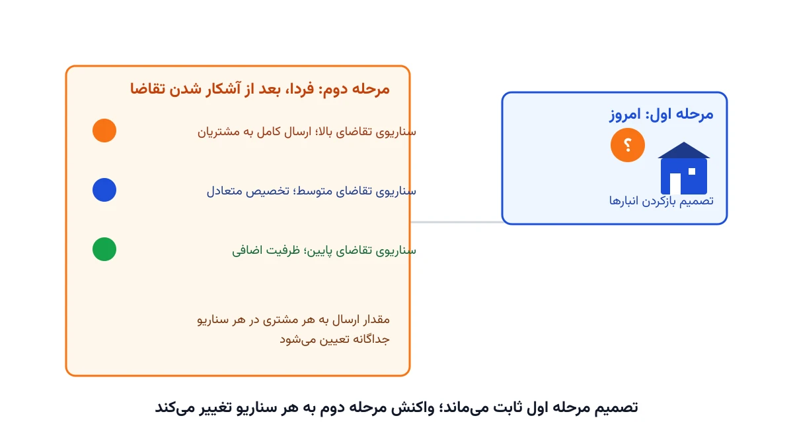

فرض کنید باید همین امروز تصمیم بگیرید چند انبار جدید کجا ساخته شود. این تصمیم گران است و سال‌ها پابرجا می‌ماند. اما تقاضای واقعی مشتریان را فقط در آینده می‌فهمید. اگر انبار را در جای اشتباه بسازید، هزینه‌اش سال‌ها روی دوش شرکت می‌ماند. برنامه‌ریزی تصادفی دومرحله‌ای (Two-Stage Stochastic Programming) دقیقاً برای همین معما طراحی شده است.

در مدل‌های کلاسیک طراحی شبکه، معمولاً یک پیش‌بینی واحد از تقاضا در نظر می‌گیریم. اما تقاضای واقعی به رکود اقتصادی، تغییر ذائقه مشتری یا حرکت رقبا بستگی دارد. اگر یادداشت [مسئله مکان‌یابی تسهیلات](/notes/facility-location-problem/) را خوانده باشید، آنجا تقاضا از قبل دقیقاً معلوم فرض شده بود. این یادداشت دقیقاً همان فرض ساده را کنار می‌گذارد و چند سناریوی ممکن تقاضا را هم‌زمان در یک مدل می‌بیند.

## اهمیت این موضوع

شرکتی مثل پی‌اند‌جی (P&G) در بازطراحی شبکه توزیع آمریکای شمالی خود دقیقاً با همین چالش روبه‌رو بوده است. باید مشخص می‌شد کدام کارخانه‌ها و انبارها نگه داشته شوند، درحالی‌که تقاضای آینده هر منطقه نامعلوم بود. چنین پروژه‌های بازطراحی شبکه، معمولاً برای یک دهه یا بیشتر ثابت می‌مانند. تصمیم اشتباه در چنین افقی، هزینه‌ای میلیون‌دلاری در پی دارد.

اگر شرکت فقط بر مبنای خوش‌بینانه‌ترین سناریو تصمیم بگیرد، در سناریوهای بد ظرفیت کم می‌آورد. اگر فقط بدبینانه‌ترین حالت را در نظر بگیرد، در سناریوهای خوب هزینه اضافی پرداخته. صنایع خرده‌فروشی، لوازم خانگی و محصولات فصلی هم دقیقاً با همین معمای تقاضای نامعلوم روبه‌رو هستند. راه‌حل درست، دیدن همه سناریوهای محتمل هم‌زمان در یک مدل واحد است، نه انتخاب یکی از دو حالت افراطی.



## فرمول‌بندی ریاضی مسئله

مجموعه مکان‌های کاندید برای احداث انبار را با $J$ نشان می‌دهیم و مجموعه مناطق مشتری را با $I$. هزینه ثابت احداث انبار $j$ برابر $f_j$ است و ظرفیت آن $Cap_j$. چون تقاضای آینده نامعلوم است، $S$ سناریوی ممکن را با احتمال $p_s$ در نظر می‌گیریم. تقاضای منطقه $i$ در سناریوی $s$ را با $d_{is}$ نشان می‌دهیم.

متغیر $y_j$ یک متغیر دودویی مرحله اول است؛ یعنی همین امروز، پیش از آشکار شدن تقاضا، تعیین می‌شود. متغیر $x_{ijs}$ مقدار ارسالی از انبار $j$ به منطقه $i$ در سناریوی $s$ است. این متغیر مرحله دوم، بعد از آشکار شدن تقاضا در هر سناریو تعیین می‌شود. متغیر $g_{is}$ هم کمبود تأمین‌نشده منطقه $i$ در سناریوی $s$ را نشان می‌دهد، با هزینه جریمه $q_i$ به ازای هر واحد.

$$
\min \; \sum_{j \in J} f_j y_j \;+\; \sum_{s \in S} p_s \left( \sum_{i \in I}\sum_{j \in J} c_{ij} x_{ijs} + \sum_{i \in I} q_i g_{is} \right)
$$

با محدودیت‌های زیر، برای هر منطقه $i$ و هر سناریوی $s$:

$$
\sum_{j \in J} x_{ijs} + g_{is} = d_{is}
$$

$$
\sum_{i \in I} x_{ijs} \le Cap_j \, y_j \qquad \forall j \in J, s \in S
$$

$$
y_j \in \{0,1\}, \quad x_{ijs} \ge 0, \quad g_{is} \ge 0
$$

جمله اول تابع هدف، هزینه ثابت شبکه است که فقط یک‌بار و مستقل از سناریو پرداخت می‌شود. جمله دوم، میانگین وزنی هزینه حمل‌ونقل و جریمه کمبود در تمام سناریوهاست. دقیقاً همین جمله دوم است که مدل را «تصادفی» می‌کند؛ مدل قطعی فقط یک سناریو را می‌بیند، نه میانگین وزنی همه آن‌ها. محدودیت اول تضمین می‌کند تقاضای هر منطقه یا تأمین شود یا به‌عنوان کمبود ثبت شود. محدودیت دوم می‌گوید فقط انبارهای بازشده می‌توانند کالا ارسال کنند، و آن هم تا سقف ظرفیتشان.

این مدل را معمولاً «فرم گسترده» یا «معادل قطعی» مسئله تصادفی می‌نامند، چون همه سناریوها در یک مدل بزرگ ادغام شده‌اند. برای چند ده سناریو، سالورهای MILP معمولی این فرم گسترده را مستقیم حل می‌کنند.

## ظرفیت کار آکادمیک و پژوهشی

وقتی تعداد سناریوها به هزاران برسد، فرم گسترده مدل بسیار بزرگ و کند می‌شود. روش کلاسیک مقابله با این مشکل، تجزیه بندرز (Benders Decomposition) است. در ادبیات برنامه‌ریزی تصادفی به آن روش ال-شکل (L-Shaped Method) هم می‌گویند. این روش مسئله را به یک مسئله اصلی برای تصمیم مرحله اول و چند زیرمسئله مستقل برای هر سناریو می‌شکند.

مسیر پژوهشی دیگر، کاهش سناریو (Scenario Reduction) است. یعنی انتخاب زیرمجموعه‌ای کوچک‌تر و نماینده از سناریوهای اصلی، بدون افت کیفیت جواب. مسیر سوم، نسخه ریسک‌گریز مدل است. به‌جای مینیمم‌کردن میانگین هزینه، می‌توان معیار CVaR را مینیمم کرد تا از بدترین سناریوها هم محافظت شود. مقایسه این رویکرد با بهینه‌سازی استوار (Robust Optimization)، که اصلاً به توزیع احتمال سناریوها نیاز ندارد، خودش یک حوزه پژوهشی فعال است.

## پیاده‌سازی با پایتون

خبر خوب این است که حل این مدل نیازی به سالور تجاری گران‌قیمت ندارد. کتابخانه متن‌باز [Pyomo](https://www.pyomo.org/) برای تعریف مجموعه‌ها، پارامترها و متغیرهای اندیس‌دار روی سناریوها بسیار مناسب است. سالور رایگان [HiGHS](https://highs.dev/) برای حل فرم گسترده مدل کفایت می‌کند؛ برای مسائل بزرگ‌تر، [CBC](https://github.com/coin-or/Cbc) هم گزینه خوبی است.

داده ورودی این مسئله، شامل مختصات انبارهای کاندید، ظرفیت و هزینه ثابت هرکدام، و تقاضای هر منطقه در هر سناریو است. این داده را می‌توان در چند برگه اکسل ساده نگه داشت و با pandas خواند. اسکلت اولیه مدل در Pyomo به این شکل شروع می‌شود:

```python
import pyomo.environ as pyo

model = pyo.ConcreteModel()
model.J = pyo.Set(initialize=["DC1", "DC2", "DC3"])      # انبارهای کاندید
model.I = pyo.Set(initialize=["R1", "R2", "R3", "R4"])    # مناطق مشتری
model.S = pyo.Set(initialize=["low", "base", "high"])     # سناریوهای تقاضا

model.y = pyo.Var(model.J, within=pyo.Binary)
model.x = pyo.Var(model.I, model.J, model.S, within=pyo.NonNegativeReals)
model.g = pyo.Var(model.I, model.S, within=pyo.NonNegativeReals)

# ادامه قیود تأمین تقاضا، سقف ظرفیت هر انبار و تابع هدف به همین شیوه تعریف می‌شوند.
```

بعد از حل مدل، ارزش گزارش «ارزش اطلاعات کامل» (EVPI) هم جالب است. این یعنی چقدر حاضریم بپردازیم تا تقاضای واقعی را از قبل بدانیم. می‌توان نتیجه مدل تصادفی را با جواب هر سناریو به‌تنهایی مقایسه کرد. برای نمایش شبکه نهایی، [NetworkX](https://networkx.org/) می‌تواند انبارهای بازشده و مسیرهای فعال هر سناریو را به‌صورت گراف رسم کند.

## سوالات متداول

<h3>تفاوت این مدل با مسئله کلاسیک مکان‌یابی تسهیلات چیست؟</h3>
<p>مدل کلاسیک مکان‌یابی فرض می‌کند تقاضای هر منطقه از قبل دقیقاً معلوم است. این مدل همان ساختار را حفظ می‌کند. اما چند سناریوی تقاضا را هم‌زمان می‌بیند و تصمیم مکان‌یابی را در برابر همه آن‌ها مقاوم می‌کند.</p>

<h3>اگر تعداد سناریوهای تقاضا خیلی زیاد باشد چه باید کرد؟</h3>
<p>با افزایش تعداد سناریوها، فرم گسترده مدل خیلی بزرگ می‌شود. در این حالت، روش‌های تجزیه مثل روش ال-شکل یا نمونه‌گیری کوچک‌تر از سناریوهای نماینده (کاهش سناریو) به کار می‌آید.</p>

<h3>برای یادگیری مدل‌سازی این نوع مسائل از کجا شروع کنم؟</h3>
<p>دوره <a href="/courses/vrp-python/" style="color:#2563EB; font-weight:bold;">مسیریابی و بهینه‌سازی زنجیره تأمین با پایتون</a> پایه لازم برای مدل‌سازی این نوع مسائل شبکه را می‌دهد. اگر برای پیاده‌سازی این مدل روی داده واقعی کسب‌وکارتان راهنمایی لازم دارید، از طریق صفحه <a href="/consultation/" style="color:#2563EB; font-weight:bold;">مشاوره</a> می‌توانید با ما در ارتباط باشید.</p>
