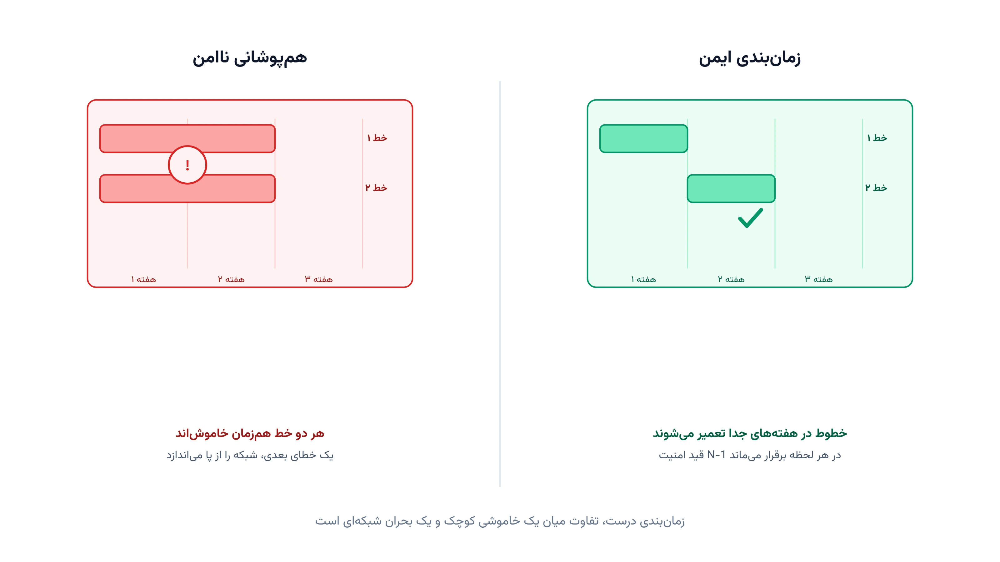

هر خط انتقال برق، دیر یا زود به تعمیر نیاز دارد. عایق‌ها فرسوده می‌شوند، تجهیزات کلیدزنی نیاز به سرویس دارند، و برج‌ها باید بازرسی شوند. اما این تعمیرات را نمی‌توان هر زمان دلخواه انجام داد. وقتی یک خط برای تعمیر از مدار خارج می‌شود، شبکه در برابر خطای بعدی آسیب‌پذیرتر می‌شود.

این دقیقاً مسئله زمان‌بندی تعمیرات پیشگیرانه شبکه انتقال است؛ به انگلیسی Transmission Maintenance Scheduling. اپراتور شبکه باید برای ده‌ها خط و تجهیز، یک پنجره زمانی تعمیر پیدا کند. این پنجره باید با قید امنیت N-1 سازگار باشد. یعنی حتی وقتی یک خط خاموش است، شبکه باید در برابر از دست رفتن یک تجهیز دیگر هم مقاوم بماند. محدودیت گروه‌های تعمیراتی هم باید رعایت شود، چون تعداد تیم‌های در دسترس در هر هفته محدود است.

## فرمول‌بندی ریاضی مسئله

فرض کنید مجموعه خطوط و تجهیزاتی که باید تعمیر شوند را با $L$ نشان دهیم. افق برنامه‌ریزی را به $T$ دوره زمانی، مثلاً هفته، تقسیم می‌کنیم. متغیر دودویی $x_{\ell t}$ برابر یک است اگر تعمیر تجهیز $\ell$ در دوره $t$ آغاز شود. هر تجهیز باید دقیقاً یک‌بار در این افق زمان‌بندی شود:

$$
\sum_{t=1}^{T} x_{\ell t} = 1 \qquad \forall \ell \in L
$$

در هر دوره زمانی، تعداد محدودی گروه تعمیراتی در دسترس است. اگر $K_t$ ظرفیت گروه‌های تعمیراتی در دوره $t$ باشد، این قید باید برقرار بماند:

$$
\sum_{\ell \in L} x_{\ell t} \le K_t \qquad \forall t
$$

مهم‌ترین قید مدل، امنیت N-1 است. برخی جفت تجهیزات، اگر هم‌زمان از مدار خارج شوند، شبکه را در برابر یک خطای دیگر بسیار آسیب‌پذیر می‌کنند. این جفت‌ها از پیش، با مطالعات تحلیل حادثه یا Contingency Analysis شناسایی می‌شوند. اگر $C$ مجموعه این جفت‌های ناسازگار باشد، داریم:

$$
x_{\ell t} + x_{\ell' t} \le 1 \qquad \forall (\ell,\ell') \in C,\ \forall t
$$

هدف مدل هم مهم است. معمولاً تجهیزاتی با ریسک خرابی بالاتر باید زودتر تعمیر شوند. اگر $w_\ell$ وزن فوریت تعمیر تجهیز $\ell$ باشد، هدف کمینه‌کردن مجموع تاخیر وزنی است:

$$
\min \sum_{\ell \in L}\sum_{t=1}^{T} w_\ell\, t\, x_{\ell t}
$$

این فرمول‌بندی، یک مسئله برنامه‌ریزی عدد صحیح است. بخش غیربدیهی آن، ساختن مجموعه $C$ است. برای این کار، هر جفت تجهیز باید زیر یک سناریوی پخش‌بار DC-OPF با خروج هم‌زمان بررسی شود. اگر خروج هم‌زمان باعث عبور جریان از ظرفیت مجاز خطوط باقی‌مانده شود، آن جفت ناسازگار علامت‌گذاری می‌شود.

## اهمیت این موضوع

اپراتورهای شبکه انتقال در سراسر دنیا، برنامه تعمیرات سالانه خود را ماه‌ها زودتر طراحی می‌کنند. شرکتی مثل ترنا (Terna) در ایتالیا، مسئول بهره‌برداری از شبکه انتقال سراسری این کشور است. این شرکت هر سال هزاران ساعت خاموشی برنامه‌ریزی‌شده را هماهنگ می‌کند. این هماهنگی معمولاً با داده‌های زنده مرکز کنترل و مفاهیم [بهینه‌سازی شبکه هوشمند](/notes/smart-grid-optimization/) هم گره خورده است.

خاموشی سراسری ایتالیا در سال ۲۰۰۳ نمونه‌ای روشن از ریسک این تصمیمات است. وقتی چند خط مهم پشت‌سرهم از مدار خارج شدند، شبکه در برابر خطای بعدی بسیار شکننده شد. یک اتفاق نسبتاً کوچک، به قطع برق میلیون‌ها نفر انجامید. این رویداد نشان داد که نادیده‌گرفتن قید امنیت N-1 هنگام برنامه‌ریزی خاموشی، چه هزینه‌ای دارد.

از طرف دیگر، تاخیرانداختن تعمیرات هم هزینه دارد. تجهیزی که به‌موقع سرویس نشود، ریسک خرابی ناگهانی آن بالا می‌رود. خرابی ناگهانی، برخلاف تعمیر برنامه‌ریزی‌شده، هیچ هشداری نمی‌دهد و معمولاً هزینه تعمیر اضطراری را هم افزایش می‌دهد. مدل بهینه‌سازی، دقیقاً همین مصالحه میان ریسک تاخیر و ریسک هم‌زمانی خاموشی‌ها را حل می‌کند.

## ظرفیت پژوهشی و آکادمیک

زمان‌بندی تعمیرات شبکه انتقال، حوزه‌ای فعال در پژوهش سیستم قدرت است. مسیر اول، مدل‌سازی تصادفی نرخ خرابی تجهیزات است. نرخ خرابی واقعی، معمولاً قطعی نیست و به سن، آب‌وهوا و شرایط بار بستگی دارد.

مسیر دوم، هم‌زمان‌سازی این مسئله با تعهد واحدها یا Unit Commitment و برنامه تولید نیروگاه‌هاست. وقتی یک خط مهم برای تعمیر خاموش است، الگوی بهینه تولید نیروگاه‌ها هم تغییر می‌کند. مسیر سوم، گسترش مدل به حالت چنددوره‌ای است؛ یعنی تعمیراتی که چند هفته طول می‌کشند، نه فقط یک دوره تک.

مسیر چهارم، ترکیب زمان‌بندی تعمیرات با مسیریابی گروه‌های تعمیراتی است. این‌جا مسئله یک لایه ترکیبیاتی اضافه پیدا می‌کند، شبیه مسائل مسیریابی وسایل نقلیه. مسیر پنجم، طراحی روش‌های حل سریع‌تر برای شبکه‌های سراسری با هزاران تجهیز است، جایی که غربالگری همه جفت‌های ناسازگار به‌تنهایی سنگین می‌شود. هرکدام از این مسیرها، ظرفیت خوبی برای پایان‌نامه یا مقاله علمی دارند.



## پیاده‌سازی با پایتون

خبر خوب این است که حل این مدل، نیازی به نرم‌افزار تجاری گران‌قیمت ندارد. کتابخانه متن‌باز [Pyomo](https://www.pyomo.org/) برای نوشتن این نوع مدل‌های عدد صحیح بسیار مناسب است. سالورهای رایگان مثل [HiGHS](https://highs.dev/) یا [CBC](https://github.com/coin-or/Cbc) این مدل را برای ده‌ها تجهیز در چند ثانیه حل می‌کنند.

برای تولید خودکار مجموعه جفت‌های ناسازگار $C$، باید برای هر جفت تجهیز یک سناریوی پخش‌بار اجرا شود. کتابخانه [pandapower](https://www.pandapower.org/) دقیقاً برای این کار مناسب است؛ با آن می‌توان سناریوهای خروج هم‌زمان را روی مدل شبکه شبیه‌سازی کرد. داده ورودی هر تجهیز شامل مدت تعمیر، وزن فوریت و گروه تعمیراتی لازم است. این داده معمولاً در یک فایل ساده اکسل یا CSV نگهداری می‌شود. این داده را می‌توان با pandas خواند و مستقیم به مدل Pyomo داد.

```python
import pyomo.environ as pyo

assets = ["L1", "L2", "L3", "L4", "L5"]
periods = list(range(1, 9))  # افق برنامه‌ریزی: ۸ هفته
urgency = {"L1": 5, "L2": 3, "L3": 4, "L4": 2, "L5": 5}
crew_needed = {"L1": 1, "L2": 2, "L3": 1, "L4": 1, "L5": 2}
crew_capacity = {t: 2 for t in periods}

# جفت تجهیزاتی که طبق تحلیل پخش‌بار، خروج هم‌زمانشان ناامن است
incompatible_pairs = [("L1", "L2"), ("L3", "L4"), ("L2", "L5")]

model = pyo.ConcreteModel()
model.x = pyo.Var(assets, periods, domain=pyo.Binary)

def schedule_once(m, l):
    return sum(m.x[l, t] for t in periods) == 1
model.schedule_once = pyo.Constraint(assets, rule=schedule_once)

def crew_limit(m, t):
    return sum(crew_needed[l] * m.x[l, t] for l in assets) <= crew_capacity[t]
model.crew_limit = pyo.Constraint(periods, rule=crew_limit)

def n1_security(m, l1, l2, t):
    return m.x[l1, t] + m.x[l2, t] <= 1
model.n1_security = pyo.Constraint(incompatible_pairs, periods, rule=n1_security)

model.obj = pyo.Objective(
    expr=sum(urgency[l] * t * model.x[l, t] for l in assets for t in periods),
    sense=pyo.minimize,
)

pyo.SolverFactory("appsi_highs").solve(model)
for l in assets:
    for t in periods:
        if model.x[l, t].value > 0.5:
            print(l, "در هفته", t, "تعمیر می‌شود")
```

روی این مثال کوچک، سالور معمولاً تجهیزاتی با وزن فوریت بالاتر را زودتر زمان‌بندی می‌کند. این اتفاق می‌افتد مگر اینکه قید ناسازگاری یا ظرفیت گروه مانع شود. برای شبکه واقعی، کافی است فهرست تجهیزات و مجموعه جفت‌های ناسازگار از نتایج واقعی تحلیل پخش‌بار خوانده شود.

## سوالات متداول

<h3>تفاوت این مسئله با تعمیرات اضطراری چیست؟</h3>
<p>تعمیر اضطراری، پاسخ به یک خرابی غیرمنتظره است و از قبل قابل برنامه‌ریزی نیست. زمان‌بندی تعمیرات پیشگیرانه، برعکس، ماه‌ها زودتر و با در نظر گرفتن قید امنیت N-1 طراحی می‌شود. هدف این برنامه‌ریزی، کاهش احتمال وقوع همان خرابی‌های اضطراری در آینده است.</p>

<h3>آیا این مدل فقط برای شبکه‌های انتقال بزرگ کاربرد دارد؟</h3>
<p>نه؛ حتی یک شرکت توزیع منطقه‌ای با چند ده خط فشار متوسط هم می‌تواند از این مدل بهره ببرد. دوره <a href="/courses/advanced-power-system/" style="color:#2563EB; font-weight:bold;">بهینه‌سازی پیشرفته سیستم قدرت</a> دقیقاً همین نوع مدل‌های برنامه‌ریزی عدد صحیح شبکه انتقال و توزیع را با پایتون آموزش می‌دهد.</p>

<h3>تولید مجموعه جفت‌های ناسازگار N-1 چقدر زمان می‌برد؟</h3>
<p>برای شبکه‌ای با چند ده تجهیز، این کار معمولاً چند دقیقه طول می‌کشد. برای شبکه‌های سراسری با هزاران تجهیز، نیاز به غربالگری هوشمند و موازی‌سازی محاسبات دارد. برای طراحی دقیق این بخش از مدل متناسب با مقیاس شبکه شما، از طریق <a href="/consultation/" style="color:#2563EB; font-weight:bold;">مشاوره</a> می‌توانیم جزئیات فنی را بررسی کنیم.</p>
