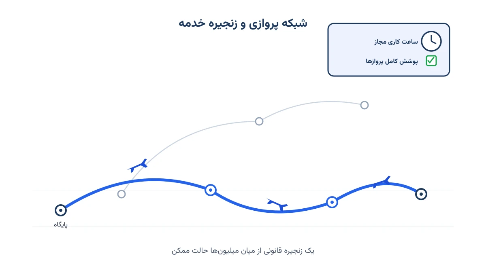
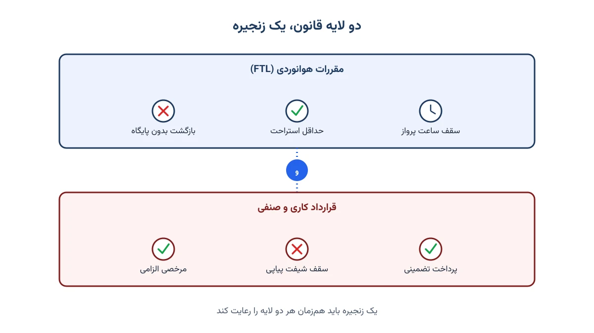

وقتی سوار هواپیما می‌شوید، احتمالاً هیچ‌وقت از خودتان نمی‌پرسید چرا همین خلبان‌ها و مهمانداران روی این پرواز هستند. اما این انتخاب تصادفی نیست.

چند هفته قبل از پرواز، متخصصان بهینه‌سازی از میان حالت‌های بسیار زیاد ممکن، یک برنامه را انتخاب کرده‌اند. این برنامه باید هم قانونی باشد، هم کم‌هزینه و هم برای خدمه قابل‌قبول. این همان کاری است که تحقیق در عملیات انجام می‌دهد: تبدیل یک مسئله بسیار پیچیده به یک فرایند روزمره کسب‌وکار. در این یادداشت می‌بینیم چه عواملی این مسئله را این‌قدر دشوار می‌کنند.

## پوشش کامل؛ نه کمتر، نه بیشتر

نقطه شروع ساده به نظر می‌رسد: هر پرواز برنامه‌ریزی‌شده باید خدمه داشته باشد، دقیقاً یک بار. هیچ پروازی نباید بدون خدمه بماند و هیچ پروازی نباید دو گروه خدمه داشته باشد.

مشکل اینجاست که خدمه معمولاً یک پرواز تکی انجام نمی‌دهند. آن‌ها زنجیره‌ای از پروازها را طی می‌کنند که ممکن است چند روز طول بکشد. این زنجیره باید از پایگاه خودشان شروع و به همان‌جا ختم شود. به این زنجیره‌ها در ادبیات این حوزه Pairing می‌گویند. وقتی یک ایرلاین هزاران پرواز روزانه دارد، تعداد زنجیره‌هایی که می‌شود ساخت، عملاً قابل شمارش نیست.

## ساختار شبکه: هاب یا نقطه‌به‌نقطه؟

اندازه فضای جواب تا حد زیادی به طراحی شبکه بستگی دارد. در شبکه هاب‌وپره، خدمه از پایگاه به یک مقصد می‌روند و برمی‌گردند و تصمیم‌های اصلی در خود هاب متمرکز است. در شبکه نقطه‌به‌نقطه، خدمه از هر مقصد به مقصد بعدی ادامه می‌دهند و در هر فرودگاه چند پرواز اتصالی پیش رویشان است.

ایرلاین‌هایی مثل ایرایشیا که شبکه نقطه‌به‌نقطه دارند، با فضای جواب بسیار بزرگ‌تری روبه‌رو هستند. دلیلش این است که این انتخاب‌ها در هر توقف، برای هر گروه خدمه و در کل پروازهای روزانه، روی هم انباشته می‌شوند.

## قانونی بودن: جایی که پیچیدگی چند برابر می‌شود

یک زنجیره پروازی فقط وقتی قابل‌استفاده است که قانونی باشد. قوانین در دو لایه اعمال می‌شوند. لایه اول مقررات هوانوردی است: سقف ساعت کار در شیفت، حداقل استراحت بین دو مأموریت، و سقف ساعات پرواز هفتگی. لایه دوم قراردادهای کاری و صنفی است که اغلب سخت‌گیرانه‌ترند؛ مثل حداقل پرداخت تضمینی ماهانه و تعداد روزهای مرخصی الزامی.

نکته مهم این است که زنجیره‌ای که همه مقررات دولتی را رعایت می‌کند، ممکن است از نظر قرارداد کاری کاملاً غیرقابل‌قبول باشد. در زبان مدل‌سازی، این یعنی تعداد زیادی قید ترکیبیاتی که باید هم‌زمان برقرار باشند.

## وابستگی به برنامه هواپیماها

تعداد مهمانداران هر پرواز به اندازه هواپیما بستگی دارد. بنابراین نیاز خدمه تا زمانی که برنامه تخصیص هواپیما نهایی نشود، قطعی نیست؛ و برنامه هواپیماها هم مدام تغییر می‌کند. به همین دلیل، برنامه‌ریزی خدمه یک مسئله مستقل نیست و در عمل حلقه‌ای از یک زنجیره بزرگ‌تر برنامه‌ریزی ایرلاین است.

## شدنی بودن کافی نیست؛ برنامه باید خوب باشد

پیدا کردن یک برنامه قانونی، تازه نیمی از کار است. سؤال اصلی این است که کدام برنامه بهترین است. اینجا چند هدف با هم رقابت می‌کنند. هزینه خدمه یکی از بزرگ‌ترین اقلام هزینه‌ای هر ایرلاین است. رضایت خدمه هم ممکن است در یک برنامه کم‌هزینه نادیده گرفته شود. هدف سوم هم پایداری عملیات است.

فرض کنید خدمه در یک زنجیره بین دو هواپیمای مختلف جابه‌جا شوند. اگر پرواز اول تأخیر داشته باشد، تأخیر به پرواز بعدی هم سرایت می‌کند. گاهی همین تأخیر باعث می‌شود سقف ساعت کاری خدمه پر شود و ایرلاین مجبور شود از خدمه ذخیره استفاده کند. یک برنامه خوب باید میان این اهداف توازن برقرار کند.

## و همه این‌ها، با سرعت

در نهایت، هدف این است که بهترین برنامه ممکن تولید شود: قانونی، کم‌هزینه و مطلوب برای خدمه. اما این برنامه باید آن‌قدر سریع تولید شود که در عملیات واقعی به کار بیاید. برنامه‌ای که بهینه است اما چند روز طول می‌کشد تا حل شود، در دنیای واقعی ارزش چندانی ندارد.

## از دید تحقیق در عملیات

اگر با بهینه‌سازی آشنا باشید، احتمالاً در همین توضیحات ردپای مسائل کلاسیک را دیده‌اید. پوشش دقیقاً یک‌باره هر پرواز، همان ساختار Set Partitioning است. تولید زنجیره‌های قانونی از میان فضای عظیم جواب هم معمولاً با تولید ستون انجام می‌شود. بخش تولید زنجیره‌ها هم خودش یک مسئله کوتاه‌ترین مسیر با قید منابع روی شبکه پروازهاست. جزئیات کامل این فرمول‌بندی و تولید ستون را در [یادداشت زمان‌بندی خدمه پرواز](/notes/crew-pairing-problem/) می‌خوانید.

همین ابزارها، با تغییراتی، در حوزه‌های دیگر هم به کار می‌روند. در حمل‌ونقل و زنجیره تأمین، منطق ساختن زنجیره‌های قانونی پرواز تقریباً همان منطق ساختن مسیر برای ناوگان خودروهاست. هر مشتری باید دقیقاً یک بار سرویس بگیرد و هر مسیر باید از انبار شروع و به آن ختم شود. اگر می‌خواهید این نوع مدل‌سازی را عملی و با پایتون یاد بگیرید، [دوره مسیریابی وسایل نقلیه با پایتون](/courses/vrp-python/) نقطه شروع مناسبی است.

در سیستم‌های سلامت هم با نسخه‌ای بسیار نزدیک به همین مسئله روبه‌رو هستیم: زمان‌بندی شیفت پرستاران و پزشکان. آنجا هم باید همه شیفت‌ها پوشش داده شوند، حداقل استراحت بین شیفت‌ها رعایت شود و رضایت کارکنان هم در نظر گرفته شود. برای یادگیری این مدل‌ها در بیمارستان‌ها، [دوره بهینه‌سازی سیستم‌های سلامت با پایتون](/courses/health-opt/) را ببینید.

## جمع‌بندی

برنامه‌ریزی خدمه پرواز ترکیبی است از پوشش دقیق، فضای جواب عظیم، لایه‌لایه قوانین، وابستگی به سایر برنامه‌ها و اهداف متعارض. برنامه‌ای که فقط قوانین را رعایت کند، لزوماً برنامه خوبی نیست. ارزش واقعی بهینه‌سازی این است: پیدا کردن برنامه‌ای که هم شدنی باشد و هم ارزش اجرا داشته باشد.

<h3>سوالات متداول</h3>

چرا نمی‌شود این مسئله را فقط با آزمون‌وخطا یا تجربه‌ی برنامه‌ریز حل کرد؟

چون تعداد زنجیره‌های قانونی ممکن برای یک شبکه پروازی بزرگ، از توان محاسبه‌ی دستی و حتی شهود انسانی بسیار فراتر است. تنها روش‌های بهینه‌سازی ریاضی می‌توانند در این فضای عظیم، برنامه‌ای شدنی و کم‌هزینه پیدا کنند.

تفاوت این یادداشت با فرمول‌بندی ریاضی کامل مسئله چیست؟

این یادداشت روی منبع پیچیدگی مسئله تمرکز دارد. اگر به دنبال مدل ریاضی دقیق، تابع هدف و قیدها هستید، <a href="/notes/crew-pairing-problem/" style="color:#2563EB; font-weight:bold;">یادداشت زمان‌بندی خدمه پرواز</a> را ببینید.

چطور می‌توانم این نوع مدل‌سازی را برای مسئله خودم یاد بگیرم یا پیاده کنم؟

دوره <a href="/courses/vrp-python/" style="color:#2563EB; font-weight:bold;">مسیریابی وسایل نقلیه با پایتون</a> مبانی مدل‌سازی مسائل پوشش و زمان‌بندی را پوشش می‌دهد. برای پیاده‌سازی روی داده‌های واقعی سازمان خودتان هم می‌توانید از طریق صفحه <a href="/consultation/" style="color:#2563EB; font-weight:bold;">مشاوره</a> اقدام کنید.

