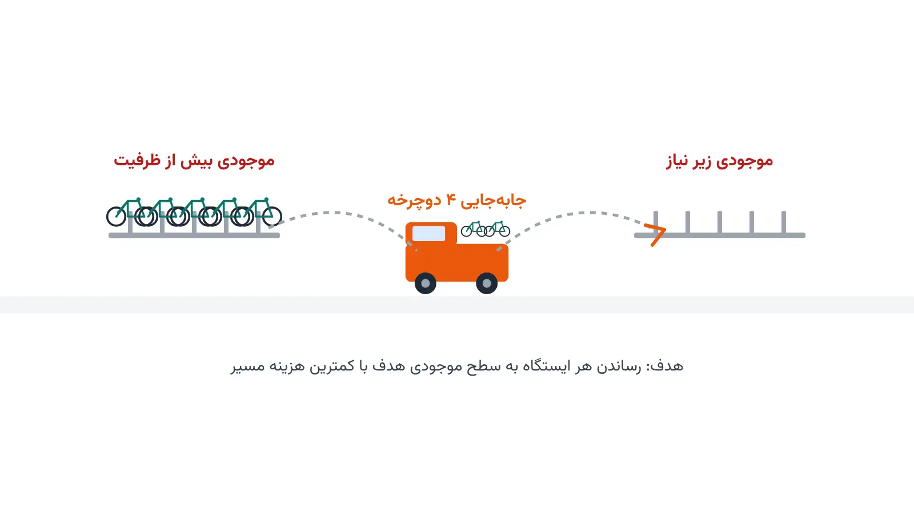

اگر در یک شهر بزرگ از دوچرخه اشتراکی استفاده کرده باشید، این تجربه را می‌شناسید. گاهی ایستگاه نزدیک خانه‌تان پر از دوچرخه است. گاهی هم هیچ دوچرخه‌ای برای برداشتن پیدا نمی‌کنید. این ناهماهنگی تصادفی نیست. الگوی رفت‌وآمد روزانه مردم، دوچرخه‌ها را از محله‌های مسکونی به مراکز کاری منتقل می‌کند. نتیجه این جابه‌جایی، ایستگاه‌های پر در یک طرف شهر است. طرف دیگر هم با ایستگاه‌های خالی روبه‌رو می‌شود. اپراتورهای سیستم هر شب باید این نابرابری را جبران کنند. این کار دقیقاً همان مسئله‌ای است که در این مطلب بررسی می‌کنیم.

برای جبران این نابرابری، اپراتور سیستم هر شب ناوگانی از وانت به کار می‌گیرد. هر وانت دوچرخه‌ها را از ایستگاه‌های پر برمی‌دارد و در ایستگاه‌های خالی تحویل می‌دهد. هدف این است که موجودی هر ایستگاه به یک سطح هدف از پیش تعیین‌شده نزدیک شود. این سطح هدف معمولاً از پیش‌بینی تقاضای روز بعد به دست می‌آید. اما ظرفیت هر وانت محدود است و طول مسیر هم هزینه دارد. به همین دلیل، باید هم مقدار جابه‌جایی و هم ترتیب بازدید ایستگاه‌ها را هم‌زمان بهینه کرد. در ادبیات پژوهشی، به این مسئله «بازآرایی دوچرخه‌های اشتراکی» یا Bike-Sharing Rebalancing Problem می‌گویند.

این مسئله دو حالت اصلی دارد: ایستا و پویا. در حالت ایستا، بازآرایی یک‌بار و معمولاً در میانه شب انجام می‌شود. در حالت پویا، بازآرایی هم‌زمان با تقاضای واقعی در طول روز اتفاق می‌افتد. حالت پویا بسیار پیچیده‌تر است، چون باید به تغییرات لحظه‌ای واکنش نشان دهد. بیشتر اپراتورهای بزرگ، ترکیبی از هر دو رویکرد را به کار می‌گیرند.

## اهمیت این موضوع در دنیای واقعی

سیستم‌های دوچرخه اشتراکی امروز در صدها شهر دنیا فعال هستند. شرکتی مثل Citi Bike در نیویورک، روزانه هزاران جابه‌جایی دوچرخه را مدیریت می‌کند. بدون برنامه‌ریزی مسیر هوشمند، هزینه این عملیات به‌شدت بالا می‌رود. بازآرایی ضعیف باعث نارضایتی مشترکان هم می‌شود. کاربری که ایستگاه را خالی یا پر می‌بیند، معمولاً سرویس را رها می‌کند. این موضوع مستقیماً روی درآمد و اعتبار اپراتور اثر می‌گذارد.

بهینه‌سازی مسیر بازآرایی، هزینه سوخت و نیروی انسانی را هم کاهش می‌دهد. در شهرهایی با صدها ایستگاه، حتی کاهش ده‌درصدی مسافت طی‌شده، صرفه‌جویی قابل‌توجهی ایجاد می‌کند. همین موضوع، این مسئله را برای اپراتورهای تجاری بسیار جذاب کرده است. دوره [بهینه‌سازی زنجیره تأمین و حمل‌ونقل با پایتون](/courses/vrp-python/) دقیقاً روی همین نوع مسائل مسیریابی و تخصیص تمرکز دارد.



## فرمول‌بندی ریاضی مسئله

ساده‌ترین شکل مسئله را می‌توان به‌صورت یک مسیریابی با برداشت و تحویل مدل کرد. فرض کنید $n$ ایستگاه و یک وانت با ظرفیت $Q$ داریم. متغیر دودویی $x_{ij}$ برابر یک است اگر وانت از ایستگاه $i$ مستقیماً به $j$ برود.

$$ \min \sum_{i} \sum_{j} c_{ij}\, x_{ij} $$

این تابع هدف، مجموع هزینه مسیر طی‌شده را کمینه می‌کند. محدودیت بعدی تضمین می‌کند هر ایستگاه دقیقاً یک‌بار سر زده شود.

$$ \sum_{j} x_{ij} = 1 \qquad \forall i $$

بار وانت هم باید در هر لحظه زیر ظرفیت باشد. متغیر $l_i$ بار وانت را بلافاصله بعد از خروج از ایستگاه $i$ نشان می‌دهد.

$$ 0 \le l_i \le Q \qquad \forall i $$

در عمل، باید مقدار برداشت یا تحویل هر ایستگاه را هم به مدل اضافه کرد. این مقدار معمولاً برابر تفاضل موجودی فعلی و موجودی هدف است. یک زیرمسئله ساده‌تر، فقط تعیین می‌کند چه مقدار دوچرخه باید بین هر جفت ایستگاه جابه‌جا شود. بخش پیاده‌سازی پایتون همین زیرمسئله را با مثال نشان می‌دهد. مدل کامل بعد از آن، ترتیب بازدید وانت را روی همین جابه‌جایی‌ها تعیین می‌کند.

## ظرفیت کار آکادمیک و پژوهشی

این حوزه هنوز جای زیادی برای پژوهش دارد. بیشتر مقالات کلاسیک، حالت ایستا و قطعی را بررسی کرده‌اند. اما تقاضای واقعی در طول روز دائماً تغییر می‌کند. مدل‌سازی بازآرایی پویا زیر عدم‌قطعیت تقاضا، یک مسیر پژوهشی باز است. ترکیب یادگیری ماشین برای پیش‌بینی تقاضا با بهینه‌سازی مسیر، موضوع داغ سال‌های اخیر است.

زمینه‌های دیگر هم جای کار دارند. استفاده از دوچرخه یا وانت الکتریکی با محدودیت شارژ باتری یکی از آن‌هاست. بازآرایی چندانبار و چندوانت هم‌زمان هم کمتر بررسی شده است. در نظرگرفتن عدالت در دسترسی به دوچرخه میان محله‌های مختلف هم بُعد تازه‌ای است. این مسئله می‌تواند موضوع یک پایان‌نامه ارشد یا مقاله علمی مناسب باشد. ارتباط نزدیک آن با [مسئله مسیریابی وسایل نقلیه تعمیم‌یافته](/notes/generalized-vehicle-routing-problem/) هم فضای پژوهشی را گسترده‌تر می‌کند.

## پیاده‌سازی با پایتون

خبر خوب این است که نیازی به نرم‌افزار گران‌قیمت نیست. ابزارهای متن‌باز پایتون برای این مسئله کاملاً کافی هستند. کتابخانه [OR-Tools](https://developers.google.com/optimization) گوگل، یک ماژول مسیریابی اختصاصی برای مسائل برداشت و تحویل دارد. این ماژول محدودیت ظرفیت وانت و چند ایستگاه را به‌خوبی پشتیبانی می‌کند. برای حل زیرمسئله «چه مقدار جابه‌جایی لازم است»، ماژول CP-SAT همین کتابخانه هم گزینه بسیار مناسبی است.

```python
from ortools.sat.python import cp_model

# موجودی فعلی و سطح هدف هر ایستگاه
current = {"A": 6, "B": 1, "C": 3}
target = {"A": 3, "B": 4, "C": 3}
capacity = 4  # ظرفیت وانت در هر جابه‌جایی مستقیم

model = cp_model.CpModel()
stations = list(current)
move = {(i, j): model.NewIntVar(0, capacity, f"move_{i}_{j}")
        for i in stations for j in stations if i != j}

for i in stations:
    inflow = sum(move[j, i] for j in stations if j != i)
    outflow = sum(move[i, j] for j in stations if j != i)
    model.Add(current[i] - outflow + inflow == target[i])

model.Minimize(sum(move.values()))

solver = cp_model.CpSolver()
solver.Solve(model)
for (i, j), var in move.items():
    if solver.Value(var) > 0:
        print(f"{solver.Value(var)} دوچرخه از ایستگاه {i} به {j}")
```

این مدل کوچک، کمترین حجم جابه‌جایی لازم بین ایستگاه‌ها را پیدا می‌کند. مرحله بعدی، تعیین ترتیب بازدید وانت روی همین جابه‌جایی‌هاست. برای آن مرحله، ماژول مسیریابی OR-Tools یا کتابخانه‌ای مثل [NetworkX](https://networkx.org/) به کار می‌آید. داده ورودی این مدل‌ها را می‌توان از یک فایل اکسل یا CSV شامل مختصات و موجودی هر ایستگاه خواند. برای مسائل بزرگ‌تر با صدها ایستگاه، سالورهای متن‌باز مثل [CBC](https://github.com/coin-or/Cbc) یا [HiGHS](https://highs.dev/) هم در کنار CP-SAT گزینه‌های سریعی هستند.

## سوالات متداول

<h3>آیا مسئله بازآرایی دوچرخه اشتراکی فقط برای شهرهای بزرگ کاربرد دارد؟</h3>
<p>نه. حتی شهرهای کوچک‌تر با چند ده ایستگاه هم از بازآرایی بهینه سود می‌برند. کاهش هزینه سوخت و نیروی انسانی در هر مقیاسی ارزشمند است.</p>

<h3>چه دوره‌ای برای یادگیری عمیق‌تر این نوع مسائل مناسب است؟</h3>
<p>دوره <a href="/courses/vrp-python/" style="color:#2563EB; font-weight:bold;">بهینه‌سازی زنجیره تأمین و حمل‌ونقل با پایتون</a> دقیقاً مسائل مسیریابی مشابه این مقاله را با OR-Tools آموزش می‌دهد.</p>

<h3>آیا امکان پیاده‌سازی اختصاصی این مدل برای شهر یا سازمان خاصی وجود دارد؟</h3>
<p>بله. برای تنظیم مدل بر اساس داده‌های واقعی شهر یا سازمان خودتان، می‌توانید از <a href="/consultation/" style="color:#2563EB; font-weight:bold;">مشاوره</a> استفاده کنید.</p>
