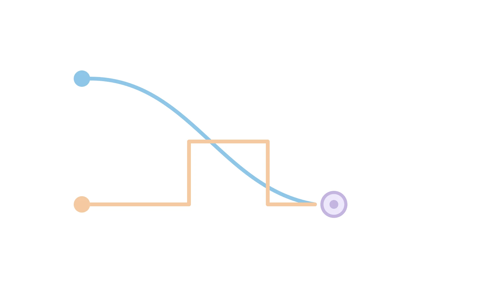

گاهی یک تصمیم به‌تنهایی کافی نیست، چون یک بازیگر دیگر بعد از شما تصمیم می‌گیرد و واکنش نشان می‌دهد. بهینه‌سازی دوسطحی دقیقاً برای همین موقعیت ساخته شده است. در این مطلب، یک مثال کامل رهبر-پیرو را با دو روش متفاوت حل می‌کنیم.

## چرا این موضوع اهمیت دارد

در بهینه‌سازی معمولی، یک تصمیم‌گیرنده با یک مجموعه قید روبه‌رو است. اما در بسیاری از مسائل واقعی، دو تصمیم‌گیرنده با منافع متفاوت در دو سطح قرار دارند. سطح بالا یا رهبر اول حرکت می‌کند. سطح پایین یا پیرو، با دیدن تصمیم رهبر، بهترین واکنش ممکن را انتخاب می‌کند. رهبر باید از قبل این واکنش را پیش‌بینی کند، وگرنه تصمیمش اشتباه از آب درمی‌آید.

تیم‌های تحقیقاتی گوگل، در طراحی خودکار معماری شبکه‌های عصبی یا NAS، دقیقاً از همین ساختار استفاده می‌کنند. سطح بالا ابرپارامترهای معماری را تنظیم می‌کند و سطح پایین، وزن‌های شبکه را روی داده آموزش می‌دهد. این دو مسئله در هم تنیده‌اند و نمی‌توان آن‌ها را جدا از هم حل کرد. مسئله‌ی تعیین عوارض جاده توسط دولت‌ها هم یک مثال کلاسیک‌تر است. دولت نرخ عوارض را تعیین می‌کند و رانندگان با دیدن آن نرخ، مسیرشان را انتخاب می‌کنند.

## فرمول‌بندی مسئله

سطح پایین یا پیرو، برای هر $x$ ثابتی که رهبر انتخاب کرده، مقدار $y$ را انتخاب می‌کند. او می‌خواهد به نقطه‌ی ایده‌آل خودش یعنی $y=2$ نزدیک شود، اما از سقف تعیین‌شده عبور نمی‌کند.

$$
\min_{y}\ (y-2)^2 \quad \text{s.t.}\quad y\le x,\quad y\ge0
$$

سطح بالا یا رهبر، می‌خواهد زوج نهایی $(x,y)$ به نقطه‌ی $(1,3)$ نزدیک شود، با این محدودیت که $0\le x\le4$.

$$
\min_{x}\ (x-1)^2+(y-3)^2 \quad \text{s.t.}\quad 0\le x\le4,\quad y\in\arg\min(\text{مسئله‌ی پیرو})
$$



نکته‌ی کلیدی این است که رهبر نمی‌تواند $y$ را مستقیم انتخاب کند. او فقط می‌تواند با انتخاب $x$ روی تصمیم پیرو اثر بگذارد. همین وابستگی، بهینه‌سازی دوسطحی را از یک مسئله‌ی معمولی جدا می‌کند.

## روش اول: تابع واکنش

چون مسئله‌ی پیرو فقط یک متغیره است، می‌توان واکنش او را مستقیم به دست آورد. تابع $(y-2)^2$ تا $y=2$ کاهشی است، پس پیرو همیشه می‌خواهد تا جای ممکن به ۲ نزدیک شود. اگر $x\ge2$ باشد، سقف مزاحم نیست و پیرو $y^*=2$ را انتخاب می‌کند. اگر $x<2$ باشد، پیرو مجبور است بیشترین مقدار مجاز یعنی $y^*=x$ را بردارد.

$$
y^*(x)=\begin{cases}x & 0\le x<2\\2 & 2\le x\le4\end{cases}
$$

حالا این تابع واکنش را در هدف رهبر جای‌گذاری می‌کنیم. برای $x\in[2,4]$، هدف می‌شود $(x-1)^2+1$ که صعودی است، پس کمینه‌اش در $x=2$ با مقدار ۲ رخ می‌دهد. برای $x\in[0,2)$، هدف می‌شود $(x-1)^2+(x-3)^2$ که نزولی است و هرچه $x$ به ۲ نزدیک‌تر شود، کوچک‌تر می‌شود. هر دو بازه دقیقاً در $x^*=2,\ y^*=2$ به هم می‌رسند، با مقدار بهینه‌ی $F^*=2$.

## روش دوم: جایگزینی با شرایط KKT

روش تابع واکنش فقط برای مسئله‌های پیروی ساده کار می‌کند. در عمل، راه استاندارد جایگزین‌کردن مسئله‌ی پیرو با شرایط بهینگی‌اش است. این همان [شرایط KKT](/notes/kkt-conditions-examples/) است که در مطلب قبلی دیدید. چون مسئله‌ی پیرو اینجا محدب است، این جایگزینی دقیق است.

$$
L=(y-2)^2+\mu_1(y-x)-\mu_2y
$$

شرایط چهارگانه‌ی KKT مسئله‌ی پیرو، با $\mu_1$ برای قید $y\le x$ و $\mu_2$ برای قید $y\ge0$، به این صورت‌اند.

$$
2(y-2)+\mu_1-\mu_2=0
$$

$$
y\le x,\qquad y\ge0
$$

$$
\mu_1\ge0,\qquad \mu_2\ge0
$$

$$
\mu_1(y-x)=0,\qquad \mu_2y=0
$$

حالا مسئله‌ی رهبر را با همین چهار شرط، به‌جای کل مسئله‌ی پیرو، می‌نویسیم. به این نوع مسئله، برنامه‌ریزی با قیدهای مکملی یا MPCC گفته می‌شود.

$$
\min_{x,y,\mu_1,\mu_2}\ (x-1)^2+(y-3)^2 \quad \text{s.t.}\quad \text{چهار شرط بالا},\quad 0\le x\le4
$$

برای حل این مسئله، باید حالت‌های مختلف Complementary Slackness را جداگانه بررسی کرد. اگر هر دو ضریب صفر باشند، ایستایی می‌دهد $y=2$ و شدنی اولیه نیاز دارد $x\ge2$. هدف رهبر در این حالت در $x=2$ کمینه می‌شود، با مقدار ۲. اگر فقط $\mu_1$ مثبت باشد، قید $y=x$ فعال است و ایستایی می‌دهد $\mu_1=4-2x$. این مقدار فقط برای $x<2$ مثبت می‌ماند و هدف رهبر باز هم در حد $x\to2$ کمینه می‌شود. حالت فعال‌بودن $\mu_2$ هم ناسازگار درمی‌آید، چون ایستایی مقدار منفی برای آن می‌دهد. هر دو حالت معتبر، دقیقاً در همان نقطه‌ی $x^*=2,\ y^*=2$ به هم می‌رسند؛ درست همان جوابی که روش اول هم داد.

## چه زمانی جایگزینی با KKT معتبر است

جایگزینی سطح پایین با شرایط KKTش فقط یک ترفند محاسباتی نیست. چند شرط دقیق باید برقرار باشد تا مسئله‌ی تک‌سطحی حاصل، واقعاً معادل مسئله‌ی دوسطحی اصلی بماند.

شرط اول، محدب‌بودن مسئله‌ی سطح پایین نسبت به $y$ است. برای هر $x$ ثابتی که رهبر انتخاب می‌کند، تابع هدف پیرو باید نسبت به $y$ محدب باشد. ناحیه‌ی شدنی‌اش هم باید محدب بماند، یعنی قیدهای نامساوی محدب و قیدهای تساوی خطی باشند. این شرط تضمین می‌کند هر نقطه‌ای که KKT را برآورده می‌کند، واقعاً بهینه‌ی سراسری پیرو هم باشد، نه فقط یک نقطه‌ی ایستا. دقیقاً همان چیزی که در مثال پنجم [شرایط KKT](/notes/kkt-conditions-examples/) دیدید. آنجا یک نقطه‌ی زینی هم هر چهار شرط را برآورده می‌کرد، بدون اینکه واقعاً بهینه باشد. اگر این اتفاق در سطح پایین بیفتد، جایگزینی با KKT نقاطی را به‌عنوان «بهترین واکنش پیرو» قبول می‌کند که اصلاً بهینه نیستند.

شرط دوم، برقراری یک شرط واجد بودن قید یا constraint qualification برای هر $x$ ممکن است. شرایط KKT فقط وقتی شرط لازم بهینگی‌اند که چیزی مثل LICQ، MFCQ یا شرط Slater برقرار باشد. اگر این شرط نقض شود، ممکن است پیرو به یک جواب بهینه برسد که هیچ ضریب $\mu,\lambda$ای آن را برآورده نمی‌کند. در آن صورت، جایگزینی با KKT آن جواب درست را از دست می‌دهد. مسئله‌ی تک‌سطحی حاصل هم بخشی از جواب‌های معتبر رهبر را نادیده می‌گیرد.

شرط سوم، یکتایی جواب پیرو یا پذیرفتن تفسیر خوش‌بینانه است. اگر برای یک $x$ ثابت، پیرو چند جواب بهینه‌ی هم‌ارزش داشته باشد، شرایط KKT همه‌ی آن‌ها را هم‌زمان مجاز می‌شمارد. در این حالت، مسئله‌ی رهبر به‌طور ضمنی اجازه دارد از میان آن جواب‌ها بهترین را برای خودش انتخاب کند. به این حالت بهینه‌سازی دوسطحی خوش‌بینانه یا optimistic گفته می‌شود. حالت مقابل هم وجود دارد: شاید پیرو بدترین جواب را برای رهبر انتخاب کند، یعنی حالت بدبینانه یا pessimistic. در آن حالت، جایگزینی ساده‌ی KKT کافی نیست و فرمول‌بندی متفاوتی لازم است.

نکته‌ی مهم آخر این است که حتی با برقراری هر سه شرط بالا، مسئله‌ی تک‌سطحی حاصل خودش غیرمحدب می‌ماند. قیدهای مکملی مثل $\mu_i g_i(x,y)=0$ ذاتاً غیرخطی‌اند. معمولاً هیچ‌جای این مسئله، که به آن MPCC می‌گویند، شرط واجد بودن استانداردی مثل MFCQ برقرار نیست. پس با اینکه خودِ بازنویسی درست است، حل عددی‌اش به روش‌های تخصصی نیاز دارد. مثال‌هایش نرم‌کردن قید مکملی با روش Scholtes یا استفاده از سالورهای اختصاصی MPCC است، نه دادن مستقیم به یک سالور NLP معمولی.

یک حالت خاص و ساده‌تر هم وجود دارد: وقتی مسئله‌ی پیرو خودش یک برنامه‌ریزی خطی یا LP است. در این حالت، به‌جای نوشتن کامل چهار شرط KKT، می‌توان از قضیه‌ی دوگانی قوی خطی یا strong duality استفاده کرد. کافی است بگوییم مقدار تابع هدف اولیه برابر مقدار تابع هدف دوگان است. این فرمول‌بندی هم‌ارز KKT است، اما گاهی ساده‌تر پیاده‌سازی می‌شود.

این جایگزینی در یک حالت کاملاً بی‌اثر می‌شود: وقتی متغیر $y$ در سطح پایین صحیح یا دودویی باشد. یعنی مسئله‌ی پیرو خودش یک مسئله‌ی ترکیبیاتی باشد. در این حالت، اصلاً شرایط KKT تعریف نمی‌شود، چون مبتنی بر مشتق‌پذیری تابع هدف و قیدهاست. برای چنین مسئله‌هایی باید از روش‌های دیگر بهینه‌سازی دوسطحی عدد صحیح استفاده کرد.

## پیاده‌سازی با پایتون

برای مسئله‌های بزرگ‌تر که تابع واکنش را نمی‌توان دستی نوشت، باید مسئله‌ی MPCC را مستقیم با یک سالور حل کرد. اسکلت کلی چنین مدلی در پایومو این‌طور شروع می‌شود.

```python
import pyomo.environ as pyo

model = pyo.ConcreteModel()
model.x = pyo.Var(bounds=(0, 4))
model.y = pyo.Var(bounds=(0, None))
model.mu1 = pyo.Var(bounds=(0, None))
model.mu2 = pyo.Var(bounds=(0, None))

model.obj = pyo.Objective(expr=(model.x - 1)**2 + (model.y - 3)**2)
model.stationarity = pyo.Constraint(
    expr=2 * (model.y - 2) + model.mu1 - model.mu2 == 0
)
model.follower_feasible = pyo.Constraint(expr=model.y <= model.x)

# قیدهای مکملی mu1*(y-x)=0 و mu2*y=0 معمولاً با متغیر کمکی big-M
# یا با فرمول‌بندی غیرخطی به مدل اضافه می‌شوند؛ ادامه‌ی مدل به همین شیوه تکمیل می‌شود.
```

این کد فقط اسکلت اولیه است، نه یک پیاده‌سازی کامل و آماده‌ی اجرا. بخش قیدهای مکملی، بسته به سالور انتخابی، نیاز به فرمول‌بندی دقیق‌تری دارد.

## جمع‌بندی و تأیید نهایی جواب

جواب نهایی این مسئله‌ی دوسطحی به‌صورت $x^*=2$, $y^*=2$, $\mu_1^*=0$, $\mu_2^*=0$ و $F^*=2$ است. برای اطمینان، هر چهار شرط KKT را دقیقاً در همین نقطه بررسی می‌کنیم.

در این نقطه، قید $y\le x$ به‌صورت تساوی برقرار است، چون $y^*=x^*=2$. قید $y\ge0$ غیرفعال است، چون $y^*=2$ غیرصفر است. چون $y^*\ne0$، Complementary Slackness دومین قید اجبار می‌کند $\mu_2^*=0$. ایستایی می‌دهد $2(y^*-2)+\mu_1^*-\mu_2^*=0$؛ چون $y^*-2=0$، این معادله به $\mu_1^*=\mu_2^*=0$ ساده می‌شود.

$$
2(y^*-2)+\mu_1^*-\mu_2^*=2(0)+0-0=0
$$

شدنی اولیه برقرار است چون $y^*=2\le x^*=2$ و $y^*=2\ge0$. شدنی دوگان هم برقرار است چون هر دو ضریب نامنفی‌اند. Complementary Slackness برقرار است چون $\mu_1^*(y^*-x^*)=0\times0=0$ و $\mu_2^*y^*=0\times2=0$. این حالت که قید فعال است اما ضریبش صفر می‌شود، تبهگن (degenerate) نام دارد.

برای تأیید مستقل، مسئله‌ی پیرو را دوباره در $x^*=2$ حل می‌کنیم. کمینه‌ی بدون قید $(y-2)^2$ در $y=2$ رخ می‌دهد، که خودش داخل بازه‌ی مجاز $0\le y\le2$ قرار دارد. پس $y^*=2$ واقعاً بهترین واکنش پیرو است، نه فقط یک حدس. مقدار نهایی تابع هدف رهبر هم برابر است با:

$$
F(x^*,y^*)=(2-1)^2+(2-3)^2=1+1=2
$$

این مقدار از هر دو روش حل، به‌طور مستقل، یکسان به دست آمد. پس نقطه‌ی $(x^*,y^*)=(2,2)$ با $F^*=2$ جواب نهایی و قطعی مسئله است.

## ظرفیت کار آکادمیک و پژوهشی

بهینه‌سازی دوسطحی یکی از فعال‌ترین زمینه‌های پژوهشی در بهینه‌سازی ریاضی است. یک مسیر مهم، طراحی روش‌های عددی کاراتر برای مسئله‌های MPCC بزرگ‌مقیاس است، چون قیدهای مکملی به‌طور ذاتی غیرمحدب‌اند. مسیر دیگر، تعمیم این چارچوب به بیش از دو سطح تصمیم‌گیری است، مثل زنجیره‌های تأمین چندلایه. ترکیب بهینه‌سازی دوسطحی با یادگیری ماشین هم، به‌خصوص در تنظیم خودکار ابرپارامترها، حوزه‌ای رو به رشد است.

اگر به [انجام پروژه بهینه‌سازی](/consultation/) برای مسئله خودتان نیاز دارید یا می‌خواهید [مدل‌سازی ریاضی](/courses/optimization-modeling/) را از پایه یاد بگیرید، این دو صفحه نقطه شروع خوبی هستند.

## سوالات متداول

**آیا هر مسئله‌ی دوسطحی را می‌توان با جایگزینی KKT حل کرد؟**

فقط وقتی این روش دقیق است که مسئله‌ی سطح پایین نسبت به متغیر خودش محدب باشد. برای یادگیری عمیق‌تر فرمول‌بندی این شرایط، <a style="color:#2563EB; font-weight:bold;" href="/courses/optimization-modeling/">دوره‌ی مدل‌سازی بهینه‌سازی</a> را ببینید.

**چرا مسئله‌ی MPCC حاصل، با وجود محدب‌بودن هر دو سطح، غیرمحدب است؟**

چون قیدهای مکملی مثل $\mu_1(y-x)=0$ یک معادله‌ی ضرب دو متغیر هستند، نه یک قید خطی یا محدب ساده. همین موضوع حل این مسئله‌ها را سخت‌تر از یک برنامه‌ریزی محدب معمولی می‌کند.

**اگر مدل‌تان در عمل به این شکل همگرا نشد چه کار کنم؟**

مسئله‌های MPCC به نقطه‌ی شروع و روش حل حساس‌اند. برای بررسی دقیق‌تر مدل‌تان، <a style="color:#2563EB; font-weight:bold;" href="/consultation/">مشاوره‌ی تخصصی</a> دریافت کنید.
