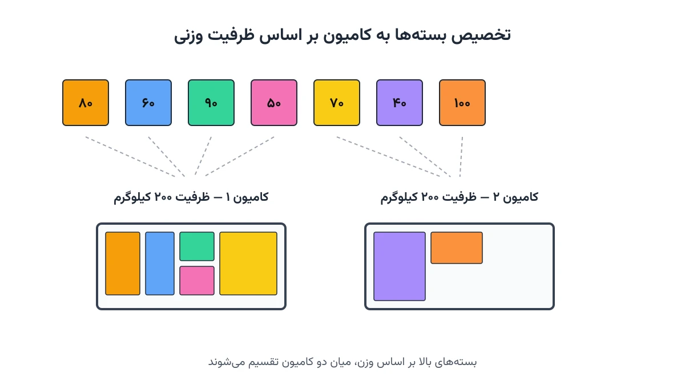

انبار یک شرکت پخش، هر شب چند ده بسته برای ارسال فردا آماده می‌کند. بسته‌ها اندازه و وزن یکسانی ندارند. برخی سبک و کوچک‌اند، برخی سنگین و حجیم. مسئول بارگیری باید تصمیم بگیرد این بسته‌ها را در چند کامیون جا دهد. هر کامیون اضافه، یعنی هزینه سوخت، راننده و زمان بیشتر. سوال ساده است: کمترین تعداد کامیون برای حمل همه بسته‌ها چقدر است؟

این دقیقاً همان مسئله‌ای است که در پژوهش عملیاتی به آن Bin Packing Problem می‌گویند. نسخه ساده‌شده‌ی آن، از دهه ۱۹۷۰ میلادی مورد مطالعه قرار گرفته است. با وجود سادگی ظاهری، این مسئله از نظر محاسباتی سخت است. برای تعداد زیاد بسته، یافتن جواب دقیق بدون ابزار مناسب عملاً ناممکن می‌شود. خوشبختانه سالورهای مدرن مثل CP-SAT در [OR-Tools](https://developers.google.com/optimization) این مسئله را در مقیاس صنعتی به‌خوبی حل می‌کنند.

## مسئله Bin Packing چیست؟

در حالت کلاسیک، تعدادی شیء با اندازه‌های مشخص داریم. همچنین تعدادی ظرف (Bin) با ظرفیت یکسان در اختیار داریم. هدف این است که همه اشیا را در کمترین تعداد ظرف جای دهیم. هیچ ظرفی نباید از ظرفیتش تجاوز کند. در مثال بارگیری کامیون، هر بسته یک شیء است و هر کامیون یک ظرف. ظرفیت کامیون می‌تواند بر اساس وزن، حجم، یا هر دو باشد.

نکته مهم این است که این مسئله، برخلاف مسئله بارگیری سه‌بعدی کانتینر، به چیدمان هندسی دقیق کاری ندارد. فرض می‌کنیم اگر مجموع اندازه بسته‌ها از ظرفیت کامیون کمتر باشد، جاگیری فیزیکی هم ممکن است. این فرض برای بسیاری از کسب‌وکارهای واقعی، تقریب خوبی است. وقتی بسته‌ها جعبه‌های استاندارد یا پالت باشند، محدودیت اصلی معمولاً وزن یا حجم کل است، نه آرایش دقیق هر جعبه.

## تفاوت با مسائل مشابه

سایت پیش‌تر دو مسئله نزدیک را پوشش داده است. [مسئله برش بهینه](/notes/cutting-stock-problem/) یک‌بعدی است و روی طول یا عرض مواد اولیه تمرکز دارد. مسئله بارگیری کانتینر هم سه‌بعدی است و چرخش و موقعیت دقیق هر جعبه را هم مدل می‌کند. Bin Packing کلاسیک میان این دو قرار می‌گیرد. تمرکز اصلی آن، تخصیص سریع و مقیاس‌پذیر اشیا به ظرف‌هاست، بدون پیچیدگی هندسی. برای بسیاری از تصمیم‌های روزانه در انبار و پخش، همین سطح از دقت کافی و عملی است.



## اهمیت این موضوع

شرکتی مثل دی‌اچ‌ال (DHL) هر روز هزاران محموله را میان انبارها و مشتریان جابه‌جا می‌کند. تصمیم اینکه هر محموله در کدام کامیون بارگیری شود، مستقیم روی تعداد کامیون‌های لازم اثر می‌گذارد. کاهش حتی یک کامیون از یک مسیر روزانه، در مقیاس سالانه صرفه‌جویی قابل‌توجهی ایجاد می‌کند. صنایعی مثل پخش مواد غذایی و خرده‌فروشی هم با همین چالش روزمره روبه‌رو هستند.

تصمیم بد در این مرحله، دو اثر منفی دارد. یا کامیون‌های اضافی اجاره یا خریداری می‌شوند، یا کامیون‌های موجود نیمه‌خالی حرکت می‌کنند. هر دو حالت، هزینه حمل به‌ازای هر بسته را بالا می‌برد. وقتی این تصمیم هر روز و برای صدها بسته تکرار شود، یک الگوریتم بهینه‌سازی سریع، مزیت رقابتی واقعی ایجاد می‌کند.

## فرمول‌بندی ریاضی مسئله

فرض کنید $n$ بسته داریم که وزن هر بسته $i$ برابر $w_i$ است. تعداد کامیون در دسترس حداکثر $n$ است؛ چون در بدترین حالت هر بسته یک کامیون جداگانه می‌گیرد. ظرفیت وزنی هر کامیون $C$ است. متغیر باینری $y_k$ برابر یک است اگر کامیون $k$ استفاده شود. متغیر باینری $x_{ik}$ برابر یک است اگر بسته $i$ در کامیون $k$ قرار گیرد.

$$
\min \; \sum_{k=1}^{n} y_k
$$

با قیدهای زیر:

$$
\sum_{k=1}^{n} x_{ik} = 1 \qquad \forall i=1,\dots,n
$$

$$
\sum_{i=1}^{n} w_i x_{ik} \le C \, y_k \qquad \forall k=1,\dots,n
$$

$$
x_{ik} \le y_k \qquad \forall i,k
$$

قید اول می‌گوید هر بسته باید دقیقاً در یک کامیون قرار گیرد. قید دوم، سقف ظرفیت وزنی هر کامیون فعال را تضمین می‌کند. قید سوم هم تضمین می‌کند بسته فقط به کامیونی اختصاص یابد که واقعاً استفاده می‌شود. این مدل، یک برنامه‌ریزی عدد صحیح مختلط کلاسیک است. اما به‌دلیل تقارن بالا میان کامیون‌ها، حل آن با سالورهای عمومی معمولاً کند است.

## گسترش دوبعدی: وزن و حجم هم‌زمان

در عمل، کامیون‌ها معمولاً دو نوع محدودیت دارند: سقف وزنی و سقف حجمی. این حالت را Vector Bin Packing می‌نامند. کافی است یک قید حجمی مشابه قید وزنی به مدل اضافه شود، با ظرفیت حجمی $V$ و حجم هر بسته $v_i$:

$$
\sum_{i=1}^{n} v_i x_{ik} \le V \, y_k \qquad \forall k=1,\dots,n
$$

گاهی بسته‌ها محدودیت‌های دیگری هم دارند؛ مثلاً برخی بسته‌ها نباید در یک کامیون قرار گیرند، چون مواد شیمیایی ناسازگار حمل می‌کنند. افزودن چنین قیدی به مدل، کار سختی نیست. همین انعطاف، یکی از دلایل محبوبیت فرمول‌بندی MILP برای این دسته مسائل است.

## ظرفیت کار آکادمیک و پژوهشی

Bin Packing یکی از پرکارترین مسائل در ادبیات پژوهش عملیاتی است. یک مسیر پژوهشی فعال، نسخه آنلاین مسئله است. در این حالت، بسته‌ها یکی‌یکی می‌رسند و باید بدون اطلاع از بسته‌های آینده تصمیم گرفت. مسیر دیگر، Vector Bin Packing با ابعاد بیشتر از دو است؛ مثلاً وزن، حجم و محدودیت زمان تحویل هم‌زمان.

زمینه سوم، ترکیب Bin Packing با مسیریابی وسایل نقلیه است. در این ترکیب، هم باید تصمیم بگیریم هر بسته در کدام کامیون برود، هم مسیر حرکت هر کامیون را طراحی کنیم. این ترکیب به مسئله مسیریابی با ظرفیت (Capacitated VRP) نزدیک می‌شود و زمینه غنی‌ای برای پایان‌نامه یا مقاله فراهم می‌کند.

## پیاده‌سازی با پایتون

خبر خوب این است که حل این مسئله نیازی به سالور تجاری گران‌قیمت ندارد. سالور [CP-SAT](https://developers.google.com/optimization/cp/cp_solver) در [OR-Tools](https://developers.google.com/optimization) مستقیماً برای این نوع مسائل ترکیبیاتی طراحی شده است. نصب آن هم فقط یک دستور `pip install ortools` است، بدون نیاز به لایسنس جداگانه.

داده ورودی این مسئله معمولاً یک فایل اکسل یا CSV ساده است؛ شامل شناسه هر بسته و وزن آن. این داده را می‌توان مستقیم با pandas خواند و به یک دیکشنری یا لیست پایتون تبدیل کرد. اسکلت اولیه مدل در CP-SAT به این شکل شروع می‌شود:

```python
from ortools.sat.python import cp_model

weights = [120, 85, 60, 95, 110, 40, 75]  # وزن هر بسته (کیلوگرم)
truck_capacity = 200
n_items = len(weights)
n_trucks = n_items  # کران بالای ساده: هر بسته یک کامیون

model = cp_model.CpModel()
x = {}
for i in range(n_items):
    for k in range(n_trucks):
        x[i, k] = model.NewBoolVar(f"x_{i}_{k}")
y = [model.NewBoolVar(f"y_{k}") for k in range(n_trucks)]

# ادامه قیدها (تخصیص هر بسته و ظرفیت هر کامیون) و تابع هدف به همین شیوه تعریف می‌شوند.
```

یک نکته عملی مهم، شکستن تقارن میان کامیون‌هاست. چون کامیون‌ها از نظر ظرفیت یکسان‌اند، بدون قید اضافه، سالور فضای جست‌وجوی بسیار بزرگ و تکراری را بررسی می‌کند. افزودن یک قید ساده مثل «کامیون $k$ فقط وقتی فعال شود که کامیون $k-1$ هم فعال باشد» کمک می‌کند. این یک قید، زمان حل را به‌طور چشمگیری کاهش می‌دهد. بعد از حل مدل، می‌توان با [NetworkX](https://networkx.org/) نموداری از تخصیص بسته‌ها به کامیون‌ها رسم کرد. این نمودار، بررسی جواب را برای تیم عملیات راحت‌تر می‌کند.

## سوالات متداول

<h3>آیا Bin Packing همان مسئله Knapsack است؟</h3>
<p>نه، این دو مسئله نزدیک اما متفاوت‌اند. در Knapsack یک ظرف با ارزش انتخابی داریم؛ در Bin Packing چندین ظرف یکسان و هدف کمینه‌کردن تعدادشان است.</p>

<h3>برای چند صد بسته، CP-SAT چقدر سریع جواب می‌دهد؟</h3>
<p>با شکستن تقارن و تعریف درست کران بالای تعداد کامیون، CP-SAT معمولاً در چند ثانیه تا چند دقیقه به جواب نزدیک به بهینه می‌رسد.</p>

<h3>برای یادگیری این نوع مسائل زنجیره تأمین از کجا شروع کنم؟</h3>
<p>دوره <a href="/courses/vrp-python/" style="color:#2563EB; font-weight:bold;">مسیریابی و بهینه‌سازی زنجیره تأمین با پایتون</a> پایه محکمی برای مدل‌سازی این دسته مسائل می‌دهد. برای پیاده‌سازی این مدل روی داده واقعی شرکت‌تان، از طریق صفحه <a href="/consultation/" style="color:#2563EB; font-weight:bold;">مشاوره</a> می‌توانید با ما در ارتباط باشید.</p>
