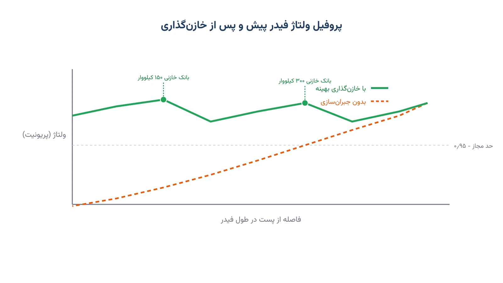

فرض کنید یک فیدر توزیع بیست کیلوولت، حدود ده کیلومتر طول دارد. هرچه از پست فاصله بگیرید، ولتاژ کمی افت می‌کند. در انتهای فیدر، گاهی ولتاژ از حد مجاز پایین‌تر می‌رود. این افت، یکی از قدیمی‌ترین دغدغه‌های مهندسان توزیع برق است. راه‌حل رایج، نصب بانک خازنی در چند نقطه از فیدر است. خازن، توان راکتیو تولید می‌کند و ولتاژ را بالا می‌برد. اما سوال سخت این است: دقیقاً کجا؟ و چه اندازه؟

این سؤال، در ادبیات مهندسی قدرت به «مکان‌یابی و اندازه‌گذاری بهینه خازن» معروف است. نسخه انگلیسی آن Capacitor Placement and Sizing Problem نام دارد. امروز با ابزارهای بهینه‌سازی متن‌باز، می‌توان این تصمیم را دقیق و قابل‌تکرار گرفت. به‌جای حدس مهندسی یا امتحان نقطه‌به‌نقطه، یک مدل ریاضی بهترین ترکیب محل و اندازه را پیدا می‌کند.

## اهمیت این موضوع

تلفات توان در شبکه‌های توزیع برق، معمولاً بین پنج تا پانزده درصد کل انرژی تولیدی است. بخش بزرگی از این تلفات، به جریان توان راکتیو اضافی در خطوط برمی‌گردد. نصب خازن در نقطه درست، همین جریان راکتیو را از خط برمی‌دارد. نتیجه آن، کاهش تلفات، بهبود ولتاژ و حتی افزایش ظرفیت انتقال فیدر است. برای یک شرکت توزیع بزرگ، این صرفه‌جویی سالانه می‌تواند رقم قابل‌توجهی باشد.

شرکتی مثل دوک انرژی (Duke Energy) در آمریکا، یک نمونه شناخته‌شده در این زمینه است. این شرکت در برنامه مدرن‌سازی شبکه خود، کنترل خودکار بانک‌های خازنی توزیع را با تنظیم ولتاژ-توان راکتیو هماهنگ کرده است. چنین سرمایه‌گذاری‌هایی نشان می‌دهد این مسئله، صرفاً یک تمرین دانشگاهی نیست.

این مسئله با بازآرایی شبکه توزیع هم نسبت نزدیکی دارد؛ هر دو، ابزار کم‌هزینه‌ای برای بهبود عملکرد شبکه موجودند. برای آشنایی بیشتر با مدل‌سازی شبکه هوشمند، می‌توانید یادداشت [بهینه‌سازی شبکه هوشمند](/notes/smart-grid-optimization/) را هم ببینید. تفاوت اصلی این است که خازن‌گذاری، یک تصمیم سرمایه‌گذاری بلندمدت است، نه یک کلیدزنی لحظه‌ای.

## فرمول‌بندی ریاضی مسئله

برای مدل‌سازی، فیدر را یک درخت شعاعی از پست تا انتهای خطوط در نظر می‌گیریم. هر گره، یک باس با تقاضای توان اکتیو و راکتیو مشخص است. برای خطی‌سازی رابطه ولتاژ و توان، از مدل معروف LinDistFlow استفاده می‌کنیم. این مدل، افت ولتاژ را به‌صورت خطی بر حسب توان عبوری از هر شاخه تقریب می‌زند. همین خطی‌بودن است که اجازه می‌دهد مسئله را با یک سالور متن‌باز معمولی حل کنیم.

تابع هدف، مجموع هزینه سرمایه‌گذاری خازن و هزینه سالانه تلفات را کمینه می‌کند.

$$
\min \; \sum_{i \in C}\sum_{k} c_k\, z_{i,k} \;+\; c_{loss}\cdot L
$$

موازنه توان اکتیو و راکتیو در هر باس، با دو رابطه زیر نوشته می‌شود.

$$
P_i = p_i^d + \sum_{j \in Child(i)} P_j
$$

$$
Q_i = q_i^d - \sum_{k} Q_k\, z_{i,k} + \sum_{j \in Child(i)} Q_j
$$

افت ولتاژ بین هر باس و باس بالادست آن، به‌صورت خطی تقریب زده می‌شود.

$$
V_j = V_i - \frac{r_{ij}\,P_i + x_{ij}\,Q_i}{V_0}
$$

$$
V_{min} \le V_i \le V_{max}
$$

برای کنترل تعداد و اندازه خازن‌های نصب‌شده، این قیدها اضافه می‌شوند.

$$
\sum_{k} z_{i,k} \le 1 \qquad \forall i \in C
$$

$$
\sum_{i \in C}\sum_{k} z_{i,k} \le N_{max}
$$

$$
z_{i,k} \in \{0,1\}
$$

در این فرمول‌بندی، `P_i` و `Q_i` توان اکتیو و راکتیو ورودی به باس i هستند. `p_i^d` و `q_i^d` بار اکتیو و راکتیو مصرفی همان باس‌اند. `V_i` ولتاژ باس i و `V_0` ولتاژ مرجع پست است. `z_{i,k}` یک متغیر دودویی است؛ یک یعنی نصب خازن استاندارد k در باس i. قید آخر، تعداد کل بانک‌های خازنی قابل نصب را به سقف بودجه محدود می‌کند. چون تابع هدف و همه قیدها خطی‌اند، مسئله یک برنامه‌ریزی خطی عدد صحیح مختلط است. این یعنی سالورهای متن‌باز می‌توانند آن را در چند ثانیه حل کنند.

## پیاده‌سازی با پایتون

خبر خوب این است که برای حل این مدل، نیازی به نرم‌افزار گران‌قیمت نیست. ابزارهای متن‌باز پایتون، دقیقاً همین کلاس از مسائل را به‌خوبی حل می‌کنند. برای مدل‌سازی شبکه توزیع و بررسی پخش‌بار، می‌توان از [pandapower](https://www.pandapower.org/) کمک گرفت. سپس مدل برنامه‌ریزی عدد صحیح مختلط را می‌توان با [Pyomo](https://www.pyomo.org/) یا [PuLP](https://coin-or.github.io/pulp/) نوشت. برای حل نهایی، سالورهای رایگانی مثل [HiGHS](https://highs.dev/)، [CBC](https://github.com/coin-or/Cbc) یا [GLPK](https://www.gnu.org/software/glpk/) کاملاً کافی‌اند.

داده ورودی مدل ساده است: مقاومت و راکتانس هر شاخه، بار هر باس، و فهرست باس‌های کاندید نصب خازن. این داده‌ها را می‌توان از یک فایل اکسل یا CSV شامل ستون‌های مربوط به هر باس و هر شاخه خواند. کتابخانه pandas، خواندن و پاک‌سازی این جدول‌ها را بسیار ساده می‌کند.

خروجی مدل، برای هر باس کاندید، تصمیم نصب یا عدم نصب و اندازه خازن را مشخص می‌کند. همچنین می‌توان پروفیل ولتاژ نهایی فیدر را رسم کرد و با حالت بدون خازن مقایسه کرد. همین خروجی ساده، مبنای یک تصمیم سرمایه‌گذاری چندساله برای یک شرکت توزیع برق می‌شود.

## ظرفیت کار آکادمیک و پژوهشی

این مسئله، فضای پژوهشی غنی و هنوز بازی دارد. نسخه کامل آن با معادلات پخش‌بار غیرخطی AC نوشته می‌شود، نه نسخه خطی‌شده. حل دقیق آن معمولاً به برنامه‌ریزی غیرخطی عدد صحیح مختلط نیاز دارد. به همین دلیل، بسیاری از مقالات، الگوریتم‌های فراابتکاری مانند ژنتیک یا ازدحام ذرات را هم امتحان کرده‌اند.

جهت پژوهشی جذاب‌تر، ترکیب مکان‌یابی خازن با حضور تولید پراکنده خورشیدی است. وقتی پنل خورشیدی به شبکه اضافه می‌شود، الگوی ولتاژ در طول روز تغییر می‌کند. این یعنی یک خازن با اندازه ثابت، شاید همیشه بهترین پاسخ نباشد. موضوع دیگر، مکان‌یابی مشترک خازن و تنظیم‌کننده ولتاژ زیر عدم‌قطعیت تقاضا و تولید خورشیدی است. این زمینه‌ها، برای پایان‌نامه کارشناسی ارشد یا رساله دکتری، گزینه‌های مناسبی‌اند.

## سوالات متداول

<h3>مسئله مکان‌یابی خازن دقیقاً چه چیزی را تعیین می‌کند؟</h3>

این مدل، باس‌های مناسب فیدر برای نصب بانک خازنی را مشخص می‌کند. همچنین اندازه هر خازن را از میان گزینه‌های استاندارد تعیین می‌کند.

<h3>آیا می‌توان این مدل را بدون سالورهای تجاری مثل Gurobi حل کرد؟</h3>

بله، کاملاً. اندازه معمول این مسئله برای فیدرهای واقعی، به‌خوبی با سالورهای رایگانی مثل CBC یا HiGHS حل می‌شود.

<h3>برای یادگیری عمیق‌تر این مباحث از کجا شروع کنم؟</h3>

دوره <a href="/courses/advanced-power-system/" style="color:#2563EB; font-weight:bold;">بهینه‌سازی پیشرفته سیستم قدرت</a> دقیقاً همین نوع مسائل برنامه‌ریزی و بهره‌برداری شبکه توزیع را با مثال و کد پایتون پوشش می‌دهد.

<h3>اگر بخواهم این مدل را برای شبکه واقعی شرکت خودم پیاده‌سازی کنم چه؟</h3>

برای پیاده‌سازی اختصاصی روی داده واقعی شبکه شما، می‌توانید از طریق <a href="/consultation/" style="color:#2563EB; font-weight:bold;">مشاوره</a> با ما در ارتباط باشید.

