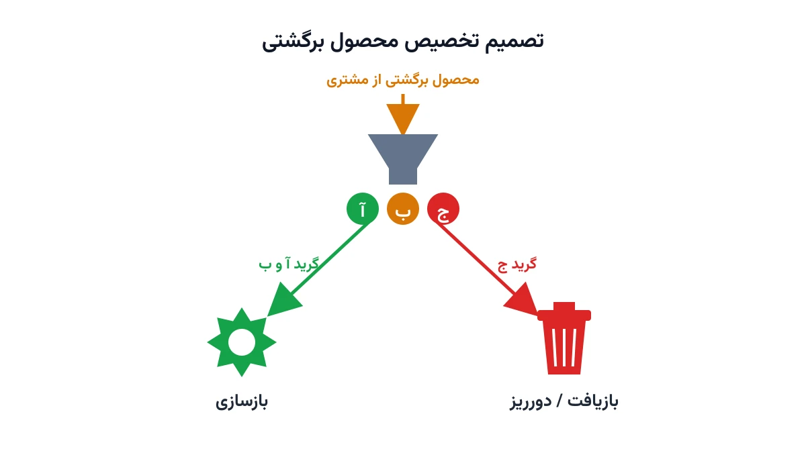

وقتی مشتری یک محصول را پس می‌دهد، داستان شرکت تازه شروع می‌شود. آیا این محصول قابل بازسازی و فروش دوباره است؟ یا فقط ارزش مواد اولیه‌اش باقی مانده؟ این پرسش ساده، هسته‌ی یک تصمیم مهم در زنجیره تأمین حلقه‌بسته (Closed-Loop Supply Chain) است. زنجیره تأمین کلاسیک فقط یک جریان رو به جلو دارد. اینجا یک جریان برگشتی هم وجود دارد: از مشتری به شرکت. به این جریان برگشتی، لجستیک معکوس (Reverse Logistics) هم می‌گویند. مدیریت درستش نیازمند تصمیمی دقیق درباره‌ی سرنوشت هر واحد محصول مرجوعی است.

محصولات برگشتی معمولاً یک‌دست نیستند. برخی تقریباً سالم‌اند و فقط نیاز به بازرسی جزئی دارند. برخی دیگر باید کاملاً باز شوند و قطعات معیوب‌شان تعویض شود. برخی هم آن‌قدر فرسوده‌اند که فقط برای بازیافت مواد به کار می‌آیند. همین تفاوت کیفیت، تصمیم «بازسازی یا دورریز» را به یک مسئله بهینه‌سازی واقعی تبدیل می‌کند، نه یک قاعده‌ی ساده‌ی بله یا خیر. در ادامه یک مدل ریاضی کامل برای این تصمیم می‌سازیم و با پایتون حلش می‌کنیم.

## اهمیت این موضوع

بازسازی محصول (Remanufacturing) برای بسیاری از صنایع، منبع درآمدی واقعی است، نه فقط یک اقدام زیست‌محیطی. شرکتی مثل رنو (Renault) در کارخانه بازسازی موتور خود در فرانسه فعال است. این کارخانه سالانه هزاران موتور فرسوده را به محصولی نزدیک به نو تبدیل می‌کند. هزینه بازسازی این موتورها معمولاً کسری از هزینه تولید موتور نو است. اما ظرفیت خط بازسازی محدود است و همه موتورهای برگشتی هم قابل بازسازی نیستند.

همین محدودیت، تصمیم تخصیص را حیاتی می‌کند. اگر شرکت ظرفیت بازسازی را به موتورهای کم‌کیفیت‌تر اختصاص دهد، هزینه بازسازی بالا می‌رود. فرصت استفاده از موتورهای باکیفیت‌تر هم از دست می‌رود. اگر تصمیم غلط باشد، یا هزینه‌ها بالا می‌رود یا باید محصول نو بیشتری تولید کرد. صنایعی مثل تولید تایر، چاپگر و قطعات خودرو هم دقیقاً با همین معمای تخصیص روبه‌رو هستند.



## فرمول‌بندی ریاضی مسئله

فرض کنید محصولات برگشتی یک دوره، در $K$ گرید کیفی دسته‌بندی شده‌اند؛ مثلاً گرید آ (تقریباً سالم)، گرید ب (نیاز به تعمیر متوسط) و گرید ج (فقط قابل بازیافت مواد). مقدار موجود هر گرید را با پارامتر $r_k$ نشان می‌دهیم. متغیر تصمیم $z_k$ نشان می‌دهد چه مقدار از گرید $k$ واقعاً بازسازی می‌شود. هر واحد بازسازی گرید $k$ هزینه $c^m_k$ دارد. هر واحدی که بازسازی نشود، باید بازیافت یا دور ریخته شود، با هزینه $c^d_k$. تقاضای کل دوره را $D$ و هزینه تولید هر واحد محصول نو را $c^n$ می‌نامیم. متغیر $p$ مقدار تولید محصول نو است.

$$
\min \; c^n p + \sum_{k=1}^{K} c^m_k z_k + \sum_{k=1}^{K} c^d_k (r_k - z_k)
$$

با محدودیت‌های زیر:

$$
p + \sum_{k=1}^{K} z_k = D
$$

$$
0 \le z_k \le r_k \qquad \forall k=1,\dots,K
$$

$$
\sum_{k=1}^{K} z_k \le C^m
$$

محدودیت اول می‌گوید تقاضا باید از ترکیب تولید نو و بازسازی‌شده تأمین شود. محدودیت دوم سقف طبیعی هر گرید را تعیین می‌کند؛ نمی‌توان بیشتر از مقدار موجود بازسازی کرد. محدودیت سوم ظرفیت کلی خط بازسازی $C^m$ را اعمال می‌کند. چون هزینه بازسازی گریدهای پایین‌تر بیشتر است، سالور باید تصمیم بگیرد ظرفیت محدود را اول به کدام گرید بدهد.

این مدل را می‌توان به‌راحتی گسترش داد. می‌توان بعد زمانی برای چند دوره اضافه کرد. می‌توان متغیر مکان‌یابی هم افزود تا مشخص شود هر مرکز بازسازی کجا احداث شود. برای بخش مکان‌یابی، یادداشت [مسئله مکان‌یابی تسهیلات](/notes/facility-location-problem/) پایه نظری لازم را می‌دهد.

## ظرفیت کار آکادمیک و پژوهشی

تصمیم بازسازی-یا-دورریز یکی از پرکاربردترین زیرمسئله‌های زنجیره تأمین حلقه‌بسته در ادبیات پژوهشی است. یک مسیر باز، مدل‌سازی عدم‌قطعیت در حجم و کیفیت محصولات برگشتی است. برخلاف تقاضای رفت که معمولاً قابل‌پیش‌بینی‌تر است، حجم و کیفیت بازگشتی‌ها نوسان زیادی دارد. مسیر دیگر، مدل‌سازی چنددوره‌ای این تصمیم همراه با برنامه‌ریزی موجودی قطعات بازسازی‌شده است.

زمینه سوم، ترکیب این مدل با قیمت‌گذاری پویا است. شرکت می‌تواند با تغییر قیمت محصول بازسازی‌شده، تقاضا برای آن را کنترل کند. این کار تعادل بهتری بین دو کانال تولید نو و بازسازی ایجاد می‌کند. این سه مسیر، گزینه‌های پژوهشی غنی برای پایان‌نامه یا مقاله در حوزه مدیریت عملیات هستند.

## پیاده‌سازی با پایتون

مثل بسیاری از مسائل برنامه‌ریزی خطی عدد صحیح مختلط، این مدل هم نیازی به سالور تجاری گران‌قیمت ندارد. کتابخانه متن‌باز [PuLP](https://coin-or.github.io/pulp/) برای نوشتن سریع مدل کافی است. سالور رایگان [CBC](https://github.com/coin-or/Cbc) هم به‌راحتی آن را حل می‌کند. برای مسائل بزرگ‌تر با چند دوره زمانی و چند مرکز بازسازی، [HiGHS](https://highs.dev/) گزینه سریع‌تری خواهد بود.

فرض کنید داده ورودی این مسئله در یک فایل اکسل ساده نگه‌داری می‌شود. این داده شامل مقدار موجود هر گرید و هزینه‌های بازسازی و بازیافت است. می‌توان آن را مستقیم با pandas خواند و به دیکشنری پارامترهای مدل تبدیل کرد. اسکلت اولیه مدل در PuLP به این شکل شروع می‌شود:

```python
import pulp

grades = ["A", "B", "C"]
r = {"A": 120, "B": 200, "C": 150}         # مقدار موجود هر گرید
c_reman = {"A": 40, "B": 65, "C": 90}      # هزینه بازسازی هر گرید
c_new = 150
capacity_reman = 250
demand = 400

model = pulp.LpProblem("Closed_Loop_Disposition", pulp.LpMinimize)

z = {k: pulp.LpVariable(f"reman_{k}", lowBound=0, upBound=r[k]) for k in grades}
p = pulp.LpVariable("new_production", lowBound=0)

# ادامه قیدها (تأمین تقاضا و ظرفیت خط بازسازی) و تابع هدف به همین شیوه تعریف می‌شوند.
```

بعد از حل مدل، می‌توان با [NetworkX](https://networkx.org/) جریان محصول بین گریدها و مقصدهای نهایی را رسم کرد. مقصدهایی مثل بازسازی، بازیافت و دورریز. این نمودار شبکه‌ای، تصمیم نهایی را برای مدیران عملیات قابل‌فهم‌تر می‌کند.

## سوالات متداول

<h3>تفاوت این مدل با زنجیره تأمین حلقه‌بسته سبز در چیست؟</h3>
<p>زنجیره تأمین حلقه‌بسته سبز روی طراحی شبکه جمع‌آوری و وزن‌دهی هزینه کربن تمرکز دارد. این مطلب روی تصمیم عملیاتی تخصیص ظرفیت محدود بازسازی بین گریدهای کیفی مختلف تمرکز می‌کند.</p>

<h3>آیا باید حتماً گریدهای کیفی را به‌صورت دستی تعیین کنم؟</h3>
<p>نه. در عمل، بسیاری از شرکت‌ها از بازرسی بصری یا حسگرهای ساده برای تخمین سریع گرید هر واحد برگشتی استفاده می‌کنند. هرچه این تخمین دقیق‌تر باشد، مدل بهینه‌سازی تصمیم بهتری می‌دهد.</p>

<h3>برای یادگیری مدل‌سازی این نوع مسائل زنجیره تأمین از کجا شروع کنم؟</h3>
<p>دوره <a href="/courses/vrp-python/" style="color:#2563EB; font-weight:bold;">مسیریابی و بهینه‌سازی زنجیره تأمین با پایتون</a> پایه محکمی برای مدل‌سازی این نوع مسائل فراهم می‌کند. اگر برای پیاده‌سازی این مدل روی داده واقعی کسب‌وکارتان راهنمایی لازم دارید، از طریق صفحه <a href="/consultation/" style="color:#2563EB; font-weight:bold;">مشاوره</a> می‌توانید با ما در ارتباط باشید.</p>
