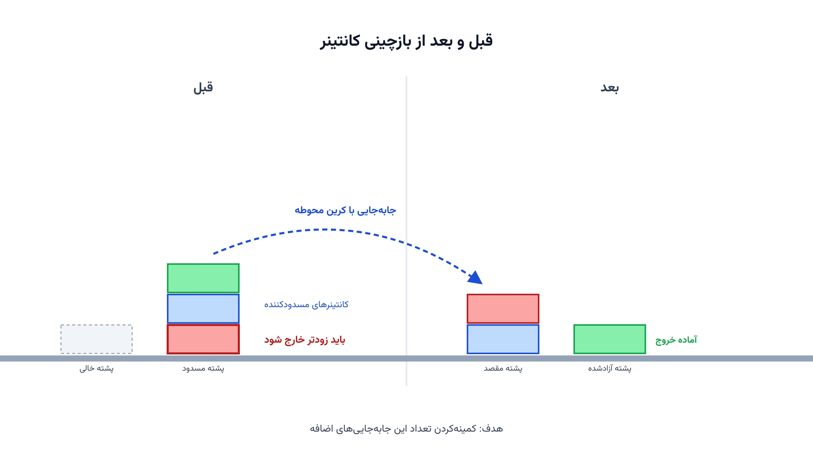

یک کشتی کانتینری وارد بندر می‌شود. کرین باید سریع کانتینرهای آن را تخلیه کند. اما کانتینرها در محوطه بندر روی هم چیده شده‌اند. هر کانتینری که باید زودتر از بقیه خارج شود، ممکن است زیر چند کانتینر دیگر گیر افتاده باشد. برای برداشتن آن، باید اول کانتینرهای بالایی را جابه‌جا کرد. این جابجایی اضافه، وقت و هزینه‌ی گرانی دارد.

به این چالش در ادبیات علمی «مسئله بازچینی کانتینر» یا Container Relocation Problem می‌گویند. گاهی آن را «مسئله جابجایی بلوک» یا Blocks Relocation Problem هم می‌نامند. هدف ساده است. باید از ابتدا کانتینرها را طوری در هر دسته بچینیم که کمترین جابجایی اضافه لازم شود. یا اگر چیدمان از قبل مشخص است، باید بهترین ترتیب برداشتن کانتینرها را پیدا کنیم.

### چرا این مسئله با زمان‌بندی جرثقیل یا بسته‌بندی کانتینر فرق دارد؟

این مسئله با زمان‌بندی جرثقیل ساحلی و بسته‌بندی کانتینر داخل کشتی فرق دارد. آن دو مسئله درباره‌ی جابجایی کانتینر بین کشتی و اسکله‌اند. بازچینی کانتینر اما کاملاً داخل محوطه بندر اتفاق می‌افتد. هر دسته یا بلوک از کانتینرها مثل یک پشته است و فقط کانتینر رویی هر پشته در دسترس است. این محدودیت دقیقاً مثل بازی معروف هانوی عمل می‌کند. تفاوت این است که هر کانتینر زمان خروج مشخص و از پیش تعیین‌شده‌ای دارد. برای آشنایی بیشتر با مسائل مرتبط تصمیم‌گیری در بندر، یادداشت [تخصیص اسکله به کشتی‌ها](/notes/berth-allocation-problem/) هم نمونه‌ی خوبی است.

هر کانتینر یک اولویت خروج دارد. این اولویت را برنامه‌ی بارگیری کشتی بعدی تعیین می‌کند. اگر کانتینری با اولویت زودتر، زیر کانتینری با اولویت دیرتر باشد، مشکلی نیست. اما اگر برعکس باشد، یعنی کانتینر زیرین باید زودتر خارج شود، یک «بلوک» یا Blocking رخ داده است. برای برداشتن کانتینر زیرین، باید کانتینر بالایی یا بالایی‌ها را به پشته‌ی دیگری منتقل کرد. هر انتقال اضافه، یک حرکت گران‌قیمت کرین محوطه است.

### فرمول‌بندی ریاضی

فرض کنید مجموعه‌ی کانتینرها را با $i \in N$ نشان دهیم. هر کانتینر یک اولویت خروج $\pi_i$ دارد؛ عدد کوچک‌تر یعنی خروج زودتر. محوطه از چند دسته یا پشته $s \in S$ تشکیل شده و هر پشته حداکثر $H$ طبقه جا دارد. متغیر تصمیم $x_{i,s,t}$ برابر یک است اگر کانتینر $i$ در پشته $s$ و طبقه $t$ قرار گیرد.

$$
\sum_{s \in S} \sum_{t=1}^{H} x_{i,s,t} = 1 \qquad \forall i \in N
$$

هر طبقه از هر پشته حداکثر یک کانتینر دارد. همچنین کانتینر نباید در هوا معلق بماند. یعنی طبقه‌ی بالاتر فقط وقتی پر می‌شود که طبقه‌ی پایین‌تر از قبل پر باشد.

$$
\sum_{i \in N} x_{i,s,t} \;\le\; \sum_{i \in N} x_{i,s,t-1} \qquad \forall s \in S,\ t = 2,\dots,H
$$

متغیر باینری $b_{ij}$ نشان می‌دهد کانتینر $i$ بالای کانتینر $j$ قرار دارد و خروج $j$ زودتر از $i$ است. این دقیقاً همان وضعیت بلوک‌شدن است.

$$
b_{ij} \;\ge\; x_{i,s,t'} + x_{j,s,t} - 1 \qquad \forall s \in S,\ t' > t,\ \pi_j < \pi_i
$$

هدف مدل، کمینه‌کردن مجموع این وضعیت‌های بلوک‌شده در کل محوطه است.

$$
\min \sum_{i \in N} \sum_{j \in N} b_{ij}
$$

این فرمول‌بندی نسخه‌ی ساده‌شده‌ی مدل است. در عمل، پژوهشگران قیدهای بیشتری هم اضافه می‌کنند. مثلاً محدودیت وزن کانتینر یا نوع آن، چون کانتینرهای یخچالی یا خطرناک جای مخصوص خودشان را می‌خواهند.

### اهمیت این موضوع در دنیای واقعی

بازچینی اضافه‌ی کانتینر یکی از پنهان‌ترین هزینه‌های ترمینال‌های کانتینری است. هر حرکت اضافه‌ی کرین محوطه چند دقیقه زمان می‌گیرد. در یک ترمینال شلوغ، این دقیقه‌ها به‌سرعت جمع می‌شوند. نتیجه، صف طولانی کامیون‌ها پشت دروازه‌ی بندر است.

اپراتورهای بزرگ بندری مثل DP World ده‌ها ترمینال کانتینری را در سراسر دنیا اداره می‌کنند. آن‌ها دقیقاً با همین چالش روزانه روبه‌رو هستند. کاهش حتی ده درصد از بازچینی‌های اضافه، در یک ترمینال پرتردد یعنی صرفه‌جویی چند ساعت کاری کرین در روز. شرکت‌هایی مثل PSA سنگاپور هم که یکی از شلوغ‌ترین بنادر ترانزیتی دنیا را اداره می‌کنند، به الگوریتم‌های چیدمان هوشمند وابسته‌اند. بدون چنین الگوریتمی، ظرفیت واقعی محوطه بندر به‌خوبی استفاده نمی‌شود.

از طرف دیگر، تأخیر در تخلیه‌ی کانتینر مستقیماً به خطوط کشتیرانی هم آسیب می‌زند. هر ساعت تأخیر کشتی در بندر، هزینه‌ی مستقیم دارد. به همین دلیل، مدیریت هوشمند محوطه یک اولویت عملیاتی جدی است، نه فقط یک بهبود جزئی.

### ظرفیت کار آکادمیک و پژوهشی

بازچینی کانتینر یکی از مسائل کلاسیک و همچنان زنده‌ی پژوهش عملیاتی است. چون مسئله از خانواده‌ی مسائل NP-hard است، حل دقیق آن برای محوطه‌های بزرگ عملاً سخت می‌شود. به همین دلیل، بخش زیادی از مقالات روی الگوریتم‌های ابتکاری و فراابتکاری تمرکز دارند.

یک مسیر پژوهشی جذاب، یکپارچه‌سازی بازچینی کانتینر با برنامه‌ریزی ورود کامیون‌هاست. مسیر دیگر، در نظر گرفتن عدم‌قطعیت در زمان رسیدن کشتی بعدی است. گاهی برنامه‌ی کشتی تغییر می‌کند و اولویت خروج کانتینرها هم عوض می‌شود. مدل‌سازی این عدم‌قطعیت هنوز فضای پژوهشی باز زیادی دارد. ترکیب یادگیری تقویتی با این مسئله هم در سال‌های اخیر رشد زیادی داشته است. این روش برای یادگیری سیاست‌های چیدمان سریع، به‌جای حل دقیق MILP، به کار می‌رود.

### پیاده‌سازی با پایتون

خوشبختانه مدل‌سازی این مسئله نیازی به نرم‌افزار تجاری گران‌قیمت ندارد. برای نسخه‌ی ترکیبیاتی و توالی‌محور، ماژول CP-SAT از [OR-Tools](https://developers.google.com/optimization) گزینه‌ی بسیار مناسبی است. این سالور به‌خوبی با متغیرهای توالی و قیدهای منطقی بلوک‌شدن کنار می‌آید. برای فرمول‌بندی عدد صحیح مختلط کامل‌تر، سالورهای متن‌باز مثل [CBC](https://github.com/coin-or/Cbc) یا [HiGHS](https://highs.dev/) از طریق [Pyomo](http://www.pyomo.org/) یا [PuLP](https://coin-or.github.io/pulp/) هم قابل استفاده‌اند.

داده‌های ورودی معمولاً شامل شماره پشته، طبقه و اولویت خروج هر کانتینر است. این داده از یک فایل اکسل یا CSV خوانده می‌شود. پس از حل مدل، خروجی یک دنباله از حرکت‌های پیشنهادی برای کرین محوطه است. این خروجی را می‌توان مستقیماً به سامانه‌ی مدیریت ترمینال بندر وصل کرد. برای مسائل با تعداد کانتینر خیلی زیاد، ترکیب یک الگوریتم حریصانه‌ی اولیه با بهینه‌سازی محلی روی آن، نتیجه‌ی عملی بهتری می‌دهد. علاقه‌مندان به مسائل مسیریابی و زمان‌بندی مشابه در زنجیره تأمین می‌توانند دوره [مسیریابی وسایل نقلیه با پایتون](/courses/vrp-python/) را هم ببینند.

### سوالات متداول

<h3>آیا این مدل فقط برای بنادر بزرگ کاربرد دارد؟</h3>

نه. حتی یک محوطه کوچک با چند پشته هم از این مدل سود می‌برد. هرچه فضای محوطه محدودتر باشد، هزینه‌ی یک چیدمان بد نسبت به ظرفیت کل بزرگ‌تر می‌شود.

<h3>این نوع مسائل بهینه‌سازی لجستیک و بندری را کجا می‌توان پروژه‌محور یاد گرفت؟</h3>

دوره <a href="/courses/vrp-python/" style="color:#2563EB; font-weight:bold;">مسیریابی وسایل نقلیه با پایتون</a> ابزارها و روش‌های مشابه را پوشش می‌دهد. از مدل‌سازی تا حل با OR-Tools، همه برای همین دسته از مسائل لجستیکی کاربرد دارند.

<h3>برای پیاده‌سازی این مدل روی داده‌های واقعی یک ترمینال کانتینری چه باید کرد؟</h3>

هر ترمینال تعداد پشته، ارتفاع مجاز و قواعد چیدمان خودش را دارد. به همین دلیل بهتر است مدل بر اساس داده‌های واقعی همان ترمینال طراحی شود. از طریق <a href="/consultation/" style="color:#2563EB; font-weight:bold;">مشاوره</a> می‌توانید جزئیات پروژه را مطرح کنید.

