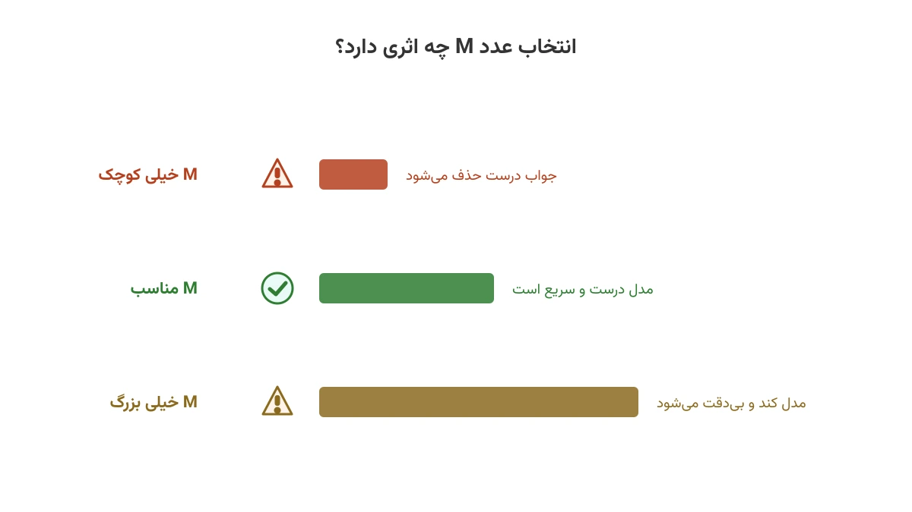

فرض کنید یک قید دارید که باید فقط گاهی برقرار باشد. مثلاً «اگر این واحد تولید برق روشن است، توانش نباید از سقف مجاز بیشتر شود». وقتی واحد خاموش است، این قید اصلاً معنا ندارد. این الگو، یعنی قید شرطی، یکی از پرتکرارترین نیازها در بهینه‌سازی عدد صحیح است. دو راه اصلی برای بیان آن وجود دارد. یکی ترفند کلاسیک Big-M است که در تقریباً هر کتاب برنامه‌ریزی خطی آمده. دیگری دستور `only_enforce_if` در سالور CP-SAT گوگل است. این دو راه، با وجود این‌که به یک نتیجه می‌رسند، از نظر ریسک و دقت زمین تا آسمان فرق دارند.

## چرا این موضوع اهمیت دارد

شرکتی مثل زیمنس انرژی در مدل‌سازی زمان‌بندی واحدهای تولید برق (Unit Commitment) هزاران قید شرطی از همین نوع دارد. هر واحد یک متغیر دودویی روشن/خاموش دارد و محدودیت توان فقط وقتی واحد روشن است باید اعمال شود. اگر عدد M در این مدل‌ها اشتباه انتخاب شود، نتیجه بد است. یا یک جواب نادرست می‌گیریم، یا یک مدل که ساعت‌ها طول می‌کشد تا حل شود. در مقیاس صنعتی، این اشتباه می‌تواند به‌معنای میلیون‌ها دلار هزینه برنامه‌ریزی غلط باشد.

## فرمول‌بندی ریاضی: روش Big-M

فرض کنید متغیر دودویی $y$ نشان می‌دهد آیا قید فعال است. عبارت خطی $a^\top x \le b$ باید فقط وقتی $y=1$ برقرار باشد. روش Big-M این‌طور آن را می‌نویسد:

$$a^\top x \le b + M (1 - y)$$

وقتی $y=1$ باشد، جمله $M(1-y)$ صفر می‌شود و قید اصلی برقرار می‌شود. وقتی $y=0$ باشد، سمت راست به‌اندازه $M$ بزرگ می‌شود. اگر $M$ به‌اندازه کافی بزرگ باشد، قید عملاً بی‌اثر می‌شود. مشکل درست همین‌جاست: کلمه «به‌اندازه کافی بزرگ» یک قضاوت دستی است، نه یک واقعیت ریاضی.

اگر $M$ کوچک‌تر از لازم انتخاب شود، برخی جواب‌های درست به‌اشتباه غیرمجاز اعلام می‌شوند. این یک باگ ظریف است و معمولاً هم فقط در حالت $y=0$ خودش را نشان می‌دهد. اگر $M$ خیلی بزرگ‌تر از لازم انتخاب شود، مدل همچنان درست جواب می‌دهد. اما کران خطی آن (LP relaxation) آن‌قدر شل می‌شود که سالور برای اثبات بهینگی زمان زیادی صرف می‌کند.

## فرمول‌بندی دوم: رایفیکیشن در CP-SAT

سالور CP-SAT یک مکانیزم بومی برای همین نیاز دارد به نام رایفیکیشن (Reification). به‌جای افزودن یک عدد بزرگ، قید مستقیماً به یک متغیر منطقی گره می‌خورد:

$$(a^\top x \le b) \iff \text{وقتی } y=1 \text{ باشد، اعمال شود}$$

در کد، این دقیقاً یک خط است: `model.add(expr <= b).only_enforce_if(y)`. وقتی $y$ صفر باشد، سالور قید را کاملاً نادیده می‌گیرد، بدون این‌که هیچ عدد بزرگی وارد مدل شود. هیچ پارامتری برای تنظیم‌کردن وجود ندارد و هیچ ریسک کران غلط هم در کار نیست.

نکته مهم این است که `only_enforce_if` به‌طور پیش‌فرض فقط «نیمه‌رایفیکیشن» ایجاد می‌کند. یعنی وقتی $y=1$ است قید را اجرا می‌کند، اما درباره حالت $y=0$ چیزی نمی‌گوید. برای رایفیکیشن کامل، باید متغیر دقیقاً معادل برقراری رابطه باشد. برای این کار، قید را یک‌بار برای $y$ و یک‌بار برای نقیض آن می‌نویسیم. این تفاوت کوچک، اما در مدل‌های بزرگ می‌تواند نتیجه را کاملاً تغییر دهد.

## کدام روش را انتخاب کنیم؟

اگر از CP-SAT استفاده می‌کنید، `only_enforce_if` تقریباً همیشه انتخاب بهتری است. اما این دستور مخصوص CP-SAT است. سالورهای کلاسیک برنامه‌ریزی عدد صحیح مختلط این قابلیت را به همین شکل ندارند. مثال‌هایش [CBC](https://github.com/coin-or/Cbc) و [HiGHS](https://highs.dev/) هستند که در [Pyomo](https://www.pyomo.org/) استفاده می‌شوند؛ این سالورها همچنان به Big-M نیاز دارند. برخی سالورهای تجاری مثل Gurobi و CPLEX قیدهای اندیکاتور بومی دارند که شبیه رایفیکیشن عمل می‌کنند. اما این یک استثنا است، نه قاعده. یادداشت [سه روش عملی استفاده از سالورها در Pyomo](/notes/pyomo-solvers/) این سالورها را معرفی می‌کند. با خواندن آن می‌بینید انتخاب سالور چقدر روی نوشتن مدل اثر می‌گذارد.



## ظرفیت کار آکادمیک و پژوهشی

تنگ‌کردن کران Big-M (Tightening the Big-M) خودش یک حوزه پژوهشی مستقل در بهینه‌سازی عدد صحیح است. هدف پیدا کردن کوچک‌ترین $M$ معتبر برای هر قید، به‌جای یک عدد ثابت و محافظه‌کارانه برای کل مدل است. این مسئله به تحلیل حساسیت و برنامه‌ریزی خطی کمکی برای هر قید نیاز دارد.

زاویه پژوهشی دیگر، مقایسه تجربی قدرت کران دوگان (LP bound) بین فرمول‌بندی Big-M و فرمول‌بندی مبتنی بر قید اندیکاتور است. این مقایسه نشان می‌دهد چرا برخی مدل‌های معادل ریاضی، از نظر سرعت حل چند مرتبه با هم فرق دارند. یادداشت [تشخیص مدل غیرممکن](/notes/infeasible-model-diagnosis/) هم به این موضوع اشاره کرده است.

## پیاده‌سازی با پایتون

خوشبختانه آزمایش هر دو روش روی یک مثال کوچک، چند دقیقه بیشتر طول نمی‌کشد. در این مثال از [OR-Tools](https://developers.google.com/optimization) گوگل و ماژول CP-SAT آن استفاده می‌کنیم، چون `only_enforce_if` مستقیماً در این کتابخانه پیاده‌سازی شده است.

```python
from ortools.sat.python import cp_model

model = cp_model.CpModel()
y = model.new_bool_var("unit_on")
power = model.new_int_var(0, 1000, "power")

# روش only_enforce_if: بدون هیچ عدد جادویی
model.add(power <= 300).only_enforce_if(y)

# ادامه قیدهای روشن/خاموش، هزینه راه‌اندازی و تابع هدف به همین شیوه اضافه می‌شوند
```

اگر به [انجام پروژه بهینه‌سازی](/consultation/) برای مسئله خودتان نیاز دارید، صفحه مشاوره نقطه شروع خوبی است.

## سوالات متداول

<h3>آیا Big-M همیشه اشتباه است؟</h3>
<p>نه. وقتی کران واقعی مسئله مشخص باشد، Big-M کاملاً درست و کارآمد کار می‌کند. مشکل فقط وقتی شروع می‌شود که این کران حدس زده شود.</p>

<h3>چطور بفهمم مدل من از Big-M رنج می‌برد؟</h3>
<p>اگر سالور شما زمان زیادی روی اثبات بهینگی صرف می‌کند اما جواب‌های نزدیک به هم زود پیدا می‌شوند، کران‌های Big-M شل یکی از مظنونان اول هستند. دوره <a href="/courses/optimization-modeling/" style="color:#2563EB; font-weight:bold;">مبانی مدل‌سازی ریاضی و بهینه‌سازی با پایتون</a> این نوع تشخیص را هم پوشش می‌دهد.</p>

<h3>برای مدل خاص خودم کدام روش را استفاده کنم؟</h3>
<p>این بستگی به سالور و اندازه مدل شما دارد و معمولاً نیاز به بررسی دقیق‌تری دارد. برای این کار می‌توانید از طریق <a href="/consultation/" style="color:#2563EB; font-weight:bold;">مشاوره</a> با من در تماس باشید.</p>
