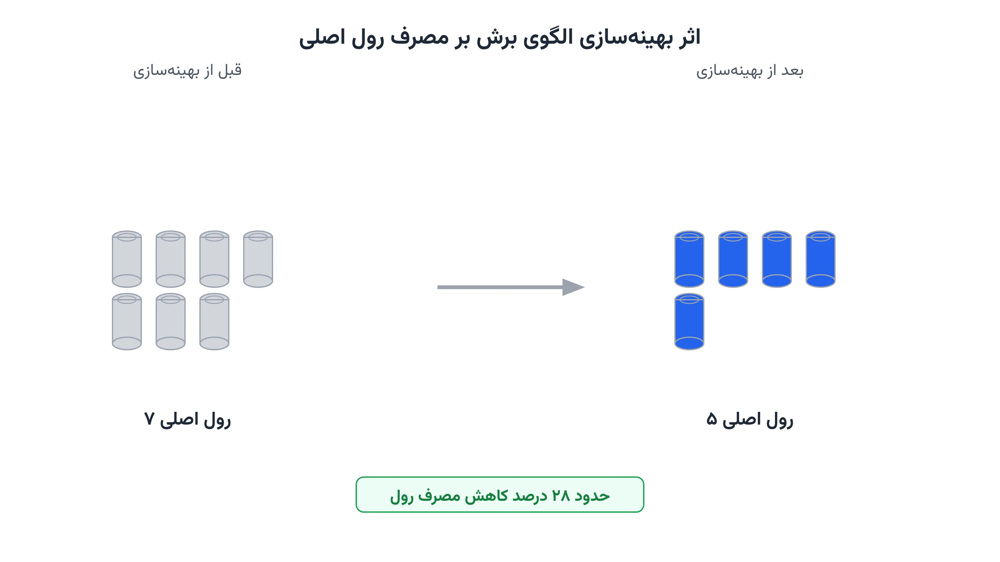

در یک کارخانه کاغذسازی، رول‌های اصلی با عرضی ثابت و بزرگ تولید می‌شوند. اما مشتریان رول‌هایی با عرض‌های کوچک‌تر و متفاوت سفارش می‌دهند. یک چاپخانه رول نود سانتی‌متری می‌خواهد. چاپخانه دیگری رول پنجاه سانتی‌متری سفارش می‌دهد. کارخانه باید هر رول اصلی را به این عرض‌های کوچک‌تر ببرد. سوال ساده به‌نظر می‌رسد، اما جواب آن میلیون‌ها تومان صرفه‌جویی یا هدررفت را رقم می‌زند.

این مسئله نام رسمی دارد: مسئله برش بهینه یا Cutting Stock Problem. از دهه ۱۹۶۰ میلادی در پژوهش عملیاتی مطرح شده است. ریاضی‌دانانی مثل گیلمور و گومری اولین‌بار آن را با دقت فرمول‌بندی کردند. امروز همین مسئله در صنایع کاغذ، فولاد، شیشه و نساجی هر روز تکرار می‌شود. هرچه الگوی برش هوشمندانه‌تر باشد، ضایعه کمتر و سود بیشتر است.

## اهمیت این موضوع در دنیای واقعی

این مسئله فقط یک تمرین ریاضی نیست؛ مستقیم روی سودآوری کارخانه اثر می‌گذارد. شرکتی مثل اینترنشنال پیپر (International Paper)، یکی از بزرگ‌ترین تولیدکنندگان کاغذ جهان، روزانه هزاران رول را برش می‌دهد. حتی کاهش چند درصدی ضایعه، در مقیاس صنعتی به معنای تن‌ها ماده اولیه ذخیره‌شده است. این صرفه‌جویی مستقیماً هزینه تمام‌شده محصول را پایین می‌آورد.

کاهش ضایعه مواد اولیه، اثر زیست‌محیطی هم دارد؛ تولید هر تن کاغذ یا فولاد، انرژی و آب قابل‌توجهی مصرف می‌کند. به همین دلیل، این موضوع با نگاه زنجیره تأمین سبز هم پیوند می‌خورد. دوره [بهینه‌سازی زنجیره تأمین و حمل‌ونقل با پایتون](/courses/vrp-python/) دقیقاً همین نوع مسائل تخصیص و برنامه‌ریزی تولید را پوشش می‌دهد.



## فرمول‌بندی ریاضی مسئله

فرض کنید عرض رول اصلی برابر $W$ باشد. مشتریان $m$ عرض سفارشی متفاوت $w_1, \ldots, w_m$ می‌خواهند. تقاضای هر عرض $i$ را با $d_i$ نشان می‌دهیم. چالش اصلی، نه انتخاب عرض‌ها، که پیداکردن الگوی برش است. هر الگوی برش $p$، ترکیبی از عرض‌های سفارشی است که در عرض $W$ جا می‌شود.

متغیر $a_{ip}$ نشان می‌دهد الگوی $p$ چند قطعه از عرض $i$ تولید می‌کند. این الگوها باید قید ظرفیت رول را رعایت کنند:

$$ \sum_{i=1}^{m} w_i\, a_{ip} \le W \qquad \forall p \in P $$

متغیر تصمیم $x_p$ تعداد رول‌هایی است که با الگوی $p$ برش می‌خورند. هدف مدل، کمینه‌کردن تعداد کل رول‌های اصلی مصرفی است:

$$ \min \sum_{p \in P} x_p $$

هر سفارش هم باید کامل تأمین شود:

$$ \sum_{p \in P} a_{ip}\, x_p \ge d_i \qquad \forall i = 1,\ldots,m $$

متغیرهای $x_p$ باید عدد صحیح و نامنفی باشند. این مدل، نسخه استاندارد مسئله برش بهینه یک‌بعدی است. در ادبیات علمی، به آن مدل پوشش ستونی یا Set-Covering هم می‌گویند.

چالش عملی این مدل، تعداد الگوهاست. حتی با چند عرض سفارشی، هزاران الگوی ممکن وجود دارد. فهرست‌کردن همه آن‌ها از پیش، عملاً غیرممکن است. به همین دلیل، پژوهشگران روشی به نام تولید ستون یا Column Generation ابداع کردند. این روش، الگوهای مفید را فقط در صورت نیاز، در حین حل مسئله می‌سازد.

## ظرفیت کار آکادمیک و پژوهشی

این حوزه یکی از غنی‌ترین زمینه‌های پژوهش عملیاتی کلاسیک است. روش تولید ستون گیلمور و گومری، هنوز هم پایه بسیاری از مقالات جدید است. مسیر اول پژوهشی، گسترش مدل به برش دوبعدی است؛ مثلاً برش ورق شیشه یا فلز. مسیر دوم، درنظرگرفتن عدم‌قطعیت در تقاضای مشتریان است. مسیر سوم، مدل‌سازی چندهدفه است؛ هم‌زمان کمینه‌کردن ضایعه و هزینه تعویض تیغه برش. رویکرد [اپسیلون-محدودیت](/notes/epsilon-constraint-bi-objective/) ابزاری مناسب برای چنین مصالحه‌ای است.

ترکیب این مسئله با برنامه‌ریزی تولید و موجودی هم فضای پژوهشی تازه‌ای باز می‌کند. برای نمونه، تصمیم هم‌زمان درباره الگوی برش و زمان‌بندی تولید. این زمینه ظرفیت خوبی برای پایان‌نامه کارشناسی ارشد یا مقاله علمی دارد.

## پیاده‌سازی با پایتون

خبر خوب این است که حل این مدل، نیاز به نرم‌افزار گران‌قیمت ندارد. برای مسائل کوچک و متوسط، می‌توان چند الگوی برش را از پیش ساخت. سپس یک مدل برنامه‌ریزی عدد صحیح با کتابخانه [PuLP](https://coin-or.github.io/pulp/) حل می‌شود. سالورهای متن‌باز مثل [CBC](https://github.com/coin-or/Cbc) یا [HiGHS](https://highs.dev/) برای این مدل کاملاً کافی هستند. برای مسائل بزرگ‌تر با صدها عرض سفارشی، پیاده‌سازی کامل تولید ستون لازم است. در آن حالت، کتابخانه [Pyomo](http://www.pyomo.org/) هم انعطاف بیشتری برای تعریف زیرمسئله کوله‌پشتی فراهم می‌کند.

کد زیر، نسخه ساده‌شده مسئله را با چند الگوی از پیش تعیین‌شده حل می‌کند. عرض رول اصلی، عرض‌های سفارشی و تقاضای هر عرض را می‌توان از یک فایل اکسل یا CSV خواند.

```python
import pulp

roll_width = 210
# هر الگو: (تعداد قطعه عرض ۹۰، عرض ۷۰، عرض ۵۰)
patterns = [
    (2, 0, 0),  # 2x90
    (1, 1, 0),  # 90+70
    (0, 3, 0),  # 3x70
    (1, 0, 2),  # 90+2x50
    (0, 2, 1),  # 2x70+50
    (0, 0, 4),  # 4x50
    (1, 1, 1),  # 90+70+50
]
demand = {"w90": 80, "w70": 120, "w50": 150}
widths = ["w90", "w70", "w50"]

model = pulp.LpProblem("cutting_stock", pulp.LpMinimize)
x = [pulp.LpVariable(f"x_{p}", lowBound=0, cat="Integer") for p in range(len(patterns))]

model += pulp.lpSum(x)

for idx, w in enumerate(widths):
    model += pulp.lpSum(patterns[p][idx] * x[p] for p in range(len(patterns))) >= demand[w]

model.solve(pulp.PULP_CBC_CMD(msg=False))

for p, var in enumerate(x):
    if var.value() and var.value() > 0:
        print(f"الگوی {patterns[p]}: {int(var.value())} رول")
```

بعد از حل، تعداد دقیق رول‌های لازم برای هر الگو مشخص می‌شود. اگر تعداد عرض‌های سفارشی زیاد باشد، تولید الگوها به‌صورت دستی عملی نیست. در آن شرایط، زیرمسئله کوله‌پشتی باید در هر تکرار، با یک سالور عدد صحیح جداگانه حل شود. کتابخانه [OR-Tools](https://developers.google.com/optimization) گوگل هم برای حل سریع همین زیرمسئله کوله‌پشتی مناسب است.

## سوالات متداول

<h3>آیا این مدل فقط برای کارخانه‌های بزرگ کاغذ یا فولاد کاربرد دارد؟</h3>
<p>نه. هر واحد تولیدی که ماده اولیه را از رول یا ورق بزرگ برش می‌دهد، از این مدل سود می‌برد. حتی چند عرض سفارشی ساده هم کاهش ضایعه محسوسی ایجاد می‌کند.</p>

<h3>چه دوره‌ای برای یادگیری عمیق‌تر این نوع مدل‌های عدد صحیح مناسب است؟</h3>
<p>دوره <a href="/courses/vrp-python/" style="color:#2563EB; font-weight:bold;">بهینه‌سازی زنجیره تأمین و حمل‌ونقل با پایتون</a> پایه مدل‌سازی مسائل تخصیص و برنامه‌ریزی تولید مشابه این مقاله را پوشش می‌دهد.</p>

<h3>آیا امکان طراحی اختصاصی این مدل برای کارخانه ما وجود دارد؟</h3>
<p>بله. عرض رول اصلی، فهرست سفارش‌ها و حتی هزینه تعویض تیغه برش، همگی قابل تنظیم با داده واقعی شما هستند. از طریق <a href="/consultation/" style="color:#2563EB; font-weight:bold;">مشاوره</a> می‌توانیم جزئیات پروژه را بررسی کنیم.</p>
