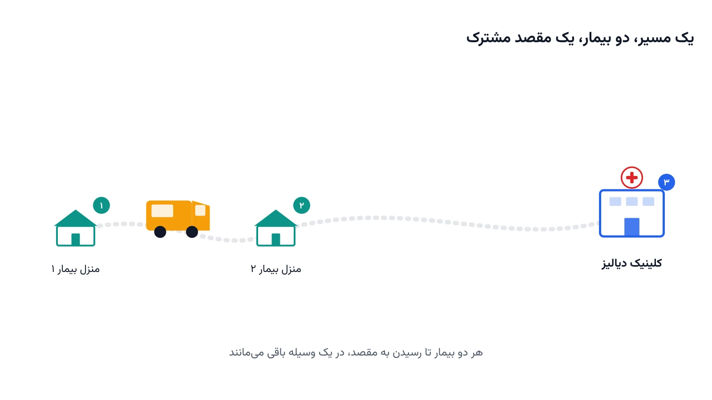

ساعت هفت صبح است. خانم رضایی، یک بیمار دیالیزی، باید سه بار در هفته به کلینیک برود. او خودش رانندگی نمی‌کند و خانواده‌اش هم همیشه در دسترس نیستند. این دقیقاً جایی است که حمل‌ونقل غیر اورژانسی بیماران وارد می‌شود. یک ون باید او را از خانه به کلینیک ببرد و بعد برگرداند. اما این ون معمولاً فقط برای یک نفر حرکت نمی‌کند.

شرکت‌هایی که این نوع جابه‌جایی را مدیریت می‌کنند، هر روز ده‌ها بیمار دارند. هر بیمار پنجره زمانی خودش را دارد. برخی باید دقیقاً ساعت هشت برسند، نه زودتر و نه دیرتر. یکی از این سرویس‌ها باید چند بیمار را با یک ون جابه‌جا کند. اینجا دیگر یک مسیر ساده کافی نیست. باید مشخص شود کدام بیمار در کدام ون و به چه ترتیبی سوار شود.

به این مسئله، در ادبیات پژوهشی، دایال-ا-راید یا Dial-a-Ride Problem می‌گویند؛ معادل فارسی آن را می‌توان «سرویس حمل‌ونقل بر حسب درخواست» نامید. مخفف رایج آن DARP است. هدف این مسئله، برنامه‌ریزی مسیر و زمان‌بندی چند وسیله نقلیه است. هر وسیله باید چند بیمار را از نقطه سوارشدن به نقطه مقصد برساند. مهم‌ترین تفاوت آن با مسیریابی معمولی کالا، وجود «مسافر» به‌جای «بار» است. مسافر برخلاف بسته، زمان انتظار و راحتی سفر برایش مهم است.

## ویژگی‌های کلیدی و تفاوت آن با مسائل مشابه

سه ویژگی، دایال-ا-راید را از مسیریابی عادی متمایز می‌کند. اول، هر بیمار یک نقطه سوارشدن و یک نقطه مقصد دارد. این دو نقطه باید حتماً در یک سفر، با یک وسیله باقی بمانند. دوم، هر بیمار سقف زمانی سفر دارد. طول سفر او نباید بیش از حد طولانی شود، حتی اگر وسیله در راه بیماران دیگر را هم سوار کند. سوم، ظرفیت هر وسیله محدود است و چند بیمار می‌توانند هم‌زمان سوار باشند.

این مسئله با مسیریابی خدمات پرستاری در منزل فرق دارد. در آن مسئله، پرستار یا مراقب جابه‌جا می‌شود، نه بیمار. اینجا برعکس است؛ خود بیمار در وسیله نقلیه نشسته و جابه‌جا می‌شود. همین تفاوت، قیدهای راحتی و زمان سفر را اضافه می‌کند. دوره [بهینه‌سازی سیستم‌های سلامت با پایتون](/courses/health-opt/) هر دو نوع مسئله را، به‌صورت مجزا، پوشش می‌دهد.

## اهمیت این موضوع در دنیای واقعی

جمعیت سالمند دنیا هر سال بزرگ‌تر می‌شود. بسیاری از سالمندان و بیماران مزمن، خودرو شخصی یا توان رانندگی ندارند. در آمریکا، نبود وسیله نقلیه یکی از دلایل اصلی غیبت از قرار ملاقات پزشکی است. این غیبت‌ها هزینه زیادی به نظام سلامت تحمیل می‌کنند. شرکتی مثل Uber Health دقیقاً برای حل همین مشکل، سرویس هماهنگی سفرهای غیر اورژانسی بیماران را راه‌اندازی کرده است.

در ایران هم، بیماران دیالیزی و شیمی‌درمانی چند بار در هفته نیاز به رفت‌وآمد دارند. بسیاری از بیمارستان‌ها و خیریه‌ها، سرویس ایاب‌وذهاب رایگان یا کم‌هزینه برای این بیماران دارند. اگر این سرویس‌ها با مدل دایال-ا-راید برنامه‌ریزی شوند، با همان تعداد ون می‌توان بیماران بیشتری را جابه‌جا کرد. این یعنی کاهش هزینه سوخت، کاهش ساعت کاری راننده‌ها و رضایت بیشتر بیماران.



## فرمول‌بندی ریاضی مسئله

فرض کنید $n$ درخواست سفر داریم. هر درخواست $i$ یک نقطه سوارشدن و یک نقطه مقصد دارد. گره سوارشدن را $i$ و گره مقصد متناظر را $n+i$ می‌نامیم. مجموعه وسایل نقلیه را $K$ در نظر بگیرید. متغیر دودویی $x_{ijk}$ برابر یک است اگر وسیله $k$ مستقیماً از گره $i$ به گره $j$ برود.

$$ \min \sum_{k \in K} \sum_{i} \sum_{j} c_{ij}\, x_{ijk} $$

تابع هدف، مجموع هزینه یا مسافت طی‌شده توسط همه وسایل نقلیه را کمینه می‌کند. مهم‌ترین ویژگی دایال-ا-راید، قید جفت‌شدن است. اگر وسیله $k$ مسافر $i$ را سوار کند، همان وسیله باید او را به مقصد $n+i$ هم برساند.

$$ \sum_{j} x_{ijk} = \sum_{j} x_{(n+i)jk} \qquad \forall i, \forall k $$

این قید تضمین می‌کند مسافر در میانه راه به وسیله دیگری منتقل نشود. قید دوم، سقف زمان سفر هر مسافر را کنترل می‌کند. متغیر $T_i$ لحظه رسیدن وسیله به گره $i$ را نشان می‌دهد.

$$ T_{n+i} - T_i \le L_i \qquad \forall i $$

این نامساوی، فاصله زمانی میان سوارشدن و پیاده‌شدن را به سقف $L_i$ محدود می‌کند. هر چه این سقف سخت‌گیرانه‌تر باشد، امکان هم‌سفرشدن چند بیمار کمتر می‌شود. پیداکردن نقطه تعادل میان هزینه و راحتی مسافر، چالش اصلی این مدل است.

## ظرفیت کار آکادمیک و پژوهشی

دایال-ا-راید یکی از پرتکرارترین مسائل در ادبیات تحقیق در عملیات حمل‌ونقل است. با این حال، نسخه‌های جدید آن هنوز جای کار دارند. دایال-ا-راید پویا، جایی که درخواست‌ها در طول روز وارد سیستم می‌شوند، یک جهت پژوهشی فعال است. نسخه تصادفی آن، با زمان سفر نامشخص به‌خاطر ترافیک، جهت دیگری است.

بُعد عدالت هم موضوع تازه‌ای است؛ آیا همه بیماران سهم برابر از کیفیت سرویس می‌گیرند؟ ترکیب دایال-ا-راید با ناوگان خودروهای برقی، مسئله را به سمت زمان‌بندی شارژ هم می‌کشاند. پیوند این مسئله با [زمان‌بندی صندلی دیالیز](/notes/dialysis-chair-scheduling/)، فضای خوبی برای پایان‌نامه یا مقاله علمی فراهم می‌کند.

## پیاده‌سازی با پایتون

حل دقیق مدل دایال-ا-راید برای ده‌ها درخواست، به سالور قدرتمند نیاز دارد. ماژول مسیریابی کتابخانه متن‌باز [OR-Tools](https://developers.google.com/optimization) گوگل، دقیقاً برای همین دسته مسائل ساخته شده است. این ماژول از محدودیت برداشت‌وتحویل، پنجره زمانی و سقف مدت سفر هر مسافر پشتیبانی می‌کند. برای مسائل کوچک‌تر و آموزشی، می‌توان مدل را با ماژول CP-SAT همین کتابخانه هم نوشت.

```python
from ortools.constraint_solver import pywrapcp, routing_enums_pb2

# هر درخواست یک نقطه سوارشدن و یک نقطه پیاده‌شدن متناظر دارد
num_requests = 6
num_nodes = 2 * num_requests + 1  # + پایگاه ناوگان
pickups_deliveries = [[1, 7], [2, 8], [3, 9], [4, 10], [5, 11], [6, 12]]

manager = pywrapcp.RoutingIndexManager(num_nodes, 3, 0)
routing = pywrapcp.RoutingModel(manager)

# هر زوج سوارشدن-پیاده‌شدن باید با یک وسیله یکسان و به همان ترتیب طی شود
for pickup, delivery in pickups_deliveries:
    pickup_index = manager.NodeToIndex(pickup)
    delivery_index = manager.NodeToIndex(delivery)
    routing.AddPickupAndDelivery(pickup_index, delivery_index)

# ادامه قیود سقف مدت سفر، پنجره زمانی و تابع هدف به همین شیوه تعریف می‌شوند
```

داده هر درخواست، شامل مختصات سوارشدن، مختصات مقصد و پنجره زمانی، معمولاً از یک فایل اکسل یا CSV خوانده می‌شود. برای تحلیل و رسم شبکه جاده‌ای میان نقاط، کتابخانه [NetworkX](https://networkx.org/) ابزار مناسبی است. نیازی به خرید نرم‌افزار تجاری گران‌قیمت برای این نوع مدل‌سازی نیست.

## سوالات متداول

<h3>آیا دایال-ا-راید همان مسیریابی وسایل نقلیه معمولی است؟</h3>
<p>نه دقیقاً. مسیریابی معمولی وسایل نقلیه بار یا کالا جابه‌جا می‌کند. دایال-ا-راید مسافر جابه‌جا می‌کند و قید سقف زمان سفر و جفت‌شدن سوارشدن-پیاده‌شدن را هم اضافه می‌کند.</p>

<h3>چه دوره‌ای این نوع مسائل حمل‌ونقل بیماران را آموزش می‌دهد؟</h3>
<p>دوره <a href="/courses/health-opt/" style="color:#2563EB; font-weight:bold;">بهینه‌سازی سیستم‌های سلامت با پایتون</a> مسائل حمل‌ونقل و زمان‌بندی مرتبط با بیماران را با ابزارهای متن‌باز پوشش می‌دهد.</p>

<h3>آیا امکان طراحی اختصاصی این مدل برای یک مرکز درمانی یا شرکت حمل‌ونقل وجود دارد؟</h3>
<p>بله. برای تنظیم مدل بر اساس تعداد ون‌ها، مناطق پوشش و داده واقعی بیماران شما، می‌توانید از <a href="/consultation/" style="color:#2563EB; font-weight:bold;">مشاوره</a> استفاده کنید.</p>
