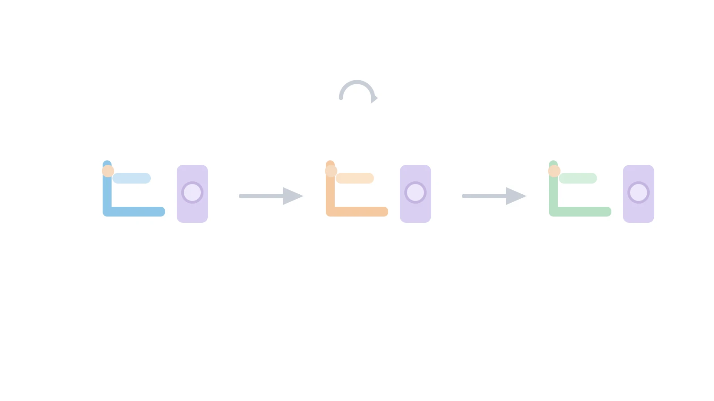

کسی که کلیه‌هایش دیگر کار نمی‌کند، دیالیز را به یک قرار ثابت هفتگی تبدیل می‌کند. سه بار در هفته باید به مرکز دیالیز برود. هر جلسه بین سه تا چهار ساعت طول می‌کشد. این جلسات باید روی یک دستگاه مشخص و با یک پرستار معین برگزار شوند. برخلاف یک عمل جراحی، این قرار فقط یک‌بار نیست. همین الگوی تکرارشونده هفته‌به‌هفته، زمان‌بندی مرکز دیالیز را از بسیاری مسائل مشابه متفاوت می‌کند.

مدیر مرکز باید برای هر بیمار سه تصمیم هم‌زمان بگیرد. اول اینکه کدام سه روز هفته به او تعلق می‌گیرد؛ معمولاً شنبه-دوشنبه-چهارشنبه یا یکشنبه-سه‌شنبه-پنجشنبه. دوم اینکه کدام شیفت روزانه، صبح یا عصر، مناسب اوست. سوم اینکه روی کدام دستگاه بنشیند. نکته مهم این است که این سه تصمیم باید برای هفته‌های آینده ثابت بماند. بیمار دیالیزی نمی‌تواند هر هفته صندلی و ساعتش عوض شود. ثبات برنامه برای او هم از نظر روانی و هم از نظر هماهنگی زندگی روزمره اهمیت زیادی دارد.

این ویژگی، زمان‌بندی دیالیز را از زمان‌بندی اتاق عمل یا حتی صندلی شیمی‌درمانی متمایز می‌کند. در آن دو مسئله، هر بیمار فقط یک یا چند جلسه مجزا دارد. اما در دیالیز، یک تصمیم باید برای ده‌ها هفته آینده پایدار بماند. علاوه بر این، هر دستگاه دیالیز بین دو بیمار متوالی به زمان ضدعفونی و آماده‌سازی آب نیاز دارد. نسبت پرستار به بیمار هم در هر شیفت باید رعایت شود؛ معمولاً یک پرستار مسئول چهار تا شش بیمار هم‌زمان است.

### اهمیت این موضوع

بیماری مزمن کلیوی در سراسر دنیا رو به افزایش است. تعداد بیمارانی که به دیالیز نیاز دارند هر سال بیشتر می‌شود. ساخت مرکز دیالیز جدید هزینه بالایی دارد. دستگاه، سیستم تصفیه آب و فضای استریل همگی گران‌اند. به همین دلیل، استفاده بهینه از ظرفیت موجود اهمیت زیادی پیدا می‌کند.

شرکت‌هایی مانند Fresenius Medical Care آلمان یا DaVita Kidney Care در آمریکا هزاران مرکز دیالیز را در سراسر دنیا اداره می‌کنند. این شرکت‌ها دقیقاً با همین چالش روبه‌رو هستند. چطور بیشترین تعداد بیمار را با کمترین تعداد دستگاه و پرستار، بدون افزایش زمان انتظار، پوشش دهند؟ حتی بهبود چند درصدی در نرخ استفاده از دستگاه‌ها، در مقیاس یک شبکه بزرگ از مراکز دیالیز، صرفه‌جویی مالی قابل‌توجهی ایجاد می‌کند. از طرف دیگر، زمان‌بندی ضعیف می‌تواند به معنای ماندن بیمار در لیست انتظار یا جابه‌جایی اجباری شیفت او باشد. هر دو حالت برای بیمار دیالیزی آزاردهنده است.



### فرمول‌بندی ریاضی مسئله

برای مدل‌سازی، مجموعه بیماران را با $p = 1, \dots, P$ نشان می‌دهیم. الگوهای مجاز هفتگی را $g \in G$ می‌نامیم؛ هر الگو شامل سه روز ثابت در هفته است. شیفت‌های روزانه با $t = 1, \dots, T$ و دستگاه‌های دیالیز با $k = 1, \dots, K$ مشخص می‌شوند. متغیر تصمیم دودویی $x_{p,g,t,k}$ برابر یک است اگر بیمار $p$ به الگوی $g$، شیفت $t$ و دستگاه $k$ اختصاص یابد. این اختصاص برای کل افق برنامه‌ریزی ثابت می‌ماند.

هر بیمار باید دقیقاً یک ترکیب از الگو، شیفت و دستگاه داشته باشد:

$$\sum_{g,t,k} x_{p,g,t,k} = 1 \quad \forall p$$

هر دستگاه در هر روز و هر شیفت فقط می‌تواند به یک بیمار اختصاص یابد. اگر $D_g$ مجموعه روزهای الگوی $g$ باشد، این قید به‌صورت زیر نوشته می‌شود:

$$\sum_{p} \sum_{g:\, d \in D_g} x_{p,g,t,k} \le 1 \quad \forall d, t, k$$

نسبت پرستار به بیمار هم باید در هر روز و هر شیفت رعایت شود. اگر $R$ حداکثر تعداد بیمار برای هر پرستار و $N_{d,t}$ تعداد پرستاران حاضر در روز $d$ و شیفت $t$ باشد، داریم:

$$\sum_{p} \sum_{g:\, d \in D_g} \sum_{k} x_{p,g,t,k} \le R \cdot N_{d,t} \quad \forall d, t$$

تابع هدف می‌تواند میزان برآورده‌شدن ترجیح شیفتی بیماران را حداکثر کند. اگر $w_{p,t}$ وزن ترجیح بیمار $p$ برای شیفت $t$ باشد، داریم:

$$\max \sum_{p,g,t,k} w_{p,t}\, x_{p,g,t,k}$$

در عمل، معمولاً یک جمله جریمه برای تعداد دستگاه‌های فعال یا اضافه‌کاری پرستاران هم به تابع هدف اضافه می‌شود. این مسئله به‌خاطر ساختار تکرارشونده هفتگی‌اش، نسخه‌ای خاص از مسئله تخصیص تعمیم‌یافته با قیود دوره‌ای محسوب می‌شود.

### ظرفیت کار آکادمیک و پژوهشی

زمان‌بندی مراکز دیالیز نسبت به زمان‌بندی اتاق عمل یا زمان‌بندی پرستاران، پژوهش کمتری گرفته است. با این حال، جای رشد زیادی در این حوزه وجود دارد. یک مسیر پژوهشی فعال، مدل‌سازی عدم‌قطعیت طول جلسه است. برخی بیماران حین درمان دچار افت فشار خون یا عوارض دیگر می‌شوند. این عوارض می‌تواند جلسه را طولانی‌تر از حد معمول کند. رویکردهایی مانند برنامه‌ریزی تصادفی یا بهینه‌سازی استوار می‌توانند این نااطمینانی را در زمان‌بندی لحاظ کنند.

مسیر دیگر، هماهنگی بین چند مرکز دیالیز در یک شهر یا منطقه است. وقتی ظرفیت یک مرکز پر می‌شود، بیمار جدید باید به مرکز دیگری ارجاع شود. این ارجاع هزینه رفت‌وآمد بیمار را هم افزایش می‌دهد. مدل‌سازی مشترک چند مرکز به‌صورت یک شبکه، موضوع جالبی برای پژوهش است. همچنین ترکیب دیالیز خانگی و دیالیز در مرکز، یک مسیر پژوهشی نوظهور است. این دو حالت می‌توانند مکمل هم باشند و فشار روی ظرفیت مراکز را کاهش دهند. این موضوعات می‌توانند مبنای خوبی برای پایان‌نامه یا مقاله باشند، درست در تقاطع پژوهش در عملیات و مدیریت خدمات سلامت.

### پیاده‌سازی با پایتون

خوشبختانه برای حل این مسئله نیازی به نرم‌افزار تجاری گران‌قیمت نیست. کتابخانه متن‌باز [OR-Tools](https://developers.google.com/optimization) گوگل، و به‌ویژه ماژول CP-SAT آن، گزینه بسیار مناسبی است. محدودیت‌هایی مانند «حداکثر یک بیمار روی هر دستگاه در هر شیفت» را می‌توان مستقیماً با قیود جمعی مدل کرد. برای آشنایی عمیق‌تر با این الگوهای مدل‌سازی در CP-SAT، می‌توانید به [راهنمای جامع زمان‌بندی با CP-SAT](/notes/cpsat-scheduling-guide/) در سایت مراجعه کنید.

داده‌های ورودی شامل فهرست بیماران، ترجیح شیفتی هر بیمار، تعداد دستگاه‌های موجود و تعداد پرستاران حاضر در هر روز است. این داده‌ها را می‌توان از یک فایل اکسل یا CSV خواند. چنین فایلی ستون‌های شناسه بیمار، ترجیح شیفت و الگوی هفتگی مجاز را دارد. برای مراکزی که مسئله را با نگاه خطی‌تر می‌بینند، ترکیب [Pyomo](https://www.pyomo.org/) یا [PuLP](https://coin-or.github.io/pulp/) با سالورهای متن‌باز مانند [HiGHS](https://highs.dev/) یا [CBC](https://github.com/coin-or/Cbc) هم قابل‌اجراست. نکته کلیدی این است که حتی یک کلینیک دیالیز کوچک و مستقل هم می‌تواند از همین ابزارهای رایگان استفاده کند. این کلینیک بدون نیاز به هزینه نرم‌افزار تجاری، یک سیستم زمان‌بندی کاربردی برای خودش می‌سازد.

برای تصویر بهتر این پیاده‌سازی، اسکلت اولیه مدل در CP-SAT این‌طور شروع می‌شود:

```python
from ortools.sat.python import cp_model

model = cp_model.CpModel()
x = {}
for p in patients:
    for g in patterns:
        for t in shifts:
            for k in stations:
                x[p, g, t, k] = model.NewBoolVar(f"x_{p}_{g}_{t}_{k}")

# هر بیمار دقیقاً یک ترکیب الگو، شیفت و دستگاه می‌گیرد
for p in patients:
    model.Add(
        sum(x[p, g, t, k] for g in patterns for t in shifts for k in stations) == 1
    )

# قید ظرفیت هر دستگاه در هر روز و شیفت، قید نسبت پرستار به بیمار،
# و تابع هدف بر اساس ترجیح بیماران، به همین شیوه و متناسب با داده‌های
# واقعی هر مرکز تکمیل می‌شوند.
```

این فقط هسته اولیه مدل است، نه پیاده‌سازی کامل و آماده اجرا. تکمیل قیود ظرفیت و تابع هدف به داده‌ها و قواعد خاص هر مرکز دیالیز بستگی دارد.

### سوالات متداول

<h3>چه تفاوتی بین زمان‌بندی دیالیز و زمان‌بندی صندلی شیمی‌درمانی وجود دارد؟</h3>
<p>در شیمی‌درمانی هر بیمار معمولاً یک یا چند جلسه مجزا دارد و قید اصلی زمان آماده‌سازی داروست. اما در دیالیز، بیمار باید هفته‌ای سه بار و برای ماه‌ها روی یک الگوی ثابت از روز، شیفت و دستگاه قرار بگیرد. این پایداری بلندمدت، دیالیز را به نسخه‌ای دوره‌ای از مسئله تخصیص تبدیل می‌کند.</p>

<h3>برای یادگیری مدل‌سازی این‌گونه مسائل بهینه‌سازی در حوزه سلامت از کجا شروع کنم؟</h3>
<p>دوره <a href="/courses/health-opt/" style="color:#2563EB; font-weight:bold;">بهینه‌سازی سیستم‌های سلامت با پایتون</a> به‌صورت پروژه‌محور مسائلی از همین جنس را با OR-Tools پوشش می‌دهد. این دوره نقطه شروع مناسبی برای یادگیری زمان‌بندی و تخصیص منابع در محیط درمانی است.</p>

<h3>اگر مرکز دیالیز من به یک سیستم زمان‌بندی اختصاصی نیاز دارد چه کنم؟</h3>
<p>هر مرکز دیالیز محدودیت‌های خاص خودش را از نظر تعداد دستگاه، تعداد پرستار و الگوهای هفتگی بیماران دارد. مدل‌سازی دقیق این محدودیت‌ها نیاز به بررسی اختصاصی دارد. می‌توانید از طریق صفحه <a href="/consultation/" style="color:#2563EB; font-weight:bold;">مشاوره</a> جزئیات مسئله خودتان را مطرح کنید.</p>
