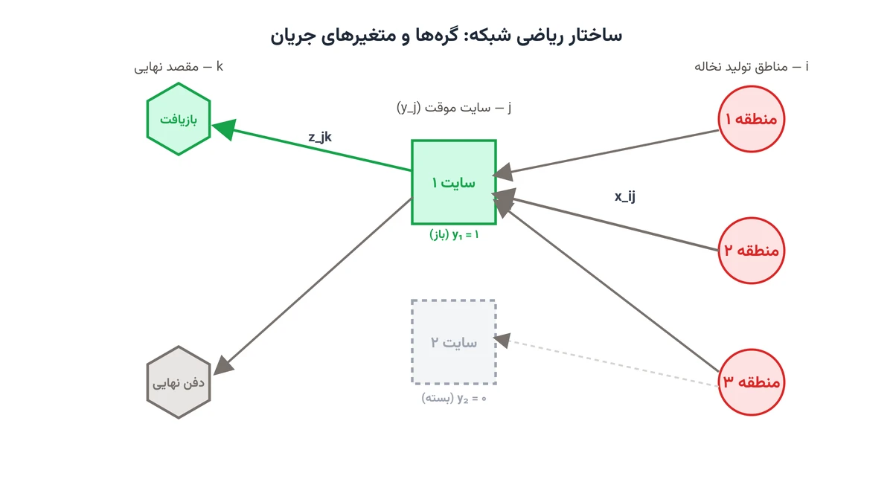

چند ساعت بعد از یک زلزله بزرگ، شهر پر از خیابان‌های مسدود است. نه به‌خاطر ترافیک، بلکه به‌خاطر کوه‌های نخاله. دیوارهای ریخته، بتن خردشده، آهن‌آلات و وسایل خانه، همه با هم روی آسفالت انباشته‌اند. قبل از هر کمک‌رسانی یا بازسازی، باید این نخاله‌ها جمع‌آوری و جابه‌جا شوند. اما جمع‌آوری تنها نیمی از مسئله است؛ نیم دیگر این است که این حجم عظیم نخاله را کجا ببریم؟

این دقیقاً همان سوالی است که پاسخش این یادداشت را شکل می‌دهد. مسئله «مدیریت شبکه نخاله پس از بلایا» (Disaster Debris Management) یک مسئله کلاسیک در لجستیک بشردوستانه است. باید تصمیم بگیریم کدام سایت‌های موقت نگهداری و پردازش نخاله (TDSRS) را باز کنیم. باید تصمیم بگیریم نخاله هر منطقه آسیب‌دیده به کدام سایت فرستاده شود. و در نهایت، باید تصمیم بگیریم چه بخشی از نخاله قابل بازیافت است. چه بخشی هم باید در محل مجاز دفن شود؟

## چالش واقعی چیست؟

بلافاصله بعد از یک زلزله یا سیل بزرگ، برآورد حجم نخاله کار سختی است. مهندسان شهرداری باید سریع تخمین بزنند: هر منطقه آسیب‌دیده چند تن نخاله تولید کرده؟ این نخاله باید اول به یک سایت موقت برود، نه مستقیم به محل دفن نهایی. چرا؟ چون سایت موقت فضایی برای تفکیک نخاله فراهم می‌کند: آهن‌آلات، بتن، چوب و زباله خطرناک از هم جدا می‌شوند. بخشی از این نخاله تفکیک‌شده قابل بازیافت است و ارزش اقتصادی دارد. بخش دیگر باید به محل دفن نهایی مجاز منتقل شود.

این زنجیره سه‌لایه را می‌توان دقیقاً مثل یک مسئله مکان‌یابی تسهیلات دید. لایه اول مناطق آسیب‌دیده‌اند که نخاله تولید می‌کنند. لایه دوم سایت‌های موقت نگهداری و پردازش نخاله‌اند. لایه سوم هم مقصدهای نهایی‌اند: کارخانه بازیافت یا محل دفن مجاز. تفاوت اصلی این مسئله با [مسئله کلاسیک مکان‌یابی تسهیلات](/notes/facility-location-problem/) در فوریت زمانی آن است. هر روز تأخیر در بازگشایی سایت موقت، هم هزینه دارد و هم بازسازی را عقب می‌اندازد.

این مسئله با مدیریت پسماند شهری روزمره فرق اساسی دارد. حجم نخاله یک بلایا می‌تواند ده‌ها برابر زباله عادی یک شهر در یک روز باشد. سایت‌های پردازش معمولی شهر هم برای این حجم طراحی نشده‌اند. به همین دلیل، نیاز به سایت‌های موقت و مدل تصمیم‌گیری جداگانه داریم.

## اهمیت این موضوع

هزینه مدیریت نخاله بعد از یک بلایای بزرگ، می‌تواند میلیاردها دلار باشد. بعد از طوفان‌های بزرگ در آمریکا، حجم نخاله گاهی از حجم زباله یک‌ساله یک ایالت هم بیشتر می‌شود. شرکتی مثل AshBritt Environmental سال‌هاست پیمانکار اصلی مدیریت نخاله بعد از طوفان در آمریکاست. این شرکت دقیقاً با چنین تصمیمی روبه‌رو می‌شود. باید در عرض چند روز تصمیم بگیرد کدام زمین‌ها به سایت موقت تبدیل شوند. تصمیم اشتباه یعنی مسیرهای طولانی‌تر کامیون، هزینه سوخت بیشتر، و تأخیر در بازگشایی جاده‌ها.

از نگاه قانونی هم این تصمیم حساس است. نخاله ساختمانی گاهی حاوی مواد خطرناک مثل آزبست است. قوانین محیط‌زیستی معمولاً مسیر این نخاله خطرناک را از نخاله عادی جدا می‌کنند. یک مدل بهینه‌سازی خوب باید همین محدودیت‌های قانونی و ظرفیتی را هم در نظر بگیرد. در غیر این صورت، تصمیم روی کاغذ خوب است اما در عمل قابل اجرا نیست.



## فرمول‌بندی ریاضی مسئله

می‌توان این مسئله را به زبان یک مدل MILP نوشت. سه مجموعه گره داریم: مناطق آسیب‌دیده $i$، سایت‌های موقت نامزد $j$، و مقصدهای نهایی $k$ (بازیافت یا دفن). باید مشخص کنیم چه حجمی از نخاله بین هر دو گره جابه‌جا شود و کدام سایت موقت باز شود.

متغیر $x_{ij}$ حجم نخاله‌ای است که از منطقه $i$ به سایت موقت $j$ فرستاده می‌شود. متغیر $z_{jk}$ حجم نخاله‌ای است که از سایت $j$ به مقصد نهایی $k$ می‌رود. متغیر دودویی $y_j$ یک است اگر سایت $j$ باز شود، و صفر در غیر این صورت.

تابع هدف، مجموع سه نوع هزینه را کمینه می‌کند. نوع اول هزینه ثابت باز کردن هر سایت موقت است. نوع دوم هزینه حمل نخاله از منطقه آسیب‌دیده به سایت موقت است. نوع سوم هم هزینه حمل از سایت موقت تا مقصد نهایی است.

$$
\min \; \sum_{j} f_j y_j \;+\; \sum_{i,j} c^{1}_{ij}\, x_{ij} \;+\; \sum_{j,k} c^{2}_{jk}\, z_{jk}
$$

قید اول تضمین می‌کند کل نخاله هر منطقه فرستاده شود. قید دوم جریان ورودی و خروجی هر سایت را برابر نگه می‌دارد. یعنی نخاله در سایت انباشته نمی‌ماند. قید سوم ظرفیت هر سایت موقت را رعایت می‌کند، و فقط وقتی $y_j=1$ باشد اجازه ورود نخاله می‌دهد. قید چهارم هم ظرفیت مقصد نهایی را محدود می‌کند.

$$
\sum_{j} x_{ij} = d_i \qquad \forall i
$$

$$
\sum_{i} x_{ij} = \sum_{k} z_{jk} \qquad \forall j
$$

$$
\sum_{i} x_{ij} \le \text{Cap}_j \cdot y_j \qquad \forall j
$$

$$
\sum_{j} z_{jk} \le \text{Cap}_k \qquad \forall k
$$

$$
x_{ij},\, z_{jk} \ge 0, \qquad y_j \in \{0,1\}
$$

## یک مثال کوچک و عددی

برای ملموس شدن مدل، یک مثال کوچک را در نظر بگیرید. فرض کنید دو منطقه آسیب‌دیده داریم: منطقه یک با ۲۰۰ تن نخاله، و منطقه دو با ۱۵۰ تن. دو سایت موقت نامزد هم داریم. سایت یک ظرفیت ۲۵۰ تن دارد و سایت دو ظرفیت ۱۵۰ تن. اگر هزینه باز کردن سایت یک کمتر باشد، مدل ممکن است فقط همان را باز کند. آن‌وقت نخاله هر دو منطقه به همان یک سایت فرستاده می‌شود. اگر ظرفیت سایت یک کافی نباشد، مدل به‌صورت خودکار سایت دوم را هم باز می‌کند.

## ظرفیت کار آکادمیک و پژوهشی

این مسئله فرصت‌های پژوهشی زیادی دارد. اولین جهت، عدم قطعیت در برآورد حجم نخاله است. بعد از هر بلایا، تخمین اولیه معمولاً پر از خطاست. یک مدل تصادفی دومرحله‌ای می‌تواند چند سناریوی حجم نخاله را هم‌زمان در نظر بگیرد. جهت دوم، ترکیب مکان‌یابی با مسیریابی کامیون‌هاست. به‌جای فرض هزینه ثابت حمل، می‌توان مسیر واقعی کامیون‌ها را هم بهینه کرد. جهت سوم، افزودن هدف زمانی است: هر چه سایت موقت زودتر باز شود، جاده‌ها زودتر بازگشایی می‌شوند.

جهت چهارم، انصاف در توزیع بار بین مناطق است. اگر فقط هزینه کمینه شود، ممکن است یک منطقه مدت زیادی منتظر پاک‌سازی بماند. افزودن یک قید یا هدف عدالت‌محور می‌تواند این نابرابری را کاهش دهد. این موضوع می‌تواند پایه یک مقاله یا پایان‌نامه کامل در لجستیک بشردوستانه باشد.

## پیاده‌سازی با پایتون

خبر خوب این است که نیازی به سالور تجاری گران‌قیمت نیست. این مدل را می‌توان با [Pyomo](https://www.pyomo.org/) نوشت و با سالور رایگان [HiGHS](https://highs.dev/) حل کرد. برای مسائل بزرگ‌تر، سالور متن‌باز [CBC](https://github.com/coin-or/Cbc) هم گزینه خوبی است. مهم این است که تیم‌های کوچک امدادی بدون بودجه نرم‌افزاری، هم بتوانند این مدل را اجرا کنند.

```python
from pyomo.environ import *

model = ConcreteModel()

# مجموعه‌ها (باید از داده واقعی خوانده شوند)
model.I = Set()   # مناطق آسیب‌دیده
model.J = Set()   # سایت‌های موقت نامزد
model.K = Set()   # مقصدهای نهایی (بازیافت / دفن)

# متغیرهای تصمیم کلیدی
model.x = Var(model.I, model.J, domain=NonNegativeReals)
model.z = Var(model.J, model.K, domain=NonNegativeReals)
model.y = Var(model.J, domain=Binary)

# قید ظرفیت سایت موقت (فقط اگر سایت باز باشد اجازه ورود نخاله دارد)
def site_capacity_rule(model, j):
    return sum(model.x[i, j] for i in model.I) <= model.Cap[j] * model.y[j]
model.site_capacity = Constraint(model.J, rule=site_capacity_rule)

# ادامه قیود (تعادل جریان، ظرفیت مقصد نهایی) و تابع هدف به همین شیوه تعریف می‌شوند
```

پس از تکمیل قیود و تابع هدف، کافی است سالور HiGHS را صدا بزنید. آن‌وقت بهترین ترکیب سایت‌ها و جریان نخاله پیدا می‌شود.

## سوالات متداول

<h3>چرا نخاله باید اول به سایت موقت برود، نه مستقیم به محل دفن؟</h3>
<p>چون سایت موقت امکان تفکیک نخاله قابل بازیافت از نخاله خطرناک یا بی‌ارزش را فراهم می‌کند. این تفکیک هم هزینه دفن نهایی را کم می‌کند و هم محیط‌زیست را حفظ می‌کند.</p>

<h3>آیا این مدل فقط برای زلزله کاربرد دارد؟</h3>
<p>نه، همین ساختار برای سیل، طوفان و حتی مدیریت نخاله ساختمانی عادی شهری هم قابل استفاده است. تنها پارامترهای حجم و ظرفیت تغییر می‌کنند، نه ساختار مدل. اگر می‌خواهید این مدل‌سازی را در مسائل مسیریابی دیگر هم یاد بگیرید، دوره <a href="/courses/vrp-python/" style="color:#2563EB; font-weight:bold;">مسیریابی وسایل نقلیه با پایتون</a> را ببینید.</p>

<h3>اگر داده‌های واقعی شهر یا سازمان ما را داشته باشیم، می‌توانید مدل را برایمان پیاده‌سازی کنید؟</h3>
<p>بله، این دقیقاً همان کاری است که در جلسات <a href="/consultation/" style="color:#2563EB; font-weight:bold;">مشاوره</a> انجام می‌دهم. مدل را با داده‌های واقعی شما تنظیم می‌کنم و نتیجه قابل اجرا تحویل می‌دهم.</p>
