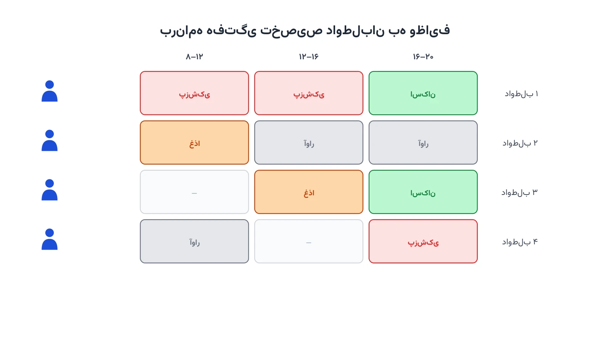

چند ساعت بعد از یک زلزله بزرگ، صدها داوطلب در پایگاه امداد ثبت‌نام می‌کنند. برخی پرستارند، برخی راننده‌اند، برخی فقط دست خالی و دل پر آورده‌اند. هماهنگ‌کننده باید در عرض چند دقیقه تصمیم بگیرد کدام داوطلب به کدام چادر پزشکی برود. کدام‌یک در صف توزیع غذا بایستد و کدام‌یک برای پاکسازی آوار اعزام شود. این تصمیم ساده به‌نظر می‌رسد، اما ساده نیست. مهارت هر نفر، ساعت حضورش، فاصله تا محل کار و اولویت هر وظیفه هم‌زمان اهمیت دارند. وقتی همه این عوامل با هم ترکیب شوند، تصمیم دیگر شهودی نیست. اینجا دقیقاً جایی است که بهینه‌سازی ریاضی وارد میدان می‌شود.

## مسئله چیست؟ فراتر از یک تخته وایت‌برد

در روزهای اول هر عملیات امداد، فهرست داوطلبان روی کاغذ یا یک تخته وایت‌برد نوشته می‌شود. هر داوطلب یک یا چند مهارت دارد: کمک‌های اولیه، رانندگی، نجاری، ترجمه یا فقط توان بدنی برای کار یدی. هر داوطلب فقط در بازه‌های زمانی مشخصی در دسترس است، نه کل شبانه‌روز. در طرف دیگر، وظایف بحران هم ثابت نیستند. چادر پزشکی نیاز به چند نفر آموزش‌دیده دارد. توزیع غذا نیاز به نیروی ساده و منظم دارد. پاکسازی آوار هم نیاز به افراد توانمند و دارای تجهیزات ایمنی دارد. هر وظیفه اولویت متفاوتی هم دارد؛ نجات زیر آوار از چیدن انبار فوری‌تر است.

این مسئله در واقع یک نسخه بحرانی از «مسئله تخصیص تعمیم‌یافته» (Generalized Assignment Problem) است. تفاوتش این است که منابع انسانی داوطلب و رایگان‌اند، نه کارمند با قرارداد ثابت. داوطلبان می‌توانند بدون اطلاع قبلی نیایند یا زودتر بروند. تعداد آن‌ها هم در ساعات اول پس از بحران به‌شدت نوسان دارد. به همین دلیل، مدل باید هم انعطاف‌پذیر باشد و هم به‌سرعت قابل اجرا در میدان.

## اهمیت این موضوع در دنیای واقعی

بدترین اتفاق در یک عملیات امداد، هدررفتن انرژی داوطلبانه است. وقتی ده نفر برای یک وظیفه کم‌اهمیت معطل می‌مانند، درحالی‌که یک وظیفه حیاتی کمبود نیرو دارد، اعتماد داوطلبان هم از بین می‌رود. تحقیقات حوزه مدیریت بحران نشان می‌دهد بخش بزرگی از داوطلبان پس از یک تجربه بی‌نظمی، دیگر برنمی‌گردند. سازمانی مانند تیم روبیکون (Team Rubicon) با هزاران داوطلب در عملیات‌های امدادی آمریکا و جاهای دیگر کار می‌کند. این سازمان دقیقاً با همین چالش روبه‌رو است: چطور مهارت درست را در زمان درست به کار درست برساند. چنین سازمان‌هایی هرچه بیشتر به ابزارهای داده‌محور و بهینه‌سازی روی می‌آورند، چون تصمیم دستی در مقیاس چند صد نفر دیگر جواب نمی‌دهد.

اهمیت این موضوع فقط در کارایی عملیاتی خلاصه نمی‌شود. تخصیص درست داوطلبان مستقیماً روی سرعت رسیدن کمک به آسیب‌دیدگان اثر می‌گذارد. چند دقیقه تأخیر در اعزام نیروی کمک‌های اولیه می‌تواند نتیجه بالینی یک مصدوم را عوض کند. برای آشنایی بیشتر با مسائل مشابه در لجستیک بحران، می‌توانید دوره [مسیریابی وسایل نقلیه با پایتون](/courses/vrp-python/) را هم ببینید. این دوره پایه مشترک بسیاری از این مدل‌هاست.



## ظرفیت کار آکادمیک و پژوهشی

این حوزه برای کار پژوهشی بسیار بکر است. اکثر مقالات کلاسیک تخصیص نیرو روی کارمندان ثابت یک شرکت تمرکز دارند، نه روی داوطلبان. مدل‌سازی رفتار داوطلب خودش یک مسئله جذاب است؛ داوطلبانی که ممکن است نیایند، زودتر خسته شوند یا دوباره ثبت‌نام نکنند. یک مسیر پژوهشی قوی، تخصیص آنلاین است: داوطلبان رفته‌رفته و بدون اطلاع قبلی از کل جمعیت وارد سامانه می‌شوند. مدل باید بدون دانستن آینده، بهترین تصمیم لحظه‌ای را بگیرد؛ دقیقاً مثل مسائل کلاسیک «تطبیق آنلاین» در نظریه الگوریتم.

مسیر دوم، ترکیب عدالت و کارایی است. اگر فقط کارایی را بیشینه کنیم، ممکن است بار کاری سنگین روی تعداد کمی داوطلب فعال بیفتد و همان‌ها زودتر فرسوده شوند. مدل‌های چندهدفه که هم‌زمان پوشش وظایف و توزیع عادلانه ساعت کاری را در نظر می‌گیرند، موضوع خوبی برای پایان‌نامه یا مقاله‌اند. مسیر سوم هم افزودن عدم‌قطعیت در حضور داوطلب است. [یادداشتی درباره پاکسازی آوار جاده‌ها پس از بلایا](/notes/debris-clearance-arc-routing/) چنین ابزارهایی را برای ماشین‌آلات سنگین نشان می‌دهد. همان منطق، اینجا برای نیروی انسانی داوطلب هم به کار می‌رود.

## فرمول‌بندی ریاضی مسئله

برای مدل‌سازی، سه مجموعه اصلی تعریف می‌کنیم: مجموعه داوطلبان $V$، مجموعه وظایف $K$ و مجموعه بازه‌های زمانی $S$. پارامتر $a_{vk}$ برابر با یک است اگر داوطلب $v$ مهارت لازم برای وظیفه $k$ را داشته باشد. پارامتر $h_{vs}$ هم نشان می‌دهد آیا داوطلب $v$ در بازه زمانی $s$ در دسترس است یا نه. هر وظیفه یک وزن اولویت $p_k$ دارد و هر داوطلب حداکثر ساعت کاری مجاز $H_v$ دارد تا از فرسودگی جلوگیری شود.

متغیر تصمیم $x_{vks}$ یک متغیر دودویی است. این متغیر برابر با یک می‌شود اگر داوطلب $v$ در بازه $s$ به وظیفه $k$ تخصیص یابد. تابع هدف، پوشش وزن‌دار وظایف با اولویت بالاتر را بیشینه می‌کند:

$$ \max \sum_{v \in V} \sum_{k \in K} \sum_{s \in S} p_k \, a_{vk} \, x_{vks} $$

قید مهارت و در دسترس‌بودن تضمین می‌کند تخصیص فقط به داوطلبان واجد شرایط و در دسترس انجام شود:

$$ x_{vks} \le a_{vk} \cdot h_{vs} \qquad \forall v \in V,\ k \in K,\ s \in S $$

هر داوطلب در هر بازه زمانی فقط می‌تواند یک وظیفه بپذیرد، نه بیشتر:

$$ \sum_{k \in K} x_{vks} \le 1 \qquad \forall v \in V,\ s \in S $$

و در نهایت، مجموع ساعت کاری هر داوطلب در کل دوره نباید از سقف مجازش بیشتر شود، تا از فرسودگی جلوگیری شود.

## پیاده‌سازی با پایتون، بدون نیاز به نرم‌افزار گران‌قیمت

خبر خوب این است که چنین مدلی را می‌توان کاملاً رایگان حل کرد. سالورهای متن‌باز مثل [OR-Tools](https://developers.google.com/optimization) گوگل، به‌خصوص ماژول CP-SAT آن، برای این نوع مسائل تخصیص و زمان‌بندی ترکیبیاتی عالی عمل می‌کنند. جایگزین دیگر، مدل‌سازی با [PuLP](https://coin-or.github.io/pulp/) و حل با سالور متن‌باز [HiGHS](https://highs.dev/) است. هیچ‌کدام از این ابزارها نیاز به مجوز تجاری ندارند و برای یک سازمان امدادی کوچک یا دانشجویی کاملاً در دسترس‌اند.

داده‌های ورودی معمولاً از یک فایل اکسل یا CSV خوانده می‌شوند. ستون‌های آن شامل نام داوطلب، مهارت‌ها، بازه‌های در دسترس‌بودن و حداکثر ساعت کاری مجازند. وظایف هم در فایلی مشابه با ستون‌های نوع کار، مهارت موردنیاز، اولویت و تعداد نفر لازم نگهداری می‌شوند. اسکلت اولیه مدل در CP-SAT این‌طور آغاز می‌شود:

```python
from ortools.sat.python import cp_model

model = cp_model.CpModel()

volunteers = ["v1", "v2", "v3"]
tasks = ["medical", "food", "debris"]
shifts = ["morning", "afternoon"]

# متغیر تصمیم: آیا داوطلب v در شیفت s به وظیفه k برود؟
x = {}
for v in volunteers:
    for k in tasks:
        for s in shifts:
            x[v, k, s] = model.NewBoolVar(f"x_{v}_{k}_{s}")

# قید نمونه: هر داوطلب در هر شیفت حداکثر یک وظیفه بپذیرد
for v in volunteers:
    for s in shifts:
        model.Add(sum(x[v, k, s] for k in tasks) <= 1)

# ادامه قیود مهارت، سقف ساعت کاری و تابع هدف به همین شیوه تعریف می‌شوند
```

این کد عمداً ناقص است و فقط اسکلت مدل را نشان می‌دهد. در عمل باید قید مهارت و در دسترس‌بودن، سقف ساعت کاری هر داوطلب و تابع هدف وزن‌دار را هم اضافه کنید.

اگر به [انجام پروژه بهینه‌سازی](/consultation/) برای مسئله خودتان نیاز دارید یا می‌خواهید [مدل‌سازی ریاضی](/courses/optimization-modeling/) را از پایه یاد بگیرید، این دو صفحه نقطه شروع خوبی هستند.

## سوالات متداول

<h3>آیا این مدل فقط برای بلایای بزرگ مثل زلزله کاربرد دارد؟</h3>
<p>خیر. همین مدل در مقیاس کوچک‌تر برای سازمان‌های مردم‌نهاد، رویدادهای خیریه و حتی مدیریت داوطلبان یک اردوگاه پناهجویان هم قابل استفاده است. اصل مسئله، یعنی تطبیق مهارت و زمان با نیاز، در همه این موقعیت‌ها یکسان است.</p>

<h3>چه تفاوتی بین این مسئله و زمان‌بندی معمول پرسنل یک شرکت دارد؟</h3>
<p>در زمان‌بندی پرسنل شرکتی، نیروی کار ثابت و قراردادی است و حضورش تضمین‌شده. اینجا داوطلبان رایگان و بدون تعهدند و ممکن است هر لحظه از دسترس خارج شوند. برای آشنایی با پایه این مدل‌ها در پایتون، دوره <a href="/courses/vrp-python/" style="color:#2563EB; font-weight:bold;">مسیریابی وسایل نقلیه با پایتون</a> نقطه شروع خوبی است.</p>

<h3>اگر بخواهیم این مدل را برای سازمان امدادی خودمان پیاده‌سازی کنیم، از کجا شروع کنیم؟</h3>
<p>بهترین شروع، فهرست‌کردن دقیق مهارت‌ها و بازه‌های زمانی واقعی داوطلبان‌تان است. برای طراحی اختصاصی مدل و پیاده‌سازی آن متناسب با ساختار سازمان‌تان، می‌توانید از طریق <a href="/consultation/" style="color:#2563EB; font-weight:bold;">مشاوره</a> با ما در ارتباط باشید.</p>
