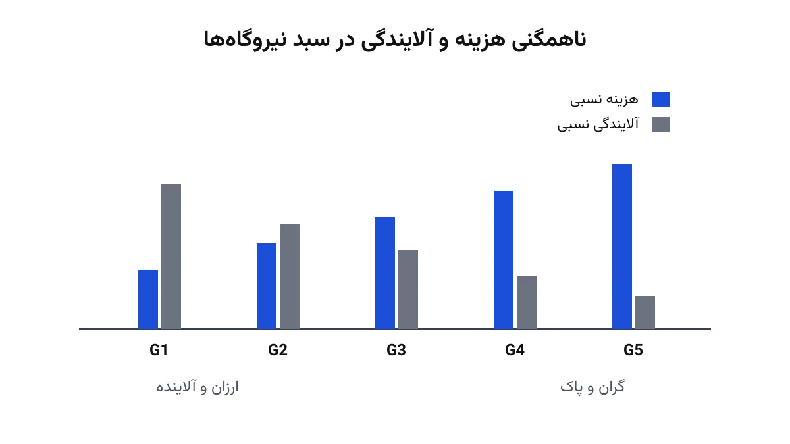

هر اپراتور شبکه برق هر روز یک سوال ساده دارد: کدام نیروگاه چقدر تولید کند تا هزینه سوخت کل کمینه شود؟ به این مسئله، پخش بار اقتصادی (Economic Dispatch) می‌گویند. اما یک سوال دوم هم هست که این روزها نادیده گرفتنش سخت‌تر شده: همین ترکیب تولید، چقدر آلاینده هوا تولید می‌کند؟ نیروگاه‌های ارزان، معمولاً همان‌هایی هستند که بیشترین آلایندگی را هم دارند. این یادداشت یک مدل دوهدفه می‌سازد که هر دو سوال را همزمان جواب می‌دهد.

نکته جالب این مسئله، تضاد ذاتی دو هدف است. کمینه‌کردن هزینه، معمولاً یعنی تکیه بیشتر بر نیروگاه‌های ارزان‌تر و کثیف‌تر. کمینه‌کردن آلایندگی، معمولاً یعنی قبول هزینه بیشتر برای تکیه بر نیروگاه‌های پاک‌تر. جواب «درست» یک نقطه نیست؛ یک طیف از مصالحه‌های ممکن است.

## مسئله واقعی چیست؟

فرض کنید چند نیروگاه حرارتی داریم که هرکدام دو تابع مشخص دارند. تابع اول، هزینه سوخت بر حسب توان تولیدی است. تابع دوم، میزان آلایندگی (مثلاً دی‌اکسید گوگرد یا نیتروژن) بر حسب همان توان تولیدی است. هر دو تابع معمولاً درجه‌دوم‌اند و با افزایش توان، رشد می‌کنند. محدودیت اصلی مسئله، تامین تقاضای کل شبکه با مجموع تولید نیروگاه‌هاست.

تفاوت این مسئله با پخش بار بهینه معمولی، مثل مدل [DC-OPF](/notes/dc-opf/)، در نادیده‌گرفتن شبکه انتقال است. اینجا افت ولتاژ هم دیده نمی‌شود؛ فقط تعادل عرضه و تقاضای کل مهم است. در عوض، یک هدف دوم یعنی آلایندگی وارد مسئله می‌شود. این ساده‌سازی شبکه، اجازه می‌دهد تمرکز کامل روی تضاد میان هزینه و آلایندگی باشد.

## فرمول‌بندی ریاضی

متغیر تصمیم اصلی، توان تولیدی هر نیروگاه $i$ است که آن را $P_i$ می‌نامیم. تابع هزینه سوخت یک رابطه درجه‌دوم کلاسیک است:

$$
TC = \sum_{i} \left( a_i P_i^2 + b_i P_i + c_i \right)
$$

تابع آلایندگی هم، با ضرایب متفاوت، همین ساختار درجه‌دوم را دارد:

$$
TE = \sum_{i} \left( d_i P_i^2 + e_i P_i + f_i \right)
$$

محدودیت تامین بار و کران‌های ظرفیت هر نیروگاه هم به‌صورت زیر نوشته می‌شوند:

$$
\sum_{i} P_i \ge D, \qquad P_i^{min} \le P_i \le P_i^{max}
$$

که در آن $D$ تقاضای کل شبکه است. برای حل این مسئله دوهدفه، از همان [تکنیک اپسیلون محدود](/notes/epsilon-constraint-bi-objective/) استفاده می‌کنیم. ابتدا $TC$ را به‌تنهایی کمینه می‌کنیم تا سقف و کف بازه $TE$ به دست بیاید. سپس در هر گام، یک سقف جدید روی $TE$ می‌گذاریم و دوباره $TC$ را کمینه می‌کنیم:

$$
\min \; TC \quad \text{s.t.} \quad TE \le \varepsilon,\ \ \sum_i P_i \ge D
$$

با عبور $\varepsilon$ از کمترین تا بیشترین مقدار ممکن $TE$، هر بار یک نقطه جدید از مرز پارتو به دست می‌آید.

### کد GAMS

همین مدل، در قالب یک کد کامل GAMS برای پنج نیروگاه این‌طور نوشته می‌شود:

```gams
$title Multi-objective Economic-Environmental Load Dispatch

Set
   Gen     / g1*g5  /
   counter / c1*c11 /;

Parameter report(*), rep(counter,*), rep2(counter,gen);

Scalar
   load   / 400 /
   Eprice / 0.1 /
   Elim;

Table data(Gen,*)
       a     b      c       d     e      f     Pmin  Pmax
   G1  3     20     100     2     -5     3     28    206
   G2  4.05  18.07  98.87   3.82  -4.24  6.09  90    284
   G3  4.05  15.55  104.26  5.01  -2.15  5.69  68    189
   G4  3.99  19.21  107.21  1.1   -3.99  6.2   76    266
   G5  3.88  26.18  95.31   3.55  -6.88  5.57  19    53;

Variable P(gen), OF, TE, TC;
Equation eq1, eq2, eq3;

eq1.. TC =e= sum(gen, data(gen,'a')*P(gen)*P(gen) + data(gen,'b')*P(gen) + data(gen,'c'));
eq2.. sum(gen, P(gen)) =g= load;
eq3.. TE =e= sum(gen, data(gen,'d')*P(gen)*P(gen) + data(gen,'e')*P(gen) + data(gen,'f'));

P.lo(gen) = data(gen,'Pmin');
P.up(gen) = data(gen,'Pmax');

Model END / eq1, eq2, eq3 /;
solve END using qcp minimizing TC;
report('maxTE') = TE.l;
report('minTC') = TC.l;

solve END using qcp minimizing te;
report('maxTC') = TC.l;
report('minTE') = TE.l;

loop(counter,
   Elim  = (report('maxTE') - report('minTE'))*((ord(counter) - 1)/(card(counter) - 1)) + report('minTE');
   TE.up =  Elim;
   solve END using qcp minimizing TC;
   rep(counter,'TC') = TC.l;
   rep(counter,'TE') = TE.l;
   rep2(counter,gen) = P.l(gen);
);
display rep, rep2;
```

### توضیح خط‌به‌خط کد

دو خط اول، دو مجموعه تعریف می‌کنند. مجموعه `Gen` پنج نیروگاه را نام‌گذاری می‌کند: g1 تا g5. مجموعه `counter` یازده شمارنده دارد (c1 تا c11) که برای یازده نقطه روی مرز پارتو استفاده می‌شوند.

خط `Parameter` سه جدول خروجی تعریف می‌کند. `report` مقادیر کرانی (کمینه و بیشینه هزینه و آلایندگی) را نگه می‌دارد. `rep` هزینه و آلایندگی هر نقطه روی مرز پارتو را ذخیره می‌کند. `rep2` میزان تولید هر نیروگاه در هر نقطه را ثبت می‌کند.

خط `Scalar` سه عدد ثابت تعریف می‌کند: `load` یعنی تقاضای کل شبکه که اینجا چهارصد مگاوات است. `Eprice` قیمت فرضی آلایندگی است که در این مدل ساده استفاده نمی‌شود. `Elim` یک متغیر کمکی است که مقدار سقف آلایندگی را در هر گام نگه می‌دارد.

جدول `data` قلب مسئله است. برای هر نیروگاه، شش ضریب و دو کران تعریف می‌شود. `a`، `b`، `c` ضرایب تابع هزینه‌اند و `d`، `e`، `f` ضرایب تابع آلایندگی‌اند. ستون‌های `Pmin` و `Pmax` هم کران پایین و بالای تولید هر نیروگاه را مشخص می‌کنند.

خط `Variable` چهار متغیر می‌سازد. `P(gen)` توان تولیدی هر نیروگاه است، `TE` و `TC` به‌ترتیب آلایندگی و هزینه کل‌اند، و `OF` در این مدل خاص استفاده نمی‌شود. سه معادله بعدی، دقیقاً همان فرمول‌های ریاضی بالا را به زبان GAMS می‌نویسند. `eq1` هزینه کل را تعریف می‌کند، `eq2` تامین تقاضا را تضمین می‌کند، و `eq3` آلایندگی کل را تعریف می‌کند. دو خط `P.lo` و `P.up` هم کران تولید هر نیروگاه را از جدول داده می‌گیرند.

اولین `solve` مسئله را فقط با هدف کمینه‌کردن هزینه حل می‌کند. آلایندگی حاصل از این حل، به‌عنوان بیشترین مقدار ممکن `TE` ثبت می‌شود. دومین `solve` برعکس عمل می‌کند و فقط آلایندگی را کمینه می‌کند؛ هزینه حاصل، بیشترین مقدار ممکن `TC` را مشخص می‌کند. این دو حل، دو سر بازه مرز پارتو را پیدا می‌کنند.

حلقه `loop` هسته تکنیک اپسیلون محدود است. در هر دور، `Elim` یک مقدار جدید و فاصله‌دار بین کمینه و بیشینه `TE` می‌گیرد. سپس `TE.up` با همین مقدار برابر می‌شود. این دقیقاً همان قید $TE \le \varepsilon$ در فرمول بالاست. فقط به‌جای یک معادله جدید، روی کران بالای متغیر `TE` اعمال شده است. مدل دوباره با هدف کمینه‌کردن هزینه حل می‌شود و نتیجه هر دور، در `rep` و `rep2` ذخیره می‌شود. خط آخر، `display`، همین دو جدول را در خروجی چاپ می‌کند.



## اهمیت این موضوع

در اکثر شبکه‌های برق دنیا، سبد نیروگاه‌ها ناهمگن است. برخی واحدها ارزان و زغال‌سنگی‌اند، برخی دیگر گران‌تر و گازی یا تجدیدپذیرند. شرکتی مثل دوک انرژی (Duke Energy) در آمریکا ترکیبی از نیروگاه‌های زغال‌سنگی قدیمی و واحدهای گازی جدیدتر را اداره می‌کند. این شرکت دقیقاً با چنین مصالحه‌ای روبه‌رو است. سقف‌های قانونی انتشار آلاینده، فشار بیشتری برای حل این مسئله دوهدفه ایجاد کرده‌اند.

نکته مهم این است که مدل تک‌هدفه (فقط کمینه‌کردن هزینه) دیگر کافی نیست. تنظیم‌گران بازار برق، معمولاً یک سقف آلایندگی تعیین می‌کنند یا هزینه‌ای برای هر واحد آلایندگی منظور می‌کنند. در هر دو حالت، اپراتور شبکه باید بداند با قبول چه هزینه اضافه‌ای، چقدر آلایندگی کمتر ممکن است. مرز پارتوی این مسئله، دقیقاً همین اطلاعات را در قالب یک نمودار قابل‌فهم ارائه می‌دهد.

## ظرفیت پژوهشی و آکادمیک

این مسئله یکی از کلاسیک‌ترین و در عین حال هنوز فعال‌ترین زمینه‌های پژوهش سیستم قدرت است. یک مسیر رایج، اضافه‌کردن عدم‌قطعیت تولید تجدیدپذیر به مدل است. وقتی بخشی از تولید از باد یا خورشید تامین شود، هم هزینه و هم آلایندگی به یک متغیر تصادفی وابسته می‌شوند. مسیر دیگر، جایگزینی تابع آلایندگی درجه‌دوم ساده با توابع واقعی‌تر نمایی است که در ادبیات علمی رایج‌اند و دقت بیشتری دارند.

یک زاویه کمتر کاوش‌شده، ترکیب این مدل دوهدفه با قیمت‌گذاری کربن پویا است. به‌جای یک سقف ثابت آلایندگی، قیمت کربن می‌تواند بر اساس ساعت روز یا فصل تغییر کند. چنین مدلی، مسئله دوهدفه را به یک مسئله چندمرحله‌ای نزدیک می‌کند و فرصت خوبی برای کار پایان‌نامه فراهم می‌آورد.

## پیاده‌سازی با پایتون

برای این مسئله هم نیازی به سالور تجاری گران‌قیمت نیست. چون توابع هزینه و آلایندگی درجه‌دوم و پیوسته‌اند، مدل از نوع برنامه‌ریزی غیرخطی محدب است. [Pyomo](https://www.pyomo.org/) این نوع مدل را به‌راحتی می‌پذیرد. می‌توان آن را با سالور متن‌باز [Ipopt](https://coin-or.github.io/Ipopt/) حل کرد که برای مسائل غیرخطی پیوسته بسیار مناسب است.

ساختار پیاده‌سازی، تعریف تابع هزینه و آلایندگی، سپس حلقه زدن روی مقادیر مختلف $\varepsilon$ است:

```python
from pyomo.environ import ConcreteModel, Var, Objective, Constraint, NonNegativeReals

model = ConcreteModel()
model.P = Var(generators, domain=NonNegativeReals)

def cost_rule(m):
    return sum(a[i]*m.P[i]**2 + b[i]*m.P[i] + c[i] for i in generators)

def emission_rule(m):
    return sum(d[i]*m.P[i]**2 + e[i]*m.P[i] + f[i] for i in generators)

model.emission_cap = Constraint(expr=emission_rule(model) <= epsilon)
model.demand = Constraint(expr=sum(model.P[i] for i in generators) >= demand)
```

ادامه کران‌های تولید هر نیروگاه و تابع هدف کمینه‌سازی هزینه، به همین شیوه تعریف می‌شوند.

## سوالات متداول

<h3>چرا به‌جای یک جواب، یک منحنی کامل به دست می‌آید؟</h3>
<p>چون دو هدف این مسئله با هم در تضادند. هیچ جوابی وجود ندارد که هم‌زمان کمترین هزینه و کمترین آلایندگی را داشته باشد. هر نقطه روی مرز پارتو، یک مصالحه متفاوت و قابل‌دفاع است.</p>

<h3>این مدل چه فرقی با مدل تعهد واحدها دارد؟</h3>
<p>در این مدل فرض می‌شود کدام نیروگاه‌ها روشن‌اند و فقط میزان تولید هر کدام تعیین می‌شود. مدل تعهد واحدها یک گام جلوتر می‌رود و تصمیم روشن یا خاموش بودن هر نیروگاه را هم شامل می‌شود.</p>

<h3>برای یادگیری کامل این نوع مدل‌سازی سیستم قدرت از کجا شروع کنم؟</h3>
<p>دوره <a href="/courses/advanced-power-system/" style="color:#2563EB; font-weight:bold;">سیستم قدرت پیشرفته</a> دقیقاً همین نوع مدل‌های دیسپچ و بهینه‌سازی چندهدفه را از پایه آموزش می‌دهد. اگر پروژه یا داده واقعی برای این مدل دارید، از طریق صفحه <a href="/consultation/" style="color:#2563EB; font-weight:bold;">مشاوره</a> می‌توانیم جزئیات را بررسی کنیم.</p>
