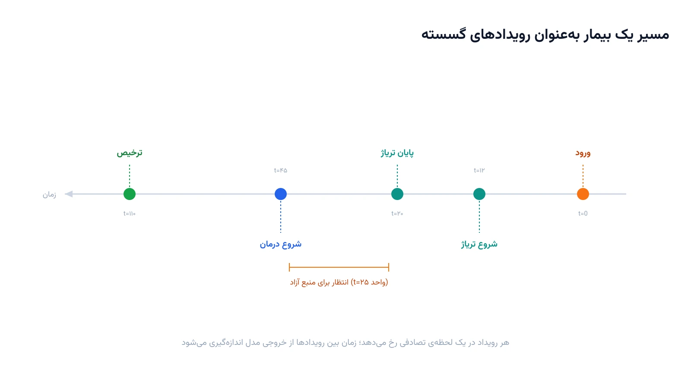

مدیر یک اورژانس بیمارستانی از خودش می‌پرسد: اگر یک پزشک دیگر استخدام کنم، صف انتظار واقعاً کوتاه‌تر می‌شود؟ یا اگر دو تخت مشاهده اضافه کنم، بیماران زودتر مرخص می‌شوند؟ او نمی‌تواند این تغییرات را روی بیماران واقعی امتحان کند. باید پیش از هر تصمیمی، جواب را به شکلی دیگر پیدا کند.

در بیشتر مطالب این سایت، پاسخ این سؤال‌ها از دل یک مدل بهینه‌سازی بیرون می‌آید. یک برنامه‌ریزی عدد صحیح، بهترین زمان‌بندی یا تخصیص را پیدا می‌کند. اما یک سؤال متفاوت هم وجود دارد. بیماران به‌طور تصادفی می‌رسند و مدت درمانشان نامعلوم است. چند بخش هم هم‌زمان منابع را به اشتراک می‌گذارند. سیستم واقعی دقیقاً چطور رفتار می‌کند؟ این سؤال را یک مدل بهینه‌سازی ساده جواب نمی‌دهد. اینجا نوبت به ابزاری دیگر می‌رسد: شبیه‌سازی رویداد گسسته یا Discrete Event Simulation (به‌اختصار DES).

در DES، سیستم به‌صورت دنباله‌ای از رویدادهای مجزا مدل می‌شود: ورود بیمار، شروع تریاژ، پایان تریاژ، شروع درمان، پایان درمان، ترخیص. هر رویداد در یک لحظه‌ی زمانی تصادفی رخ می‌دهد. کامپیوتر این رویدادها را یکی‌یکی و به ترتیب زمانی شبیه‌سازی می‌کند. در پایان، می‌توان میانگین زمان انتظار، طول صف و میزان اشغال منابع را مستقیماً از خروجی شبیه‌سازی اندازه گرفت.

### اهمیت این موضوع

ازدحام اورژانس یک مشکل جهانی است، نه فقط یک مشکل محلی. بیمارستانی مثل مایو کلینیک سال‌هاست از شبیه‌سازی رویداد گسسته برای تحلیل گلوگاه‌های جریان بیمار در اورژانس استفاده می‌کند. نظام سلامتی مثل NHS بریتانیا هم مدل‌های شبیه‌سازی را برای برنامه‌ریزی ظرفیت تخت و پرسنل به کار می‌گیرد.

ارزش DES در این است که پیش از هر تغییر واقعی، می‌توان آن را در دنیای مجازی امتحان کرد. اضافه‌کردن یک پزشک، تغییر قوانین تریاژ، یا بازچینی تخت‌ها، همه را می‌توان ابتدا در مدل آزمود. این یعنی بیمارستان ریسک مالی و بالینی یک تصمیم اشتباه را پیش از اجرا کشف می‌کند. دوره [بهینه‌سازی و تصمیم‌گیری سیستم سلامت با پایتون](/courses/health-opt/) این مکمل‌بودن شبیه‌سازی و بهینه‌سازی را در کنار هم آموزش می‌دهد.

نکته مهم دیگر این است که DES و بهینه‌سازی رقیب هم نیستند. می‌توان یک قانون زمان‌بندی بهینه را داخل مدل شبیه‌سازی گذاشت و رفتار واقعی آن را زیر عدم‌قطعیت کامل آزمایش کرد. این ترکیب را در ادبیات پژوهشی به آن شبیه‌سازی-بهینه‌سازی یا Simulation Optimization می‌گویند.

### چارچوب ریاضی مسئله

پایه‌ی نظری DES از تئوری صف می‌آید. ساده‌ترین حالت، یک صف با نرخ ورود $\lambda$ و نرخ خدمت‌دهی $\mu$ برای هر سرور است. یکی از مفیدترین رابطه‌ها، قانون لیتل است:

$$L = \lambda W$$

در این رابطه، $L$ میانگین تعداد بیماران در سیستم و $\lambda$ نرخ ورود بیماران است. $W$ هم میانگین زمان حضور هر بیمار در سیستم را نشان می‌دهد. این رابطه برای هر سیستم صف پایدار برقرار است، فارغ از توزیع ورود یا خدمت.

مشکل اینجاست که فرمول‌های کلاسیک صف، مثل مدل $M/M/c$، فرض‌های ساده‌کننده زیادی دارند. آن‌ها معمولاً یک کلاس بیمار و یک منبع یکنواخت فرض می‌کنند. اما یک اورژانس واقعی چند کلاس بیمار بر اساس شدت دارد. همچنین چند نوع منبع مثل پزشک، پرستار و تخت را هم‌زمان نیاز دارد. وقتی این پیچیدگی‌ها اضافه شوند، فرمول بسته دیگر جواب نمی‌دهد. اینجا دقیقاً همان‌جایی است که شبیه‌سازی رویداد گسسته جایگزین فرمول تحلیلی می‌شود.

### ظرفیت کار آکادمیک و پژوهشی

این حوزه برای پژوهش بسیار باز است. بیشتر مطالعات موجود، یک بخش اورژانس خاص را با پارامترهای محلی شبیه‌سازی می‌کنند. تعمیم این مدل‌ها به بیمارستان‌های دیگر هنوز چالش باز پژوهشی است.

یک مسیر جذاب، ترکیب شبیه‌سازی با یادگیری ماشین برای پیش‌بینی نرخ ورود بیماران است. اگر مدل بداند فردا چند بیمار می‌آیند، می‌تواند سناریوهای ظرفیت را دقیق‌تر بسنجد. مسیر دیگر، اعتبارسنجی مدل‌های شبیه‌سازی با داده واقعی بیمارستان‌هاست؛ کاری که هنوز به‌اندازه کافی استاندارد نشده است.

جهت پژوهشی تازه‌تر، دوقلوی دیجیتال بیمارستان است: مدلی زنده که پیوسته با داده واقعی به‌روزرسانی می‌شود. این زمینه برای پایان‌نامه و مقاله، هم در علوم کامپیوتر و هم در مدیریت خدمات سلامت، فضای زیادی برای کار دارد.

### پیاده‌سازی با پایتون

برای شبیه‌سازی رویداد گسسته هم مثل بهینه‌سازی، نیازی به نرم‌افزار گران‌قیمت نیست. [SimPy](https://simpy.readthedocs.io/) محبوب‌ترین کتابخانه متن‌باز پایتون برای این کار است. این ابزار امکان تعریف منابع محدود، مثل تعداد پزشک یا تخت، و فرآیندهای تصادفی ورود و خدمت را می‌دهد.

ساختار کلی مدل این‌طور است: یک فرآیند مولد بیمار، با فاصله‌های زمانی تصادفی، بیماران جدید وارد سیستم می‌کند. هر بیمار به‌نوبت درخواست منابعی مثل پزشک یا تخت مشاهده می‌دهد. اگر منبع آزاد نباشد، بیمار در صف منتظر می‌ماند. مدت درمان هم از یک توزیع احتمالی، مثل توزیع نمایی یا مثلثی، نمونه‌گیری می‌شود.

بعد از اجرای مدل برای چندین تکرار مستقل، میانگین زمان انتظار و میزان اشغال هر منبع را می‌توان با [pandas](https://pandas.pydata.org/) محاسبه کرد. سپس همین مدل را یک‌بار با پزشک فعلی و یک‌بار با یک پزشک اضافه اجرا می‌کنیم. مقایسه دو نتیجه، جواب دقیق همان سؤال اولیه مدیر اورژانس را می‌دهد.

اگر هدف نهایی تصمیم بهینه باشد، نه فقط ارزیابی یک سناریو، می‌توان همین مدل شبیه‌سازی را با یک سالور ترکیب کرد. مطالب دیگر همین سایت، ساخت مدل تخصیص بهینه با [OR-Tools](https://developers.google.com/optimization) را نشان می‌دهند. ترکیب آن مدل با خروجی این شبیه‌سازی، تصویر کامل‌تری از تصمیم واقعی به مدیر بیمارستان می‌دهد.

اگر به [انجام پروژه بهینه‌سازی](/consultation/) برای مسئله خودتان نیاز دارید یا می‌خواهید [مدل‌سازی ریاضی](/courses/optimization-modeling/) را از پایه یاد بگیرید، این دو صفحه نقطه شروع خوبی هستند.

### سوالات متداول

<h3>آیا شبیه‌سازی جایگزین مدل‌های بهینه‌سازی سایت می‌شود؟</h3>

خیر. این دو مکمل هم‌اند، نه رقیب. بهینه‌سازی بهترین تصمیم را زیر فرض‌های مشخص پیدا می‌کند. شبیه‌سازی هم نشان می‌دهد آن تصمیم در دنیای واقعی و زیر عدم‌قطعیت کامل چطور عمل می‌کند. دوره <a href="/courses/health-opt/" style="color:#2563EB; font-weight:bold;">بهینه‌سازی و تصمیم‌گیری سیستم سلامت با پایتون</a> هر دو رویکرد را کنار هم آموزش می‌دهد.

<h3>آیا این روش فقط برای اورژانس کاربرد دارد؟</h3>

نه. همین چارچوب برای درمانگاه سرپایی، آزمایشگاه، داروخانه بیمارستانی و حتی خط تولید کارخانه هم قابل استفاده است. هر جا صف، منبع محدود و رویداد تصادفی وجود داشته باشد، DES جواب می‌دهد.

<h3>برای پیاده‌سازی این مدل روی داده واقعی بیمارستانم چه کار کنم؟</h3>

ساخت یک مدل شبیه‌سازی دقیق نیاز به داده واقعی ورود بیماران و زمان خدمت هر بخش دارد. بهترین راه برای تطبیق این مدل با شرایط واقعی بیمارستان شما، گرفتن <a href="/consultation/" style="color:#2563EB; font-weight:bold;">مشاوره</a> تخصصی است.

