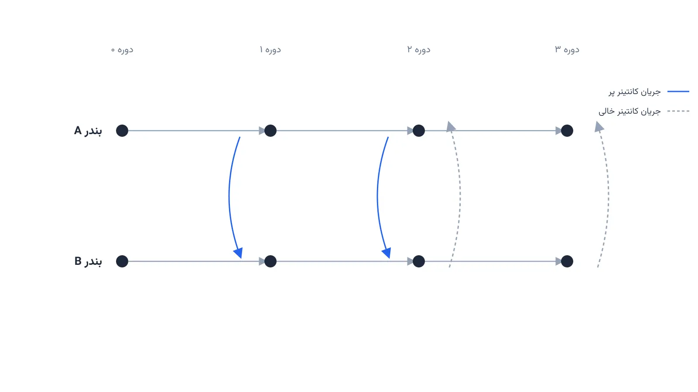

هر بار که یک کشتی کانتینری از شانگهای به سمت لس‌آنجلس حرکت می‌کند، معمولاً پر از بار است. اما مسیر برگشت داستان دیگری دارد. بخش بزرگی از کانتینرهایی که به آسیا برمی‌گردند، خالی هستند. طبق برآوردهای صنعت کشتیرانی، نزدیک به یک‌سوم جابه‌جایی‌های کانتینری جهان اصلاً باری ندارند. این یعنی سوخت، فضای کشتی و زمان کارکنان بندر صرف جابه‌جایی چیزی می‌شود که هیچ درآمدی تولید نمی‌کند.

این اتفاق تصادفی نیست. چین و بسیاری از کشورهای آسیایی صادرکننده خالص کالا هستند. آمریکا و اروپا بیشتر واردکننده‌اند. پس کانتینرهای پر عمدتاً در یک جهت حرکت می‌کنند. در مسیر برگشت، کانتینرهای خالی باید به‌نوعی به نقطه شروع بازگردند. در غیر این صورت، صادرکننده‌ها کانتینر خالی برای بارگیری کالای بعدی نخواهند داشت.

این چالش در ادبیات بهینه‌سازی زنجیره تأمین به «بازگردانی کانتینر خالی» یا Empty Container Repositioning معروف است. پرسش اصلی این است که چه تعداد کانتینر خالی، در چه زمانی، از کدام بندر به کدام بندر دیگر فرستاده شود. هدف، کمینه‌کردن هزینه کل حمل، اجاره و نگهداری کانتینرهاست، بدون اینکه هیچ بندری با کمبود مواجه شود. اگر پیش‌تر با [مسئله تخصیص اسکله به کشتی‌ها](/notes/berth-allocation-problem/) آشنا باشید، می‌دانید تصمیم‌های بندری چقدر به هم وابسته‌اند. بازگردانی کانتینر هم دقیقاً همین‌جا اتفاق می‌افتد، کنار برنامه‌ریزی اسکله و جرثقیل.

شرکتی مثل مرسک (Maersk)، یکی از بزرگ‌ترین اپراتورهای کانتینری دنیا، این مسئله را به‌روشنی تأیید کرده است. به گفته این شرکت، هزینه بازگردانی کانتینر در برخی مسیرها آن‌قدر بالاست که از نظر اقتصادی توجیه ندارد. شرکت‌هایی مانند MSC و کوسکو (COSCO) هم روزانه با همین معما دست‌وپنجه نرم می‌کنند. یک تصمیم ضعیف در این حوزه، یعنی میلیون‌ها دلار هزینه اضافی در طول یک سال، فقط برای جابه‌جایی جعبه‌های خالی فلزی.

## اهمیت این موضوع

اهمیت این مسئله فقط به کاهش هزینه حمل‌ونقل محدود نمی‌شود. در دوران بحران کرونا، این موضوع به‌خوبی نمایان شد. تقاضای واردات آمریکا ناگهان جهش کرد و کانتینرهای خالی در بنادر آسیا گیر کردند. نبود کانتینر خالی برای بارگیری، صادرات بسیاری از کارخانه‌های کوچک را هم مختل کرد. نرخ اجاره یک کانتینر استاندارد در برخی مسیرها چندین برابر شد و این هزینه مستقیماً به قیمت کالاهای مصرفی منتقل شد.

بهینه‌سازی بازگردانی کانتینر، روی قیمت تمام‌شده کالاهای وارداتی اثر مستقیم می‌گذارد. هر دلار صرفه‌جویی در این هزینه پنهان، به کاهش کرایه حمل برای همه کمک می‌کند. همین موضوع رقابت‌پذیری صادرکنندگان کشورهای در حال توسعه را هم بهبود می‌بخشد. به همین دلیل، بنادر بزرگی مانند روتردام و سنگاپور روی سامانه‌های هوشمند مدیریت کانتینر خالی سرمایه‌گذاری کرده‌اند. کاهش جابه‌جایی‌های خالی، مصرف سوخت کشتی‌ها را هم پایین می‌آورد و اثر زیست‌محیطی ناوگان تجاری را کم می‌کند.

کسی که پیش‌تر با مدل‌های مسیریابی و شبکه آشنا باشد، این مسئله برایش آشناست. در عمل، این یک برنامه‌ریزی خطی چندمرحله‌ای روی زمان و مکان است. دوره [مسیریابی وسایل نقلیه با پایتون](/courses/vrp-python/) دقیقاً همین نوع مدل‌های شبکه‌ای را با مثال‌های عملی و کد واقعی آموزش می‌دهد.



## فرمول‌بندی ریاضی مسئله

برای مدل‌سازی، هر بندر را یک گره شبکه و هر مسیر دریایی بین دو بندر را یک یال جهت‌دار در نظر می‌گیریم. این شبکه در طول زمان هم گسترش می‌یابد، چون تصمیم هر دوره روی موجودی دوره بعد اثر دارد. چنین ساختاری را در ادبیات بهینه‌سازی «شبکه زمان-مکان» می‌نامند.

متغیر $x_{ij}^t$ تعداد کانتینر خالی ارسالی از بندر $i$ به بندر $j$ در دوره $t$ است. متغیر $I_i^t$ موجودی کانتینر خالی بندر $i$ در پایان دوره $t$ را نشان می‌دهد. پارامتر $d_i^t$ کسری یا مازاد کانتینر آن بندر در آن دوره را مشخص می‌کند. وقتی $d_i^t$ منفی باشد، یعنی بندر $i$ در دوره $t$ به کانتینر بیشتری نیاز دارد.

تابع هدف، مجموع هزینه حمل کانتینرهای خالی و هزینه نگهداری موجودی را کمینه می‌کند:

$$ \min \sum_{t \in T} \sum_{(i,j) \in A} c_{ij}\, x_{ij}^{t} \;+\; \sum_{t \in T} \sum_{i \in P} h_i\, I_i^{t} $$

قید اصلی مدل، موازنه موجودی هر بندر در هر دوره است. موجودی پایان دوره، برابر موجودی قبلی به‌علاوه ورودی‌ها منهای خروجی‌ها و تقاضای خالص است:

$$ I_i^{t} = I_i^{t-1} + \sum_{j} x_{ji}^{t-\tau_{ji}} - \sum_{j} x_{ij}^{t} + d_i^{t} \qquad \forall i \in P,\ t \in T $$

و البته همه متغیرها باید نامنفی باشند:

$$ x_{ij}^{t} \ge 0, \qquad I_i^{t} \ge 0 $$

این فرمول‌بندی در واقع یک مسئله کلاسیک «جریان کمینه‌هزینه» روی یک شبکه گسترش‌یافته در زمان است. همین ساختار ساده، پایه اغلب سامانه‌های تجاری مدیریت کانتینر در دنیای واقعی را تشکیل می‌دهد.

## پیاده‌سازی با پایتون

خبر خوب این است که برای حل این مدل، نیازی به نرم‌افزار گران‌قیمت تجاری نیست. ابزارهای متن‌باز پایتون به‌خوبی از پس مسائل جریان شبکه و برنامه‌ریزی خطی برمی‌آیند. [OR-Tools](https://developers.google.com/optimization) گوگل، با ماژول سالور خطی خودش، گزینه‌ای سریع و رایگان است. کتابخانه [NetworkX](https://networkx.org/) هم الگوریتم‌های آماده جریان کمینه‌هزینه دارد که برای نمونه‌های کوچک‌تر بسیار کاربردی‌اند.

برای مسائل بزرگ‌تر، می‌توان مدل را با [PuLP](https://coin-or.github.io/pulp/) نوشت و با سالورهای متن‌باز مانند [CBC](https://github.com/coin-or/Cbc) یا [HiGHS](https://highs.dev/) حل کرد. داده ورودی این مدل معمولاً شامل حجم صادرات و واردات هر بندر در هر دوره است. هزینه حمل بین هر جفت بندر و ظرفیت کشتی‌ها هم بخش دیگر این داده‌هاست. این داده‌ها را می‌توان از یک فایل اکسل یا CSV شامل ستون‌های بندر مبدأ، بندر مقصد، هزینه و زمان سفر خواند.

یک اسکلت ساده برای شروع مدل‌سازی با OR-Tools این‌طور شروع می‌شود:

```python
from ortools.linear_solver import pywraplp

solver = pywraplp.Solver.CreateSolver("CBC")

ports = ["shanghai", "los_angeles", "rotterdam"]
periods = range(4)

# متغیر تصمیم: تعداد کانتینر خالی ارسالی از هر بندر به بندر دیگر در هر دوره
x = {}
for i in ports:
    for j in ports:
        if i == j:
            continue
        for t in periods:
            x[i, j, t] = solver.NumVar(0, solver.infinity(), f"x_{i}_{j}_{t}")

# موجودی کانتینر خالی هر بندر در پایان هر دوره
inventory = {
    (p, t): solver.NumVar(0, solver.infinity(), f"I_{p}_{t}")
    for p in ports for t in periods
}

# ادامه قید موازنه موجودی برای هر بندر و هر دوره، و تعریف تابع هدف کمینه‌سازی هزینه،
# به همین شیوه با حلقه روی ports و periods نوشته می‌شود.
```

این کد فقط اسکلت اولیه مدل را نشان می‌دهد، نه یک پیاده‌سازی کامل و آماده اجرا. در عمل باید قید موازنه موجودی، هزینه‌های واقعی هر مسیر و زمان سفر بین بنادر هم اضافه شوند.

## ظرفیت کار آکادمیک و پژوهشی

بازگردانی کانتینر خالی، یکی از پرکارترین حوزه‌های پژوهشی در بهینه‌سازی حمل‌ونقل دریایی است. مدل پایه‌ای که در این مطلب دیدیم، قطعی و ساده‌شده است. اما دنیای واقعی پر از عدم‌قطعیت در تقاضای صادرات و واردات هر بندر است. همین موضوع فضای زیادی برای برنامه‌ریزی تصادفی و بهینه‌سازی مقاوم باز می‌کند.

یک مسیر پژوهشی جذاب دیگر، ترکیب بازگردانی دریایی با جابه‌جایی زمینی کانتینر بین بنادر و مراکز داخلی است. این موضوع مستقیماً به [انتخاب حالت حمل‌ونقل سبز](/notes/green-intermodal-mode-selection/) هم مربوط می‌شود، چون هر بار جابه‌جایی کانتینر خالی هم رد پای کربن دارد. موضوع دیگر، سامانه‌های تطبیق مستقیم بین واردکننده و صادرکننده محلی است. به این ایده «street turn» می‌گویند و نیاز به بازگشت کانتینر به بندر را کم می‌کند. برای شبکه‌های بسیار بزرگ، روش‌های ابتکاری مانند جستجوی همسایگی بزرگ هم می‌توانند جایگزین سالورهای دقیق شوند. این حوزه، گزینه‌ای مناسب برای پایان‌نامه کارشناسی ارشد یا مقاله در ژورنال‌های حمل‌ونقل و لجستیک است.

## سوالات متداول

<h3>آیا این مدل فقط برای خطوط بزرگ کشتیرانی کاربرد دارد؟</h3>
<p>نه. حتی اپراتورهای کوچک‌تر کانتینر یا شرکت‌های لجستیک ریلی و جاده‌ای هم با نسخه ساده‌تر همین مسئله روبه‌رو هستند، مثلاً در بازگردانی تریلر یا قفسه خالی بین انبارها.</p>

<h3>برای یادگیری این مدل‌های شبکه‌ای از کجا شروع کنیم؟</h3>
<p>دوره <a href="/courses/vrp-python/" style="color:#2563EB; font-weight:bold;">مسیریابی وسایل نقلیه با پایتون</a> پایه مدل‌سازی جریان و شبکه را با مثال‌های عملی و کد واقعی آموزش می‌دهد و نقطه شروع خوبی است.</p>

<h3>آیا می‌شود این مدل را برای داده‌های واقعی شرکت خودمان پیاده‌سازی کرد؟</h3>
<p>بله، برای تطبیق این مدل با بنادر، هزینه‌ها و ناوگان اختصاصی شرکت شما می‌توانید از <a href="/consultation/" style="color:#2563EB; font-weight:bold;">مشاوره</a> کمک بگیرید.</p>
