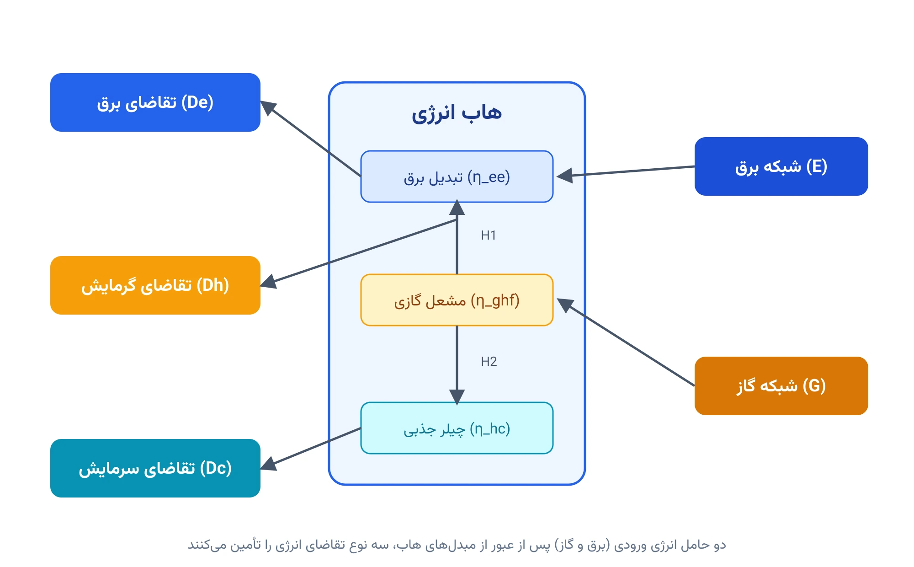
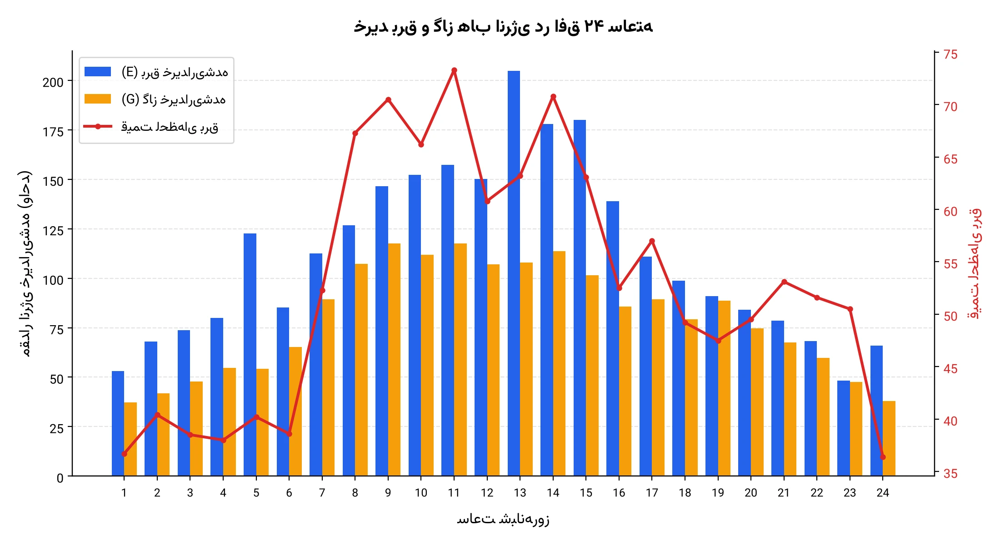

## مقدمه: هاب انرژی چیست؟

تا امروز بیشتر مدل‌هایی که در این سایت بررسی کرده‌ایم، تنها یک حامل انرژی را در نظر می‌گیرند؛ معمولاً برق. اما در دنیای واقعی، یک ساختمان تجاری، یک پردیس دانشگاهی یا یک منطقه صنعتی، هم‌زمان به چند حامل انرژی نیاز دارد: برق برای روشنایی و تجهیزات، گرما برای گرمایش فضا، و سرما برای تهویه مطبوع. این تقاضاها معمولاً از چند منبع ورودی مختلف، مثل شبکه برق سراسری و شبکه گاز طبیعی، تأمین می‌شوند. چارچوب ریاضی‌ای که نحوه تبدیل چند حامل انرژی ورودی به چند حامل انرژی خروجی را مدل می‌کند، **هاب انرژی (Energy Hub)** نام دارد.

یک هاب انرژی را می‌توان مثل یک جعبه سیاه در نظر گرفت که از یک طرف چند نوع انرژی وارد آن می‌شود (در این مدل: برق و گاز طبیعی)، درون آن چند مبدل انرژی (مثل ترانسفورماتور، مشعل گازی، یا چیلر جذبی) این ورودی‌ها را پردازش می‌کنند، و از طرف دیگر چند نوع تقاضای انرژی (در این مدل: برق، گرما و سرما) تأمین می‌شود. این مفهوم پایه بسیاری از مطالعات امروزی حوزه **سیستم‌های چندحامل انرژی (Multi-Carrier Energy Systems)** و **تلفیق بخش‌های انرژی (Sector Coupling)** است؛ موضوعی که با گسترش شبکه‌های گرمایش منطقه‌ای، پمپ‌های حرارتی، و تولید همزمان برق و حرارت (CHP) اهمیت روزافزونی پیدا کرده است.

مدلی که در این یادداشت بررسی می‌کنیم، مدل **Gcode10.3** از کتاب زیر است:

> Soroudi, Alireza. *Power System Optimization Modeling in GAMS*. Springer, 2017. DOI: [10.1007/978-3-319-62350-4](https://doi.org/10.1007/978-3-319-62350-4)

این مدل، نسخه مقدماتی و آموزشی هاب انرژی را در افق زمانی ۲۴ ساعته نشان می‌دهد؛ ساختاری ساده که پایه ورود به مدل‌های پیچیده‌تر با انعطاف بیشتر (مثل CHP یا ذخیره‌ساز حرارتی) است.

## فرمول‌بندی ریاضی مسئله

در این مدل، هاب انرژی دو ورودی دارد: توان برق خریداری‌شده از شبکه $E_t$ و حجم گاز طبیعی خریداری‌شده $G_t$. سه نوع تقاضا هم باید در هر ساعت $t$ تأمین شود: تقاضای برق $D^e_t$، تقاضای گرمایش $D^h_t$، و تقاضای سرمایش $D^c_t$.

**تابع هدف** کمینه‌کردن هزینه کل خرید انرژی در طول افق ۲۴ ساعته است. قیمت برق $\lambda_t$ ساعت‌به‌ساعت تغییر می‌کند، اما قیمت گاز طبیعی ثابت و برابر ۱۲ واحد پولی به ازای هر واحد انرژی در نظر گرفته شده است:

$$
\min \; \text{Cost} = \sum_{t} \left( \lambda_t \, E_t + 12 \, G_t \right)
$$

**تعادل برق**: توان خریداری‌شده از شبکه، پس از اعمال ضریب تلفات/بازده $\eta_{ee}$، باید دقیقاً برابر تقاضای برق باشد:

$$
\eta_{ee} \, E_t = D^e_t \qquad \forall t
$$

**تعادل گرمایش مستقیم**: بخشی از گرمای تولیدشده توسط مشعل گازی، $H1_t$، مستقیماً صرف تأمین تقاضای گرمایش می‌شود:

$$
H1_t = D^h_t \qquad \forall t
$$

**تعادل مشعل گازی (Gas-Fired Heater)**: گاز خریداری‌شده با بازده $\eta_{ghf}$ به گرما تبدیل می‌شود؛ این گرما بین دو مصرف تقسیم می‌شود: تأمین مستقیم گرمایش ($H1_t$) و تغذیه چیلر جذبی ($H2_t$):

$$
\eta_{ghf} \, G_t = H1_t + H2_t \qquad \forall t
$$

**تعادل چیلر جذبی (Absorption Chiller)**: بخشی از گرمای تولیدشده که به چیلر جذبی می‌رود، با بازده $\eta_{hc}$ به سرما تبدیل می‌شود و باید دقیقاً تقاضای سرمایش را پوشش دهد:

$$
\eta_{hc} \, H2_t = D^c_t \qquad \forall t
$$

همچنین متغیر $H2_t$ از بالا به ظرفیت نامی چیلر جذبی، $CB^{max}$، محدود است:

$$
0 \le H2_t \le CB^{max} \qquad \forall t
$$

نکته مهمی که در ادامه با جزئیات بیشتر به آن می‌پردازیم این است: هر چهار معادله این مدل، به‌صورت **تساوی** نوشته شده‌اند، نه نامساوی. این یعنی هیچ‌کدام از متغیرهای $E_t$, $H1_t$, $G_t$, $H2_t$ واقعاً «درجه آزادی» برای انتخاب ندارند؛ هر یک مستقیماً از روی داده‌های تقاضا و بازده تجهیزات محاسبه می‌شود. مسئله کمینه‌سازی در این حالت خاص، صرفاً محاسبه هزینه یک جواب یکتا و از‌پیش‌تعیین‌شده است، نه انتخاب بین چند مسیر تأمین انرژی.

## کد کامل GAMS (Gcode10.3)

کد زیر دقیقاً همان کدی است که کاربر در اختیار قرار داده و بدون هیچ تغییری آورده شده است:

```gams
$title Optimal operation of energy hub

$onText
For more details please refer to Chapter 10 (Gcode10.3), of the following book:
Soroudi, Alireza. Power System Optimization Modeling in GAMS. Springer, 2017.
--------------------------------------------------------------------------------
Model type: MIP
--------------------------------------------------------------------------------
Contributed by
Dr. Alireza Soroudi
IEEE Senior Member
email: alireza.soroudi@gmail.com
We do request that publications derived from the use of the developed GAMS code
explicitly acknowledge that fact by citing
Soroudi, Alireza. Power System Optimization Modeling in GAMS. Springer, 2017.
DOI: doi.org/10.1007/978-3-319-62350-4
$offText

Set t 'hours' / t1*t24 /;

Table data(t,*)
        Dh    De     Dc    lambda
   t1   21.4  52.1   11.5  36.7
   t2   23.2  66.7   13.7  40.4
   t3   26.1  72.2   16    38.5
   t4   26.7  78.4   21.4  38
   t5   25.6  120.2  22    40.2
   t6   26.4  83.5   30.8  38.6
   t7   39.5  110.4  38.9  52.3
   t8   47.3  124.3  46.8  67.3
   t9   52.1  143.6  51    70.5
   t10  49.1  149.3  48.9  66.2
   t11  69.3  154.2  34.8  73.3
   t12  62    147.3  32.7  60.8
   t13  68    200.7  27.8  63.2
   t14  68.6  174.4  32    70.8
   t15  56.4  176.5  33.2  63.1
   t16  41.3  136.1  34.1  52.5
   t17  37.4  108.7  40.8  57
   t18  25.4  96.9   43.6  49.2
   t19  25.7  89.1   51.5  47.5
   t20  21.9  82.5   43.1  49.5
   t21  22.4  76.9   36.5  53.1
   t22  24.6  66.8   27.7  51.6
   t23  22.7  47.2   19.1  50.5
   t24  22.6  64.7   11    36.4;

Scalar
   CBmax   / 500  /
   eta_ee  / 0.98 /
   eta_ghf / 0.9  /
   eta_hc  / 0.95 /;

Variable cost;
Positive Variable E(t), G(t), H1(t), H2(t);
H2.up(t) = CBmax;

Equation eq1, eq2, eq3, eq4, eq5;
eq1..    cost =e= sum(t, data(t,'lambda')*E(t) + 12*G(t));
eq2(t).. eta_ee*E(t) =e= data(t,'De');
eq3(t).. H1(t) =e= data(t,'Dh');
eq4(t).. eta_ghf*G(t) =e= H1(t) + H2(t);
eq5(t).. eta_hc*H2(t) =e= data(t,'Dc');

Model Hub / all /;
solve hub using lp minimizing cost;

Parameter report(t,*);
report(t,'E')  = E.l(t);
report(t,'G')  = G.l(t);
report(t,'h1') = h1.l(t);
report(t,'h2') = h2.l(t);
display report;
```

### توضیح خط‌به‌خط کد

- **`Set t 'hours'`** افق زمانی ۲۴ ساعته روزانه را از `t1` تا `t24` تعریف می‌کند.
- **`Table data(t,*)`** چهار سری داده را در یک جدول واحد نگه می‌دارد: تقاضای گرمایش (`Dh`)، تقاضای برق (`De`)، تقاضای سرمایش (`Dc`) و قیمت لحظه‌ای برق (`lambda`). استفاده از یک `Table` به‌جای چهار `Parameter` جداگانه، خواندن و نگهداری داده را در مدل‌های چندمتغیره ساده‌تر می‌کند.
- **`Scalar`** چهار پارامتر ثابت مدل را تعریف می‌کند: ظرفیت چیلر جذبی (`CBmax`) و سه بازده تبدیل انرژی (`eta_ee`, `eta_ghf`, `eta_hc`).
- **`Variable cost`** هزینه کل را به‌عنوان یک متغیر آزاد (free) تعریف می‌کند؛ چون می‌تواند هر عدد حقیقی‌ای باشد (هرچند در عمل همیشه مثبت است).
- **`Positive Variable E(t), G(t), H1(t), H2(t)`** چهار متغیر تصمیم اصلی مدل را تعریف می‌کند که همگی باید نامنفی باشند: برق خریداری‌شده، گاز خریداری‌شده، گرمای مستقیم، و گرمای ارسالی به چیلر جذبی.
- **`H2.up(t) = CBmax`** کران بالای متغیر `H2` را مستقیماً روی ظرفیت چیلر جذبی تنظیم می‌کند؛ این یک قید کران ساده روی متغیر است، نه یک معادله مجزا.
- **`eq1`** تابع هدف را تعریف می‌کند: مجموع هزینه برق (با قیمت ساعتی متغیر `lambda`) به‌علاوه هزینه گاز (با قیمت ثابت ۱۲ واحد).
- **`eq2(t)`** تعادل برق است: برق خریداری‌شده، پس از ضرب در بازده `eta_ee`، باید دقیقاً برابر تقاضای برق همان ساعت باشد.
- **`eq3(t)`** گرمای مستقیم (`H1`) را دقیقاً برابر تقاضای گرمایش قرار می‌دهد؛ یعنی هیچ ذخیره‌سازی یا مسیر جایگزینی برای تأمین گرما وجود ندارد.
- **`eq4(t)`** تعادل مشعل گازی است: گاز ورودی، پس از ضرب در بازده احتراق `eta_ghf`، بین دو مصرف‌کننده گرما (گرمایش مستقیم و چیلر جذبی) تقسیم می‌شود.
- **`eq5(t)`** تعادل چیلر جذبی است: گرمای ارسالی به چیلر، پس از ضرب در ضریب عملکرد `eta_hc`، باید دقیقاً تقاضای سرمایش را پوشش دهد.
- **`Model Hub / all /`** همه معادلات تعریف‌شده را در یک مدل واحد به نام `Hub` جمع می‌کند.
- **`solve hub using lp minimizing cost`** مدل را به‌عنوان یک برنامه‌ریزی خطی (LP) حل می‌کند. نکته جالب اینجاست که سرتیتر توضیحات کد (`$onText`) نوع مدل را `MIP` معرفی کرده، اما مدلی که واقعاً حل می‌شود هیچ متغیر صحیح یا باینری‌ای ندارد و دستور `solve` هم صراحتاً از `lp` استفاده می‌کند. این‌جور مغایرت‌های کوچک بین توضیحات و پیاده‌سازی واقعی، در کدهای آموزشی غیرعادی نیست؛ احتمالاً برچسب `MIP` از نسخه‌های کامل‌تر همین مدل در فصل دهم کتاب (که شاید شامل تصمیم‌های باینری سرمایه‌گذاری یا روشن/خاموش بودن تجهیزات باشند) به این نسخه ساده‌شده منتقل شده است.
- بلوک پایانی **`Parameter report`** مقادیر بهینه چهار متغیر تصمیم را در یک جدول گزارش جمع‌آوری و با `display` چاپ می‌کند؛ دقیقاً همان کاری که در پیاده‌سازی پایتون آن را با ساخت یک دیکشنری یا دیتافریم انجام می‌دهیم.

## چرا هر چهار معادله «تساوی» هستند؟

اگر به چهار معادله `eq2` تا `eq5` دقت کنید، متوجه نکته مهمی می‌شوید: هیچ‌کدام مسیر جایگزینی برای تأمین انرژی تعریف نمی‌کنند. تقاضای برق فقط از شبکه برق تأمین می‌شود، تقاضای گرمایش فقط از مشعل گازی، و تقاضای سرمایش فقط از چیلر جذبی (که آن هم فقط از گرمای مشعل گازی تغذیه می‌شود). به همین دلیل، با مشخص‌بودن داده‌های تقاضا و بازده تجهیزات، مقدار هر چهار متغیر تصمیم به‌صورت یکتا تعیین می‌شود؛ حل‌کننده خطی فقط هزینه همین جواب یکتا را محاسبه می‌کند.

این ویژگی، این نسخه از مدل را بیشتر یک **ابزار آموزشی برای معرفی ساختار موازنه انرژی در هاب** می‌کند تا یک مسئله بهینه‌سازی با انتخاب واقعی. نسخه‌های واقعی‌تر و پژوهشی‌تر هاب انرژی، معمولاً مسیرهای جایگزین اضافه می‌کنند تا مسئله واقعاً «بهینه‌سازی» شود، نه فقط «محاسبه». نمونه‌هایی از این مسیرهای اضافه عبارت‌اند از:

- افزودن یک **پمپ حرارتی الکتریکی (Electric Heat Pump)** در کنار مشعل گازی، به‌طوری‌که تقاضای گرمایش بتواند هم از برق و هم از گاز تأمین شود؛ این باعث می‌شود مدل واقعاً بین دو منبع انرژی انتخاب کند.
- افزودن یک **چیلر الکتریکی (Electric Chiller)** به‌عنوان جایگزین چیلر جذبی، تا تقاضای سرمایش هم مسیر برق را داشته باشد.
- افزودن **ذخیره‌ساز حرارتی یا برقی (Thermal/Battery Storage)**، که اجازه می‌دهد انرژی ارزان یک ساعت برای مصرف ساعت‌های گران‌تر ذخیره شود.
- افزودن واحد **تولید همزمان برق و حرارت (CHP)**، که گاز را هم‌زمان به برق و گرما تبدیل می‌کند و یک مسیر تأمین برق جایگزین شبکه سراسری ایجاد می‌کند؛ در این حالت معمولاً متغیرهای باینری روشن/خاموش بودن واحد هم به مدل اضافه می‌شود و مسئله را به یک MIP واقعی تبدیل می‌کند (شاید دقیقاً همین‌جا توضیح برچسب `MIP` در کد اصلی کتاب معنا پیدا کند).



## پیاده‌سازی با پایتون (Pyomo + HiGHS)

برای بازتولید همین مدل در پایتون، از **Pyomo** برای مدل‌سازی و از حل‌کننده متن‌باز **HiGHS** برای حل استفاده می‌کنیم. چون مدل یک LP ساده است، نیازی به هیچ سالور تجاری نیست.

```python
from pyomo.environ import *

T = [f"t{k}" for k in range(1, 25)]

# (Dh, De, Dc, lambda) برای هر ساعت
data = {
    "t1": (21.4, 52.1, 11.5, 36.7),   "t2": (23.2, 66.7, 13.7, 40.4),
    "t3": (26.1, 72.2, 16.0, 38.5),   "t4": (26.7, 78.4, 21.4, 38.0),
    "t5": (25.6, 120.2, 22.0, 40.2),  "t6": (26.4, 83.5, 30.8, 38.6),
    "t7": (39.5, 110.4, 38.9, 52.3),  "t8": (47.3, 124.3, 46.8, 67.3),
    "t9": (52.1, 143.6, 51.0, 70.5),  "t10": (49.1, 149.3, 48.9, 66.2),
    "t11": (69.3, 154.2, 34.8, 73.3), "t12": (62.0, 147.3, 32.7, 60.8),
    "t13": (68.0, 200.7, 27.8, 63.2), "t14": (68.6, 174.4, 32.0, 70.8),
    "t15": (56.4, 176.5, 33.2, 63.1), "t16": (41.3, 136.1, 34.1, 52.5),
    "t17": (37.4, 108.7, 40.8, 57.0), "t18": (25.4, 96.9, 43.6, 49.2),
    "t19": (25.7, 89.1, 51.5, 47.5),  "t20": (21.9, 82.5, 43.1, 49.5),
    "t21": (22.4, 76.9, 36.5, 53.1),  "t22": (24.6, 66.8, 27.7, 51.6),
    "t23": (22.7, 47.2, 19.1, 50.5),  "t24": (22.6, 64.7, 11.0, 36.4),
}
Dh = {t: v[0] for t, v in data.items()}
De = {t: v[1] for t, v in data.items()}
Dc = {t: v[2] for t, v in data.items()}
lam = {t: v[3] for t, v in data.items()}

eta_ee, eta_ghf, eta_hc = 0.98, 0.9, 0.95
CBmax = 500

m = ConcreteModel()
m.T = Set(initialize=T, ordered=True)

m.E = Var(m.T, within=NonNegativeReals)
m.G = Var(m.T, within=NonNegativeReals)
m.H1 = Var(m.T, within=NonNegativeReals)
m.H2 = Var(m.T, within=NonNegativeReals, bounds=(0, CBmax))

m.cost = Objective(
    expr=sum(lam[t] * m.E[t] + 12 * m.G[t] for t in m.T), sense=minimize
)

m.eq_elec = Constraint(m.T, rule=lambda m, t: eta_ee * m.E[t] == De[t])
m.eq_heat = Constraint(m.T, rule=lambda m, t: m.H1[t] == Dh[t])
m.eq_boiler = Constraint(
    m.T, rule=lambda m, t: eta_ghf * m.G[t] == m.H1[t] + m.H2[t]
)
m.eq_cool = Constraint(m.T, rule=lambda m, t: eta_hc * m.H2[t] == Dc[t])

# ادامه کد (فراخوانی حل‌کننده HiGHS و استخراج نتایج) در این‌جا آورده نشده است.
```

### درباره‌ی ساختار کد

- هر چهار معادله GAMS (`eq2` تا `eq5`) مستقیماً و بدون تغییر به چهار `Constraint` در Pyomo تبدیل شده‌اند؛ چون همگی تساوی هستند، نوشتن آن‌ها با `==` کاملاً معادل `=e=` در GAMS است.
- کران بالای `H2` به‌جای یک قید جداگانه، مستقیماً در `bounds=(0, CBmax)` هنگام تعریف متغیر اعمال شده است؛ این دقیقاً معادل `H2.up(t) = CBmax` در کد GAMS است.
- جدول `data(t,*)` در GAMS با یک دیکشنری پایتون جایگزین شده که چهار سری زمانی (`Dh`, `De`, `Dc`, `lam`) را از آن استخراج می‌کنیم؛ این ساختار خواناتر از نگهداری چهار دیکشنری مستقل از ابتدا است.
- چون مدل یک LP با متغیرهای پیوسته است، نیازی به رابط خاصی مثل `appsi_highs` نیست و `SolverFactory("highs")` معمولی به‌خوبی کار می‌کند.

## نتایج حل مدل

با اجرای مدل، حل‌کننده HiGHS جواب بهینه (`optimal`) را با هزینه کل **۱۷۳٬۵۷۰** واحد پولی پیدا می‌کند. همان‌طور که در بخش قبل اشاره شد، چون هر چهار معادله تساوی هستند، این عدد صرفاً هزینه یک جواب از‌پیش‌تعیین‌شده است و حل‌کننده هیچ انتخابی بین مسیرهای تأمین انرژی نداشته است.

تفکیک هزینه نشان می‌دهد سهم برق حدود ۱۵۰٬۷۰۳ واحد (معادل تقریباً ۸۷ درصد هزینه کل) و سهم گاز حدود ۲۲٬۸۶۸ واحد (تقریباً ۱۳ درصد) است؛ این نسبت طبیعی است، چون قیمت لحظه‌ای برق در بیشتر ساعات روز به‌مراتب بالاتر از قیمت ثابت گاز است. اوج خرید برق در ساعت ۱۳ (حدود ۲۰۵ واحد توان، متناظر با اوج تقاضای برق در همان ساعت) و اوج خرید گاز در ساعت ۱۱ (حدود ۱۱۸ واحد) رخ می‌دهد.



در نمودار بالا، منحنی برق خریداری‌شده دقیقاً الگوی تقاضای برق را دنبال می‌کند (با ضریب ثابت $1/\eta_{ee}$)، و مصرف گاز هم مجموع وزن‌دار تقاضای گرمایش و سرمایش را دنبال می‌کند. نبود هرگونه ناهمواری یا تغییر الگو نسبت به منحنی‌های تقاضا، دقیقاً همان رفتار «جواب یکتا» است که در بخش قبل توضیح داده شد.

## جمع‌بندی و مسیرهای توسعه

مدل Gcode10.3 یک نقطه شروع ساده و شفاف برای آشنایی با ساختار موازنه انرژی در یک هاب چندحامل است: چند ورودی انرژی، چند مبدل با بازده مشخص، و چند خروجی تقاضا. اما همان‌طور که دیدیم، نسخه فعلی مدل به دلیل نبود مسیر جایگزین برای هیچ‌کدام از تقاضاها، عملاً یک مسئله بهینه‌سازی با انتخاب واقعی نیست، بلکه یک محاسبه هزینه برای یک پیکربندی ثابت است.

برای تبدیل این مدل به یک مسئله بهینه‌سازی واقعی و قابل انتشار در یک مقاله پژوهشی، می‌توان:

- حداقل یک مسیر جایگزین برای هر تقاضا اضافه کرد (مثلاً پمپ حرارتی الکتریکی برای گرمایش یا چیلر الکتریکی برای سرمایش)، تا مدل واقعاً مجبور به انتخاب بین برق و گاز شود.
- واحد CHP و متغیرهای باینری روشن/خاموش را اضافه کرد تا مدل به یک MIP واقعی تبدیل شود؛ این دقیقاً همان مسیری است که در بسیاری از مقالات هاب انرژی دنبال می‌شود.
- عدم‌قطعیت قیمت برق یا تقاضا را با رویکرد تصادفی یا مقاوم (Stochastic/Robust) وارد مدل کرد.
- چند هاب انرژی را در قالب یک شبکه به هم متصل کرد تا اثرات تبادل انرژی بین چند ساختمان یا منطقه بررسی شود.

## مرجع

- Soroudi, Alireza. *Power System Optimization Modeling in GAMS*. Springer, 2017. DOI: [10.1007/978-3-319-62350-4](https://doi.org/10.1007/978-3-319-62350-4)

اگر به [انجام پروژه بهینه‌سازی](/consultation/) برای مسئله خودتان نیاز دارید یا می‌خواهید [مدل‌سازی ریاضی](/courses/optimization-modeling/) را از پایه یاد بگیرید، این دو صفحه نقطه شروع خوبی هستند.
