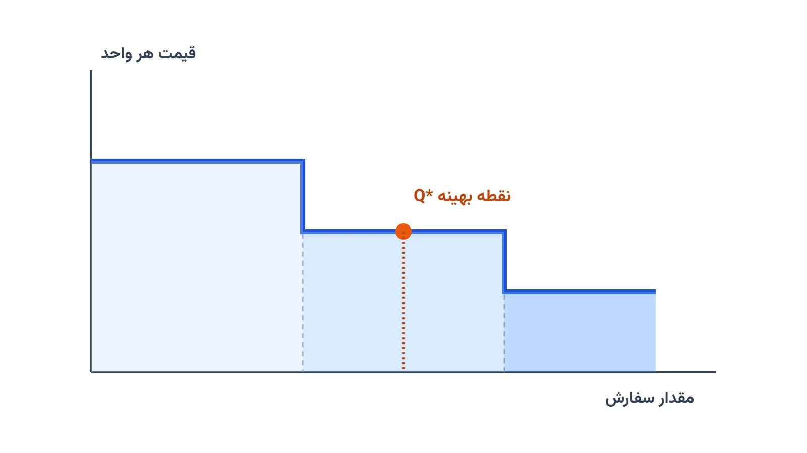

فرض کنید مسئول خرید یک فروشگاه زنجیره‌ای هستید. تأمین‌کننده یک پیشنهاد جذاب می‌دهد: اگر به‌جای صد عدد، سیصد عدد سفارش بدهید، قیمت هر واحد ده درصد کمتر می‌شود. وسوسه‌انگیز است، اما سفارش بزرگ‌تر یعنی انبار بزرگ‌تر، سرمایه راکد بیشتر و هزینه نگهداری سنگین‌تر. دقیقاً همین تنش، موضوع این یادداشت است: مدل اقتصادی مقدار سفارش یا Economic Order Quantity (به‌اختصار EOQ) وقتی قیمت واحد به حجم سفارش وابسته باشد.

## مسئله واقعی چیست؟

در حالت ساده و کلاسیک EOQ، قیمت هر واحد کالا ثابت فرض می‌شود. تنها چیزی که باید بهینه شود، موازنه بین هزینه سفارش‌دهی و هزینه نگهداری انبار است. اما در دنیای واقعی، تأمین‌کنندگان اغلب جدول قیمت پلکانی ارائه می‌دهند. برای مثال، تا صد واحد قیمت هر واحد ده هزار تومان است. از صد و یک تا چهارصد واحد، قیمت به نه هزار تومان می‌رسد. از چهارصد و یک واحد به بالا هم قیمت هشت هزار تومان می‌شود.

این تغییر قیمت، مسئله را پیچیده‌تر می‌کند. سفارش بیشتر، هزینه خرید کل را کاهش می‌دهد. اما همان سفارش بزرگ‌تر، هزینه نگهداری موجودی را افزایش می‌دهد، چون موجودی میانگین انبار بالاتر می‌رود. نقطه بهینه جایی است که مجموع سه هزینه -- خرید، سفارش‌دهی و نگهداری -- کمینه شود. این دقیقاً همان مسئله‌ای است که با عنوان مدل تخفیف پلکانی مقداری یا Quantity Discount شناخته می‌شود.

## اجزای مدل: دو نوع تخفیف پلکانی

دو نوع رایج تخفیف پلکانی وجود دارد. در تخفیف همه‌واحدی یا All-Units Discount، وقتی مقدار سفارش به یک آستانه می‌رسد، قیمت تخفیف‌خورده به تمام واحدهای آن سفارش تعلق می‌گیرد. در تخفیف افزایشی یا Incremental Discount، فقط واحدهای بالاتر از آستانه با قیمت جدید محاسبه می‌شوند. واحدهای قبلی، قیمت قبلی را دارند. تفاوت این دو نوع، در فرمول هزینه کل خودش را نشان می‌دهد و نتیجه بهینه را هم تغییر می‌دهد.

برای حالت تخفیف همه‌واحدی، تابع هزینه کل سالانه برای هر پله قیمتی به این شکل نوشته می‌شود:

$$TC(Q) = \frac{D}{Q} \cdot S + \frac{Q}{2} \cdot h \cdot P_i + D \cdot P_i$$

در این رابطه، $D$ تقاضای سالانه و $S$ هزینه ثابت هر بار سفارش‌دهی است. $h$ نرخ هزینه نگهداری به‌عنوان درصدی از قیمت است و $P_i$ قیمت واحد در پله $i$ است. جمله اول هزینه سفارش‌دهی، جمله دوم هزینه نگهداری، و جمله سوم هزینه خرید سالانه کالاست.

## الگوریتم کلاسیک حل مسئله

خبر خوب این است که این مسئله را می‌توان بدون بهینه‌سازی عددی پیچیده هم حل کرد. الگوریتم کلاسیک سه گام دارد. گام اول: برای ارزان‌ترین پله قیمتی، مقدار EOQ کلاسیک را با فرمول استاندارد محاسبه کنید. اگر این مقدار در بازه مجاز همان پله قرار گرفت، همان جواب بهینه قطعی است. اگر نه، باید به گام دوم بروید.

گام دوم: برای هر پله‌ای که EOQ محاسبه‌شده در بازه‌اش جا نمی‌شود، نزدیک‌ترین مرز بازه را به‌عنوان نامزد جواب در نظر بگیرید. گام سوم: هزینه کل را در تمام نامزدهای جمع‌آوری‌شده محاسبه کنید و کمترین مقدار را انتخاب کنید. این الگوریتم ساده، برای تخفیف همه‌واحدی تضمین‌شده بهینه است. اما وقتی قیدهای دیگری مثل ظرفیت انبار یا بودجه خرید اضافه شود، یک مدل بهینه‌سازی صریح لازم می‌شود.

## اهمیت این موضوع

تصمیم «چقدر سفارش بدهیم» یکی از پرتکرارترین تصمیم‌های هر کسب‌وکار تجاری است. صنعت خرده‌فروشی انبارمحور دقیقاً حول همین ایده ساخته شده. شرکتی مثل کاستکو (Costco) مدل کسب‌وکارش را بر پایه خرید عمده بنا کرده است. بخشی از تخفیف پلکانی تأمین‌کنندگان هم به مشتری منتقل می‌شود. تصمیم اینکه هر کالا را به چه مقدار و با کدام تأمین‌کننده سفارش بدهند، مستقیماً روی حاشیه سود این شرکت‌ها اثر می‌گذارد.

در زنجیره تأمین صنعتی هم همین منطق حاکم است. کارخانه‌ای که مواد اولیه را فله‌ای می‌خرد، باید بین تخفیف قیمت و هزینه سرمایه در گردش توازن برقرار کند. این مدل، نسخه قطعی‌تری از مسئله موجودی زیر عدم‌قطعیت است. تفاوتش این است که اینجا تقاضا معلوم فرض می‌شود. تمرکز مدل، روی ساختار قیمت‌گذاری تأمین‌کننده است.

## ظرفیت کار آکادمیک و پژوهشی

مدل تخفیف پلکانی مقداری، نقطه شروع خوبی برای چندین مسیر پژوهشی است. یک مسیر، تعمیم مدل به چند کالا با محدودیت مشترک ظرفیت انبار یا بودجه کل خرید است. این حالت دیگر فرمول بسته ندارد و باید با برنامه‌ریزی غیرخطی عدد صحیح حل شود. مسیر دیگر، ترکیب تخفیف پلکانی با عدم‌قطعیت تقاضا یا زمان تحویل تأمین‌کننده است.

مسیر سوم و جذاب‌تر، تخفیف پلکانی چندتأمین‌کننده‌ای است: هر تأمین‌کننده جدول قیمت پلکانی خودش را دارد. باید هم تأمین‌کننده و هم مقدار سفارش هر کدام را هم‌زمان تعیین کرد. این دقیقاً جایی است که مدل ساده EOQ به یک مسئله برنامه‌ریزی عدد صحیح مختلط واقعی تبدیل می‌شود. ده‌ها متغیر تصمیم و قید باید هم‌زمان در نظر گرفته شوند.



## پیاده‌سازی با پایتون

خبر خوب این است که حل این مدل‌ها، حتی نسخه‌های پیچیده‌تر چندکالایی و چندتأمین‌کننده‌ای، نیازی به نرم‌افزار تجاری گران‌قیمت ندارد. با کتابخانه متن‌باز [Pyomo](https://www.pyomo.org/) می‌توان مسئله را مدل‌سازی کرد و با یک سالور رایگان مثل [HiGHS](https://highs.dev/) یا [CBC](https://github.com/coin-or/Cbc) حلش کرد. برای نسخه ساده تک‌کالایی، حتی یک تابع پایتون ساده بدون هیچ سالوری هم کافی است. اما وقتی قید اضافه می‌شود، مدل‌سازی صریح لازم است.

در مدل Pyomo، متغیر تصمیم اصلی مقدار سفارش $Q$ است، و برای انتخاب پله قیمتی از متغیرهای باینری کمکی استفاده می‌شود. هر پله قیمتی یک متغیر باینری دارد که نشان می‌دهد آیا سفارش در آن بازه قرار گرفته یا نه. دقیقاً یکی از این متغیرهای باینری باید برابر یک باشد.

```python
from pyomo.environ import *

model = ConcreteModel()

# پارامترهای پایه
model.D = Param(initialize=4000)   # تقاضای سالانه
model.S = Param(initialize=50)     # هزینه هر بار سفارش
model.h = Param(initialize=0.2)    # نرخ هزینه نگهداری

# متغیر تصمیم: مقدار سفارش
model.Q = Var(domain=NonNegativeReals)

# متغیر باینری انتخاب پله قیمتی (سه پله)
model.y = Var([1, 2, 3], domain=Binary)

# قید: دقیقاً یک پله قیمتی انتخاب شود
model.one_tier = Constraint(
    expr=sum(model.y[i] for i in [1, 2, 3]) == 1
)

# ادامه قیود بازه هر پله و تابع هدف هزینه کل به همین شیوه تعریف می‌شوند
```

اگر به [انجام پروژه بهینه‌سازی](/consultation/) برای مسئله خودتان نیاز دارید یا می‌خواهید [مدل‌سازی ریاضی](/courses/optimization-modeling/) را از پایه یاد بگیرید، این دو صفحه نقطه شروع خوبی هستند.

## سوالات متداول

<h3>آیا این مدل فقط برای یک قلم کالا کار می‌کند؟</h3>
<p>نسخه پایه بله، فقط یک کالا را در نظر می‌گیرد. اما با افزودن قید ظرفیت انبار یا بودجه مشترک، می‌توان آن را به چند کالا همزمان تعمیم داد.</p>

<h3>چه زمانی باید سراغ مدل بهینه‌سازی صریح برویم، نه الگوریتم کلاسیک؟</h3>
<p>وقتی فقط یک کالا و یک تأمین‌کننده دارید، الگوریتم کلاسیک سه‌گام کافی و دقیق است. اما با چند کالا، چند تأمین‌کننده یا محدودیت بودجه و انبار، یک مدل برنامه‌ریزی عدد صحیح لازم می‌شود؛ برای یادگیری این مسیر از پایه، دوره <a href="/courses/vrp-python/" style="color:#2563EB; font-weight:bold;">بهینه‌سازی زنجیره تأمین با پایتون</a> را ببینید.</p>

<h3>برای پیاده‌سازی این مدل روی داده واقعی شرکت خودم چه کار کنم؟</h3>
<p>اگر داده‌های قیمت پلکانی و تقاضای واقعی شرکت‌تان را دارید، بهتر است مدل را متناسب با قیدهای خاص کسب‌وکارتان بسازیم. برای این کار می‌توانید درخواست <a href="/consultation/" style="color:#2563EB; font-weight:bold;">مشاوره</a> ثبت کنید.</p>
