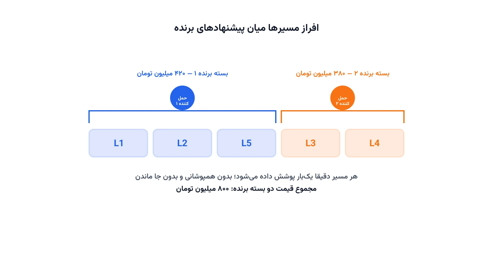

هر سال، شرکت‌های بزرگ خرده‌فروشی صدها مسیر حمل‌ونقل را برون‌سپاری می‌کنند. روش سنتی این است که برای هر مسیر جداگانه از چند حمل‌کننده قیمت بگیرند. اما این روش یک مشکل جدی دارد. حمل‌کننده‌ای که مسیر رفت را می‌برد، معمولاً برای مسیر برگشت هم ظرفیت خالی دارد. اگر این دو مسیر را جدا از هم بخرید، آن صرفه‌جویی هرگز به شما منتقل نمی‌شود.

حراج ترکیبی (Combinatorial Auction) دقیقاً همین شکاف را پر می‌کند. در این روش، هر حمل‌کننده می‌تواند برای یک «بسته» از چند مسیر با هم قیمت پیشنهاد دهد. سپس خریدار باید زیرمجموعه‌ای از پیشنهادها را انتخاب کند. این زیرمجموعه باید همه مسیرها را دقیقاً یک‌بار پوشش دهد و هزینه کل را کمینه کند. به این مسئله انتخاب، مسئله تعیین برنده یا Winner Determination Problem می‌گویند.

## چرا قیمت‌گذاری مسیر به مسیر کافی نیست؟

فرض کنید یک تولیدکننده باید کالا را از کارخانه به پنج مرکز توزیع برساند. اگر هر مسیر را جداگانه مناقصه کند، هر حمل‌کننده فقط هزینه همان یک مسیر را می‌بیند. او نمی‌تواند تخفیفی که از ترکیب چند مسیر به دست می‌آورد را منعکس کند.

اما در حراج ترکیبی، حمل‌کننده می‌تواند بسته پیشنهاد دهد. او می‌گوید: «اگر مسیر الف و ب را با هم بدهید، ۱۵ درصد ارزان‌تر حمل می‌کنم». این پیشنهاد واقعی‌تر است. دلیلش ساده است: کامیونی که مسیر الف را می‌رود، می‌تواند بدون برگشت خالی مسیر ب را هم انجام دهد. این هم‌افزایی مسیرها، موتور اصلی صرفه‌جویی در حراج ترکیبی است.

## فرمول‌بندی ریاضی مسئله تعیین برنده

فرض کنید مجموعه مسیرهای قابل‌تدارک را با $L = \{1, \dots, m\}$ نشان دهیم. هر حمل‌کننده چند پیشنهاد می‌دهد؛ هر پیشنهاد $b$ شامل یک زیرمجموعه از مسیرها، $S_b \subseteq L$، و یک قیمت $c_b$ است. متغیر تصمیم $x_b$ برابر یک است اگر پیشنهاد $b$ برنده شود.

$$\min \sum_{b} c_b \, x_b$$

قید اصلی این است که هر مسیر باید دقیقاً یک‌بار پوشش داده شود. نه صفر بار، و نه بیشتر از یک بار:

$$\sum_{b \,:\, l \in S_b} x_b = 1 \quad \forall l \in L$$

$$x_b \in \{0, 1\} \quad \forall b$$

این ساختار دقیقاً همان مسئله افراز مجموعه (Set Partitioning) است. همین ساختار ریاضی، پایه مسئله [زوج‌سازی خدمه پرواز](/notes/crew-pairing-problem/) در خطوط هوایی هم هست. آنجا هم باید هر پرواز دقیقاً یک‌بار به یک زوج خدمه تعلق بگیرد. تفاوت اینجا در این است که «پیشنهادها» را حمل‌کننده‌های مستقل تولید می‌کنند، نه خود شرکت.

مسئله تعیین برنده از نظر محاسباتی NP-hard است. با افزایش تعداد پیشنهادها، فضای جست‌وجو به‌سرعت رشد می‌کند. با این‌حال، برای تعداد پیشنهادهای معقول، یک مدل برنامه‌ریزی عدد صحیح معمولی را می‌توان در زمان قابل‌قبول حل کرد.

## اهمیت این موضوع در صنعت

حراج‌های ترکیبی برای تدارکات حمل‌ونقل، از دهه ۱۹۹۰ در صنعت جا افتاده‌اند. شرکتی مثل هوم‌دیپو یا سیرز، در ادبیات دانشگاهی به‌عنوان نمونه‌های اولیه استفاده از این روش برای خرید قراردادهای حمل‌ونقل شناخته می‌شوند. هدف این شرکت‌ها، اجازه‌دادن به حمل‌کننده‌ها برای پیشنهاد روی بسته‌های مسیر بود، نه مسیرهای تکی.

مطالعات منتشرشده در این حوزه، کاهشی حدود ده تا پانزده درصد نسبت به مناقصه سنتی گزارش کرده‌اند. این صرفه‌جویی از دو جا می‌آید. اول، حمل‌کننده‌ها دیگر مجبور نیستند ریسک برگشت خالی را در قیمت لحاظ کنند. دوم، خریدار می‌تواند میان ده‌ها ترکیب مختلف از پیشنهادها انتخاب کند. او واقعاً ارزان‌ترین راه‌حل کلی را پیدا می‌کند، نه فقط ارزان‌ترین گزینه برای هر مسیر به‌تنهایی.

این موضوع فقط به حمل جاده‌ای محدود نیست. خطوط هوایی باری، اپراتورهای ریلی و حتی تدارکات دریایی هم از نسخه‌های مشابه این مدل برای خرید ظرفیت استفاده می‌کنند. هر جا که «هم‌افزایی بین چند قلم خرید» وجود داشته باشد، حراج ترکیبی ارزش بررسی دارد.



## ظرفیت کار آکادمیک و پژوهشی

حراج‌های ترکیبی یکی از پرکارترین حوزه‌های تقاطع بهینه‌سازی و طراحی مکانیزم اقتصادی هستند. چند مسیر پژوهشی باز در این زمینه وجود دارد که می‌تواند موضوع پایان‌نامه یا مقاله باشد.

اول، الگوریتم‌های حل دقیق برای مسئله تعیین برنده در مقیاس بزرگ، مانند شاخه‌و‌قیمت (Branch-and-Price) و تولید ستون. دوم، طراحی مکانیزم‌های قیمت‌گذاری صادقانه مانند قوانین پرداخت وی‌سی‌جی (VCG)، که انگیزه دروغ‌گفتن حمل‌کننده درباره هزینه واقعی‌اش را از بین می‌برند. سوم، مقایسه ساختارهای پیشنهاد؛ برخی حراج‌ها فقط پیشنهاد نوع «یا» (XOR) را می‌پذیرند و برخی پیچیده‌ترند.

یک مسیر پژوهشی تازه‌تر هم، افزودن عدم‌قطعیت به این مدل است. قیمت سوخت، ظرفیت جاده یا حتی تقاضای واقعی ممکن است بعد از برگزاری حراج تغییر کند. مدل‌سازی این تغییرات با بهینه‌سازی تصادفی یا استوار، یک حوزه پژوهشی نسبتاً جوان و فعال است.

## پیاده‌سازی با پایتون

نکته خوب این است که برای نمونه‌های متوسط، اصلاً نیازی به نرم‌افزار گران‌قیمت تجاری نیست. مسئله تعیین برنده در اصل یک مدل برنامه‌ریزی عدد صحیح دودویی است. سالورهای متن‌باز مثل [HiGHS](https://highs.dev/) یا CBC، آن را برای چند هزار پیشنهاد به‌راحتی حل می‌کنند.

کتابخانه [PuLP](https://coin-or.github.io/pulp/) یا [Pyomo](https://www.pyomo.org/) برای نوشتن این مدل گزینه‌های طبیعی هستند، چون ساختار آن یک برنامه خطی عدد صحیح ساده است. همچنین می‌توان آن را با [OR-Tools](https://developers.google.com/optimization) و ماژول CP-SAT آن هم پیاده کرد. این گزینه به‌خصوص وقتی مفید است که قیدهای منطقی اضافه هم به مدل اضافه شوند؛ مثلاً «اگر پیشنهاد سوم برنده شد، پیشنهاد هفتم نباید برنده شود».

اسکلت اولیه مدل در PuLP به این شکل است. پیشنهادها و مسیرهای هر پیشنهاد از قبل در قالب یک فایل اکسل یا CSV خوانده می‌شوند:

```python
import pulp

model = pulp.LpProblem("Winner_Determination", pulp.LpMinimize)

# x[b] = 1 اگر پیشنهاد b برنده شود
x = {b: pulp.LpVariable(f"x_{b}", cat="Binary") for b in bids}

# تابع هدف: کمینه‌کردن مجموع قیمت پیشنهادهای برنده
model += pulp.lpSum(price[b] * x[b] for b in bids)

# قید پوشش: هر مسیر دقیقاً توسط یک پیشنهاد برنده پوشش داده شود
for lane in lanes:
    model += pulp.lpSum(x[b] for b in bids if lane in bid_lanes[b]) == 1

# ادامه قیدهای منطقی اضافه (در صورت وجود) و فراخوانی سالور به همین شیوه تعریف می‌شوند
```

برای مسائل واقعاً بزرگ، با ده‌ها هزار پیشنهاد، این مدل ساده دیگر کافی نیست و باید سراغ تولید ستون یا شاخه‌و‌قیمت رفت. اما برای یادگیری منطق مسئله و حتی بسیاری از کاربردهای واقعی میان‌مقیاس، همین مدل پایه کاملاً کاربردی است.

اگر می‌خواهید چنین مدل‌های بهینه‌سازی ترکیبیاتی را از پایه یاد بگیرید، یک نقطه شروع خوب هست. دوره [بهینه‌سازی مسیریابی با پایتون](/courses/vrp-python/) با مثال‌های واقعی زنجیره تأمین به همین هدف می‌رسد.

## سوالات متداول

<h3>تفاوت حراج ترکیبی با مناقصه معمول چیست؟</h3>
<p>در مناقصه معمول، هر مسیر جداگانه قیمت می‌گیرد و حمل‌کننده نمی‌تواند صرفه ناشی از ترکیب چند مسیر را نشان دهد. در حراج ترکیبی، پیشنهاد روی «بسته‌ای» از مسیرها داده می‌شود و این صرفه مستقیماً وارد قیمت می‌شود.</p>

<h3>آیا مسئله تعیین برنده همیشه در زمان معقول حل‌پذیر است؟</h3>
<p>این مسئله از نظر نظری NP-hard است. اما برای تعداد پیشنهادهای معقول، مدل‌های برنامه‌ریزی عدد صحیح معمولی با سالورهای متن‌باز جواب خوبی در زمان کوتاه می‌دهند. جزئیات بیشتر این نوع مدل‌سازی در دوره <a href="/courses/vrp-python/" style="color:#2563EB; font-weight:bold;">بهینه‌سازی مسیریابی با پایتون</a> پوشش داده شده است.</p>

<h3>برای پیاده‌سازی این مدل روی داده‌های واقعی شرکت خودم چه باید بکنم؟</h3>
<p>ساختار واقعی پیشنهادها، قیدهای اضافه کسب‌وکار و حجم داده در هر شرکت متفاوت است. برای طراحی و پیاده‌سازی اختصاصی چنین مدلی می‌توانید از <a href="/consultation/" style="color:#2563EB; font-weight:bold;">مشاوره</a> کمک بگیرید.</p>
