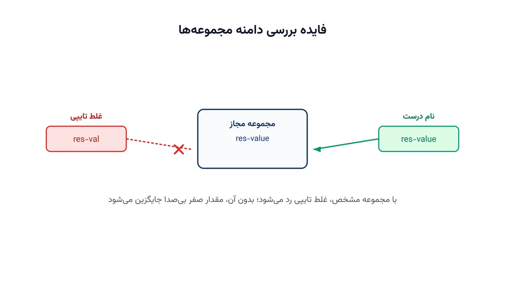

یک مدل GAMS خوب، فقط باید جواب درست بدهد؟ نه. یک مدل خوب باید شش ماه بعد هم، برای یک همکار تازه، قابل‌فهم باشد. تفاوت بین این دو، معمولاً در چند عادت ساده نهفته است. این یادداشت، مهم‌ترین عادت‌های کدنویسی تمیز در GAMS را مرور می‌کند.

## چرا کیفیت کد در GAMS اهمیت دارد؟

مدل‌های بهینه‌سازی به‌ندرت توسط یک نفر و برای همیشه نوشته می‌شوند. یک مدل برنامه‌ریزی تولید، معمولاً سال‌ها زنده می‌ماند. هر بار که داده جدید می‌رسد یا قانونی تغییر می‌کند، باید کد را دوباره باز کرد. اگر کد خوانا نباشد، حتی نویسنده اصلی هم بعد از چند ماه گیج می‌شود.

این موضوع در پروژه‌های بزرگ اهمیت دوچندان دارد. نهادهای برنامه‌ریزی انرژی، مشابه آزمایشگاه‌های ملی وزارت انرژی آمریکا، سال‌هاست از GAMS برای مدل‌های گسترش شبکه و برنامه‌ریزی تولید برق استفاده می‌کنند. چنین مدل‌هایی را معمولاً چند نفر، در طول چند سال، با هم توسعه می‌دهند. بدون قرارداد نام‌گذاری و کامنت‌نویسی مشترک، نگهداری این مدل‌ها عملاً غیرممکن می‌شود.

## نام‌گذاری توصیفی به‌جای نام‌های کوتاه

GAMS اجازه می‌دهد نام شناسه‌ها و برچسب‌های مجموعه طولانی و معنادار باشند. استفاده از این امکان، یکی از ساده‌ترین راه‌ها برای بهبود خوانایی است. به‌جای `p` برای «محصول» بنویسید `product`. به‌جای `x` برای متغیر تولید، بنویسید `production`.

متن توصیفی هم به همین اندازه مهم است. هر پارامتر باید واحدش را در توضیح خودش داشته باشد. برای نمونه، نوشتن «فروش منطقه‌ای (میلیون دلار در سال)» بسیار بهتر از نوشتن صرف «فروش منطقه‌ای» است. این توضیح، هر بار که پارامتر نمایش داده شود، همراهش می‌آید. این موضوع بعداً هنگام تفسیر خروجی‌ها وقت زیادی را ذخیره می‌کند.

## کامنت‌گذاری درباره فرایند و منبع داده

یک کامنت خوب، باید به چند سؤال پاسخ دهد. واحد پارامتر چیست؟ داده از کجا آمده؟ سال اعتبار داده کدام است؟ چرا یک قید به این شکل خاص نوشته شده؟

GAMS چند روش برای کامنت‌گذاری دارد. کامنت تک‌خطی، با ستاره در ابتدای خط نوشته می‌شود. برای توضیحات چندخطی، از `$ontext` و `$offtext` استفاده می‌شود. کامنت انتهای خط هم با گزینه `$eolCom` فعال می‌شود. ثبت منبع داده، صفحه جدول و سال مرجع در کنار هر پارامتر، بعدها هنگام به‌روزرسانی داده بسیار ارزشمند خواهد بود.

## ترجیح داده خام به داده پردازش‌شده

گاهی داده خام در یک فایل اکسل است و باید قبل از ورود به GAMS پردازش شود. وسوسه‌ی رایج این است که پردازش را در اکسل انجام دهیم و فقط نتیجه نهایی را وارد کنیم. این روش یک مشکل جدی دارد.

فایل‌های اکسل و اسکریپت‌های کمکی، به مرور زمان گم یا بدون مستندسازی می‌شوند. اگر داده خام مستقیماً در GAMS وارد شود، محاسبات هم باید داخل خود GAMS انجام شوند. در این صورت، کل منطق پردازش در یک فایل باقی می‌ماند. این کار به‌روزرسانی مدل را در آینده بسیار ساده‌تر می‌کند.

## بررسی دامنه مجموعه‌ها را جدی بگیرید

GAMS اجازه می‌دهد از مجموعه جهانی (`*`) به‌عنوان اندیس یک جدول استفاده شود. این کار راحت است، اما خطرناک هم هست. وقتی اندیس یک جدول از نوع مجموعه جهانی باشد، GAMS هیچ بررسی دامنه‌ای انجام نمی‌دهد.

نتیجه این بی‌توجهی، اغلب یک غلط تایپی ساکت است. اگر برچسب `res-value` در معادله به‌اشتباه `res-val` نوشته شود، GAMS بدون خطا اجرا می‌شود. اما مقدار استفاده‌شده در معادله، صفر خواهد بود؛ چون چنین برچسبی وجود ندارد. تعریف یک مجموعه مشخص برای اندیس‌های جدول، دقیقاً همین مشکل را از ریشه حل می‌کند.

## تعریف هوشمندانه مجموعه‌ها و زیرمجموعه‌ها

انتخاب درست ساختار مجموعه‌ها، تأثیر زیادی بر خوانایی مدل دارد. فرض کنید سه نوع نفت و سه فرایند پالایش دارید. می‌توان یک مجموعه با نه عضو ساخت، یا دو مجموعه جدا با یک مجموعه دوبعدی برای ترکیبشان تعریف کرد. گزینه دوم تقریباً همیشه بهتر است.

زیرمجموعه‌ها هم ابزار قدرتمندی هستند. فرض کنید مجموعه‌ای از همه شهرهای یک مدل حمل‌ونقل دارید. برخی از این شهرها نقش هاب ترافیکی دارند. تعریف یک زیرمجموعه برای شهرهای هاب، اجازه می‌دهد قیدهای خاص فقط روی همین زیرمجموعه اعمال شوند. این، خیلی تمیزتر از نوشتن شرط‌های پیچیده داخل معادلات است.

## ساختاردهی و فرمت‌بندی فایل

ترتیب ثابت بخش‌های کد، ناوبری در فایل را بسیار ساده‌تر می‌کند. یک ترتیب پیشنهادی این است: ابتدا تعریف مجموعه‌ها، سپس پارامترها و جدول‌ها، بعد متغیرها، سپس اعلان معادلات، فرمول معادلات، دستور حل، و در نهایت بخش گزارش‌گیری.

فرمت‌بندی هم به همان اندازه مهم است. هم‌تراز کردن نام شناسه‌ها و متن توصیفی، خوانایی را فوراً بهتر می‌کند. تورفتگی در جمع‌های تودرتو، ساختار یک فرمول پیچیده را آشکار می‌کند. خط خالی بین بخش‌های مختلف هم به چشم کمک می‌کند تا مسیر خودش را در فایل پیدا کند.

## سایر توصیه‌های عملی

چند قرارداد کوچک، تجربه کار تیمی را بهبود می‌دهد. برخی برنامه‌نویسان، حروف کوچک را برای متن توضیحی و حروف بزرگ را برای کلمات کلیدی GAMS به کار می‌برند. برخی دیگر، نام پارامترها را با پیشوند `d_` و نام متغیرها را با پیشوند `v_` شروع می‌کنند. هر قراردادی که انتخاب می‌شود، نکته اصلی ثابت‌ماندن آن در کل فایل است.

یک لاگ تغییرات در ابتدای فایل هم در پروژه‌های تیمی بسیار مفید است. ثبت تاریخ، شماره نسخه، شرح تغییر و نام فردی که تغییر را اعمال کرده، بعدها در ردیابی خطاها کمک بزرگی می‌کند.

## ظرفیت کار آکادمیک/پژوهشی

این موضوع فضای جالبی برای پژوهش در مهندسی نرم‌افزار علمی دارد. می‌توان کیفیت کد مدل‌های بهینه‌سازی منتشرشده در مقالات را به‌صورت کمّی بررسی کرد. سؤال دیگر این است که چه نسبتی از مدل‌های دانشگاهی، واقعاً توسط فرد دیگری غیر از نویسنده اصلی قابل بازتولید هستند.

زاویه سوم، طراحی ابزارهای خودکار برای ارزیابی خوانایی کد مدل‌سازی است؛ شبیه ابزارهای تحلیل ایستا در مهندسی نرم‌افزار عمومی. چنین ابزاری می‌تواند نبود بررسی دامنه یا نام‌های کوتاه و گنگ را به‌طور خودکار علامت بزند.

## آیا این اصول فقط مخصوص GAMS هستند؟

پاسخ کوتاه، نه. همین اصول، در هر زبان مدل‌سازی دیگری هم کاربرد دارند. وقتی مدلی را در [Pyomo](https://www.pyomo.org/) یا OR-Tools می‌نویسید، نام‌گذاری توصیفی و کامنت درباره منبع داده باز هم ضروری است. اگر به فکر مهاجرت از GAMS به پایتون هستید، یادداشت [چرا از GAMS به پایتون مهاجرت کنیم؟](/notes/gams-to-python-why-switch/) را هم بخوانید.

تفاوت اصلی این است که در اکوسیستم پایتون، ابزارهایی مثل linter و type checker بخشی از این انضباط را خودکار می‌کنند. در GAMS، این انضباط تقریباً به‌طور کامل بر عهده خود مدل‌ساز است.

## سوالات متداول

<h3>آیا رعایت این اصول، زمان توسعه مدل را زیاد می‌کند؟</h3>

در ابتدا کمی زمان بیشتر می‌برد. اما همین زمان، بعداً در دیباگ‌کردن و به‌روزرسانی مدل چندین برابر بازمی‌گردد.

<h3>آیا می‌توان این اصول را روی یک مدل قدیمی و بزرگ هم پیاده کرد؟</h3>

بله، اما بهتر است تدریجی انجام شود. ابتدا نام‌گذاری و کامنت بخش‌های پرکاربرد را اصلاح کنید، سپس به بخش بررسی دامنه مجموعه‌ها بروید.

<h3>برای یادگیری اصول مدل‌سازی ریاضی از کجا شروع کنم؟</h3>

دوره <a href="/courses/optimization-modeling/" style="color:#2563EB; font-weight:bold;">مدل‌سازی ریاضی و بهینه‌سازی</a> مسیر کاملی از مبانی تا الگوهای مدل‌سازی پیشرفته را پوشش می‌دهد.

<h3>اگر مدل بزرگی داریم که نیاز به بازبینی ساختاری دارد چه کنیم؟</h3>

بازبینی ساختاری یک مدل قدیمی و بزرگ، ریسک بالایی دارد. بهتر است پیش از شروع، از یک <a href="/consultation/" style="color:#2563EB; font-weight:bold;">مشاوره</a> تخصصی کمک بگیرید.

