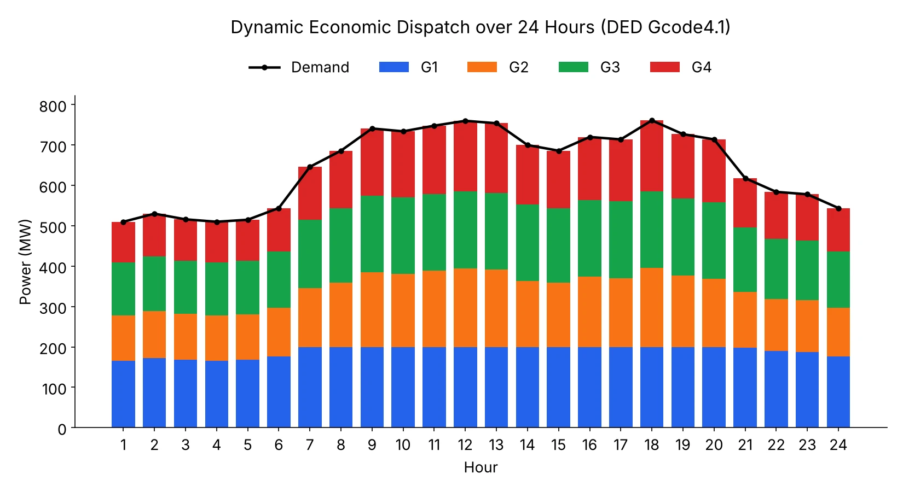

## مقدمه: دیسپچ اقتصادی دینامیک چیست؟

در دیسپچ اقتصادی استاتیک (Economic Dispatch)، توان هر نیروگاه را فقط برای **یک** بازه زمانی، مستقل از بازه‌های دیگر، تعیین می‌کنیم. اما در دنیای واقعی، نیروگاه‌های حرارتی نمی‌توانند توان خروجی خود را به‌صورت آنی و نامحدود تغییر دهند؛ یک توربین بخار یا گازی برای افزایش یا کاهش بار به زمان نیاز دارد. این محدودیت فیزیکی با عنوان **نرخ تغییر تولید (Ramp Rate)** شناخته می‌شود.

**دیسپچ اقتصادی دینامیک (Dynamic Economic Dispatch – DED)** دقیقاً همین مسئله را حل می‌کند: به‌جای حل مستقل هر ساعت، تمام افق زمانی (مثلاً ۲۴ ساعت یک روز) را هم‌زمان بهینه می‌کند، به‌طوری‌که تغییر توان هر نیروگاه بین دو ساعت متوالی از سقف مجاز صعود (Ramp-Up) یا نزول (Ramp-Down) آن نیروگاه فراتر نرود. این مدل یکی از پایه‌ای‌ترین مسائل بهره‌برداری کوتاه‌مدت سیستم قدرت است و زیربنای مسائل پیچیده‌تری مانند واحدداری (Unit Commitment) به شمار می‌رود.

مدلی که در این یادداشت بررسی می‌کنیم، مدل **Gcode4.1** از کتاب زیر است:

> Soroudi, Alireza. *Power System Optimization Modeling in GAMS*. Springer, 2017. DOI: [10.1007/978-3-319-62350-4](https://doi.org/10.1007/978-3-319-62350-4)

منبع اصلی کد در کتابخانه GAMS PSOPT:

- دسته‌بندی: [GAMS PSOPT library](https://www.gams.com/latest/psoptlib_ml/libhtml/index.html)
- فایل اصلی: [DED.gms](https://www.gams.com/latest/psoptlib_ml/DED.gms)

## فرمول‌بندی ریاضی مسئله

برای هر نیروگاه $i$ در هر ساعت $t$ یک متغیر پیوسته $P_{i,t}$ (توان تولیدی) تعریف می‌کنیم که بین حداقل و حداکثر ظرفیت نیروگاه محدود است:

$$
P_i^{min} \le P_{i,t} \le P_i^{max} \qquad \forall i \in I,\ \forall t \in T
$$

**تابع هدف** کمینه‌کردن مجموع هزینه سوخت تمام نیروگاه‌ها در تمام ساعات است. تابع هزینه هر نیروگاه یک تابع درجه‌دوم (quadratic) از توان تولیدی آن است:

$$
\min \; \text{Cost} = \sum_{t \in T} \sum_{i \in I} \left( a_i P_{i,t}^{2} + b_i P_{i,t} + c_i \right)
$$

**قید تعادل بار** در هر ساعت باید برقرار باشد؛ مجموع توان تولیدی همه نیروگاه‌ها باید حداقل برابر با بار مصرفی آن ساعت باشد:

$$
\sum_{i \in I} P_{i,t} \ge D_t \qquad \forall t \in T
$$

**قید نرخ افزایش تولید (Ramp-Up)** تغییر توان بین دو ساعت متوالی را از بالا محدود می‌کند:

$$
P_{i,t+1} - P_{i,t} \le RU_i \qquad \forall i \in I,\ t = 1, \dots, |T|-1
$$

**قید نرخ کاهش تولید (Ramp-Down)** به همین صورت کاهش توان بین دو ساعت متوالی را محدود می‌کند:

$$
P_{i,t-1} - P_{i,t} \le RD_i \qquad \forall i \in I,\ t = 2, \dots, |T|
$$

نکته‌ی مهم در پیاده‌سازی این دو قید آن است که برای اولین ساعت افق زمانی، قید Ramp-Down معنا ندارد (چون ساعت قبلی وجود ندارد) و برای آخرین ساعت، قید Ramp-Up معنا ندارد (چون ساعت بعدی وجود ندارد). همان‌طور که در بخش بعد می‌بینیم، GAMS این موضوع را به‌صورت خودکار و ضمنی مدیریت می‌کند.

مدل نهایی از نوع **QCP (Quadratically Constrained Program)** است، چون تابع هدف درجه‌دوم است اما تمام قیدها خطی هستند.

## کد کامل GAMS (Gcode4.1)

کد زیر دقیقاً همان کدی است که در کتاب فصل چهارم (دیسپچ اقتصادی دینامیک) آمده و بدون هیچ تغییری آورده شده است:

```gams
$title Dynamic Economic Load Dispatch

$onText
For more details please refer to Chapter 4 (Gcode4.1), of the following book:
Soroudi, Alireza. Power System Optimization Modeling in GAMS. Springer, 2017.
--------------------------------------------------------------------------------
Model type: QCP
--------------------------------------------------------------------------------
Contributed by
Dr. Alireza Soroudi
IEEE Senior Member
Email: alireza.soroudi@gmail.com
We do request that publications derived from the use of the developed GAMS code
explicitly acknowledge that fact by citing
Soroudi, Alireza. Power System Optimization Modeling in GAMS. Springer, 2017.
DOI: doi.org/10.1007/978-3-319-62350-4
$offText

Set
   t 'hours'         / t1*t24 /
   i 'thermal units' / g1*g4  /;

Table gendata(i,*) 'generator cost characteristics and limits'
       a     b      c    d     e     f     Pmin  Pmax  RU0  RD0
   g1  0.12  14.80  89   1.2  -5     3     28    200   40   40
   g2  0.17  16.57  83   2.3  -4.24  6.09  20    290   30   30
   g3  0.15  15.55  100  1.1  -2.15  5.69  30    190   30   30
   g4  0.19  16.21  70   1.1  -3.99  6.2   20    260   50   50;

Parameter demand(t) /  t1 510,  t2 530,  t3 516, t4  510,  t5 515,  t6 544
                       t7 646,  t8 686,  t9 741, t10 734, t11 748, t12 760
                      t13 754, t14 700, t15 686, t16 720, t17 714, t18 761
                      t19 727, t20 714, t21 618, t22 584, t23 578, t24 544 /;

Variable
   costThermal 'cost of thermal units'
   p(i,t)      'power generated by thermal power plant'
   EM          'emission calculation';

p.up(i,t) = gendata(i,"Pmax");
p.lo(i,t) = gendata(i,"Pmin");

Equation Genconst3(i,t), Genconst4(i,t), costThermalcalc, balance(t), EMcalc;

costThermalcalc..
   costThermal =e= sum((t,i), gendata(i,'a')*sqr(p(i,t))
                            + gendata(i,'b')*p(i,t) + gendata(i,'c'));

Genconst3(i,t)..   p(i,t+1) - p(i,t) =l= gendata(i,'RU0');

Genconst4(i,t)..   p(i,t-1) - p(i,t) =l= gendata(i,'RD0');

balance(t)..       sum(i, p(i,t)) =g= demand(t);

EMcalc..           EM =e= sum((t,i), gendata(i,'d')*sqr(p(i,t))
                                   + gendata(i,'e')*p(i,t) + gendata(i,'f'));

Model DEDcostbased / all /;
solve DEDcostbased using qcp minimizing costThermal;

embeddedCode Connect:
- GAMSReader:
    symbols: [ { name: p } ]
- Projection:
    name: p.l(i,t)
    newName: p_l(i,t)
- ExcelWriter:
    file: DEDcostbased.xlsx
    symbols: [ { name: p_l, range: Pthermal!A1 } ]
endEmbeddedCode
```

### توضیح خط‌به‌خط کد

- **`Set t`** افق زمانی را از `t1` تا `t24` (۲۴ ساعت شبانه‌روز) تعریف می‌کند و **`Set i`** چهار نیروگاه حرارتی `g1` تا `g4` را مشخص می‌کند.
- **`Table gendata`** مشخصات هر نیروگاه را در یک جدول نگه می‌دارد: ضرایب هزینه سوخت ($a$, $b$, $c$)، ضرایب آلایندگی ($d$, $e$, $f$)، حداقل و حداکثر ظرفیت (`Pmin`, `Pmax`) و نرخ‌های صعود و نزول (`RU0`, `RD0`).
- **`Parameter demand(t)`** منحنی بار ۲۴ ساعته را مشخص می‌کند؛ مقادیر از ۵۱۰ مگاوات در ساعات کم‌باری شب تا ۷۶۱ مگاوات در پیک بار نوسان دارد.
- **`p.up` و `p.lo`** کران بالا و پایین متغیر توان را مستقیماً از جدول `gendata` می‌خوانند — این‌ها قیدهای ساده‌ی کران متغیر هستند، نه معادله‌ی جداگانه.
- **`Genconst3`** قید Ramp-Up را با نماد `p(i,t+1) - p(i,t)` می‌نویسد. نکته‌ی کلیدی اینجاست: در GAMS وقتی اندیس `t` به `t+1` منتقل می‌شود و `t` آخرین عضو مجموعه مرتب (`t24`) باشد، مقدار `p(i,t+1)` به‌صورت خودکار صفر در نظر گرفته می‌شود و GAMS نمونه‌ی معادله برای آن حالت را **اصلاً تولید نمی‌کند** (این رفتار پیش‌فرض lead/lag روی مجموعه‌های مرتب است). یعنی برای `t24` این قید عملاً حذف می‌شود.
- **`Genconst4`** به همین ترتیب قید Ramp-Down را می‌نویسد و برای `t1` (که `t-1` خارج از مجموعه است) به‌طور خودکار نادیده گرفته می‌شود.
- **`balance(t)`** قید تعادل عرضه و تقاضا در هر ساعت است.
- **`EMcalc`** یک متغیر کمکی `EM` برای محاسبه‌ی میزان آلایندگی تعریف می‌کند؛ این متغیر در تابع هدف ظاهر نمی‌شود و صرفاً برای گزارش‌گیری محاسبه می‌شود (پایه‌ای برای مدل‌های چندهدفه‌ی بعدی مانند دیسپچ ترکیبی هزینه-آلایندگی).
- **`solve ... using qcp minimizing costThermal`** مدل را به‌عنوان یک برنامه‌ی درجه‌دوم با قید حل می‌کند.
- بلوک پایانی **`embeddedCode Connect`** بخشی از ابزار Connect در GAMS است که خروجی حل‌شده‌ی متغیر `p` را می‌خواند، آن را به فرمت `p_l(i,t)` تبدیل می‌کند و در یک فایل اکسل (`DEDcostbased.xlsx`) ذخیره می‌کند — کاری که در پیاده‌سازی پایتون آن را با نوشتن مستقیم در دیکشنری یا دیتافریم انجام می‌دهیم.

## پیاده‌سازی با پایتون (Pyomo + HiGHS)

برای بازتولید همین مدل در پایتون از **Pyomo** به‌عنوان زبان مدل‌سازی و **HiGHS** به‌عنوان حل‌کننده استفاده می‌کنیم. HiGHS یک حل‌کننده‌ی متن‌باز و رایگان است که از برنامه‌ریزی درجه‌دوم محدب (مانند تابع هزینه‌ی این مسئله) نیز پشتیبانی می‌کند.

نکته‌ی فنی مهم: رابط `appsi_highs` در نسخه‌ی فعلی Pyomo از توابع هدف درجه‌دوم پشتیبانی نمی‌کند و با خطای `DegreeError` متوقف می‌شود؛ به همین دلیل باید از رابط معمولی `SolverFactory("highs")` استفاده کرد.

چالش دیگر، بازتولید رفتار خودکار GAMS در مدیریت `t+1` و `t-1` در مرزهای افق زمانی است. در Pyomo چنین رفتار ضمنی‌ای وجود ندارد، بنابراین باید آن را صریحاً با `Constraint.Skip` پیاده‌سازی کنیم: برای آخرین ساعت از قید Ramp-Up و برای اولین ساعت از قید Ramp-Down صرف‌نظر می‌کنیم — دقیقاً همان کاری که GAMS به‌صورت خودکار انجام می‌دهد.

```python
from pyomo.environ import *
import matplotlib
matplotlib.use("Agg")
import matplotlib.pyplot as plt
import numpy as np

T = [f"t{k}" for k in range(1, 25)]
I = ["g1", "g2", "g3", "g4"]

gendata = {
    "g1": dict(a=0.12, b=14.80, c=89,  d=1.2, e=-5,     f=3,    Pmin=28, Pmax=200, RU0=40, RD0=40),
    "g2": dict(a=0.17, b=16.57, c=83,  d=2.3, e=-4.24,  f=6.09, Pmin=20, Pmax=290, RU0=30, RD0=30),
    "g3": dict(a=0.15, b=15.55, c=100, d=1.1, e=-2.15,  f=5.69, Pmin=30, Pmax=190, RU0=30, RD0=30),
    "g4": dict(a=0.19, b=16.21, c=70,  d=1.1, e=-3.99,  f=6.2,  Pmin=20, Pmax=260, RU0=50, RD0=50),
}

demand = {
    "t1": 510, "t2": 530, "t3": 516, "t4": 510, "t5": 515, "t6": 544,
    "t7": 646, "t8": 686, "t9": 741, "t10": 734, "t11": 748, "t12": 760,
    "t13": 754, "t14": 700, "t15": 686, "t16": 720, "t17": 714, "t18": 761,
    "t19": 727, "t20": 714, "t21": 618, "t22": 584, "t23": 578, "t24": 544,
}

m = ConcreteModel()
m.T = Set(initialize=T, ordered=True)
m.I = Set(initialize=I, ordered=True)

def p_bounds(m, i, t):
    return (gendata[i]["Pmin"], gendata[i]["Pmax"])

m.p = Var(m.I, m.T, bounds=p_bounds)

def obj_rule(m):
    return sum(gendata[i]["a"] * m.p[i, t] ** 2 + gendata[i]["b"] * m.p[i, t] + gendata[i]["c"]
               for i in m.I for t in m.T)
m.cost = Objective(rule=obj_rule, sense=minimize)

def balance_rule(m, t):
    return sum(m.p[i, t] for i in m.I) >= demand[t]
m.balance = Constraint(m.T, rule=balance_rule)

t_list = list(m.T)

def ramp_up_rule(m, i, t):
    idx = t_list.index(t)
    if idx == len(t_list) - 1:
        return Constraint.Skip
    t_next = t_list[idx + 1]
    return m.p[i, t_next] - m.p[i, t] <= gendata[i]["RU0"]
m.ramp_up = Constraint(m.I, m.T, rule=ramp_up_rule)

def ramp_down_rule(m, i, t):
    idx = t_list.index(t)
    if idx == 0:
        return Constraint.Skip
    t_prev = t_list[idx - 1]
    return m.p[i, t_prev] - m.p[i, t] <= gendata[i]["RD0"]
m.ramp_down = Constraint(m.I, m.T, rule=ramp_down_rule)

solver = SolverFactory("highs")
results = solver.solve(m, tee=False)

print("Termination:", results.solver.termination_condition)
print("Total cost:", value(m.cost))

dispatch = {i: [value(m.p[i, t]) for t in t_list] for i in I}
```

### درباره‌ی ساختار کد

- مجموعه‌ی `m.T` با `ordered=True` تعریف می‌شود تا بتوانیم با استفاده از `list(m.T)` و `index()` به ساعت قبل و بعد هر بازه دسترسی پیدا کنیم؛ این دقیقاً معادل مکانیزم lead/lag مجموعه‌های مرتب در GAMS است.
- کران‌های متغیر `p` به‌جای قید جداگانه، مستقیماً در `bounds=p_bounds` هنگام تعریف متغیر اعمال می‌شوند — معادل `p.up` و `p.lo` در GAMS.
- قید تعادل بار از نوع نامساوی (`>=`) نوشته شده، درست مطابق `=g=` در کد GAMS؛ چون تابع هزینه صعودی و محدب است، در جواب بهینه این قید همیشه با تساوی برقرار می‌شود (هیچ انگیزه‌ای برای تولید بیش از نیاز وجود ندارد).
- متغیر کمکی `EM` (آلایندگی) در این پیاده‌سازی حذف شده چون در تابع هدف نقشی ندارد و فقط برای گزارش‌گیری در GAMS محاسبه می‌شد؛ در صورت نیاز می‌توان آن را به همان فرمول در پایتون هم اضافه کرد.

## نتایج حل مدل

با اجرای مدل، حل‌کننده‌ی HiGHS جواب بهینه (`optimal`) را با هزینه‌ی کل تقریبی **۶۴۷٬۹۶۴** واحد پولی پیدا می‌کند. بررسی جواب نشان می‌دهد که در تمام ۲۴ ساعت، مجموع تولید چهار نیروگاه دقیقاً برابر با بار مصرفی همان ساعت است — نتیجه‌ای که از تحدب تابع هزینه (هزینه‌ی نهایی تولید همواره صعودی است) انتظار می‌رفت.



در نمودار بالا، ستون‌های رنگی سهم هر نیروگاه از تولید کل در هر ساعت و خط سیاه منحنی بار مصرفی را نشان می‌دهند. در ساعات کم‌باری (نیمه‌شب تا صبح)، نیروگاه‌ها نزدیک به حداقل ظرفیت خود کار می‌کنند و با افزایش تدریجی بار در طول روز، هر نیروگاه به‌تناسب هزینه‌ی نهایی تولیدش بار بیشتری می‌پذیرد. در ساعات پیک (حدود ساعت ۱۸)، برخی نیروگاه‌ها به نزدیکی سقف ظرفیت خود می‌رسند. محدودیت‌های Ramp-Up و Ramp-Down باعث می‌شوند تغییرات بین ساعات متوالی هموار و تدریجی باشد، برخلاف دیسپچ استاتیک که در آن هر ساعت مستقل از ساعات مجاور حل می‌شود و می‌تواند جهش‌های ناگهانی و غیرعملی در تولید ایجاد کند.

## جمع‌بندی و مسیرهای توسعه

مدل Gcode4.1 نمونه‌ای ساده اما کامل از دیسپچ اقتصادی دینامیک است که نشان می‌دهد چگونه افزودن یک بُعد زمانی و محدودیت نرخ تغییر تولید، مسئله را از یک سری مسائل مستقل به یک مسئله‌ی زنجیره‌ای تبدیل می‌کند که تصمیم هر ساعت روی ساعات مجاور اثر می‌گذارد. این مدل پایه‌ی بسیاری از مسائل پیچیده‌تر بهره‌برداری سیستم قدرت است؛ از جمله می‌توان آن را با افزودن متغیرهای باینری روشن/خاموش بودن واحد به مسئله‌ی **واحدداری حرارتی (Unit Commitment)**، یا با افزودن تابع هدف دوم (آلایندگی `EM`) به یک مسئله‌ی **بهینه‌سازی چندهدفه هزینه-آلایندگی** گسترش داد. همچنین می‌توان با افزودن عدم‌قطعیت در پیش‌بینی بار یا تولید منابع تجدیدپذیر، آن را به یک مدل **دیسپچ تصادفی (Stochastic Dispatch)** تبدیل کرد.

## مرجع

- Soroudi, Alireza. *Power System Optimization Modeling in GAMS*. Springer, 2017. DOI: [10.1007/978-3-319-62350-4](https://doi.org/10.1007/978-3-319-62350-4)
- کتابخانه‌ی مدل‌های GAMS PSOPT: [psoptlib_ml](https://www.gams.com/latest/psoptlib_ml/libhtml/index.html)
- فایل اصلی مدل: [DED.gms](https://www.gams.com/latest/psoptlib_ml/DED.gms)
