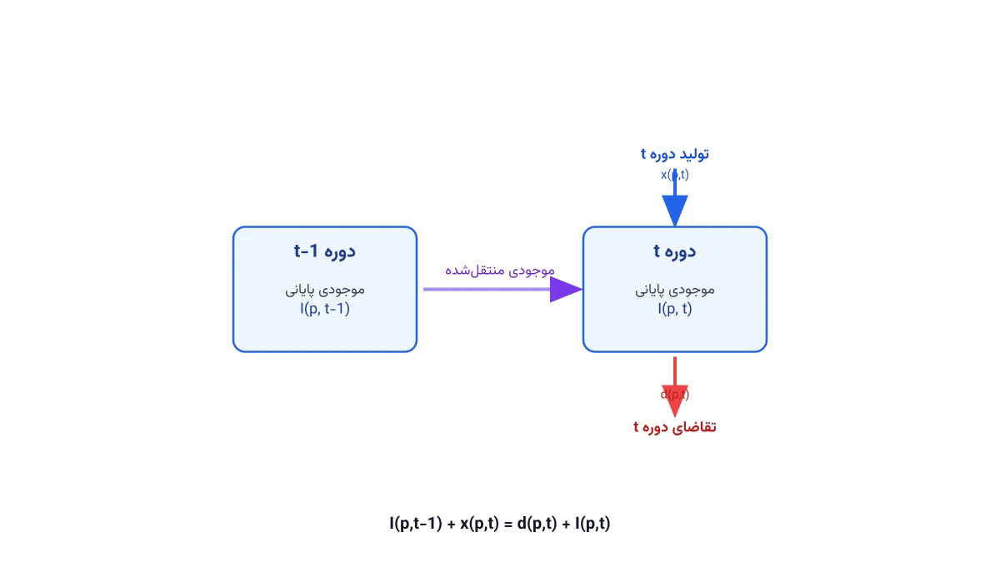

پیش‌تر دو مدل کلاسیک زنجیره تأمین را از GAMS به Pyomo ترجمه کردیم. یکی [طراحی شبکه زنجیره تأمین](/notes/gams-to-python-supply-chain-network/) بود و دیگری [انتخاب تأمین‌کننده و تخصیص سفارش](/notes/gams-to-python-supplier-selection/). این بار سراغ مسئله‌ای می‌رویم که زمان را هم وارد مدل می‌کند: برنامه‌ریزی تولید و موجودی چنددوره‌ای. این مدل در ادبیات علمی به Lot Sizing ظرفیت‌دار معروف است. نسخه GAMS آن سال‌ها در کارخانه‌های تولیدی نوشته و اجرا شده است. هدف این یادداشت، نشان‌دادن دقیق مسیر مهاجرت همین مدل به پایتون است.

## چرا این مدل، نمونه خوبی برای یادگیری ترجمه است؟

مدل‌های قبلی ما تک‌دوره‌ای بودند؛ یعنی فقط یک تصمیم، یک‌بار گرفته می‌شد. این مدل اما چنددوره‌ای است. یعنی باید برای هر دوره، تصمیم جداگانه بگیریم. همین ویژگی، یک چالش ترجمه تازه ایجاد می‌کند: ارجاع به دوره قبل. در GAMS، نوشتن `I(p,t-1)` ساده و طبیعی است. در Pyomo، باید این ارجاع را دستی و با دقت مدیریت کنید. علاوه بر این، مدل هم متغیر پیوسته دارد (مقدار تولید و موجودی) و هم متغیر دودویی (تصمیم راه‌اندازی تولید). همین ترکیب، آن را برای یادگیری بسیار مناسب می‌کند.

## مسئله نمونه: تولید و موجودی چندمحصولی روی یک خط مشترک

یک کارخانه چند محصول را روی یک خط تولید مشترک می‌سازد. برای هر محصول، تقاضای هر دوره از پیش معلوم است. تولید هر محصول در هر دوره، دو نوع هزینه دارد. هزینه نگهداری موجودی مازاد در پایان دوره، یکی از آن‌هاست. هزینه راه‌اندازی (Setup) برای شروع تولید آن محصول در آن دوره، هزینه دیگر است. هر بار راه‌اندازی، بخشی از ظرفیت خط را هم اشغال می‌کند. ظرفیت کل خط در هر دوره، محدود و مشخص است. هدف، برنامه‌ریزی تولید و موجودی به‌گونه‌ای است که تقاضا همیشه برآورده شود. در عین حال، مجموع هزینه نگهداری و راه‌اندازی کمینه گردد.

با مجموعه محصولات $P$ و دوره‌های زمانی $T$، فرمول ریاضی مدل این‌طور نوشته می‌شود:

$$
\min \; \sum_{p,t} h_p I_{pt} + \sum_{p,t} sc_p y_{pt}
$$

قید موازنه موجودی، قلب این مدل است:

$$
I_{p,t-1} + x_{pt} = d_{pt} + I_{pt} \qquad \forall p \in P,\ t \in T
$$

قید ظرفیت، تولید و راه‌اندازی را با هم محدود می‌کند:

$$
\sum_{p} \left( pt_p\, x_{pt} + st_p\, y_{pt} \right) \le C_t \qquad \forall t \in T
$$

قید پیوندی زیر، تولید را به تصمیم راه‌اندازی گره می‌زند:

$$
x_{pt} \le M_{pt}\, y_{pt} \qquad \forall p \in P,\ t \in T
$$

$$
x_{pt}, I_{pt} \ge 0, \qquad y_{pt} \in \{0,1\}
$$

در این روابط، $x_{pt}$ مقدار تولید محصول $p$ در دوره $t$ است. متغیر $I_{pt}$ موجودی پایان دوره همان محصول است. متغیر دودویی $y_{pt}$ نشان می‌دهد آیا در آن دوره، راه‌اندازی تولید انجام شده یا نه. نکته مهم، انتخاب $M_{pt}$ است. به‌جای یک عدد بزرگ دلبخواهی، بهتر است $M_{pt}$ برابر مجموع تقاضای باقی‌مانده آن محصول از دوره $t$ تا انتهای افق باشد. این انتخاب، مدل را عددی پایدارتر و سریع‌تر برای حل می‌کند.

## مدل در GAMS

این‌طور در GAMS نوشته می‌شود:

```gams
SETS
    p  products  / prodA, prodB /
    t  periods   / t1*t4 /;

PARAMETERS
    hcost(p)     holding cost of product p       / prodA 2, prodB 3 /
    scost(p)     setup cost of product p          / prodA 150, prodB 200 /
    ptime(p)     production time per unit         / prodA 1, prodB 1.5 /
    stime(p)     setup time of product p          / prodA 4, prodB 6 /
    cap(t)       available capacity in period t    / t1 40, t2 40, t3 45, t4 45 /;

TABLE dem(p,t)   demand of product p in period t
            t1    t2    t3    t4
    prodA   10    15    12    18
    prodB    8    10    14    11;

VARIABLES
    z          total cost;

POSITIVE VARIABLES
    x(p,t)     production quantity of product p in period t
    inv(p,t)   ending inventory of product p in period t;

BINARY VARIABLES
    y(p,t)     1 if setup occurs for product p in period t;

EQUATIONS
    obj             objective function
    balance(p,t)    inventory balance
    capacity_eq(t)  shared capacity
    link_eq(p,t)    production linked to setup;

obj..               z =e= sum((p,t), hcost(p)*inv(p,t) + scost(p)*y(p,t));

balance(p,t)$(ord(t) eq 1).. x(p,t) =e= dem(p,t) + inv(p,t);
balance(p,t)$(ord(t) gt 1).. inv(p,t-1) + x(p,t) =e= dem(p,t) + inv(p,t);

capacity_eq(t)..    sum(p, ptime(p)*x(p,t) + stime(p)*y(p,t)) =l= cap(t);

link_eq(p,t)..       x(p,t) =l= (sum(tt$(ord(tt) ge ord(t)), dem(p,tt))) * y(p,t);

MODEL lotsize /all/;
SOLVE lotsize USING MIP MINIMIZING z;

DISPLAY x.l, inv.l, y.l, z.l;
```

نکته این مدل، خط دوم و سوم تعریف `balance` است. در GAMS، شرط `ord(t) eq 1` دوره اول را از بقیه دوره‌ها جدا می‌کند. در دوره اول، موجودی اولیه صفر فرض شده و از معادله حذف شده است.

## جدول تناظر: مفاهیم GAMS در برابر Pyomo

پیش از دیدن کد Pyomo، این جدول را به‌عنوان مرجع سریع نگه دارید:

| مفهوم در GAMS | نحو GAMS | معادل در Pyomo |
|---|---|---|
| مجموعه مرتب زمانی | `SETS t /t1*t4/;` | لیست مرتب: `periods = ['t1','t2','t3','t4']` |
| شماره ترتیبی عضو مجموعه | `ord(t)` | ایندکس پایتونی: `periods.index(t)` |
| ارجاع به دوره قبل | `inv(p,t-1)` | تابع کمکی: `prev_period(t)` که دوره قبلی را برمی‌گرداند |
| شرط روی اولین عضو | `$(ord(t) eq 1)` | شاخه `if`‌ داخل تابع قید: `if t == periods[0]` |
| جمع روی زیرمجموعه شرطی | `sum(tt$(ord(tt) ge ord(t)), ...)` | کامپرهنشن با شرط: `sum(d[p,tt] for tt in periods if periods.index(tt) >= periods.index(t))` |
| حل مدل | `SOLVE lotsize USING MIP MINIMIZING z;` | `SolverFactory('cbc').solve(model)` |

## ترجمه به Pyomo

اولین قدم، تعریف دقیق ترتیب دوره‌ها و یک تابع کمکی برای دوره قبل است:

```python
from pyomo.environ import *

# ---------- داده‌ها (معادل SETS / PARAMETERS / TABLE در GAMS) ----------
products = ['prodA', 'prodB']
periods  = ['t1', 't2', 't3', 't4']

hcost = {'prodA': 2, 'prodB': 3}
scost = {'prodA': 150, 'prodB': 200}
ptime = {'prodA': 1, 'prodB': 1.5}
stime = {'prodA': 4, 'prodB': 6}
cap   = {'t1': 40, 't2': 40, 't3': 45, 't4': 45}

dem = {
    ('prodA', 't1'): 10, ('prodA', 't2'): 15,
    ('prodB', 't1'): 8,  ('prodB', 't2'): 10,
    # ادامه بقیه ترکیب‌های محصول و دوره، دقیقاً مطابق جدول GAMS
}

def prev_period(t):
    idx = periods.index(t)
    return periods[idx - 1] if idx > 0 else None

# ---------- مدل ----------
model = ConcreteModel()
model.P = Set(initialize=products)
model.T = Set(initialize=periods)

model.x = Var(model.P, model.T, within=NonNegativeReals)
model.inv = Var(model.P, model.T, within=NonNegativeReals)
model.y = Var(model.P, model.T, within=Binary)

def balance_rule(m, p, t):
    prev = prev_period(t)
    prev_inv = m.inv[p, prev] if prev is not None else 0
    return prev_inv + m.x[p, t] == dem[p, t] + m.inv[p, t]
model.balance_eq = Constraint(model.P, model.T, rule=balance_rule)

# ادامه قید ظرفیت، قید پیوندی راه‌اندازی و تابع هدف، به همین شیوه تعریف می‌شوند.
```

نکته کلیدی این بخش، تابع `prev_period` است. این تابع، دقیقاً همان نقش `ord(t)` و عملگر `t-1` در GAMS را بازی می‌کند. برای اولین دوره، مقدار موجودی قبلی برابر صفر در نظر گرفته می‌شود.

## تفاوت‌های ظریفی که باعث باگ می‌شوند

چند نکته هست که هنگام ترجمه این نوع مدل زمانی، به‌راحتی از قلم می‌افتد.

**ترتیب مجموعه زمانی را صریح نگه دارید.** در GAMS، ترتیب تعریف اعضای یک مجموعه، خودکار حفظ می‌شود. در پایتون، اگر از یک `set` معمولی به‌جای لیست استفاده کنید، ترتیب تضمینی ندارد. همیشه دوره‌ها را در یک لیست مرتب نگه دارید، نه در یک مجموعه بدون ترتیب.

**دوره اول را فراموش نکنید.** قید موازنه موجودی برای دوره اول، شکل متفاوتی دارد. اگر این حالت خاص را در Pyomo در نظر نگیرید، سالور با خطای `KeyError` متوقف می‌شود. علتش این است که موجودی دوره صفر اصلاً تعریف نشده است.

**Big-M شل، مدل را کند می‌کند.** استفاده از یک عدد بزرگ و ثابت برای همه $M_{pt}$، مدل را عددی ضعیف می‌کند. محاسبه $M_{pt}$ بر اساس تقاضای باقی‌مانده واقعی، زمان حل را در مسائل بزرگ به‌شدت کاهش می‌دهد. این دقیقاً همان قید `link_eq` در کد GAMS بالاست.

**جمع شرطی روی مجموعه زمانی.** عبارت `sum(tt$(ord(tt) ge ord(t)), ...)` در GAMS، یک جمع شرطی روی زیرمجموعه دوره‌هاست. در Pyomo، این شرط باید با یک کامپرهنشن و مقایسه ایندکس بازنویسی شود. جاافتادن این شرط، باعث محاسبه نادرست کران بالای تولید می‌شود.

## اهمیت این موضوع



برنامه‌ریزی تولید و موجودی چنددوره‌ای، یکی از قدیمی‌ترین و پرکاربردترین مسائل برنامه‌ریزی تولید است. شرکتی مثل یونی‌لیور (Unilever) در تولید انواع شوینده روی خطوط مشترک، دقیقاً با این چالش مواجه است. هر تغییر محصول روی خط تولید، زمان و هزینه راه‌اندازی دارد. تولید بیش‌ازحد هم هزینه انبارداری ایجاد می‌کند. تصمیم درست، تعادلی ظریف میان این دو هزینه است. وقتی این تعادل به‌صورت دستی و با تجربه گرفته شود، معمولاً از بهینه دور می‌ماند.

یک مدل MILP، این تعادل را برای صدها ترکیب محصول و دوره، در عرض چند ثانیه پیدا می‌کند. مدیر تولید می‌تواند بپرسد «اگر ظرفیت خط ۱۰٪ کم شود، هزینه چقدر بالا می‌رود؟». با تغییر یک پارامتر و حل دوباره مدل، جواب آماده است.

## ظرفیت کار آکادمیک و پژوهشی

مسئله Lot Sizing ظرفیت‌دار (Capacitated Lot Sizing Problem) یکی از پرمقاله‌ترین حوزه‌های تحقیق در برنامه‌ریزی تولید است. نسخه پایه‌ای که در این یادداشت دیدیم، قابل گسترش به شکل‌های پژوهشی متعددی است. می‌توان زمان راه‌اندازی وابسته به توالی تولید را هم اضافه کرد. یعنی هزینه تغییر از محصول A به B، با تغییر از B به A فرق کند. می‌توان عدم‌قطعیت تقاضا را هم وارد مدل کرد و به یک مدل تصادفی یا استوار رسید. همچنین می‌توان افق برنامه‌ریزی را غلتان (Rolling Horizon) کرد، طوری که مدل هر دوره با داده تازه دوباره حل شود. هر کدام از این جهت‌ها، پایه خوبی برای یک مقاله یا پایان‌نامه کارشناسی‌ارشد و دکتری است.

## پیاده‌سازی با پایتون

نکته مهم این مدل، مثل بقیه مدل‌های این سایت، امکان حل آن با ابزارهای کاملاً متن‌باز پایتون است. نیازی به لایسنس GAMS یا سالورهای تجاری گران‌قیمت نیست. [Pyomo](https://www.pyomo.org/) زبان مدل‌سازی جبری است که مدل را تعریف می‌کند. سالورهایی مثل [HiGHS](https://highs.dev/) یا [CBC](https://github.com/coin-or/Cbc) هم آن را حل می‌کنند. هر دو رایگان‌اند و برای مسائل MILP با مقیاس متوسط، کافی و سریع هستند. اگر تعداد محصولات و دوره‌ها زیاد شود، مدل ممکن است کندتر حل شود. در این حالت، کتابخانه [OR-Tools](https://developers.google.com/optimization) گوگل هم گزینه‌ای قابل‌بررسی است.

اگر به [انجام پروژه بهینه‌سازی](/consultation/) برای مسئله خودتان نیاز دارید، صفحه مشاوره نقطه شروع خوبی است.

## سوالات متداول

<h3>آیا می‌توان این مدل را برای بیش از یک خط تولید هم استفاده کرد؟</h3>
<p>بله. کافی است یک اندیس خط تولید اضافه کنید و قید ظرفیت را برای هر خط جداگانه بنویسید. ساختار موازنه موجودی بدون تغییر باقی می‌ماند.</p>

<h3>چرا باید به‌جای Big-M ثابت، از تقاضای باقی‌مانده استفاده کنیم؟</h3>
<p>یک Big-M خیلی بزرگ، فضای جست‌وجوی سالور را بی‌دلیل بزرگ و کند می‌کند. تقاضای باقی‌مانده، کوچک‌ترین کران معتبر است. برای یادگیری عمیق‌تر این نوع مدل‌سازی، دوره <a href="/courses/optimization-modeling/" style="color:#2563EB; font-weight:bold;">مدل‌سازی ریاضی و بهینه‌سازی با پایتون</a> گام بعدی مناسبی است.</p>

<h3>برای پیاده‌سازی این مدل روی داده واقعی خط تولید خودمان کمک می‌خواهم، از کجا شروع کنم؟</h3>
<p>بهترین نقطه شروع، گرفتن یک <a href="/consultation/" style="color:#2563EB; font-weight:bold;">مشاوره</a> است تا داده تقاضا، هزینه راه‌اندازی و ظرفیت واقعی خط شما بررسی شود.</p>

## جمع‌بندی

در این یادداشت، مدل کلاسیک برنامه‌ریزی تولید و موجودی چنددوره‌ای را از GAMS تا Pyomo پیش بردیم. فرمول ریاضی مسئله را نوشتیم و کد کامل GAMS را دیدیم. جدول تناظر مفاهیم را ساختیم و دام‌های رایج ترجمه مدل‌های زمانی را مرور کردیم. دیدیم چرا مدیریت درست دوره اول و انتخاب Big-M، در این نوع مدل‌ها اهمیت ویژه‌ای دارد. همچنین دیدیم چطور می‌توان آن را کاملاً با ابزارهای رایگان پایتون حل کرد.

اگر می‌خواهید مدل‌سازی ریاضی را از پایه و به‌صورت ساخت‌یافته یاد بگیرید، یک گزینه خوب پیش رو دارید. دوره [مدل‌سازی ریاضی و بهینه‌سازی با پایتون](/courses/optimization-modeling/) دقیقاً برای همین هدف طراحی شده است.
