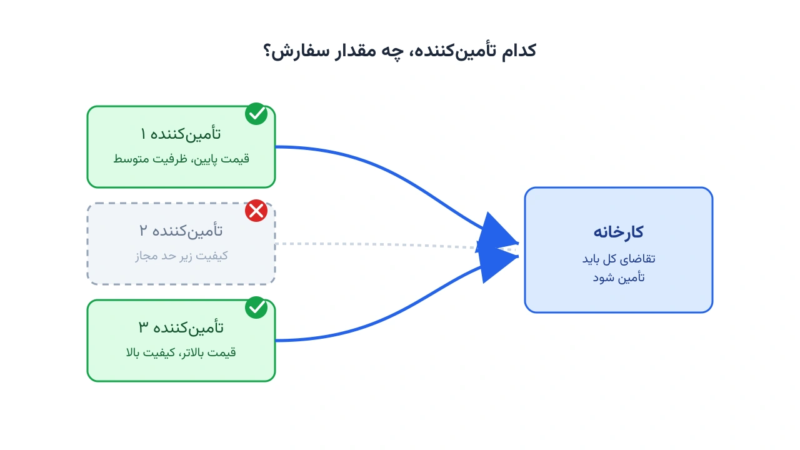

پیش‌تر یک مدل مکان‌یابی و جریان کالا را از GAMS به Pyomo ترجمه کردیم. جزئیات کامل آن در یادداشت [از GAMS به پایتون: طراحی و پیاده‌سازی مدل شبکه زنجیره تأمین با Pyomo](/notes/gams-to-python-supply-chain-network/) آمده است. این بار سراغ یکی دیگر از پرکاربردترین مدل‌های کلاسیک زنجیره تأمین می‌رویم: انتخاب تأمین‌کننده و تخصیص سفارش. این مدل در بسیاری از پروژه‌های دانشگاهی و صنعتی، سال‌ها در GAMS نوشته و نگهداری شده است. هدف این یادداشت، نشان‌دادن مسیر دقیق مهاجرت همین مدل به پایتون است. این کار را فراتر از یک ترجمه سطحی خط‌به‌خط پیش می‌بریم.

## چرا این مدل، نمونه خوبی برای یادگیری ترجمه است؟

مدل انتخاب تأمین‌کننده چند ویژگی دارد که آن را برای یادگیری ترجمه GAMS به Pyomo ایده‌آل می‌کند. هم متغیر پیوسته دارد (مقدار سفارش) و هم متغیر دودویی (انتخاب تأمین‌کننده). هم قید ظرفیت دارد و هم قیدی غیرمعمول‌تر: حداقل میانگین وزنی کیفیت. همین ترکیب، اغلب دام‌های رایج ترجمه را هم پوشش می‌دهد. اگر این مدل را خوب بفهمید، ترجمه مدل‌های بزرگ‌تر GAMS با همین الگو، کار سختی نخواهد بود.

## مسئله نمونه: انتخاب تأمین‌کننده و تخصیص سفارش چندکالایی

یک کارخانه برای تأمین دو قطعه، چند تأمین‌کننده کاندید در اختیار دارد. هر تأمین‌کننده برای هر قطعه، قیمت واحد و سقف ظرفیت مشخصی دارد. هر تأمین‌کننده همچنین یک امتیاز کیفیت ثابت دارد که بین صفر و یک است. شرکت باید تصمیم بگیرد کدام تأمین‌کنندگان را وارد زنجیره تأمین خود کند. همچنین باید معلوم شود از هر تأمین‌کننده منتخب، چه مقدار از هر قطعه سفارش داده شود. هدف، کمینه‌کردن مجموع هزینه خرید و هزینه ثابت همکاری با هر تأمین‌کننده است. دو قید هم باید برقرار بماند. تقاضای هر قطعه باید کامل تأمین شود. میانگین وزنی کیفیت کل خرید هم نباید از یک حد آستانه پایین‌تر بیاید.

با مجموعه تأمین‌کنندگان $S$ و قطعات $P$، فرمول ریاضی مدل این‌طور نوشته می‌شود:

$$
\min \; \sum_{s,p} c_{sp} x_{sp} + \sum_{s} f_s y_s
$$

قیدها به این شکل‌اند:

$$
\sum_{s} x_{sp} = d_p \qquad \forall p \in P
$$

$$
x_{sp} \le u_{sp}\, y_s \qquad \forall s \in S,\ p \in P
$$

$$
\sum_{s,p} q_s x_{sp} \ge \theta \sum_{p} d_p
$$

$$
x_{sp} \ge 0, \qquad y_s \in \{0,1\}
$$

در این روابط، $x_{sp}$ مقدار سفارش قطعه $p$ از تأمین‌کننده $s$ است. متغیر $y_s$ هم دودویی است و نشان می‌دهد آیا تأمین‌کننده $s$ انتخاب شده یا نه. قید دوم، مقدار سفارش را به انتخاب تأمین‌کننده گره می‌زند: اگر $y_s$ صفر باشد، سفارشی از آن تأمین‌کننده ممکن نیست. قید سوم، میانگین وزنی کیفیت کل خرید را به حداقل $\theta$ محدود می‌کند.

## مدل در GAMS

این‌طور در GAMS نوشته می‌شود:

```gams
SETS
    s  suppliers / sup1*sup4 /
    p  parts     / part1*part2 /;

PARAMETERS
    fcost(s)   fixed cost of engaging supplier s   / sup1 500, sup2 300, sup3 650, sup4 400 /
    qual(s)    quality score of supplier s         / sup1 0.95, sup2 0.80, sup3 0.90, sup4 0.88 /
    dem(p)     demand of part p                    / part1 400, part2 250 /
    theta      minimum weighted quality            / 0.88 /;

TABLE price(s,p)  unit price of part p from supplier s
          part1   part2
    sup1    12      18
    sup2     9      14
    sup3    13      19
    sup4    10      16;

TABLE cap(s,p)   capacity of supplier s for part p
          part1   part2
    sup1    220     150
    sup2    260     180
    sup3    200     140
    sup4    240     160;

VARIABLES
    z          total cost;

POSITIVE VARIABLES
    x(s,p)     quantity ordered from supplier s for part p;

BINARY VARIABLES
    y(s)       1 if supplier s is engaged;

EQUATIONS
    obj            objective function
    demand_eq(p)   demand satisfaction for part p
    cap_eq(s,p)    capacity linked to supplier selection
    quality_eq     minimum weighted quality;

obj..           z =e= sum((s,p), price(s,p)*x(s,p)) + sum(s, fcost(s)*y(s));

demand_eq(p)..  sum(s, x(s,p)) =e= dem(p);

cap_eq(s,p)..   x(s,p) =l= cap(s,p)*y(s);

quality_eq..    sum((s,p), qual(s)*x(s,p)) =g= theta*sum(p, dem(p));

MODEL ssoa /all/;
SOLVE ssoa USING MIP MINIMIZING z;

DISPLAY y.l, x.l, z.l;
```

## جدول تناظر: مفاهیم GAMS در برابر Pyomo

پیش از دیدن کد Pyomo، این جدول را به‌عنوان مرجع سریع نگه دارید:

| مفهوم در GAMS | نحو GAMS | معادل در Pyomo |
|---|---|---|
| مجموعه (Set) | `SETS s /sup1*sup4/;` | `model.S = Set(initialize=['sup1','sup2','sup3','sup4'])` |
| پارامتر تک‌بعدی | `PARAMETERS fcost(s) /sup1 500/;` | دیکشنری: `fcost = {'sup1': 500}` |
| پارامتر دوبعدی (TABLE) | `TABLE price(s,p) ...` | دیکشنری با کلید تاپل: `{('sup1','part1'): 12, ...}` |
| متغیر پیوسته نامنفی | `POSITIVE VARIABLES x(s,p);` | `model.x = Var(model.S, model.P, within=NonNegativeReals)` |
| متغیر دودویی | `BINARY VARIABLES y(s);` | `model.y = Var(model.S, within=Binary)` |
| قید پیوندی ظرفیت-انتخاب | `x(s,p) =l= cap(s,p)*y(s);` | `m.x[s,p] <= cap[s,p]*m.y[s]` |
| جمع تودرتو روی دو اندیس | `sum((s,p), ...)` | `sum(... for s in m.S for p in m.P)` |
| حل مدل | `SOLVE ssoa USING MIP MINIMIZING z;` | `SolverFactory('cbc').solve(model)` |

## ترجمه به Pyomo

ساختار کلی مدل در Pyomo، به همان ترتیب مجموعه، پارامتر، متغیر و قید پیش می‌رود:

```python
from pyomo.environ import *

# ---------- داده‌ها (معادل SETS / PARAMETERS / TABLE در GAMS) ----------
suppliers = ['sup1', 'sup2', 'sup3', 'sup4']
parts     = ['part1', 'part2']

fcost = {'sup1': 500, 'sup2': 300, 'sup3': 650, 'sup4': 400}
qual  = {'sup1': 0.95, 'sup2': 0.80, 'sup3': 0.90, 'sup4': 0.88}
dem   = {'part1': 400, 'part2': 250}
theta = 0.88

price = {
    ('sup1', 'part1'): 12, ('sup1', 'part2'): 18,
    ('sup2', 'part1'): 9,  ('sup2', 'part2'): 14,
    # ادامه بقیه ترکیب‌های تأمین‌کننده و قطعه، دقیقاً مطابق جدول GAMS
}

# ---------- مدل ----------
model = ConcreteModel()
model.S = Set(initialize=suppliers)
model.P = Set(initialize=parts)

model.x = Var(model.S, model.P, within=NonNegativeReals)
model.y = Var(model.S, within=Binary)

def demand_rule(m, p):
    return sum(m.x[s, p] for s in m.S) == dem[p]
model.demand_eq = Constraint(model.P, rule=demand_rule)

# ادامه قید ظرفیت-انتخاب، قید حداقل کیفیت و تابع هدف، به همین شیوه تعریف می‌شوند.
```

نکته کلیدی این بخش، قید `demand_rule` است. این قید دقیقاً همان رابطه ریاضی `demand_eq(p)` در GAMS است، اما این‌بار یک تابع پایتونی است. Pyomo همین تابع را برای هر عضو مجموعه $P$ فراخوانی می‌کند.

## تفاوت‌های ظریفی که باعث باگ می‌شوند

چند نکته هست که هنگام ترجمه این نوع مدل، به‌راحتی از قلم می‌افتد.

**جمع تودرتو روی دو مجموعه.** در GAMS، نوشتن `sum((s,p), ...)` طبیعی و فشرده است. در Pyomo، باید همین جمع را با یک کامپرهنشن دوتایی بنویسید: `sum(expr for s in m.S for p in m.P)`. جاافتادن یکی از دو حلقه، خطایی است که فقط هنگام اجرا نمایان می‌شود.

**قید پیوندی ظرفیت-انتخاب، ترتیب ضرب را حفظ کنید.** عبارت `cap(s,p)*y(s)` باید دقیقاً همان ترتیب در Pyomo بماند: `cap[s,p] * m.y[s]`. جابه‌جاکردن اندیس‌ها در دیکشنری دوبعدی (`cap[p,s]` به‌جای `cap[s,p]`) باعث `KeyError` می‌شود، نه یک جواب غلط ساکت.

**قید کیفیت، یک قید سراسری است نه خانواده‌ای از قیدها.** قید `demand_eq` برای هر $p$ یک قید جداگانه می‌سازد. اما `quality_eq` فقط یک رابطه واحد است. در Pyomo، چنین قیدی با `Constraint(expr=...)` ساخته می‌شود، نه با `Constraint(model.P, rule=...)`. اشتباه‌گرفتن این دو حالت، یکی از رایج‌ترین خطاهای تازه‌کاران است.

**مقدار پیش‌فرض صفر در GAMS، در پایتون وجود ندارد.** فرض کنید دیکشنری `price` برای یک ترکیب خاص مقداری نداشته باشد. دسترسی به آن در پایتون، خطای `KeyError` می‌دهد. در GAMS، همان ترکیب به‌سادگی صفر در نظر گرفته می‌شود. استفاده از `price.get((s, p), 0)` این رفتار GAMS را در پایتون شبیه‌سازی می‌کند.

## اهمیت این موضوع

انتخاب تأمین‌کننده و تخصیص سفارش، یکی از پرتکرارترین تصمیم‌های خرید در صنعت است. شرکتی مثل بوش (Bosch) در تأمین قطعات الکترونیکی برای خطوط مونتاژ خودرو، با این تصمیم مواجه است. هر فصل باید میان ده‌ها تأمین‌کننده با قیمت و کیفیت متفاوت انتخاب کند. تصمیم نادرست در این‌جا، یا هزینه خرید را بی‌دلیل بالا می‌برد، یا کیفیت محصول نهایی را به خطر می‌اندازد. وقتی چنین تصمیمی به‌صورت دستی و با اکسل گرفته شود، معمولاً فقط چند سناریوی محدود بررسی می‌شود. یک مدل MILP، در عرض چند ثانیه، جواب بهینه را از میان هزاران ترکیب ممکن تأمین‌کننده و مقدار سفارش پیدا می‌کند.

مزیت دیگر مدل‌سازی ریاضی در این مسئله، امکان تحلیل حساسیت سریع است. مدیر خرید می‌تواند بپرسد «اگر حداقل کیفیت مجاز را کمی بالاتر ببریم، هزینه چقدر افزایش می‌یابد؟». با تغییر یک پارامتر و حل دوباره مدل، جواب در چند ثانیه آماده است. چنین پرسش‌و‌پاسخ سریعی، با روش‌های دستی عملاً ممکن نیست.



## ظرفیت کار آکادمیک و پژوهشی

مسئله انتخاب تأمین‌کننده (Supplier Selection and Order Allocation) یکی از پرمقاله‌ترین حوزه‌های تحقیق در عملیات زنجیره تأمین است. نسخه پایه‌ای که در این یادداشت دیدیم، قابل گسترش به شکل‌های پژوهشی متعددی است. می‌توان هدف را چندمعیاره کرد و هزینه، کیفیت و زمان تحویل را هم‌زمان بهینه کرد، نه فقط هزینه را. می‌توان عدم‌قطعیت تقاضا یا ریسک اختلال در تأمین‌کننده را هم به مدل اضافه کرد. همچنین می‌توان تخفیف پلکانی قیمت بر اساس حجم سفارش را وارد مدل کرد، که خودش قیدهای غیرخطی یا دودویی اضافه‌ای می‌طلبد. هر کدام از این جهت‌ها، می‌تواند پایه یک مقاله یا پایان‌نامه کارشناسی‌ارشد و دکتری باشد.

## پیاده‌سازی با پایتون

نکته مهم این مدل، مثل بقیه مدل‌های این سایت، امکان حل آن با ابزارهای کاملاً متن‌باز پایتون است. نیازی به لایسنس GAMS یا سالورهای تجاری گران‌قیمت نیست. [Pyomo](https://www.pyomo.org/) زبان مدل‌سازی جبری است که مدل را تعریف می‌کند. سالورهایی مثل [HiGHS](https://highs.dev/) یا [CBC](https://github.com/coin-or/Cbc) هم آن را حل می‌کنند. هر دو رایگان‌اند و برای مسائل MILP با مقیاس متوسط، کافی و سریع هستند. اگر تعداد تأمین‌کنندگان و قطعات زیاد شود و مدل جنبه ترکیبیاتی بیشتری پیدا کند، [OR-Tools](https://developers.google.com/optimization) گوگل هم گزینه‌ای قابل‌بررسی است.

اگر به [انجام پروژه بهینه‌سازی](/consultation/) برای مسئله خودتان نیاز دارید، صفحه مشاوره نقطه شروع خوبی است.

## سوالات متداول

<h3>آیا می‌توان این مدل را برای بیش از دو قطعه هم استفاده کرد؟</h3>
<p>بله. مجموعه $P$ می‌تواند هر تعداد قطعه داشته باشد؛ ساختار مدل و کد Pyomo بدون تغییر باقی می‌ماند، فقط دیکشنری‌های داده بزرگ‌تر می‌شوند.</p>

<h3>اگر تابع هدف چندمعیاره شود (هزینه و کیفیت با هم)، باز هم MILP کافی است؟</h3>
<p>برای وزن‌دهی ساده بین چند معیار، همچنان می‌توان در چارچوب MILP ماند. برای مسائل چندهدفه پیچیده‌تر که نیاز به مجموعه‌ای از جواب‌های بهینه پارتو دارند، باید سراغ روش‌های چندهدفه اختصاصی رفت؛ دوره <a href="/courses/optimization-modeling/" style="color:#2563EB; font-weight:bold;">مدل‌سازی ریاضی و بهینه‌سازی با پایتون</a> پایه لازم برای این گسترش را می‌دهد.</p>

<h3>برای پیاده‌سازی این مدل روی داده واقعی شرکت خودمان کمک می‌خواهم، از کجا شروع کنم؟</h3>
<p>بهترین نقطه شروع، گرفتن یک <a href="/consultation/" style="color:#2563EB; font-weight:bold;">مشاوره</a> است تا داده‌ها، قیدهای خاص کسب‌وکار شما و معیار انتخاب مناسب، با هم بررسی شوند.</p>

## جمع‌بندی

در این یادداشت، مدل کلاسیک انتخاب تأمین‌کننده و تخصیص سفارش را از GAMS تا Pyomo پیش بردیم. فرمول ریاضی مسئله را نوشتیم، کد کامل GAMS را دیدیم، جدول تناظر مفاهیم ساختیم، و دام‌های رایج ترجمه مثل جمع تودرتو و قید سراسری را مرور کردیم. دیدیم چرا این تصمیم برای شرکت‌های واقعی مهم است، و چطور می‌توان آن را کاملاً با ابزارهای رایگان پایتون حل کرد.

اگر می‌خواهید مدل‌سازی ریاضی و پیاده‌سازی آن در پایتون را از پایه و به‌صورت ساخت‌یافته یاد بگیرید، دوره [مدل‌سازی ریاضی و بهینه‌سازی با پایتون](/courses/optimization-modeling/) دقیقاً برای همین هدف طراحی شده است.
