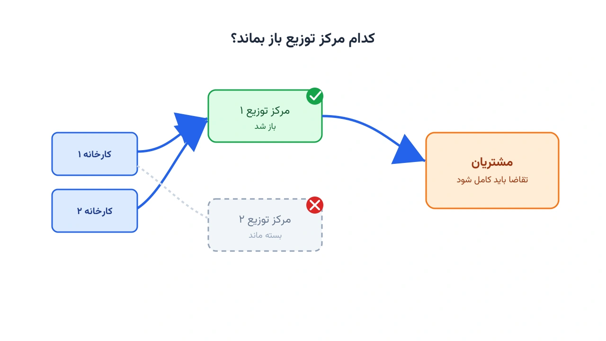

GAMS از سال ۱۹۷۸ یکی از اصلی‌ترین زبان‌های مدل‌سازی جبری در تحقیق در عملیات بوده است. هنوز هم در بسیاری از دانشگاه‌ها و شرکت‌های صنعتی، به‌خصوص در حوزه زنجیره تأمین، تدریس و استفاده می‌شود. اما بسیاری از مهندسانی که مدل‌سازی را با GAMS یاد گرفته‌اند، امروز می‌خواهند همان مدل‌ها را در پایتون بازنویسی کنند. دلیلش هم هزینه لایسنس GAMS است، هم یکپارچگی راحت‌تر با اکوسیستم داده پایتون. این یادداشت یک راهنمای عملی برای همین مهاجرت است. یک مدل واقعی طراحی شبکه زنجیره تأمین را اول در GAMS می‌نویسیم. سپس همان مدل را خط‌به‌خط به Pyomo ترجمه می‌کنیم.

## چرا مهندسان از GAMS به پایتون مهاجرت می‌کنند؟

چند دلیل اصلی معمولاً پشت این تصمیم است. **هزینه لایسنس** یکی از مهم‌ترین‌هاست؛ GAMS و سالورهای تجاری رایج آن مثل CPLEX و Gurobi، لایسنس سالانه نسبتاً گران‌قیمتی دارند. در مقابل، Pyomo رایگان و متن‌باز است. **یکپارچگی با اکوسیستم داده** دلیل دوم است. وقتی داده‌ها از یک پایگاه‌داده یا فایل اکسل می‌آیند، آماده‌سازی آن‌ها در پایتون با pandas طبیعی‌تر است. **کنترل نسخه و تست خودکار** هم مهم است؛ کد پایتون را می‌توان مثل هر نرم‌افزار دیگری در Git نگه داشت. و در آخر، **استقرار و اتوماسیون** ساده‌تر می‌شود. اجرای یک مدل Pyomo در یک سرویس وب یا خط‌لوله CI/CD، آسان‌تر از جاسازی GAMS است.

نکته مهم این است که مهاجرت به‌معنای کنار گذاشتن دانش GAMS نیست. مفاهیم (مجموعه، پارامتر، متغیر، معادله) دقیقاً همان‌ها هستند. فقط نحو نوشتاری عوض می‌شود. اگر با مفهوم مدل‌سازی ریاضی آشنا نیستید، یادداشت [مدل‌سازی ریاضی و اهمیت آن برای برنامه‌نویسی](/notes/mathematical-modeling-art/) پایه لازم را می‌دهد.

## مسئله نمونه: طراحی شبکه زنجیره تأمین دو‌سطحی

یک مسئله واقعی و کامل را از GAMS تا Pyomo پیش می‌بریم: طراحی یک شبکه زنجیره تأمین دو‌سطحی. این شبکه شامل چند **کارخانه**، چند **مرکز توزیع کاندید (DC)** و چند **مشتری** است. باید تصمیم بگیریم کدام مراکز توزیع را باز کنیم؛ هر کدام هزینه ثابت و ظرفیت مشخصی دارند. همچنین باید معلوم شود چه مقدار کالا از هر کارخانه به هر مرکز توزیع جریان یابد. همین مقدار باید از هر مرکز توزیع به هر مشتری هم مشخص شود. هدف، کمینه‌کردن مجموع هزینه ثابت بازکردن مراکز و هزینه متغیر حمل‌ونقل است. تقاضای همه مشتریان هم باید کامل تأمین شود.

این مسئله، تعمیم‌یافته مسئله مکان‌یابی تسهیلات است. نسخه تک‌سطحی آن را در یادداشت [مکان‌یابی انبار: کجا بسازیم که هزینه کمتر شود؟](/notes/facility-location-problem/) دیده‌اید. اینجا یک سطح میانی، یعنی مراکز توزیع، هم اضافه شده است.

فرمول ریاضی مدل، با مجموعه کارخانه‌ها $I$، مراکز توزیع کاندید $J$ و مشتریان $K$:

$$
\min \; \sum_{i,j} c^{1}_{ij} x_{ij} + \sum_{j,k} c^{2}_{jk} w_{jk} + \sum_{j} f_j y_j
$$

قیدها به این شکل‌اند: ظرفیت هر کارخانه، و موازنه جریان در هر مرکز توزیع. همچنین ظرفیت هر مرکز توزیع فقط در صورت باز بودنش فعال است، و تقاضای هر مشتری باید تأمین شود.

$$
\sum_{j} x_{ij} \le cap_i \qquad \forall i \in I
$$

$$
\sum_{i} x_{ij} = \sum_{k} w_{jk} \qquad \forall j \in J
$$

$$
\sum_{k} w_{jk} \le dccap_j\, y_j \qquad \forall j \in J
$$

$$
\sum_{j} w_{jk} \ge dem_k \qquad \forall k \in K
$$

## مدل در GAMS

این‌طور در GAMS نوشته می‌شود:

```gams
SETS
    i  plants        / p1*p2 /
    j  candidate DCs / dc1*dc3 /
    k  customers     / c1*c5 /;

PARAMETERS
    cap(i)   capacity of plant i     / p1 500, p2 400 /
    fcost(j) fixed cost of opening j / dc1 1000, dc2 1200, dc3 900 /
    dccap(j) capacity of DC j        / dc1 350, dc2 300, dc3 300 /
    dem(k)   demand of customer k    / c1 120, c2 160, c3 140, c4 130, c5 150 /;

TABLE tcost1(i,j)  transport cost plant -> DC
         dc1   dc2   dc3
    p1    4     6     9
    p2    5     3     7;

TABLE tcost2(j,k)  transport cost DC -> customer
         c1   c2   c3   c4   c5
    dc1   2    4    5    9    3
    dc2   6    3    4    2    5
    dc3   8    5    2    3    6;

VARIABLES
    z         total cost;

POSITIVE VARIABLES
    x(i,j)    flow from plant i to DC j
    w(j,k)    flow from DC j to customer k;

BINARY VARIABLES
    y(j)      1 if DC j is opened;

EQUATIONS
    obj           objective function
    plantcap(i)   plant capacity
    dcbal(j)      flow balance at DC j
    dccap_eq(j)   DC capacity tied to y(j)
    demand_eq(k)  customer demand;

obj..          z =e= sum((i,j), tcost1(i,j)*x(i,j))
                    + sum((j,k), tcost2(j,k)*w(j,k))
                    + sum(j, fcost(j)*y(j));

plantcap(i)..  sum(j, x(i,j)) =l= cap(i);

dcbal(j)..     sum(i, x(i,j)) =e= sum(k, w(j,k));

dccap_eq(j)..  sum(k, w(j,k)) =l= dccap(j)*y(j);

demand_eq(k).. sum(j, w(j,k)) =g= dem(k);

MODEL scnd /all/;
SOLVE scnd USING MIP MINIMIZING z;

DISPLAY y.l, x.l, w.l, z.l;
```

## جدول تناظر: مفاهیم GAMS در برابر Pyomo

پیش از دیدن کد Pyomo، این جدول را به‌عنوان مرجع سریع نگه دارید:

| مفهوم در GAMS | نحو GAMS | معادل در Pyomo |
|---|---|---|
| مجموعه (Set) | `SETS i /p1*p2/;` | `model.I = Set(initialize=['p1','p2'])` |
| پارامتر تک‌بعدی | `PARAMETERS cap(i) /p1 500/;` | دیکشنری: `cap = {'p1': 500}` |
| پارامتر دوبعدی (TABLE) | `TABLE tcost1(i,j) ...` | دیکشنری با کلید تاپل: `{('p1','dc1'): 4, ...}` |
| متغیر پیوسته نامنفی | `POSITIVE VARIABLES x(i,j);` | `model.x = Var(model.I, model.J, within=NonNegativeReals)` |
| متغیر دودویی | `BINARY VARIABLES y(j);` | `model.y = Var(model.J, within=Binary)` |
| تعریف معادله برابری | `eq.. lhs =e= rhs;` | `Constraint(rule=lambda m,...: lhs == rhs)` |
| نامعادله کوچک‌تر مساوی | `=l=` | `<=` |
| نامعادله بزرگ‌تر مساوی | `=g=` | `>=` |
| حل مدل | `SOLVE scnd USING MIP MINIMIZING z;` | `SolverFactory('cbc').solve(model)` |

## ترجمه به Pyomo

ساختار کلی مدل در Pyomo، به همان ترتیب مجموعه، پارامتر، متغیر و قید پیش می‌رود:

```python
from pyomo.environ import *

# ---------- داده‌ها (معادل SETS / PARAMETERS / TABLE در GAMS) ----------
plants    = ['p1', 'p2']
dcs       = ['dc1', 'dc2', 'dc3']
customers = ['c1', 'c2', 'c3', 'c4', 'c5']

cap   = {'p1': 500, 'p2': 400}
fcost = {'dc1': 1000, 'dc2': 1200, 'dc3': 900}
dccap = {'dc1': 350, 'dc2': 300, 'dc3': 300}
dem   = {'c1': 120, 'c2': 160, 'c3': 140, 'c4': 130, 'c5': 150}

tcost1 = {
    ('p1', 'dc1'): 4, ('p1', 'dc2'): 6, ('p1', 'dc3'): 9,
    # ادامه بقیه ترکیب‌های کارخانه و مرکز توزیع، دقیقاً مطابق جدول GAMS
}

# ---------- مدل ----------
model = ConcreteModel()
model.I = Set(initialize=plants)
model.J = Set(initialize=dcs)
model.K = Set(initialize=customers)

model.x = Var(model.I, model.J, within=NonNegativeReals)
model.w = Var(model.J, model.K, within=NonNegativeReals)
model.y = Var(model.J, within=Binary)

def plant_capacity_rule(m, i):
    return sum(m.x[i, j] for j in m.J) <= cap[i]
model.plant_capacity = Constraint(model.I, rule=plant_capacity_rule)

# ادامه قید موازنه جریان، قید ظرفیت مرکز توزیع، قید تقاضا و تابع هدف، به همین شیوه تعریف می‌شوند.
```

نکته کلیدی این بخش، قید `plant_capacity_rule` است. این قید دقیقاً همان رابطه ریاضی `plantcap(i)` در GAMS است، اما این‌بار یک تابع پایتونی است. Pyomo همین تابع را برای هر عضو مجموعه $I$ فراخوانی می‌کند. مقایسه این دو بلوک نشان می‌دهد ساختار فکری مدل ثابت می‌ماند؛ فقط نحو نوشتاری عوض می‌شود.

## تفاوت‌های ظریفی که باعث باگ می‌شوند

چند نکته هست که اگر رعایت نشود، مدل پایتون شما در ظاهر اجرا می‌شود اما جواب غلط می‌دهد.

**مقدار پیش‌فرض صفر در GAMS، در پایتون وجود ندارد.** فرض کنید برای یک ترکیب `(i,j)` مقداری در GAMS تعریف نکرده باشید. GAMS در این حالت، آن را خودکار صفر در نظر می‌گیرد. در پایتون، دسترسی به کلید نبودِ یک دیکشنری، خطای `KeyError` می‌دهد. برای شبیه‌سازی رفتار GAMS، از `dict.get(key, 0)` استفاده کنید.

**شرط دامنه با `$` معادل مستقیم ندارد.** در GAMS، نوشتن `sum(j$ok(j), ...)` یعنی فقط روی اعضایی که شرط `ok(j)` دارند جمع بزن. در Pyomo این فیلتر باید صریح نوشته شود: `sum(x[j] for j in model.J if ok[j])`.

**حساسیت به بزرگی و کوچکی حروف.** GAMS به حروف بزرگ و کوچک حساس نیست؛ پایتون کاملاً حساس است. `model.X` و `model.x` دو شیء متفاوت‌اند. این یکی از رایج‌ترین منابع خطای تایپی هنگام کپی‌کردن کد است.

**جهت نامعادله را هنگام کپی دوباره چک کنید.** اشتباه گرفتن `=l=` با `=g=` هنگام ترجمه دستی شایع است. این اشتباه، مدل را یا INFEASIBLE می‌کند یا جواب نادرست می‌دهد. برای روش سیستماتیک پیداکردن قید مقصر، یادداشت [مدل غیرقابل‌اجرا: چطور قید مقصر را پیدا کنیم؟](/notes/infeasible-model-diagnosis/) کمک می‌کند.

## اهمیت این موضوع

طراحی شبکه زنجیره تأمین، یکی از پرهزینه‌ترین تصمیم‌های استراتژیک هر شرکت تولیدی است. شرکتی مثل دانون (Danone) در توزیع محصولات لبنی، باید دائم تصمیم بگیرد کدام مراکز توزیع را فعال نگه دارد. این تصمیم مستقیماً روی هزینه حمل‌ونقل و سرعت رسیدن محصول تازه به مشتری اثر می‌گذارد. یک تصمیم اشتباه در مکان‌یابی، سال‌ها هزینه اضافی به شرکت تحمیل می‌کند. باز و بسته‌کردن یک مرکز توزیع واقعی، کار ساده و ارزانی نیست. مدل MILP، در عرض چند ثانیه، بهترین ترکیب از میان هزاران حالت ممکن را پیدا می‌کند.

مزیت دیگر این مدل‌سازی، امکان تحلیل سناریو است. مدیر زنجیره تأمین می‌تواند بپرسد «اگر تقاضای یک منطقه ۲۰ درصد رشد کند، باید مرکز توزیع جدیدی باز شود؟». با تغییر پارامتر تقاضا و حل دوباره مدل، جواب در چند ثانیه آماده می‌شود.



## ظرفیت کار آکادمیک و پژوهشی

مسئله طراحی شبکه زنجیره تأمین (Supply Chain Network Design) یکی از قدیمی‌ترین و پرمقاله‌ترین حوزه‌های تحقیق در عملیات است. نسخه پایه‌ای که در این یادداشت دیدیم، قابل گسترش به شکل‌های پژوهشی متعددی است. می‌توان عدم‌قطعیت تقاضا یا هزینه حمل‌ونقل را با برنامه‌ریزی تصادفی دومرحله‌ای وارد مدل کرد. می‌توان سطح سوم شبکه، مثل انبارهای منطقه‌ای، هم اضافه کرد. همچنین می‌توان هدف را چندمعیاره کرد و معیارهای زیست‌محیطی مثل انتشار کربن را هم‌زمان با هزینه کمینه کرد. هر کدام از این جهت‌ها می‌تواند پایه یک مقاله یا پایان‌نامه باشد.

## پیاده‌سازی با پایتون

نکته مهم این مدل، امکان حل آن با ابزارهای کاملاً متن‌باز پایتون است. نیازی به لایسنس GAMS یا سالورهای تجاری گران‌قیمت نیست. [Pyomo](https://www.pyomo.org/) زبان مدل‌سازی جبری است که مدل را تعریف می‌کند. سالورهایی مثل [HiGHS](https://highs.dev/) یا [CBC](https://github.com/coin-or/Cbc) آن را حل می‌کنند. هر دو رایگان‌اند و برای این مقیاس مسئله، کافی و سریع هستند. برای داده‌های اکسل، `pandas.read_excel` ساده‌ترین راه آماده‌سازی ورودی است. برای فایل‌های قدیمی GDX، کتابخانه `gdxpds` یک راه میانبر مستقیم به `pandas.DataFrame` می‌دهد. نحوه نصب و انتخاب چند سالور رایگان رایج را در یادداشت [سه روش عملی استفاده از Solverها در Pyomo](/notes/pyomo-solvers/) ببینید.

اگر به [انجام پروژه بهینه‌سازی](/consultation/) برای مسئله خودتان نیاز دارید، صفحه مشاوره نقطه شروع خوبی است.

## سوالات متداول

<h3>آیا ابزاری برای تبدیل خودکار کد GAMS به Pyomo وجود دارد؟</h3>
<p>ابزار تبدیل خودکار کاملی که بدون بازبینی انسانی کار کند وجود ندارد. بهترین روش، همان ترجمه بخش‌به‌بخش است که در این یادداشت نشان دادیم.</p>

<h3>آیا عملکرد CBC یا HiGHS با سالورهای تجاری GAMS قابل‌مقایسه است؟</h3>
<p>برای بیشتر مدل‌های MILP با مقیاس متوسط، HiGHS عملکردی نزدیک به سالورهای تجاری دارد. برای مسائل بسیار بزرگ، CPLEX و Gurobi هنوز برتری دارند؛ اما همین سالورها از داخل Pyomo هم در دسترس‌اند.</p>

<h3>برای پیاده‌سازی این مدل روی شبکه توزیع واقعی شرکت خودمان کمک می‌خواهم، از کجا شروع کنم؟</h3>
<p>بهترین نقطه شروع، گرفتن یک <a href="/consultation/" style="color:#2563EB; font-weight:bold;">مشاوره</a> است تا داده‌های شبکه توزیع و معیارهای تصمیم شما با هم بررسی شوند. دوره <a href="/courses/optimization-modeling/" style="color:#2563EB; font-weight:bold;">مدل‌سازی ریاضی و بهینه‌سازی با پایتون</a> هم پایه لازم برای ساخت چنین مدل‌هایی را از صفر می‌دهد.</p>

## جمع‌بندی

در این یادداشت، یک مدل واقعی طراحی شبکه زنجیره تأمین دو‌سطحی را از GAMS تا Pyomo پیش بردیم. فرمول ریاضی مسئله، کد کامل GAMS، و جدول تناظر مفاهیم را دیدیم. رایج‌ترین دام‌های ترجمه، مثل مقدار پیش‌فرض صفر و شرط دامنه با `$`، را هم مرور کردیم. دیدیم چرا این تصمیم برای شرکت‌های واقعی مهم است، و چطور می‌توان آن را کاملاً با ابزارهای رایگان پایتون حل کرد.

اگر می‌خواهید مدل‌سازی ریاضی و پیاده‌سازی آن در پایتون را از پایه و به‌صورت ساخت‌یافته یاد بگیرید، دوره [مدل‌سازی ریاضی و بهینه‌سازی با پایتون](/courses/optimization-modeling/) دقیقاً برای همین هدف طراحی شده است.
