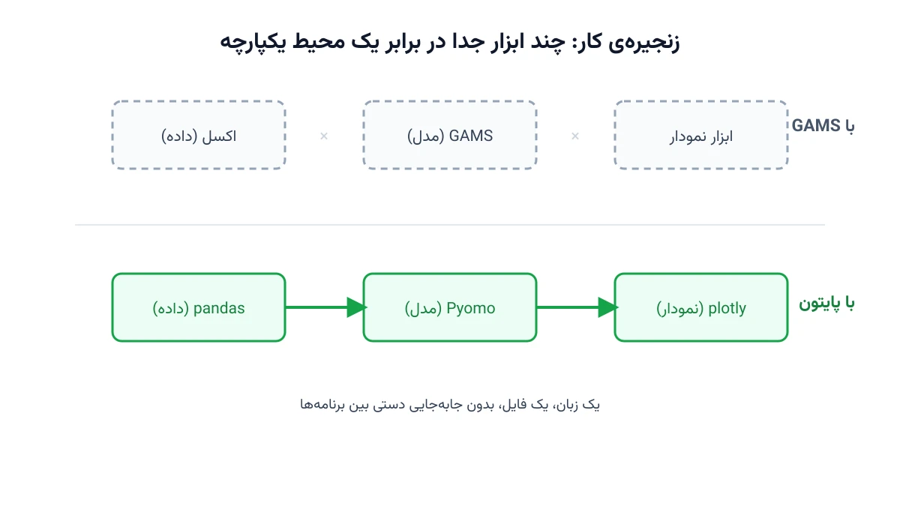

خیلی از مهندسانی که مدل‌سازی ریاضی را با GAMS یاد گرفته‌اند، این روزها می‌خواهند همان مدل‌ها را در پایتون بازنویسی کنند. این تصمیم فقط یک تغییر زبان نیست. رفتن از یک محیط بسته و تخصصی به یک اکوسیستم باز و همه‌منظوره است. در ادامه دلیل‌های اصلی این جابه‌جایی را مرور می‌کنیم، و جایی هم که GAMS هنوز برتری دارد را صادقانه می‌گوییم.

## اهمیت این موضوع

این تصمیم فقط یک بحث فنی نیست؛ روی بودجه و سرعت تحویل پروژه هم اثر مستقیم دارد. شرکتی مثل Shell، مدل‌های برنامه‌ریزی زنجیره‌ی انرژی بزرگی اجرا می‌کند. این شرکت سال‌هاست بخش قابل‌توجهی از ابزارهای داخلی بهینه‌سازی خود را حول پایتون و [Pyomo](https://www.pyomo.org/) ساخته است. دلیلش فقط هزینه نیست؛ یکپارچگی با خط لوله‌ی داده و تحویل سریع‌تر محصول به تیم‌های دیگر هم اهمیت دارد.

برای تیم‌های کوچک‌تر و مشاوره‌های مستقل، این انتخاب حتی حیاتی‌تر است. یک مشاور که باید مدل را به کارفرما تحویل دهد، نمی‌تواند فرض کند کارفرما لایسنس GAMS دارد. وقتی مدل در پایتون نوشته شود، تحویل، نصب و اجرای آن برای کارفرما بسیار ساده‌تر است.

## ۱. هزینه و دسترسی به لایسنس

لایسنس تجاری GAMS و سالورهای همراهش گران است. برای کاربران داخل ایران، خرید و تمدید این لایسنس به‌خاطر تحریم‌ها و محدودیت‌های پرداخت عملاً دشوار است. پایتون و پکیج‌هایی مثل Pyomo، در مقابل، کاملاً رایگان و متن‌باز هستند.

سالورهای متن‌باز خوبی هم در این اکوسیستم در دسترس است. [HiGHS](https://highs.dev/) و [CBC](https://github.com/coin-or/Cbc) برای مسائل خطی و عدد صحیح مختلط مناسب‌اند. [Ipopt](https://coin-or.github.io/Ipopt/) برای مسائل غیرخطی به کار می‌رود، و [SCIP](https://www.scipopt.org/) هم که حالا متن‌باز شده، گزینه‌ی قدرتمندی است. نسخه‌ی آکادمیک [Gurobi](https://www.gurobi.com/academia/academic-program-and-licenses/) و CPLEX هم برای دانشگاهیان رایگان است.

## ۲. کل زنجیره‌ی کار در یک محیط

در GAMS معمولاً داده را در اکسل آماده می‌کنید و مدل را در GAMS حل می‌کنید. سپس برای تحلیل و رسم نمودار، دوباره سراغ ابزار دیگری می‌روید. در پایتون همه‌ی این مراحل یک‌جا انجام می‌شود. خواندن داده از فایل، پایگاه داده یا API با [pandas](https://pandas.pydata.org/) انجام می‌شود. ساخت و حل مدل با Pyomo صورت می‌گیرد. تحلیل و رسم نتایج هم با [matplotlib](https://matplotlib.org/) یا [plotly](https://plotly.com/python/) امکان‌پذیر است.

حتی ساخت یک داشبورد یا اپلیکیشن وب ساده برای نمایش نتایج به کارفرما، با [Streamlit](https://streamlit.io/) در چند ساعت ممکن است. این یکپارچگی برای پروژه‌های صنعتی و مشاوره‌ای ارزش زیادی دارد. دیگر نیازی به جابه‌جایی فایل بین چند برنامه‌ی مجزا نیست.

## ۳. انعطاف در الگوریتم‌های پیشرفته

پیاده‌سازی روش‌هایی مثل تجزیه‌ی بندرز، تولید ستون، افق غلتان، یا بهینه‌سازی استوار و تصادفی در پایتون بسیار طبیعی‌تر است. حلقه‌های تکراری بین چند مدل جداگانه هم در پایتون ساده‌تر پیاده می‌شوند. در GAMS هم این روش‌ها شدنی هستند، ولی کد به‌سرعت زشت و سخت‌نگه‌دار می‌شود.

ترکیب بهینه‌سازی با یادگیری ماشین هم در پایتون مستقیم و ساده است. برای نمونه، پیش‌بینی بار مصرفی، قیمت برق یا تولید تجدیدپذیر، پیش از ورود به مدل بهینه‌سازی. وقتی هر دو بخش در یک زبان باشند، اتصال این دو مرحله به هم خیلی کمتر دردسر دارد.

## ۴. اکوسیستم تخصصی

برای سیستم‌های قدرت، ابزارهایی مثل [pandapower](http://www.pandapower.org/) و [PyPSA](https://pypsa.org/) در پایتون وجود دارند. برای زمان‌بندی و مسیریابی، [OR-Tools](https://developers.google.com/optimization) و سالور [CP-SAT](https://developers.google.com/optimization/cp/cp_solver) گزینه‌ی قدرتمندی هستند. برای مسائل تصادفی چندمرحله‌ای هم [mpi-sppy](https://github.com/Pyomo/mpi-sppy) در دسترس است.

معادل بیشتر این ابزارها در GAMS یا اصلاً وجود ندارد، یا باید از صفر نوشته شود. برای مثال، فرض کنید می‌خواهید سریع یک شبکه‌ی توزیع برق را با پخش بار مدل کنید. نوشتن چنین چیزی از صفر در GAMS زمان زیادی می‌برد.

## ۵. بازار کار و مهارت ماندگار

پایتون زبانی همه‌منظوره است و تقریباً در هر شرکت داده‌محور استفاده می‌شود. مهارت GAMS، بیرون از فضای آکادمیک و چند صنعت خاص، کاربرد نسبتاً محدودی دارد. برای کسی که می‌خواهد از مدل‌سازی ریاضی به سمت بازار کار گسترده‌تری حرکت کند، این تفاوت اهمیت زیادی دارد.

کار با git، تست‌نویسی و بازتولیدپذیری نتایج هم در پایتون جاافتاده‌تر است. این ابزارها امروز بخش استانداردی از هر پروژه‌ی نرم‌افزاری جدی هستند، نه یک افزونه‌ی اختیاری.

## نقاط قوت باقی‌مانده‌ی GAMS

با همه‌ی این حرف‌ها، صادقانه باید گفت GAMS هنوز نقاط قوت واقعی دارد. نحو جبری آن بسیار فشرده و نزدیک به فرمول‌نویسی ریاضی است؛ یک معادله‌ی چندبعدی را می‌توان در چند خط نوشت. در تولید مدل‌های خیلی بزرگ هم، GAMS معمولاً از Pyomo سریع‌تر عمل می‌کند. دلیلش این است که موتور تولید معادلات آن به زبان C نوشته شده است.

GAMS کتابخانه‌ی مدل‌های آماده‌ی بسیار بزرگی هم دارد که سال‌ها رویش کار شده است. بخش زیادی از مقالات قدیمی‌تر سیستم‌های قدرت هم با همین ابزار نوشته شده‌اند. ابزارهایی مثل EMP، برای مسائل دوسطحی و مسائل تعادلی با قیود مکملی، در GAMS بسیار پخته‌تر از معادل‌های پایتونی‌شان هستند.

جالب این‌جاست که خود GAMS هم با ارائه‌ی [GAMSPy](https://gamspy.readthedocs.io/) به سمت پایتون آمده است. این حرکت خودش نشان می‌دهد مسیر کلی صنعت به کدام سمت می‌رود.



## ظرفیت کار آکادمیک و پژوهشی

مقایسه‌ی عملکرد GAMS و Pyomo روی مدل‌های بزرگ‌مقیاس، خودش یک موضوع پژوهشی جذاب است. سوال اصلی این است: در چه اندازه‌ای از مسئله، سرعت تولید معادلات GAMS دیگر اهمیتی ندارد؟ پاسخ به این سوال برای انتخاب ابزار در پروژه‌های صنعتی بسیار کاربردی است.

مسیر دیگر، مستندسازی و بازتولیدپذیری مدل‌های قدیمی سیستم قدرت است که فقط به زبان GAMS نوشته شده‌اند. ترجمه‌ی سیستماتیک این مدل‌ها به Pyomo، همراه با آزمون صحت نتایج، می‌تواند موضوع یک پایان‌نامه یا مقاله‌ی کاربردی باشد. نمونه‌ی این کار را می‌توانید در یادداشت [از GAMS به پایتون: طراحی شبکه زنجیره تأمین](/notes/gams-to-python-supply-chain-network/) ببینید.

## پیاده‌سازی عملی: از GAMS به Pyomo

نکته‌ی مهم این است که ترجمه‌ی یک مدل GAMS به Pyomo، معمولاً یک تناظر تقریباً یک‌به‌یک دارد. مجموعه‌ها (Sets) در Pyomo هم به همین نام تعریف می‌شوند. پارامترها و متغیرها هم ساختار مشابهی دارند، فقط با نحو پایتونی.

```python
from pyomo.environ import *

model = ConcreteModel()

# در GAMS: SET i 'محصولات' / A, B, C /;
model.I = Set(initialize=["A", "B", "C"])

# در GAMS: PARAMETER cost(i);
model.cost = Param(model.I, initialize={"A": 10, "B": 14, "C": 9})

# در GAMS: VARIABLE x(i);
model.x = Var(model.I, domain=NonNegativeReals)

# ادامه قیود و تابع هدف به همین شیوه، با یک سالور مثل HiGHS، تعریف می‌شوند
```

این اسکلت فقط گام اول است. برای انتخاب و تنظیم سالور مناسب، یادداشت [سه روش عملی استفاده از سالورها در Pyomo](/notes/pyomo-solvers/) راهنمای خوبی است.

## جمع‌بندی

لازم نیست مدل‌های قدیمی GAMS را دور بریزید؛ آن‌ها همچنان کار می‌کنند. اما برای پروژه‌های جدید، وقتی هزینه، یکپارچگی با داده، الگوریتم‌های تجزیه یا تحویل محصول به کارفرما مهم است، پایتون انتخاب منطقی‌تری است. دوره [مبانی مدل‌سازی و بهینه‌سازی ریاضی](/courses/optimization-modeling/) هم دقیقاً همین مسیر یادگیری را، از صفر تا یک مدل کامل در پایتون، پوشش می‌دهد.

## سوالات متداول

<h3>آیا مهاجرت از GAMS به پایتون برای مدل‌های خیلی بزرگ هم منطقی است؟</h3>
<p>بله، ولی باید زمان تولید معادلات را هم در نظر گرفت. برای بیشتر پروژه‌های صنعتی، این تفاوت سرعت در عمل محسوس نیست و مزیت‌های یکپارچگی پایتون می‌چربد.</p>

<h3>آیا باید Pyomo را انتخاب کنیم یا مستقیم سراغ OR-Tools برویم؟</h3>
<p>به نوع مسئله بستگی دارد. برای مسائل خطی و غیرخطی پیوسته، Pyomo طبیعی‌تر است. برای زمان‌بندی و مسیریابی ترکیبیاتی، OR-Tools و CP-SAT معمولاً عملکرد بهتری دارند.</p>

<h3>برای شروع این مهاجرت در پروژه خودمان از کجا کمک بگیریم؟</h3>
<p>بهترین نقطه‌ی شروع، ترجمه‌ی یکی از کوچک‌ترین مدل‌های فعلی‌تان به Pyomo است. اگر مدل شما پیچیده یا بزرگ است، می‌توانید برای طراحی نقشه‌ی مهاجرت اختصاصی درخواست <a href="/consultation/" style="color:#2563EB; font-weight:bold;">مشاوره</a> ثبت کنید.</p>
