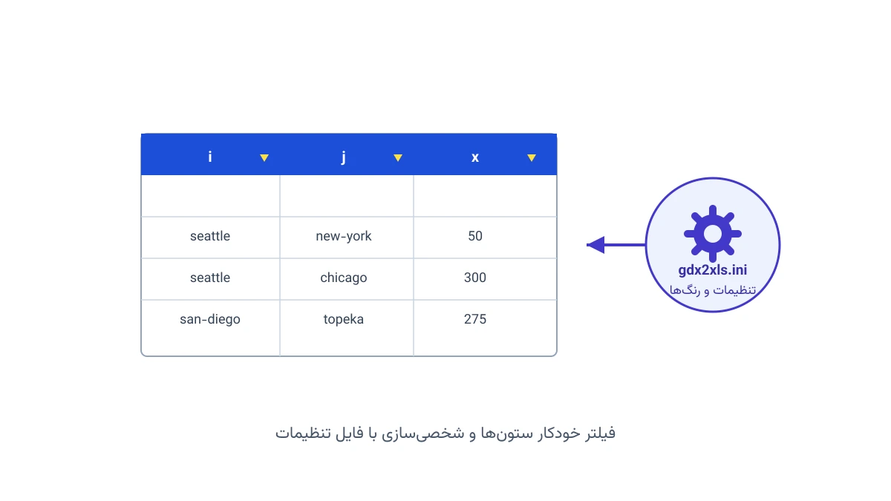

وقتی یک مدل گمز (GAMS) را حل می‌کنیم، نتیجه در قالب یک فایل GDX ذخیره می‌شود. این فایل برای خود گمز خیلی مفید است، اما برای یک مدیر پروژه یا همکار غیرفنی قابل‌خواندن نیست. اینجاست که ابزار GDX2XLS وارد می‌شود. این ابزار کل محتوای یک فایل GDX را به یک فایل اکسل تبدیل می‌کند. هر پارامتر، متغیر یا معادله، شیت جداگانه‌ی خودش را می‌گیرد.

نتیجه نهایی یک فایل XLSX معمولی است که هر همکار می‌تواند بدون نصب گمز آن را باز کند. این ویژگی، GDX2XLS را به ابزاری ساده اما کاربردی برای گزارش‌گیری تبدیل کرده است. در ادامه، ساختار خروجی، تنظیمات قابل‌شخصی‌سازی و چند مثال عملی را مرور می‌کنیم.

## چرا تبدیل GDX به اکسل اهمیت دارد

بیشتر مدل‌های بهینه‌سازی صنعتی، نتایجی تولید می‌کنند که باید برای ذی‌نفعان غیرفنی توضیح داده شوند. شرکتی مثل یک شرکت توزیع برق از گمز برای برنامه‌ریزی تولید استفاده می‌کند. نتایج این برنامه‌ریزی معمولاً در جلسات با مدیران ارشد، در قالب اکسل ارائه می‌شود. تهیه‌ی دستی چنین گزارشی از صدها متغیر و پارامتر، کاری زمان‌بر و پرخطا است.

GDX2XLS این فرایند را خودکار می‌کند. به‌جای کپی‌کردن دستی اعداد، کل جدول نماد‌ها (symbol table) در یک فرمان ساده به اکسل منتقل می‌شود. علاوه بر این، صفحه‌ی فهرست مطالب (Table of Contents) هم به‌صورت خودکار ساخته می‌شود. این صفحه با لینک‌های قابل‌کلیک، دسترسی سریع به هر نماد را ممکن می‌کند.

## ساختار خروجی و صفحه فهرست مطالب

وقتی GDX2XLS روی یک فایل GDX اجرا می‌شود، خروجی یک فایل XLSX یا XLS است. صفحه‌ی اول همیشه فهرست مطالب است؛ نام تمام نمادها به‌ترتیب حروف الفبا در آن فهرست می‌شود. با کلیک روی نام هر نماد، شیت مربوط به همان نماد باز می‌شود. ستون‌های اندیس هم برچسب دامنه‌ی خودشان را نشان می‌دهند. اگر اطلاعات دامنه موجود نباشد، به‌جای آن از نام‌های عمومی مثل dim1 و dim2 استفاده می‌شود.

مقادیر اسکالر، یعنی پارامتر، متغیر یا معادله‌ی بدون اندیس، وضعیت خاصی دارند. این مقادیر، برای کاهش تعداد شیت‌ها، به‌طور پیش‌فرض در یک شیت مشترک به نام scalar جمع می‌شوند. این رفتار را می‌توان از طریق فایل تنظیمات خاموش کرد.



## قابلیت AutoFilter

به‌طور پیش‌فرض، هر جدول در اکسل به‌صورت یک AutoFilter ساخته می‌شود. این یعنی بالای هر ستون یک فلش کوچک قرار دارد که امکان فیلتر و مرتب‌سازی را فراهم می‌کند. می‌توان روی چند ستون هم‌زمان فیلتر گذاشت؛ مثلاً ابتدا بر اساس یک ستون مرتب کرد، سپس روی ستون دوم هم ترتیب داد.

این قابلیت برای بررسی سریع نتایج بسیار کاربردی است. فرض کنید مدل شما هزاران سطر شامل مقادیر حمل‌ونقل بین شهرها تولید کرده است. با AutoFilter می‌توان فقط سطرهایی را دید که مقدار آن‌ها بیشتر از یک آستانه‌ی مشخص است. اگر این قابلیت لازم نباشد، می‌توان آن را در فایل تنظیمات خاموش کرد.

## تنظیمات از طریق فایل INI

رفتار GDX2XLS با یک فایل متنی به نام gdx2xls.ini کنترل می‌شود. این فایل باید کنار فایل اجرایی قرار بگیرد، یا با آرگومان جداگانه‌ی @filename.ini به برنامه معرفی شود. فایل تنظیمات دو بخش اصلی دارد: بخش settings برای رفتار کلی، و بخش colors برای رنگ‌بندی جدول‌ها.

در بخش settings می‌توان مقادیر خاص گمز مثل INF، EPS و NA را به مقادیر عددی یا متنی دلخواه نگاشت کرد. این نگاشت برای مواردی مهم است که می‌خواهیم روی این اعداد در اکسل فرمول بنویسیم. گزینه‌های دیگری مثل scalarsheet، autofilter و freezeheader هم رفتارهای ظاهری خروجی را تنظیم می‌کنند. بخش colors هم رنگ پس‌زمینه‌ی سربرگ جدول، بدنه‌ی جدول و متن توضیحی را مشخص می‌کند.

## فرمت‌های سفارشی برای مقادیر عددی

یکی از قابلیت‌های جالب GDX2XLS، تعریف فرمت سفارشی برای نمایش اعداد است. فرمت به چهار بخش تقسیم می‌شود: برای مقادیر مثبت، منفی، صفر و رشته‌های متنی. مثلاً فرمت زیر، اعداد مثبت را آبی نشان می‌دهد. اعداد منفی هم با همین فرمت، قرمز رنگ می‌شوند:

```
[Blue]#.????;[Red]-#.????;[Green]0.????;[Magenta]
```

یک فرمت ساده‌تر و بسیار پرکاربرد هم `valueformat=#.????` است. این فرمت، اعداد را روی ممیز اعشار تراز می‌کند و صفرها را با نقطه نشان می‌دهد، دقیقاً مثل فایل‌های خروجی لیستینگ گمز.

## مرور چند مثال عملی

برای درک بهتر GDX2XLS، شش مثال کوچک گمز را با هم مرور می‌کنیم. هر مثال، یک جنبه‌ی متفاوت از ابزار را نشان می‌دهد. نکته‌ی مشترک همه‌ی آن‌ها، استفاده از علامت مساوی قبل از دستورهای execute است. این علامت باعث می‌شود فراخوانی بدون واسطه‌ی خط فرمان انجام شود. اگر برنامه پیدا نشود، خطا بلافاصله گزارش می‌شود؛ بدون این علامت، چنین خطاهایی ممکن است بی‌سروصدا نادیده گرفته شوند.

### مثال ۱: تبدیل مدل trnsport

ساده‌ترین کاربرد GDX2XLS، تبدیل مدل‌های کتابخانه‌ی گمز است. در این مثال، مدل trnsport حل می‌شود، خروجی GDX ساخته می‌شود، و در نهایت GDX2XLS آن را به اکسل تبدیل می‌کند. دستور آخر هم فایل اکسل را برای مشاهده باز می‌کند.

```gams
$onText
Test of GDX2XLS. Dumps all symbols of
trnsport.gms to trnsport.xlsx.
$offText

execute '=gamslib trnsport';
execute '=gams trnsport lo=3 gdx=trnsport';
execute '=gdx2xls trnsport.gdx';
executeTool 'win32.shellExecute trnsport.xlsx';
```

### مثال ۲: تبدیل مدل بزرگ‌تر indus89

همین روش برای مدل‌های بزرگ‌تر هم کار می‌کند. مدل indus89 نمادهای بیشتری دارد، پس فایل اکسل خروجی هم شیت‌های بیشتری خواهد داشت. ساختار دستورها دقیقاً مثل مثال قبل است.

```gams
$onText
Test of GDX2XLS. Dumps all symbols of
indus89.gms to indus89.xlsx. This takes
longer as there is a large number of symbols.
$offText

execute '=gamslib indus89';
execute '=gams indus89 lo=3 gdx=indus89';
execute '=gdx2xls indus89.gdx';
executeTool 'win32.shellExecute indus89.xlsx';
```

### مثال ۳: یک جدول بسیار بزرگ

این مثال، یک پارامتر مصنوعی با تعداد سطرهای نزدیک به سقف اکسل می‌سازد. فایل XLS قدیمی حداکثر ۶۵۵۳۶ سطر را می‌پذیرد، پس اندیس i تا ۶۵۵۳۳ عضو تعریف شده است. اگر تعداد سطرها از این سقف فراتر برود، نوشتن فایل XLS با خطا متوقف می‌شود.

```gams
$onText
Test of GDX2XLS. Single symbol with 65536-3=65533 records.
Maximum rows that XLS can handle is 65536; an XLSX file allows for slightly more than a million rows.
$offText

Set i / i1*i65533 /;

Parameter p(i);
p(i) = uniform(-100,100);
execute_unload 'test.gdx', p;

execute '=gdx2xls test.gdx';
executeTool 'win32.shellExecute test.xlsx';
```

### مثال ۴: نگاشت مقادیر خاص گمز

مقادیری مثل INF، EPS و NA در گمز، مقادیر خاص هستند، نه عددهای معمولی. برای اینکه بتوان در اکسل روی آن‌ها فرمول نوشت، باید این مقادیر به عدد یا رشته‌ی دلخواه نگاشت شوند. این مثال یک فایل INI موقت می‌سازد. همین پارامتر، یک‌بار با تنظیمات پیش‌فرض و یک‌بار با نگاشت سفارشی، به اکسل منتقل می‌شود.

```gams
$onText
Test of GDX2XLS.
Check special value mapping.
$offText

$onEcho > m.ini
[settings]
inf=1.0e100
mininf=-1.0e100
eps=0.0
na=#NA!
undf=#UNDF!
$offEcho

Parameter p(*) / i1 inf, i2 -inf, i3 eps, i4 na /;
p('i5') = 1/0;
display p;


* save parameter p in p.xlsx
* special values are translated to default values:
execute_unload "p.gdx", p;
execute '=gdx2xls p.gdx';
executeTool 'win32.shellExecute p.xlsx';

* save parameter p in q.xls using new mapping
* INF -> 1.0e100  (numeric)
* -INF -> -1.0e100  (numeric)
* EPS -> 0.0  (numeric)
* NA -> #NA! (string)
* UNDF -> #UNDF! (string)
*
execute_unload "q.gdx", p;
execute '=gdx2xls q.gdx @m.ini';
executeTool 'win32.shellExecute q.xlsx';
```

### مثال ۵: فرمت سفارشی با رنگ‌بندی

این مثال، یک فرمت سفارشی برای مقادیر عددی تعریف می‌کند. مقادیر مثبت آبی، مقادیر منفی قرمز، صفرها سبز و متن‌ها بنفش نمایش داده می‌شوند. عدد‌ها هم روی ممیز اعشار تراز می‌شوند.

```gams
$onText
GDX2XLS example: use of custom format
$offText

$onEcho > mexls.ini
[settings]
valueformat=[Blue]#.????;[Red]-#.????;[Green]0.????;[Magenta]
$offEcho

execute '=gamslib mexls';
execute '=gams mexls lo=3 gdx=mexls';
execute '=gdx2xls mexls.gdx @mexls.ini';
executeTool 'win32.shellExecute mexls.xlsx';
```

### مثال ۶: فرمت ساده‌ی ترازشده

این مثال هم از همان مدل mexls استفاده می‌کند، اما فقط یک فرمت ساده‌تر برای تراز اعداد به‌کار می‌برد. همان‌طور که در بخش قبل گفته شد، این فرمت شبیه فایل‌های خروجی لیستینگ گمز است.

```gams
$onText
GDX2XLS example: use of custom format
$offText

$onEcho > align.ini
[settings]
valueformat=#.????
$offEcho

execute '=gamslib mexls';
execute '=gams mexls lo=3 gdx=mexls';
execute '=gdx2xls mexls.gdx @align.ini';
executeTool 'win32.shellExecute align.xlsx';
```

## یک نکته‌ی مهم: وضعیت منسوخ‌شده

لازم است صادقانه اشاره شود که GDX2XLS دیگر توسعه‌ی فعال ندارد و از نسخه‌های جدید گمز، به ابزار منسوخ‌شده تبدیل شده است. این ابزار فقط روی ویندوز کار می‌کند و به اکسل نصب‌شده روی همان سیستم وابسته است. جایگزین پیشنهادی رسمی، عامل ExcelWriter در چارچوب [GAMS Connect](https://www.gams.com/latest/docs/UG_CONNECT.html) است.

مزیت ExcelWriter این است که بخشی از یک گردش‌کار (workflow) مبتنی بر Python و YAML است، نه یک فایل اجرایی جداگانه. این یعنی می‌توان آن را با ابزارهای دیگر مثل [Pyomo](https://www.pyomo.org/) در یک خط‌لوله‌ی خودکار ترکیب کرد. برای کسانی که همین امروز پروژه‌ی جدیدی را شروع می‌کنند، توصیه می‌شود مستقیماً سراغ Connect بروند. برای نگهداری از مدل‌های قدیمی گمز، GDX2XLS همچنان قابل‌استفاده است. علاقه‌مندان به مباحث پایه‌ی مدل‌سازی ریاضی می‌توانند به دوره [مدل‌سازی و بهینه‌سازی](/courses/optimization-modeling/) هم مراجعه کنند.

## سوالات متداول

<h3>آیا GDX2XLS روی لینوکس یا مک هم کار می‌کند؟</h3>
<p>نه. این ابزار فقط روی ویندوز اجرا می‌شود و به نصب بودن اکسل روی همان سیستم نیاز دارد. برای سیستم‌عامل‌های دیگر باید از عامل ExcelWriter در GAMS Connect استفاده کرد.</p>

<h3>چه تعداد سطر را می‌توان با GDX2XLS به اکسل منتقل کرد؟</h3>
<p>برای فایل XLS قدیمی، سقف حدود ۶۵٬۵۳۶ سطر است. فرمت جدیدتر XLSX این محدودیت را به بیش از یک میلیون سطر افزایش می‌دهد. اگر جدول شما از این سقف فراتر رود، باید آن را به چند پارامتر کوچک‌تر تقسیم کرد.</p>

<h3>برای پیاده‌سازی یک گردش‌کار گزارش‌گیری سفارشی از گمز به اکسل چه کار باید کرد؟</h3>
<p>بسته به نسخه‌ی گمز و نیاز پروژه، می‌توان از GDX2XLS قدیمی یا عامل مدرن‌تر ExcelWriter استفاده کرد. برای طراحی دقیق این گردش‌کار متناسب با داده‌های خودتان، می‌توانید از <a href="/consultation/" style="color:#2563EB; font-weight:bold;">مشاوره</a> کمک بگیرید.</p>
