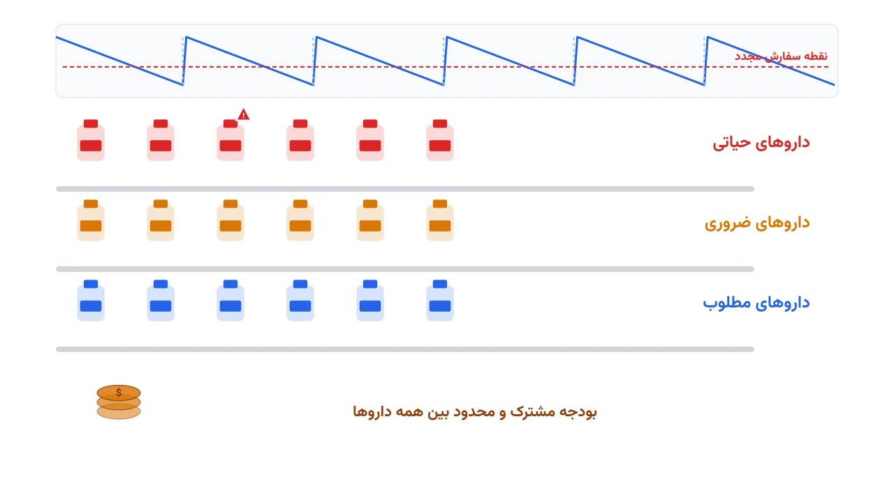

مسئول داروخانه یک بیمارستان بزرگ را تصور کنید. روی میزش صدها قلم دارو ردیف شده‌اند. برخی داروها حیاتی‌اند، مثل داروی احیای قلبی. برخی دیگر غیرضروری‌تر هستند، مثل یک مسکن ساده. بودجه داروخانه محدود است و نمی‌توان همه چیز را انبار کرد.

اگر داروی حیاتی کم بیاید، جان بیمار در خطر می‌افتد. اگر داروی کم‌اهمیت‌تر زیاد سفارش داده شود، بودجه هدر می‌رود و برخی داروها هم تاریخ انقضا می‌گذرانند. این همان کشمکش همیشگی مدیریت موجودی است، اما با یک پیچیدگی اضافه: همه داروها به یک اندازه مهم نیستند.

### چرا این مسئله با مدل موجودی معمولی فرق دارد؟

مدل‌های کلاسیک کنترل موجودی، مثل مدل مقدار اقتصادی سفارش، همه اقلام را یکسان می‌بینند. در داروخانه بیمارستان این فرض درست نیست. داروسازان معمولاً از یک طبقه‌بندی به نام VED استفاده می‌کنند. حرف V برای داروهای حیاتی (Vital) است، E برای ضروری (Essential) و D برای مطلوب (Desirable).

کمبود یک داروی حیاتی می‌تواند جان بیمار را تهدید کند. کمبود یک داروی مطلوب فقط باعث ناراحتی جزئی می‌شود. پس سطح اطمینان مورد نیاز برای هر گروه باید متفاوت باشد. تفاوت دوم این است که بودجه داروخانه بین صدها قلم دارو مشترک است. سفارش بیشتر یک دارو، بودجه داروی دیگر را کاهش می‌دهد.

نکته سوم، امکان جایگزینی دارویی است. گاهی اگر یک داروی خاص نایاب شود، داروساز می‌تواند معادل بالینی آن را جایگزین کند. این انعطاف در مدل‌های موجودی کلاسیک اصلاً دیده نمی‌شود. مدلی که این سه ویژگی را با هم ببیند، تصمیم بسیار واقعی‌تری نسبت به یک فرمول ساده EOQ می‌دهد.

### فرمول‌بندی ریاضی

فرض کنید $J$ مجموعه داروها و $T$ افق زمانی برنامه‌ریزی (مثلاً هفته) باشد. زیرمجموعه $J_V \subset J$ داروهای حیاتی را نشان می‌دهد. متغیر $x_{j,t} \ge 0$ مقدار سفارش داروی $j$ در دوره $t$ است. متغیر $I_{j,t} \ge 0$ موجودی پایان دوره و $z_{j,t} \ge 0$ مقدار کمبود تأمین‌نشده است.

موازنه موجودی با زمان تحویل $L_j$ به این شکل نوشته می‌شود:

$$
I_{j,t} - z_{j,t} = I_{j,t-1} + x_{j,t-L_j} - d_{j,t} \qquad \forall j \in J,\ t \in T
$$

تابع هدف، هزینه خرید و نگهداری را با جریمه کمبود جمع می‌زند. جریمه کمبود برای داروهای حیاتی بسیار بزرگ‌تر است:

$$
\min \sum_{t \in T} \sum_{j \in J} \left( c_j x_{j,t} + h_j I_{j,t} \right) + \sum_{t \in T} \sum_{j \in J} p_j \, z_{j,t}
$$

بودجه هر دوره یک قید مشترک بین همه داروهاست:

$$
\sum_{j \in J} c_j \, x_{j,t} \le B_t \qquad \forall t \in T
$$

برای داروهای حیاتی، سطح خدمت باید تضمین‌شده باشد؛ یعنی کمبود نباید از یک سهم کوچک تقاضا فراتر رود:

$$
z_{j,t} \le (1 - \alpha_V) \, d_{j,t} \qquad \forall j \in J_V,\ t \in T
$$

برای مدل‌سازی جایگزینی دارویی، می‌توان متغیر $u_{j,k,t} \ge 0$ اضافه کرد که مقدار جایگزینی داروی $k$ به‌جای داروی $j$ را نشان می‌دهد. این متغیر فقط برای جفت‌های دارویی تعریف می‌شود که از نظر بالینی معادل‌اند. سپس $u_{j,k,t}$ در سمت راست موازنه موجودی داروی $j$ به‌عنوان یک منبع اضافه می‌آید.

### اهمیت این موضوع در دنیای واقعی

کمبود دارو دیگر یک اتفاق نادر نیست. در سال‌های اخیر، بسیاری از بیمارستان‌ها با کمبود دوره‌ای داروهای حیاتی مواجه بوده‌اند. گاهی علت، مشکل تولید است و گاهی اختلال در زنجیره تأمین جهانی. داروخانه بیمارستان معمولاً آخرین لایه دفاعی در برابر این کمبودهاست.

شرکت‌های بزرگ توزیع دارو مثل کاردینال هلث (Cardinal Health) نقش مهمی در این زنجیره دارند. چنین شرکت‌هایی داده‌های مصرف هزاران بیمارستان را جمع‌آوری می‌کنند. آن‌ها تلاش می‌کنند الگوی کمبود احتمالی را زودتر پیش‌بینی کنند. اما تصمیم نهایی درباره سطح موجودی هر دارو، همچنان بر عهده خود داروخانه بیمارستان است.

یک مدل بهینه‌سازی رسمی، این تصمیم را از حالت تجربه شخصی داروساز خارج می‌کند. به‌جای قاعده سرانگشتی «همیشه سه ماه موجودی نگه دار»، مدل بودجه را بین داروها به‌نسبت اهمیت بالینی‌شان توزیع می‌کند. این یعنی کاهش هم‌زمان ریسک کمبود دارویی حیاتی و هزینه دورریز داروهای کم‌مصرف‌تر.



### ظرفیت کار آکادمیک و پژوهشی

این حوزه فرصت‌های پژوهشی زیادی دارد. یک مسیر رایج، مدل‌سازی تقاضای تصادفی داروهای حیاتی است. تقاضای این داروها اغلب کم و نامنظم است و فرض توزیع نرمال معمولاً ناکافی است؛ توزیع‌های گسسته‌ی نادرالوقوع دقت بیشتری می‌دهند.

مسیر دوم، بهینه‌سازی استوار در برابر اختلال زنجیره تأمین است. زمان تحویل دارو همیشه ثابت نیست و گاهی به‌طور ناگهانی طولانی می‌شود. مدل‌هایی که چند سناریوی زمان تحویل را هم‌زمان در نظر می‌گیرند، تصمیم پایدارتری ارائه می‌دهند. مسیر سوم، گسترش مدل به دو سطح است: داروخانه مرکزی بیمارستان و کابینت‌های دارویی خودکار هر بخش.

مسیر چهارم هم روی شبکه جایگزینی دارویی تمرکز دارد. اگر این شبکه را به‌صورت یک گراف ببینیم، سؤال جالبی مطرح می‌شود. کدام داروها باید همیشه موجود باشند تا بیشترین انعطاف جایگزینی را برای کل شبکه فراهم کنند؟ این سؤال مرز مشترک بهینه‌سازی موجودی و نظریه گراف است.

### پیاده‌سازی با پایتون

این مدل یک برنامه‌ریزی خطی عدد صحیح مختلط ساده است و نیازی به سالور تجاری گران‌قیمت ندارد. ابزار متن‌باز [OR-Tools](https://developers.google.com/optimization) گوگل، از طریق رابط `pywraplp`، به چند سالور رایگان مثل [CBC](https://github.com/coin-or/Cbc) و [HiGHS](https://highs.dev/) متصل می‌شود. برای مدل‌های بزرگ‌تر با چند بخش بیمارستانی، [Pyomo](http://www.pyomo.org/) انعطاف بیشتری در مدیریت مجموعه‌های تودرتو دارد.

داده ورودی معمولاً از یک فایل اکسل خوانده می‌شود: تقاضای هفتگی هر دارو، قیمت واحد، زمان تحویل و طبقه VED. کد زیر اسکلت اولیه مدل را با OR-Tools نشان می‌دهد:

```python
from ortools.linear_solver import pywraplp

solver = pywraplp.Solver.CreateSolver("CBC")

drugs = ["epinephrine", "insulin", "paracetamol"]
vital = {"epinephrine", "insulin"}
periods = range(4)

x = {(j, t): solver.NumVar(0, solver.infinity(), f"x_{j}_{t}")
     for j in drugs for t in periods}
inv = {(j, t): solver.NumVar(0, solver.infinity(), f"I_{j}_{t}")
       for j in drugs for t in periods}
shortage = {(j, t): solver.NumVar(0, solver.infinity(), f"z_{j}_{t}")
            for j in drugs for t in periods}

# قید بودجه هر دوره
budget = 50000
for t in periods:
    solver.Add(solver.Sum(cost[j] * x[j, t] for j in drugs) <= budget)
```

ادامه قیدهای موازنه موجودی، سطح خدمت داروهای حیاتی و تابع هدف نهایی، به همین شیوه تعریف می‌شوند. یادداشت [مدیریت موجودی بانک خون](/notes/blood-bank-inventory-management/) نمونه مشابهی از یک مسئله موجودی فسادپذیر در حوزه سلامت را نشان می‌دهد. دوره [بهینه‌سازی و تصمیم‌گیری سیستم سلامت با پایتون](/courses/health-opt/) این نوع مسائل را در کنار نوزده پروژه دیگر حوزه سلامت پوشش می‌دهد.

اگر مدل جواب موجه پیدا نکند، معمولاً علت این است که قید سطح خدمت داروهای حیاتی با سقف بودجه ناسازگار شده. در این حالت باید یا بودجه را افزایش داد یا فهرست داروهای حیاتی را با تیم بالینی بازبینی کرد.

### سوالات متداول

<h3>تفاوت این مدل با مدل موجودی بانک خون چیست؟</h3>
<p>مدل بانک خون روی سن کیسه خون و انقضای سریع تمرکز دارد. این مدل روی طبقه‌بندی اهمیت بالینی دارو، بودجه مشترک بین اقلام و امکان جایگزینی دارویی تمرکز می‌کند.</p>

<h3>آیا این مدل برای داروخانه‌های کوچک‌تر هم کاربرد دارد؟</h3>
<p>بله، حتی با چند ده قلم دارو هم طبقه‌بندی VED و قید بودجه مشترک ارزش عملی خود را نشان می‌دهد. مقیاس مدل به‌راحتی قابل تنظیم است.</p>

<h3>برای یادگیری پروژه‌محور این نوع مسائل بهینه‌سازی در حوزه سلامت از کجا شروع کنیم؟</h3>
<p>دوره <a href="/courses/health-opt/" style="color:#2563EB; font-weight:bold;">بهینه‌سازی و تصمیم‌گیری سیستم سلامت با پایتون</a> دقیقاً بیست زیرموضوع از این جنس را با ابزارهای متن‌باز پوشش می‌دهد.</p>

<h3>برای پیاده‌سازی این مدل روی داده‌های واقعی داروخانه خودمان چه باید کرد؟</h3>
<p>فهرست داروهای حیاتی، قیمت‌ها و قوانین جایگزینی بالینی در هر بیمارستان متفاوت است. از طریق <a href="/consultation/" style="color:#2563EB; font-weight:bold;">مشاوره</a> می‌توانید جزئیات داده و الزامات بالینی خودتان را مطرح کنید.</p>
