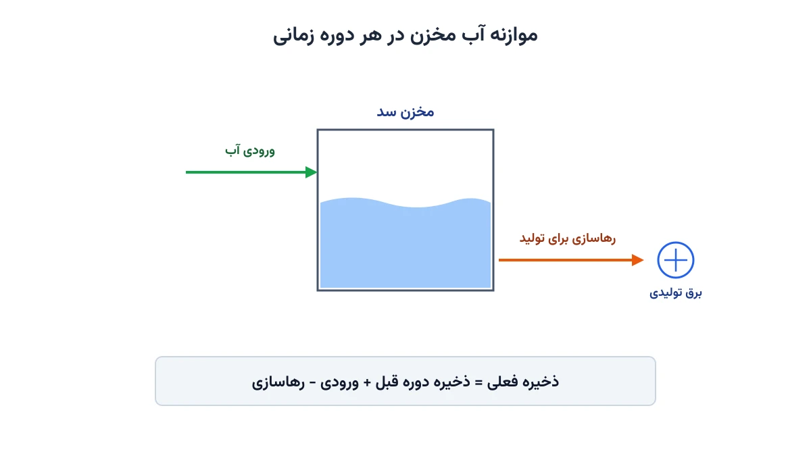

فرض کنید اپراتور شبکه برق، هم یک سد برق‌آبی در اختیار دارد و هم یک نیروگاه حرارتی. آب مخزن سد رایگان است، اما محدود. سوخت نیروگاه حرارتی همیشه در دسترس است، اما گران. تصمیم هر ساعت این است: چقدر از تقاضا را با آب تأمین کنیم و چقدر را با سوخت؟ این دقیقاً مسئله هماهنگی حرارتی-آبی (Hydrothermal Coordination) است؛ یکی از قدیمی‌ترین و کاربردی‌ترین مسائل بهینه‌سازی در صنعت برق.

## مسئله واقعی چیست؟

اگر امروز آب زیادی از مخزن رها کنیم، تولید حرارتی و هزینه سوخت کاهش می‌یابد. اما فردا ممکن است آب کافی برای دوره اوج تقاضا نداشته باشیم. اگر آب را ذخیره کنیم، امروز باید هزینه سوخت بیشتری بپردازیم. این مبادله بین «مصرف آب امروز» و «ارزش آب برای فردا» هسته اصلی مسئله است. راه‌حل، یک برنامه زمان‌بندی چنددوره‌ای است که مصرف آب مخزن را با تولید حرارتی، در کنار هم بهینه می‌کند.

## اهمیت این موضوع

شبکه‌های برق واقعی به‌ندرت فقط یک منبع تولید دارند. بیشتر آن‌ها ترکیبی از نیروگاه آبی، حرارتی، و گاهی تجدیدپذیر هستند. شرکتی مثل Tennessee Valley Authority در آمریکا، با ده‌ها سد و چند نیروگاه حرارتی، سال‌هاست دقیقاً با چنین مسئله‌ای روبه‌رو است. تصمیم غلط درباره مصرف آب می‌تواند به دو شکل هزینه‌بر شود. یا آب بیهوده رها می‌شود و بعداً سوخت گران‌تری لازم است. یا سدها با احتیاط بیش از حد خالی نمی‌شوند و هزینه سوخت امروز بی‌دلیل بالا می‌رود.

این مسئله در ایران هم اهمیت زیادی دارد. بسیاری از نیروگاه‌های برق‌آبی کشور، در کنار نیروگاه‌های حرارتی گازی و بخاری، بخشی از یک شبکه یکپارچه‌اند. تصمیم روزانه درباره میزان رهاسازی آب سدها، مستقیماً روی هزینه سوخت کشور و حتی ذخیره راهبردی آب اثر می‌گذارد. یک مدل بهینه‌سازی خوب، این تصمیم را از حدس و تجربه شخصی، به یک محاسبه شفاف و قابل دفاع تبدیل می‌کند.

## فرمول‌بندی ریاضی مسئله

برای ساخت مدل، افق زمانی را به چند دوره (مثلاً ساعت یا روز) تقسیم می‌کنیم. در هر دوره باید مشخص شود: چقدر آب رها شود و نیروگاه حرارتی چقدر تولید کند. متغیر اصلی اول، میزان رهاسازی آب در هر دوره است:

$$R_t \quad \text{(میزان رهاسازی آب در دوره } t \text{)}$$

ذخیره مخزن در پایان هر دوره هم باید پیگیری شود، چون ذخیره امروز روی ظرفیت فردا اثر دارد:

$$S_t = S_{t-1} + I_t - R_t - Spill_t$$

در این رابطه، $I_t$ ورودی طبیعی آب به مخزن و $Spill_t$ سرریز احتمالی است. ذخیره مخزن باید همیشه بین حداقل و حداکثر مجاز بماند:

$$S_{\min} \le S_t \le S_{\max}, \qquad R_{\min} \le R_t \le R_{\max}$$

توان تولیدی نیروگاه آبی، با یک رابطه تقریباً خطی به میزان رهاسازی آب مرتبط است:

$$P^{hydro}_t = k \cdot R_t$$

که در آن $k$ ضریب تبدیل آب به برق است و به ارتفاع افت آب و راندمان توربین بستگی دارد. تقاضای هر دوره باید دقیقاً با مجموع تولید آبی و حرارتی پوشش داده شود:

$$P^{hydro}_t + P^{thermal}_t = D_t$$

تابع هدف، کمینه‌کردن مجموع هزینه سوخت نیروگاه حرارتی در کل افق زمانی است، نه فقط یک دوره:

$$\min \sum_{t} \left( a + b \cdot P^{thermal}_t + c \cdot \left(P^{thermal}_t\right)^2 \right)$$

یک قید مهم دیگر هم لازم است: ذخیره مخزن در پایان افق زمانی نباید خیلی کم باشد. در غیر این صورت، مدل همه آب را امروز مصرف می‌کند و برای دوره بعدی هیچ ارزشی برای آینده قائل نمی‌شود.

## مثال عددی ساده

یک مخزن با ذخیره اولیه ۱۰۰ واحد را در نظر بگیرید. در دوره اول تقاضا پایین و ورودی آب زیاد است؛ مدل آب را ذخیره می‌کند و هزینه سوخت کمی بیشتر می‌پذیرد. در دوره دوم، تقاضا به اوج می‌رسد و آب ذخیره‌شده دقیقاً همان‌جا به کار می‌آید. نتیجه نهایی یک برنامه هوشمند رهاسازی است، نه یک قاعده ثابت مثل «هر روز مقدار یکسانی آب رها کن». دقیقاً همین رفتار هوشمند، تفاوت یک برنامه بهینه را با یک برنامه تجربی نشان می‌دهد.



## ظرفیت کار آکادمیک و پژوهشی

این مسئله بستری غنی برای پژوهش است. نسخه قطعی که در بالا دیدیم، فرض می‌کند ورودی آب به مخزن از قبل دقیقاً معلوم است. اما در دنیای واقعی، ورودی آب رودخانه نامطمئن است و به بارش و ذوب برف بستگی دارد. مدل‌سازی این عدم‌قطعیت با برنامه‌ریزی تصادفی یا بهینه‌سازی استوار، یک مسیر پژوهشی جدی است.

جهت دیگر، افزودن چند مخزن به‌هم‌پیوسته در طول یک رودخانه است؛ رهاسازی مخزن بالادست، ورودی مخزن پایین‌دست می‌شود. ترکیب این مسئله با منابع تجدیدپذیر متغیر مثل باد و خورشید هم موضوع داغ پژوهشی امروز است. آب مخزن می‌تواند مثل یک باتری بزرگ، نوسانات تولید تجدیدپذیر را جبران کند.

## پیاده‌سازی با پایتون

خبر خوب این است که حل این مسئله نیازی به نرم‌افزار گران‌قیمت ندارد. با کتابخانه متن‌باز [Pyomo](https://www.pyomo.org/) می‌توان مدل را نوشت و با سالورهای رایگانی مثل [HiGHS](https://highs.dev/) یا [IPOPT](https://coin-or.github.io/Ipopt/) حل کرد. اگر با انتخاب سالور مناسب آشنا نیستید، یادداشت [سه روش عملی استفاده از سالورها در Pyomo](/notes/pyomo-solvers/) راهنمای خوبی است. همان منطق انتخاب سالور، اینجا هم کاربرد دارد.

ورودی مدل معمولاً یک جدول ساده از پیش‌بینی تقاضا و ورودی آب برای هر دوره است. این جدول را می‌توان از یک فایل اکسل خواند. ساختار پایه مدل در Pyomo این‌طور شروع می‌شود:

```python
from pyomo.environ import *

model = ConcreteModel()
model.T = RangeSet(1, 24)  # افق ۲۴ دوره‌ای

model.R = Var(model.T, within=NonNegativeReals)      # رهاسازی آب
model.S = Var(model.T, within=NonNegativeReals)      # ذخیره مخزن
model.Pthermal = Var(model.T, within=NonNegativeReals)

def water_balance_rule(m, t):
    prev_storage = m.S[t - 1] if t > 1 else S0
    return m.S[t] == prev_storage + inflow[t] - m.R[t]

model.water_balance = Constraint(model.T, rule=water_balance_rule)

# ادامه قیود (تقاضا، محدودیت مخزن) و تابع هدف به همین شیوه تعریف می‌شوند.
```

اگر هزینه سوخت را خطی در نظر بگیرید، مسئله یک [برنامه‌ریزی خطی](/courses/advanced-power-system/) ساده خواهد بود. اگر هزینه را درجه دوم بگیرید، به یک مسئله غیرخطی می‌رسید که [IPOPT](https://coin-or.github.io/Ipopt/) به‌خوبی از پس آن برمی‌آید.

## سوالات متداول

<h3>آیا این مدل فقط برای یک سد و یک نیروگاه حرارتی کار می‌کند؟</h3>
<p>خیر، مدل به‌راحتی قابل تعمیم به چند سد و چند نیروگاه حرارتی است. فقط کافی است اندیس دومی برای شماره نیروگاه اضافه کنید و قید تقاضا را روی مجموع همه واحدها بنویسید.</p>

<h3>چرا باید برای ذخیره پایان دوره هم قید گذاشت؟</h3>
<p>بدون این قید، مدل برای کمینه‌کردن هزینه امروز، همه آب مخزن را مصرف می‌کند. برای دوره‌های بعد از افق برنامه‌ریزی، دیگر هیچ آبی باقی نمی‌ماند. این قید ارزش آینده آب را در مدل حفظ می‌کند.</p>

<h3>اگر بخواهم این مدل را برای شبکه برق واقعی خودم پیاده‌سازی کنم، از کجا شروع کنم؟</h3>
<p>برای یادگیری سیستماتیک فرمول‌بندی‌های مشابه در سیستم قدرت، دوره <a href="/courses/advanced-power-system/" style="color:#2563EB; font-weight:bold;">سیستم قدرت پیشرفته</a> نقطه شروع خوبی است. برای پیاده‌سازی اختصاصی روی داده‌های واقعی شبکه خودتان هم می‌توانید از طریق <a href="/consultation/" style="color:#2563EB; font-weight:bold;">مشاوره</a> با من در تماس باشید.</p>
