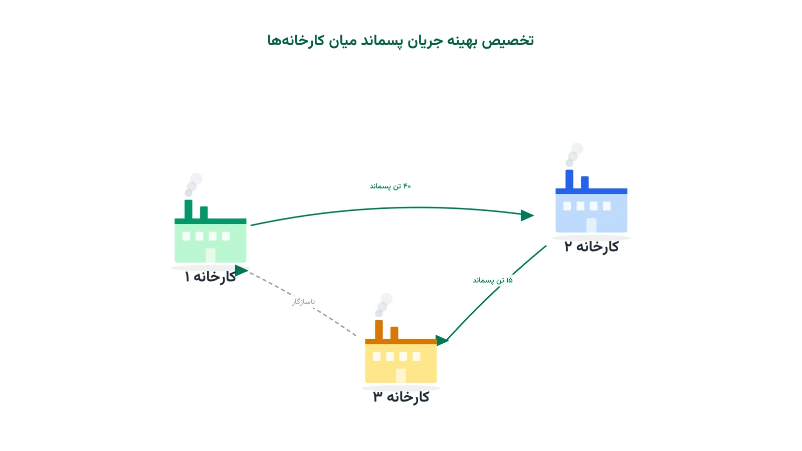

## وقتی پسماند یک کارخانه، مواد اولیه کارخانه دیگر می‌شود

در دهه ۱۹۷۰ در شهر کوچک کالوندبرو در دانمارک، چند صنعت کنار هم رشد کردند. یک نیروگاه، یک پالایشگاه نفت، یک کارخانه داروسازی و یک مزرعه پرورش ماهی. آن‌ها به‌مرور فهمیدند بخار اضافه نیروگاه، گاز پالایشگاه و گچ باقیمانده از تصفیه گوگرد، همگی ارزش اقتصادی دارند. به‌جای دفن یا سوزاندن این پسماندها، آن‌ها را میان خودشان مبادله کردند. امروز این مجموعه به «پارک صنعتی کالوندبرو» معروف است. این پارک یکی از قدیمی‌ترین نمونه‌های واقعی «همزیستی صنعتی» (Industrial Symbiosis) در جهان است.

همزیستی صنعتی یعنی طراحی شبکه‌ای از کارخانه‌ها که در آن، پسماند یا محصول جانبی یک واحد، ورودی واحد دیگر می‌شود. این ایده هسته اصلی «اقتصاد چرخه‌ای» (Circular Economy) است. اما پیاده‌سازی آن در مقیاس واقعی، یک مسئله بهینه‌سازی شبکه‌ای پیچیده است، نه فقط یک شعار زیست‌محیطی.

## چرا این مسئله یک مسئله بهینه‌سازی است؟

فرض کنید در یک منطقه صنعتی، ده کارخانه فعالیت می‌کنند. هر کارخانه چند نوع پسماند تولید می‌کند و چند نوع ماده اولیه نیاز دارد. برخی پسماندها با نیاز برخی کارخانه‌های دیگر سازگارند. اما انتقال هر پسماند هزینه حمل، هزینه فرآوری و گاهی محدودیت ظرفیت دارد. سؤال اصلی این است: کدام کارخانه، چه مقدار پسماند را به کدام کارخانه دیگر بفرستد؟ هدف، کمینه‌کردن هزینه کل شبکه یا بیشینه‌کردن پسماند بازیافت‌شده است، به‌جای دفن در زباله‌دان.

این دقیقاً شبیه مسئله کلاسیک حمل‌ونقل (Transportation Problem) است، با یک تفاوت مهم. در اینجا چند نوع کالا (پسماند) همزمان در شبکه جریان دارد و فقط برخی جفت‌های تأمین‌کننده-مصرف‌کننده با هم سازگارند. به این نوع مسئله، «جریان چندکالایی با محدودیت سازگاری» می‌گویند.

## اهمیت این موضوع در دنیای واقعی

شرکت‌هایی که در مناطق صنعتی متمرکز فعالیت می‌کنند، فشار فزاینده‌ای برای کاهش ضایعات و انتشار کربن احساس می‌کنند. صنایع شیمیایی بزرگ -- برای مثال شرکتی مثل داو کمیکال (Dow Chemical) -- در مجتمع‌های پتروشیمی با چنین چالشی روبه‌رو هستند. چالش این است که بخار و آب فرآیندی چگونه میان واحدهای مختلف به اشتراک گذاشته شود. این کار هزینه خرید انرژی و آب تازه را کاهش می‌دهد و هم‌زمان حجم پسماند ارسالی به محیط‌زیست را پایین می‌آورد.

طراحی درست چنین شبکه‌ای، تفاوت زیادی در سودآوری ایجاد می‌کند. اگر مسیرهای مبادله بدون مدل ریاضی و فقط بر پایه تجربه انتخاب شوند، معمولاً فرصت‌های بزرگ صرفه‌جویی از دست می‌رود. یک مدل بهینه‌سازی دقیق، تمام ترکیب‌های ممکن تبادل را بررسی می‌کند. این مدل، بهترین نقشه شبکه را در عرض چند ثانیه پیدا می‌کند، نه هفته‌ها بررسی دستی.

## ظرفیت پژوهشی و آکادمیک این حوزه

همزیستی صنعتی یکی از زمینه‌های فعال پژوهش در اکولوژی صنعتی (Industrial Ecology) و تحقیق در عملیات سبز است. موضوعاتی مثل «طراحی بهینه پارک‌های اکو-صنعتی» (Eco-Industrial Park Design) سال‌هاست در مجلات معتبر منتشر می‌شوند. مسیرهای پژوهشی باز زیادی هم وجود دارد.

برای مثال، می‌توان عدم‌قطعیت در حجم و زمان تولید پسماند را با بهینه‌سازی تصادفی یا استوار مدل کرد. می‌توان تحلیل چندهدفه انجام داد: هم‌زمان هزینه، انتشار کربن و مصرف آب را کمینه کرد. ترکیب این مسئله با طراحی شبکه حمل‌ونقل یا انتخاب فناوری فرآوری هم مسیر جذابی برای پایان‌نامه یا مقاله است. این حوزه هنوز جای کار باز بسیار زیادی دارد.

## فرمول‌بندی ریاضی مسئله

برای مدل‌سازی، مجموعه کارخانه‌ها را با $i \in I$ و انواع پسماند را با $k \in K$ نشان می‌دهیم. متغیر تصمیم $x_{ijk}$ مقدار پسماند نوع $k$ است که از کارخانه $i$ به کارخانه $j$ ارسال می‌شود.

$$ \min \sum_{i \in I} \sum_{j \in I} \sum_{k \in K} c_{ijk} \, x_{ijk} + \sum_{i \in I}\sum_{k\in K} p_k \, w_{ik} $$

در این رابطه، $c_{ijk}$ هزینه حمل و فرآوری هر واحد پسماند $k$ از $i$ به $j$ است. متغیر $w_{ik}$ مقدار پسماندی است که دفن یا سوزانده می‌شود و $p_k$ جریمه زیست‌محیطی هر واحد آن است.

$$ \sum_{j \in I} x_{ijk} + w_{ik} = S_{ik} \qquad \forall i \in I, \; k \in K $$

$$ \sum_{i \in I} x_{ijk} \le D_{jk} \qquad \forall j \in I, \; k \in K $$

$$ x_{ijk} \le M \, y_{ijk}, \qquad y_{ijk} \in \{0,1\} $$

محدودیت اول می‌گوید هر کارخانه، کل پسماند تولیدی‌اش را یا می‌فرستد یا دفن می‌کند. محدودیت دوم سقف نیاز هر کارخانه مصرف‌کننده را رعایت می‌کند. محدودیت سوم با متغیر صفر و یک $y_{ijk}$، فقط جفت‌های واقعاً سازگار و مجاز را فعال می‌کند. این مدل، یک برنامه‌ریزی خطی عدد صحیح مختلط (MILP) استاندارد است.

## پیاده‌سازی با پایتون

خبر خوب این است که برای حل این مدل، نیازی به نرم‌افزار گران‌قیمت تجاری نیست. ابزارهای متن‌باز پایتون به‌خوبی از پس این مسئله برمی‌آیند. کتابخانه [Pyomo](https://www.pyomo.org/) یا [PuLP](https://coin-or.github.io/pulp/) برای نوشتن مدل ریاضی مناسب‌اند. برای حل نهایی هم می‌توان از سالورهای متن‌باز مثل [HiGHS](https://highs.dev/)، [CBC](https://github.com/coin-or/Cbc) یا [GLPK](https://www.gnu.org/software/glpk/glpk.html) استفاده کرد.

داده‌های مسئله را می‌توان از یک فایل اکسل یا CSV ساده خواند. این داده‌ها شامل فهرست کارخانه‌ها، نوع و حجم پسماند تولیدی، نیاز هر کارخانه و هزینه حمل هر مسیر مجاز است. هر ردیف این فایل، یک جفت مبدأ-مقصد-نوع‌پسماند را همراه هزینه و سقف ظرفیت نشان می‌دهد. پس از خواندن داده با pandas، مدل را در Pyomo یا PuLP می‌سازیم. سپس مجموعه کارخانه‌ها، متغیرهای $x_{ijk}$ و $w_{ik}$ و سه محدودیت بالا را تعریف می‌کنیم.

برای تجسم شبکه نهایی -- اینکه کدام کارخانه به کدام کارخانه وصل است -- کتابخانه [NetworkX](https://networkx.org/) ابزار بسیار مناسبی است. می‌توان گره‌ها را کارخانه‌ها و یال‌ها را جریان‌های پسماند در نظر گرفت. ضخامت هر یال هم می‌تواند متناسب با حجم تبادل رسم شود. این نوع تصویرسازی، نتیجه مدل را برای مدیران غیرفنی هم قابل‌فهم می‌کند.

اگر به مدل‌سازی عمیق‌تر مسائل شبکه‌ای زنجیره تأمین علاقه‌مندید، دوره [بهینه‌سازی زنجیره تأمین و حمل‌ونقل با پایتون](/courses/vrp-python/) گزینه خوبی است. این دوره دقیقاً همین نوع مدل‌های جریان و تخصیص را با OR-Tools و ابزارهای متن‌باز آموزش می‌دهد. همچنین یادداشت [مسئله مکان‌یابی تسهیلات](/notes/facility-location-problem/) هم به طراحی شبکه‌های توزیع از زاویه‌ای نزدیک می‌پردازد.

اگر به [انجام پروژه بهینه‌سازی](/consultation/) برای مسئله خودتان نیاز دارید یا می‌خواهید [مدل‌سازی ریاضی](/courses/optimization-modeling/) را از پایه یاد بگیرید، این دو صفحه نقطه شروع خوبی هستند.

## سوالات متداول

<h3>آیا این مدل فقط برای صنایع شیمیایی بزرگ کاربرد دارد؟</h3>

نه. شهرک‌های صنعتی کوچک‌تر هم می‌توانند از تبادل آب، گرما یا ضایعات فلزی و پلاستیکی سود ببرند. مقیاس مدل قابل تنظیم است و برای ده یا صد کارخانه یکسان کار می‌کند.

<h3>تفاوت این مسئله با مسئله حمل‌ونقل کلاسیک چیست؟</h3>

مسئله کلاسیک فقط یک نوع کالا را جابه‌جا می‌کند و همه جفت‌ها مجاز هستند. اینجا چند نوع پسماند داریم و فقط جفت‌های سازگار فنی اجازه تبادل دارند. دوره <a href="/courses/vrp-python/" style="color:#2563EB; font-weight:bold;">بهینه‌سازی زنجیره تأمین و حمل‌ونقل</a> همین تفاوت‌ها را با جزئیات بیشتر پوشش می‌دهد.

<h3>آیا می‌توان این مدل را برای کسب‌وکار خودم پیاده‌سازی کرد؟</h3>

بله، کاملاً. اگر می‌خواهید داده واقعی شرکت خود را در چنین مدلی پیاده کنید، بهتر است کمک تخصصی بگیرید. گرفتن <a href="/consultation/" style="color:#2563EB; font-weight:bold;">مشاوره</a> برای تحلیل داده و طراحی مدل متناسب با شرایط شما بهترین مسیر است.

