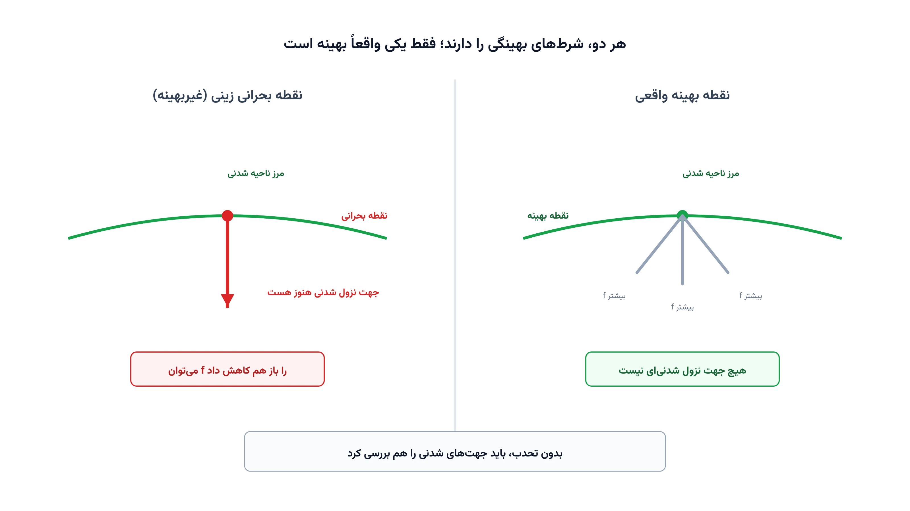

هر سالور بهینه‌سازی، در پایان کار، یک عدد و یک نقطه به شما می‌دهد. اما از کجا مطمئن شویم این نقطه واقعاً بهینه است؟ پاسخ ریاضی این سوال، شرایط کاروش-کوهن-تاکر یا KKT است. این شرایط، گواهی رسمی بهینگی هر مسئله‌ی محدب و حتی خیلی از مسئله‌های غیرمحدب هستند.

در این مطلب، شرایط KKT را با پنج مثال کامل یاد می‌گیرید. برای هر مثال، چهار شرط را جداگانه می‌نویسیم و بعد قدم‌به‌قدم حل می‌کنیم. از یک مسئله‌ی ساده‌ی درجه‌دوم شروع می‌کنیم و در پایان به دامی می‌رسیم که فقط در مسائل غیرمحدب رخ می‌دهد.

## چرا این موضوع اهمیت دارد

بیشتر مهندسان فقط خروجی سالور را نگاه می‌کنند و به آن اعتماد می‌کنند. اما سالورهای عددی گاهی به نقطه‌ای غیربهینه همگرا می‌شوند، به‌خصوص در مسائل غیرخطی و غیرمحدب. دانستن شرایط KKT به شما اجازه می‌دهد خروجی هر مدلی را دستی بررسی کنید. همین مهارت، تفاوت بین «اعتماد کورکورانه» و «فهم واقعی مدل» است.

شرکتی مثل زیمنس (Siemens)، در ابزارهای طراحی مهندسی خودش، از بهینه‌سازی توپولوژی قطعات مکانیکی استفاده می‌کند. این الگوریتم‌ها در پس‌زمینه دقیقاً بر پایه‌ی همین شرایط KKT کار می‌کنند. وقتی وزن یک پره‌ی توربین یا یک بدنه‌ی هواپیما کمینه می‌شود، سالور باید در هر مرحله شرایط KKT را بررسی کند. بدون این شرایط، اصلاً مشخص نیست الگوریتم به کجا باید همگرا شود.

همین منطق در یادگیری ماشین هم کاربرد دارد. ماشین‌های بردار پشتیبان یا SVM مستقیماً با حل شرایط KKT آموزش داده می‌شوند. اگر مدل‌سازی ریاضی را جدی دنبال می‌کنید، این شرایط را دیر یا زود دوباره خواهید دید.

## فرم استاندارد، پیش‌نیاز نوشتن KKT

پیش از نوشتن شرایط KKT، هر مسئله باید به یک فرم استاندارد تبدیل شود. دو قاعده‌ی ثابت وجود دارد که هیچ‌وقت نباید فراموش شوند.

قاعده‌ی اول، فرم قیدهای نامساوی است. هر قید نامساوی باید همیشه به‌صورت کوچک‌تر مساوی، یعنی $g(x)\le0$، نوشته شود. اگر قیدی به‌شکل $g(x)\ge0$ داده شده بود، آن را در منفی یک ضرب می‌کنیم. برای مثال، قید $x\ge1$ باید به‌صورت $1-x\le0$ نوشته شود، نه چیز دیگری.

قاعده‌ی دوم، فرم تابع هدف است. تابع هدف باید همیشه به فرم کمینه‌سازی باشد. اگر مسئله‌ی اصلی بیشینه‌سازی $\max f(x)$ بود، آن را به $\min\,(-f(x))$ تبدیل می‌کنیم، چون بیشینه‌ی $f$ دقیقاً منفیِ کمینه‌ی $-f$ است.

دلیل این دو قاعده ساده است. شرط شدنی‌بودن دوگان، یعنی نامنفی‌بودن ضریب هر قید نامساوی، فقط وقتی معتبر است که همه‌ی قیدها دقیقاً به همین فرم استاندارد نوشته شده باشند. فراموش‌کردن این تبدیل، علامت ضریب را برعکس می‌کند. همین اشتباه ساده می‌تواند یک نقطه‌ی بهینه‌ی واقعی را به‌غلط رد کند.

## چهار شرط KKT

مسئله‌ی کلی، پس از تبدیل به فرم استاندارد، همیشه به این شکل نوشته می‌شود.

$$
\begin{aligned}
\min_{x} \quad & f(x)\\
\text{s.t.} \quad & g(x) \le 0\\
& h(x) = 0
\end{aligned}
$$

در این فرم، $g(x)\le0$ خلاصه‌ی $m$ قید نامساوی $g_i(x)\le0$ است و $h(x)=0$ هم خلاصه‌ی $p$ قید تساوی $h_j(x)=0$ است. طبق قرارداد این مطلب، هر قید نامساوی یک ضریب $\mu_i \ge 0$ می‌گیرد. هر قید تساوی هم یک ضریب آزاد $\lambda_j$ می‌گیرد. تابع لاگرانژ این مسئله چنین است.

$$L(x,\mu,\lambda) = f(x) + \sum_{i=1}^{m}\mu_i\, g_i(x) + \sum_{j=1}^{p}\lambda_j\, h_j(x)$$

یک نقطه‌ی $x^*$ شرایط KKT را برآورده می‌کند، اگر چهار دسته شرط زیر هم‌زمان برقرار باشند.

$$\nabla f(x^*) + \sum_{i=1}^{m}\mu_i \nabla g_i(x^*) + \sum_{j=1}^{p}\lambda_j \nabla h_j(x^*) = 0$$

این شرط اول، ایستایی یا stationarity نام دارد. می‌گوید در نقطه‌ی بهینه، گرادیان تابع هدف دقیقاً با ترکیبی از گرادیان قیدها خنثی می‌شود. همان چیزی است که در تصویر بالای مطلب دیدید؛ دو بردار گرادیان، در نقطه‌ی بهینه هم‌راستا می‌شوند.

$$g_i(x^*)\le 0,\qquad h_j(x^*)=0 \qquad \forall i,j$$

شرط دوم، شدنی‌بودن اولیه است. نقطه باید همه‌ی قیدهای اصلی مسئله را رعایت کند.

$$\mu_i \ge 0 \qquad \forall i$$

شرط سوم، شدنی‌بودن دوگان است. فقط قیدهای نامساوی ضریب نامنفی می‌گیرند، چون فرم استاندارد جهت نامساوی را مشخص کرده است.

$$\mu_i\, g_i(x^*) = 0 \qquad \forall i$$

شرط چهارم، Complementary Slackness است. برای هر قید نامساوی، یا خودِ قید فعال است یا ضریبش صفر است، هیچ‌وقت هر دو هم‌زمان غیرصفر نیستند. دقیقاً همین چهار شرط، ستون فقرات پنج مثال زیر هستند.

## مثال ۱: یک قید نامساوی فعال

نزدیک‌ترین نقطه به $(3,2)$ را با قید $x+y\le4$ و $x,y\ge0$ پیدا کنید. نقطه‌ی بدون قید یعنی $(3,2)$ خودش $x+y=5$ دارد، پس شدنی نیست.

$$\min_{x,y}\ (x-3)^2+(y-2)^2 \quad \text{s.t.}\quad x+y\le4\ (\mu_1),\quad x\ge0\ (\mu_2),\quad y\ge0\ (\mu_3)$$

$$L = (x-3)^2+(y-2)^2+\mu_1(x+y-4)-\mu_2x-\mu_3y$$

**۱. ایستایی:**

$$2(x-3)+\mu_1-\mu_2=0,\qquad 2(y-2)+\mu_1-\mu_3=0$$

**۲. شدنی‌بودن اولیه:**

$$x+y\le4,\qquad x\ge0,\qquad y\ge0$$

**۳. شدنی‌بودن دوگان:**

$$\mu_1\ge0,\qquad \mu_2\ge0,\qquad \mu_3\ge0$$

**۴. Complementary Slackness:**

$$\mu_1(x+y-4)=0,\qquad \mu_2x=0,\qquad \mu_3y=0$$

**چطور حل می‌کنیم:** چون نقطه‌ی بدون قید در ناحیه‌ی مثبت $x,y$ قرار دارد، فرض می‌کنیم $x,y>0$ و در نتیجه $\mu_2=\mu_3=0$. همچنین فرض می‌کنیم قید $x+y\le4$ فعال است. با این دو فرض، ایستایی می‌دهد $x-3=y-2$، یعنی $x=y+1$. جای‌گذاری در $x+y=4$ نتیجه می‌دهد $y=1.5$ و $x=2.5$. سپس $\mu_1=6-2x=1$.

حالا هر چهار شرط را با این اعداد تأیید می‌کنیم. شدنی اولیه برقرار است چون $2.5+1.5=4$ و هر دو متغیر مثبت‌اند. شدنی دوگان هم برقرار است چون $\mu_1=1\ge0$. Complementary Slackness هم برقرار است چون قید فعال با ضریب مثبت آمده و قیدهای غیرفعال ضریب صفر دارند. چون تابع هدف محدب و قیدها خطی‌اند، این نقطه بهینه‌ی سراسری است با $f^*=0.5$.

## مثال ۲: شرایط KKT یک مسئله خطی

در یک شبکه‌ی سه‌گرهی $S$، $A$ و $T$، هزینه‌ی یال $S\to A$ برابر ۲، یال $A\to T$ برابر ۳ و یال مستقیم $S\to T$ برابر ۷ است. هدف، پیدا کردن کوتاه‌ترین مسیر از $S$ به $T$ است.

$$\min\ 2y_{SA}+3y_{AT}+7y_{ST}$$

$$\text{s.t.}\quad \underbrace{y_{SA}+y_{ST}=1}_{(\lambda_S)},\quad \underbrace{y_{SA}-y_{AT}=0}_{(\lambda_A)},\quad \underbrace{y_{AT}+y_{ST}=1}_{(\lambda_T)},\quad y\ge0\ (\mu_{SA},\mu_{AT},\mu_{ST})$$

$$L=2y_{SA}+3y_{AT}+7y_{ST}+\lambda_S(1-y_{SA}-y_{ST})+\lambda_A(y_{SA}-y_{AT})+\lambda_T(y_{AT}+y_{ST}-1)-\mu_{SA}y_{SA}-\mu_{AT}y_{AT}-\mu_{ST}y_{ST}$$

**۱. ایستایی** (برای هر یال $(i,j)$، ضریب آن به‌صورت $c_{ij}+\lambda_i-\lambda_j-\mu_{ij}=0$ درمی‌آید):

$$2+\lambda_S-\lambda_A-\mu_{SA}=0,\qquad 3+\lambda_A-\lambda_T-\mu_{AT}=0,\qquad 7+\lambda_S-\lambda_T-\mu_{ST}=0$$

**۲. شدنی‌بودن اولیه:**

$$y_{SA}+y_{ST}=1,\qquad y_{SA}-y_{AT}=0,\qquad y_{AT}+y_{ST}=1,\qquad y\ge0$$

**۳. شدنی‌بودن دوگان:**

$$\mu_{SA}\ge0,\qquad \mu_{AT}\ge0,\qquad \mu_{ST}\ge0$$

**۴. Complementary Slackness:**

$$\mu_{SA}y_{SA}=0,\qquad \mu_{AT}y_{AT}=0,\qquad \mu_{ST}y_{ST}=0$$

**چطور حل می‌کنیم:** سه معادله‌ی تعادل جریان به هم وابسته‌اند، پس یکی را مرجع می‌گیریم: $\lambda_S=0$. حدس می‌زنیم مسیر $S\to A\to T$ بهینه است، یعنی $y_{SA}=y_{AT}=1$ و $y_{ST}=0$. چون $y_{SA}>0$ است، Complementary Slackness $\mu_{SA}=0$ را اجبار می‌کند. جای‌گذاری در معادله‌ی اول می‌دهد $\lambda_A=2$.

چون $y_{AT}>0$ هم هست، به همین ترتیب $\mu_{AT}=0$ می‌شود. معادله‌ی دوم با این مقدار می‌دهد $\lambda_T=5$. حالا $\mu_{ST}$ را از معادله‌ی سوم حساب می‌کنیم: $\mu_{ST}=7+0-5=2$. این عدد نامنفی است، پس شدنی دوگان برقرار است و جواب تأیید می‌شود.

## مثال ۳: ترکیب قید تساوی و نامساوی

کمینه‌کردن $x^2+y^2$ را با قید تساوی $x+2y=6$ و قید نامساوی $x\ge1$ در نظر بگیرید.

$$\min_{x,y}\ x^2+y^2\quad\text{s.t.}\quad \underbrace{x+2y=6}_{(\lambda)},\qquad \underbrace{x\ge1}_{(\mu)}$$

$$L=x^2+y^2+\lambda(x+2y-6)+\mu(1-x)$$

**۱. ایستایی:**

$$2x+\lambda-\mu=0,\qquad 2y+2\lambda=0$$

**۲. شدنی‌بودن اولیه:**

$$x+2y=6,\qquad x\ge1$$

**۳. شدنی‌بودن دوگان:**

$$\mu\ge0$$

**۴. Complementary Slackness:**

$$\mu(1-x)=0$$

**چطور حل می‌کنیم:** ابتدا فرض می‌کنیم قید نامساوی فعال است، یعنی $x=1$. از قید تساوی، $y=2.5$ به دست می‌آید. از ایستایی دوم، $\lambda=-2.5$. جای‌گذاری در ایستایی اول می‌دهد $\mu=2(1)+(-2.5)=-0.5$. این عدد منفی است و شدنی دوگان را نقض می‌کند، پس این فرض رد می‌شود.

حالا فرض می‌کنیم قید نامساوی غیرفعال است، یعنی $\mu=0$. ایستایی می‌دهد $x=-\lambda/2$ و $y=-\lambda$. جای‌گذاری در قید تساوی نتیجه می‌دهد $-\lambda/2-2\lambda=6$، یعنی $\lambda=-2.4$. از اینجا $x=1.2$ و $y=2.4$ به دست می‌آید. چون $x=1.2\ge1$، شدنی اولیه هم برقرار است. این مثال نشان می‌دهد نباید حدس زد کدام قید فعال است؛ باید هر فرض را با چهار شرط بررسی کرد. مقدار تابع هدف در این نقطه برابر ۷٫۲ است.

## مثال ۴: دو قید هم‌زمان فعال

کمینه‌کردن فاصله تا نقطه‌ی $(4,4)$ را با دو قید $x+y\le4$ و $x\le1$ در نظر بگیرید.

$$\min_{x,y}\ (x-4)^2+(y-4)^2\quad\text{s.t.}\quad \underbrace{x+y\le4}_{(\mu_1)},\quad \underbrace{x\le1}_{(\mu_2)}$$

$$L=(x-4)^2+(y-4)^2+\mu_1(x+y-4)+\mu_2(x-1)$$

**۱. ایستایی:**

$$2(x-4)+\mu_1+\mu_2=0,\qquad 2(y-4)+\mu_1=0$$

**۲. شدنی‌بودن اولیه:**

$$x+y\le4,\qquad x\le1$$

**۳. شدنی‌بودن دوگان:**

$$\mu_1\ge0,\qquad \mu_2\ge0$$

**۴. Complementary Slackness:**

$$\mu_1(x+y-4)=0,\qquad \mu_2(x-1)=0$$

**چطور حل می‌کنیم:** نقطه‌ی بدون قید $(4,4)$ هر دو قید را نقض می‌کند، پس باید حدس زد کدام قید یا قیدها فعال‌اند. فرض «هیچ‌کدام فعال نیست» جواب $x=y=4$ را می‌دهد که شدنی اولیه را نقض می‌کند. فرض «فقط $x+y\le4$ فعال است» جواب $x=y=2$ را می‌دهد که از قید $x\le1$ عبور می‌کند. فرض «فقط $x\le1$ فعال است» هم جواب $x=1,\,y=4$ را می‌دهد که از $x+y\le4$ عبور می‌کند.

تنها فرض باقی‌مانده، فعال‌بودن هر دو قید هم‌زمان است. با $x=1$ و $x+y=4$، نتیجه می‌شود $y=3$. از ایستایی دوم، $\mu_1=2(4-3)=2$. از ایستایی اول، $\mu_2=2(4-1)-\mu_1=6-2=4$. هر دو ضریب نامنفی‌اند، پس شدنی دوگان برقرار است. این مثال نشان می‌دهد وقتی هدف خیلی دور از ناحیه‌ی شدنی باشد، جواب معمولاً روی گوشه‌ی تلاقی چند قید می‌نشیند. مقدار تابع هدف برابر ۱۰ است.

## مثال ۵: دامی که فقط در مسائل غیرمحدب رخ می‌دهد

کمینه‌کردن $(x-2)^2-(y-1)^2$ را با قیدهای $x+y\le3$ و $x,y\ge0$ در نظر بگیرید. این تابع هدف در جهت $y$ مقعر است، پس کل مسئله غیرمحدب است.

$$\min_{x,y}\ (x-2)^2-(y-1)^2\quad\text{s.t.}\quad \underbrace{x+y\le3}_{(\mu_1)},\quad \underbrace{x\ge0}_{(\mu_2)},\quad \underbrace{y\ge0}_{(\mu_3)}$$

$$L=(x-2)^2-(y-1)^2+\mu_1(x+y-3)-\mu_2x-\mu_3y$$

**۱. ایستایی:**

$$2(x-2)+\mu_1-\mu_2=0,\qquad -2(y-1)+\mu_1-\mu_3=0$$

**۲. شدنی‌بودن اولیه:**

$$x+y\le3,\qquad x\ge0,\qquad y\ge0$$

**۳. شدنی‌بودن دوگان:**

$$\mu_1\ge0,\qquad \mu_2\ge0,\qquad \mu_3\ge0$$

**۴. Complementary Slackness:**

$$\mu_1(x+y-3)=0,\qquad \mu_2x=0,\qquad \mu_3y=0$$

**چطور حل می‌کنیم:** فرض اول را روی نقطه‌ی $(2,0)$ امتحان می‌کنیم. اینجا $y=0$ فعال است و $x+y=2<3$ و $x=2>0$ غیرفعال‌اند، پس $\mu_1=\mu_2=0$. ایستایی اول می‌دهد $\mu_2=2(0)=0$ که سازگار است. ایستایی دوم می‌دهد $\mu_3=2-0=2$، که نامنفی است. هر چهار شرط برقرارند و مقدار تابع هدف برابر منفی یک می‌شود.

فرض دوم را روی نقطه‌ی $(2,1)$ امتحان می‌کنیم؛ این دقیقاً نقطه‌ی بحرانی بدون قید تابع هدف است. اینجا $x+y=3$ فعال است و $x,y>0$ غیرفعال‌اند. هر دو معادله‌ی ایستایی هم‌زمان $\mu_1=0$ می‌دهند، یعنی قید فعال است اما ضریبش صفر. این حالت تبهگن نام دارد و هر چهار شرط را باز هم برآورده می‌کند، با مقدار تابع هدف صفر.

دو نقطه‌ی مختلف، هر چهار شرط KKT را برآورده می‌کنند، اما فقط یکی واقعاً بهینه است. در نقطه‌ی دوم، اگر $y$ را کمی کم کنیم و در ناحیه‌ی شدنی بمانیم، تابع هدف باز هم کاهش می‌یابد. پس این نقطه حتی کمینه‌ی محلی هم نیست؛ یک نقطه‌ی زینی است که تصادفاً روی مرز افتاده. تصویر میانه‌ی مطلب دقیقاً همین تفاوت را نشان می‌دهد. درس این مثال ساده است: در مسائل محدب، هر نقطه‌ی KKT بهینه‌ی سراسری است. در مسائل غیرمحدب، باید نقاط را با هم مقایسه کرد یا شرایط مرتبه‌ی دوم را هم بررسی کرد.

## ظرفیت کار آکادمیک و پژوهشی

شرایط KKT خودش یک نتیجه‌ی کلاسیک است، اما کاربردهای مدرنش هنوز فضای پژوهشی زیادی دارند. یک مسیر فعال، شرط‌های واجد بودن قید یا constraint qualification است. گاهی حتی در نقطه‌ی بهینه، KKT برقرار نمی‌شود مگر این شرط‌ها هم رعایت شوند.

مسیر دیگر، تبدیل مسئله‌های دومرحله‌ای به مسئله‌ی تک‌سطحی با همین شرایط KKT است. به این روش در ادبیات MPEC می‌گویند. چالش اصلی آن، خطی‌سازی قید Complementary Slackness با متغیر دودویی و عدد بزرگ $M$ است. انتخاب نادرست این عدد می‌تواند جواب را کاملاً خراب کند.

اگر مدل بهینه‌سازی شما هیچ نقطه‌ی شدنی‌ای پیدا نکند، شرایط KKT اصلاً تعریف نمی‌شوند. یادداشت [چرا مدل بهینه‌سازی من ناشدنی است؟](/notes/infeasible-model-diagnosis/) دقیقاً همین حالت را بررسی می‌کند. برای مسائل چندهدفه هم، روش [اپسیلون-قید](/notes/epsilon-constraint-bi-objective/) از همین منطق قیدهای نامساوی و ضرایب آن‌ها استفاده می‌کند.

## پیاده‌سازی با پایتون

خبر خوب این است که شرایط KKT را می‌توان هم به‌صورت نمادین و هم به‌صورت عددی در پایتون بررسی کرد. نیازی به نرم‌افزار تجاری گران‌قیمت نیست.

برای حل نمادین معادلات ایستایی، کتابخانه‌ی [SymPy](https://www.sympy.org/) بسیار مناسب است. می‌توانید دقیقاً مثل مثال‌های بالا، معادلات را تعریف کنید و SymPy آن‌ها را برایتان حل کند. این روش برای یادگیری و بررسی دستی مسئله‌های کوچک عالی است.

برای حل عددی مسئله‌های غیرخطی بزرگ‌تر، کتابخانه‌ی [Pyomo](https://www.pyomo.org/) به همراه سالور متن‌باز [IPOPT](https://coin-or.github.io/Ipopt/) گزینه‌ی استاندارد است. IPOPT دقیقاً بر پایه‌ی روش نقطه‌ی درونی کار می‌کند که خودش نسخه‌ای از حل تکراری شرایط KKT است. برای مسائل کوچک‌تر، ماژول `scipy.optimize.minimize` از [SciPy](https://scipy.org/) با روش SLSQP هم به‌خوبی کار می‌کند.

بعد از حل مدل، می‌توانید ضرایب KKT را از خروجی سالور بگیرید. در Pyomo، این ضرایب از طریق پسوند `Suffix` با نام `dual` در دسترس هستند. بررسی این ضرایب، همان کاری است که در مثال‌های بالا با دست انجام دادیم؛ فقط این‌بار سالور آن را برایتان انجام می‌دهد. دوره‌ی [مدل‌سازی ریاضی در بهینه‌سازی](/courses/optimization-modeling/) این نوع تحلیل حساسیت و تفسیر ضرایب را با مثال‌های کامل آموزش می‌دهد.

اگر به [انجام پروژه بهینه‌سازی](/consultation/) برای مسئله خودتان نیاز دارید، صفحه مشاوره نقطه شروع خوبی است.

## سوالات متداول

<h3>تفاوت شرایط KKT با ضرایب لاگرانژ کلاسیک چیست؟</h3>

ضرایب لاگرانژ کلاسیک فقط برای قیدهای تساوی تعریف می‌شوند. شرایط KKT، همان ایده را به قیدهای نامساوی هم تعمیم می‌دهند و شرط Complementary Slackness را اضافه می‌کنند. به همین دلیل، KKT را تعمیم لاگرانژ می‌نامند.

<h3>برای یادگیری عملی مدل‌سازی ریاضی و تحلیل حساسیت از کجا شروع کنم؟</h3>

دوره‌ی <a href="/courses/optimization-modeling/" style="color:#2563EB; font-weight:bold;">مدل‌سازی ریاضی در بهینه‌سازی</a> دقیقاً همین مبانی، از جمله شرایط KKT و تفسیر ضرایب دوگان، را با مثال‌های عملی آموزش می‌دهد.

<h3>اگر مدل من به شرایط KKT نرسد یا همگرا نشود چه کار کنم؟</h3>

این موضوع معمولاً به ساختار غیرمحدب مدل، انتخاب نقطه‌ی شروع یا نقض شرط‌های واجد بودن قید برمی‌گردد. برای بررسی دقیق مدل خودتان و رفع این مشکل، می‌توانید از <a href="/consultation/" style="color:#2563EB; font-weight:bold;">مشاوره</a> کمک بگیرید.

