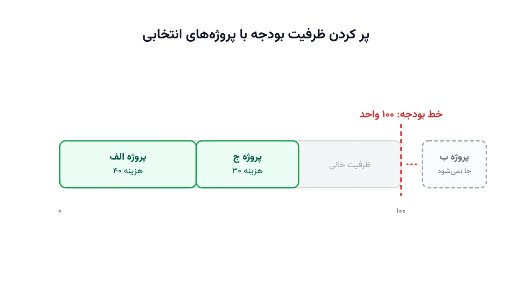

هر سال، کمیته‌ی سرمایه‌گذاری یک شرکت با فهرستی بلند از پروژه‌های پیشنهادی روبه‌رو می‌شود. بودجه محدود است، اما تعداد پروژه‌های جذاب محدود نیست. کدام پروژه‌ها باید تأیید شوند تا بیشترین ارزش ممکن از بودجه‌ی موجود بیرون بیاید؟ این دقیقاً همان سؤالی است که مسئله‌ی کلاسیک کوله‌پشتی (Knapsack Problem) برای آن طراحی شده است.

در ساده‌ترین حالت، کوله‌پشتی یک داستان آشناست. یک کوله با ظرفیت وزنی مشخص داریم. چند قلم کالا هم داریم، هرکدام با وزن و ارزش خودش. باید زیرمجموعه‌ای انتخاب کنیم که ارزش کل را بیشینه کند، بدون عبور از ظرفیت وزنی. کافی است «وزن» را «هزینه‌ی پروژه» بنامیم و «کوله» را «بودجه‌ی سالانه». آن‌گاه همان مسئله، برای انتخاب سبد پروژه هم کاربرد پیدا می‌کند. تفاوت دنیای واقعی این است که معمولاً فقط بودجه محدود نیست؛ نیروی مهندسی، زمان مدیریت پروژه و ظرفیت ریسک‌پذیری شرکت هم محدودند. به همین دلیل نسخه‌ی صنعتی این مسئله را کوله‌پشتی چندبعدی (Multi-Dimensional Knapsack) می‌نامند.

## اهمیت این موضوع

انتخاب سبد پروژه با بودجه محدود، در عمل هر صنعتی ظاهر می‌شود. یک تیم محصول باید تصمیم بگیرد کدام ویژگی‌های جدید نرم‌افزار را توسعه دهد. یک دانشگاه باید بین طرح‌های پژوهشی متقاضی گرنت انتخاب کند. شرکتی مثل فایزر ده‌ها پروژه‌ی تحقیقاتی دارویی در خط لوله دارد. هرسال باید تصمیم بگیرد کدام پروژه‌ها با بودجه‌ی تحقیق و توسعه همخوان‌اند. بقیه باید متوقف شوند. این یک چالش صنعتی واقعی و شناخته‌شده در مدیریت نوآوری است، نه فقط یک تمرین درسی.

نکته‌ی مهم این است که انتخاب دستی و شهودی این سبد، معمولاً نتیجه‌ی بهینه نمی‌دهد. ذهن انسان در مواجهه با ده‌ها گزینه و چند قید هم‌زمان، به‌سختی بهترین ترکیب را پیدا می‌کند. مدل ریاضی اما می‌تواند در عرض چند ثانیه، بهترین سبد ممکن را از میان میلیون‌ها ترکیب محتمل بیرون بکشد. همین تفاوت، ارزش اقتصادی واقعی این مدل‌سازی را توضیح می‌دهد.

## فرمول‌بندی ریاضی

فرض کنید $n$ پروژه‌ی کاندید داریم. هر پروژه‌ی $i$ هزینه‌ی $c_i$ و ارزش مورد انتظار $v_i$ دارد. بودجه‌ی کل برابر $B$ است. متغیر تصمیم $x_i$ برابر یک است اگر پروژه انتخاب شود، و در غیر این صورت صفر. مدل پایه این‌گونه نوشته می‌شود:

$$
\max \sum_{i=1}^{n} v_i x_i \quad \text{s.t.} \quad \sum_{i=1}^{n} c_i x_i \le B, \quad x_i \in \{0,1\}
$$

این مدل، همان کوله‌پشتی یک‌بعدی است. اما در دنیای واقعی معمولاً بیش از یک منبع محدود داریم. فرض کنید $m$ نوع منبع داریم، مثل بودجه، نفرساعت مهندسی و سقف ریسک. پروژه‌ی $i$ از منبع $r$ به میزان $a_{ir}$ استفاده می‌کند. مدل چندبعدی به این شکل تعمیم می‌یابد:

$$
\max \sum_{i=1}^{n} v_i x_i \quad \text{s.t.} \quad \sum_{i=1}^{n} a_{ir} x_i \le R_r \;\; \forall r \in \{1,\dots,m\}, \quad x_i \in \{0,1\}
$$

اگر پروژه‌ها به‌صورت گروهی وابسته باشند، می‌توان قیود دیگری هم افزود. مثلاً پروژه‌ی ب فقط در صورت انتخاب پروژه‌ی الف معنا دارد. یک قید منطقی ساده‌ی $x_b \le x_a$ همین وابستگی را مدل می‌کند.

## ظرفیت کار آکادمیک و پژوهشی

مسئله‌ی کوله‌پشتی یکی از شناخته‌شده‌ترین مسائل NP-سخت در علوم کامپیوتر و پژوهش عملیاتی است. نسخه‌ی یک‌بعدی آن با برنامه‌نویسی پویا در زمان شبه‌چندجمله‌ای حل می‌شود. نسخه‌ی چندبعدی اما به‌مراتب سخت‌تر است. برای مقیاس‌های بزرگ، به سالورهای MILP یا CP-SAT نیاز دارد. همین شکاف، فضای پژوهشی قابل‌توجهی باز می‌کند.

چند جهت پژوهشی فعال در این حوزه وجود دارد. یکی کوله‌پشتی درجه‌دوم (Quadratic Knapsack) است که هم‌افزایی بین دو پروژه را هم لحاظ می‌کند. دیگری کوله‌پشتی تصادفی است؛ جایی که ارزش واقعی یک پروژه تا پایان اجرا نامعلوم می‌ماند. نسخه‌ی دو‌هدفه هم وجود دارد که هم‌زمان ارزش را بیشینه و ریسک پورتفوی را کمینه می‌کند. برای همین دسته، روش [قید اپسیلون](/notes/epsilon-constraint-bi-objective/) ابزاری استاندارد برای ترسیم مرز بهینه‌ی پارتو است. برای نمونه‌های بسیار بزرگ هم، ترکیب کوله‌پشتی با جست‌وجوی همسایگی بزرگ (LNS) موضوع پژوهش‌های اخیر در زمان‌بندی سبد پروژه بوده است.



## پیاده‌سازی با پایتون

خبر خوب این است که برای حل این مسئله نیازی به نرم‌افزار تجاری گران‌قیمت نیست. کتابخانه‌ی متن‌باز [OR-Tools](https://developers.google.com/optimization) گوگل، با سالور [CP-SAT](https://developers.google.com/optimization/cp/cp_solver) آن، مسائل کوله‌پشتی را تا ابعاد صنعتی به‌خوبی حل می‌کند. ورودی مدل معمولاً یک فایل اکسل یا CSV ساده است. هر سطر یک پروژه است، با ستون‌های هزینه، نفرساعت موردنیاز و ارزش مورد انتظار. همین ساختار ساده، اجرای مدل را برای یک تیم مالی یا دفتر مدیریت پروژه کاملاً در دسترس می‌کند.

منطق مدل‌سازی با CP-SAT بسیار شبیه فرمول ریاضی بالاست. فقط باید متغیرهای صفر و یک را تعریف کنید. سپس قیود منابع را اضافه کنید. اسکلت اولیه‌ی مدل به این شکل است:

```python
from ortools.sat.python import cp_model

model = cp_model.CpModel()
n_projects = len(costs)

# یک متغیر دودویی برای هر پروژه: انتخاب شود یا نه
x = [model.NewBoolVar(f"x_{i}") for i in range(n_projects)]

# قید بودجه: مجموع هزینه‌ی پروژه‌های انتخابی از بودجه بیشتر نشود
model.Add(sum(costs[i] * x[i] for i in range(n_projects)) <= budget)
```

ادامه‌ی قیود منابع دیگر (نفرساعت، ریسک) و تابع هدف بیشینه‌سازی ارزش، به همین شیوه تعریف می‌شوند. اگر پیش از این با مسائل بسته‌بندی ترکیبیاتی کار نکرده‌اید، یادداشت [بسته‌بندی کامیون با Bin Packing](/notes/bin-packing-truck-loading/) را ببینید. این یادداشت نقطه‌ی شروع خوبی برای آشنایی با سبک مدل‌سازی CP-SAT است. برای یادگیری کامل‌تر مدل‌سازی ترکیبیاتی با پایتون، دوره‌ی [بهینه‌سازی زنجیره تأمین و حمل‌ونقل با پایتون](/courses/vrp-python/) هم مسیر گام‌به‌گام را پوشش می‌دهد.

اگر به [انجام پروژه بهینه‌سازی](/consultation/) برای مسئله خودتان نیاز دارید یا می‌خواهید [مدل‌سازی ریاضی](/courses/optimization-modeling/) را از پایه یاد بگیرید، این دو صفحه نقطه شروع خوبی هستند.

## سوالات متداول

<h3>تفاوت کوله‌پشتی ساده با کوله‌پشتی چندبعدی چیست؟</h3>
<p>در نسخه‌ی ساده فقط یک منبع محدود، مثل بودجه، وجود دارد. در نسخه‌ی چندبعدی چند منبع هم‌زمان محدودند، مثل بودجه و نفرساعت مهندسی. نسخه‌ی چندبعدی واقعی‌تر ولی محاسباتی سنگین‌تر است.</p>

<h3>آیا می‌توان هم‌زمان ریسک پروژه‌ها را هم در مدل لحاظ کرد؟</h3>
<p>بله، با افزودن یک هدف دوم یا یک قید سقف ریسک. مدل دو‌هدفه‌ای که ارزش را بیشینه و ریسک پورتفوی را کمینه کند، ابزار رایج در انتخاب سبد پروژه‌های سرمایه‌گذاری است. دوره‌ی <a href="/courses/vrp-python/" style="color:#2563EB; font-weight:bold;">بهینه‌سازی با پایتون</a> این سبک مدل‌سازی ترکیبیاتی را هم پوشش می‌دهد.</p>

<h3>برای پیاده‌سازی این مدل روی داده‌های واقعی شرکت از کجا شروع کنیم؟</h3>
<p>اگر داده‌های پروژه‌ها (هزینه، نفرساعت، ارزش مورد انتظار) آماده باشد، مدل‌سازی و حل آن معمولاً چند روز کاری بیشتر طول نمی‌کشد. برای پیاده‌سازی اختصاصی روی داده‌های شرکت خودتان، می‌توانید از طریق <a href="/consultation/" style="color:#2563EB; font-weight:bold;">مشاوره</a> با ما در تماس باشید.</p>
