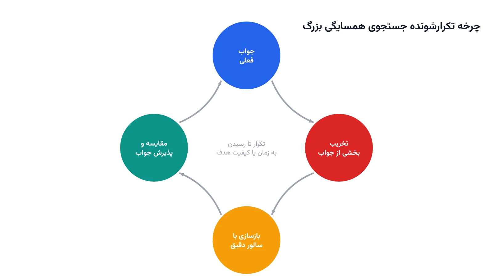

یک شرکت پخش کالا، هر شب باید مسیر چند هزار بسته را میان صدها مشتری تعیین کند. مسئله مسیریابی وسایل نقلیه در این مقیاس، به‌سرعت بسیار بزرگ می‌شود. یک سالور دقیق MILP، حتی بعد از چند ساعت، ممکن است جواب بهینه پیدا نکند. در عمل، فقط چند دقیقه برای تصمیم‌گیری وقت هست. اینجا راه‌حل‌های دقیق جواب نمی‌دهند و باید به سراغ متاهیوریستیک رفت.

متاهیوریستیک‌ها جواب خوب را سریع پیدا می‌کنند، هرچند تضمین بهینگی ندهند. روش‌های مختلفی مثل الگوریتم ژنتیک یا شبیه‌سازی تبرید وجود دارند. یکی از موفق‌ترین آن‌ها، به‌خصوص برای مسائل مسیریابی و زمان‌بندی، جستجوی همسایگی بزرگ یا Large Neighborhood Search است. مخفف رایج آن LNS است.

ایده LNS ساده و قدرتمند است. به‌جای حل کل مسئله از صفر، یک جواب اولیه، حتی ضعیف، در نظر گرفته می‌شود. بخشی کوچک از این جواب، به‌صورت تصادفی یا هدفمند، «ویران» می‌شود. سپس همان سالور دقیق، فقط همین بخش کوچک را از نو حل می‌کند. این چرخه ویران‌کردن و بازسازی، بارها تکرار می‌شود.

## چرا این روش کار می‌کند؟

حل‌کردن یک زیرمسئله کوچک، برای سالور دقیق بسیار سریع است. چون فقط بخشی از متغیرها آزاد هستند، فضای جست‌جو کوچک می‌ماند. بقیه متغیرها، در همان مقدار جواب فعلی، ثابت نگه داشته می‌شوند. این یعنی می‌توان از قدرت سالور دقیق، حتی روی مسائل بسیار بزرگ، استفاده کرد.

## اهمیت این موضوع در دنیای واقعی

شرکت‌های بزرگ لجستیک، هر روز با مسائل مسیریابی در مقیاس واقعاً صنعتی روبه‌رو هستند. شرکتی مثل یوپی‌اس (UPS) سیستم معروف ORION را برای همین منظور ساخته است. این سیستم مسیر رانندگان را در سطح کل آمریکا بهینه می‌کند. حل دقیق چنین مقیاسی، با روش‌های کلاسیک MILP، عملاً غیرممکن است. گزارش‌ها می‌گویند ORION سالانه میلیون‌ها دلار در سوخت و زمان صرفه‌جویی کرده است.

این تکنیک فقط برای شرکت‌های غول‌پیکر نیست. حتی یک توزیع‌کننده متوسط با صد یا دویست مشتری روزانه هم ممکن است با همین مشکل روبه‌رو شود. وقتی محدودیت‌های پیچیده زمانی و ظرفیتی اضافه می‌شود، مسئله به‌سرعت سنگین می‌شود. دوره [بهینه‌سازی زنجیره تأمین و حمل‌ونقل با پایتون](/courses/vrp-python/) دقیقاً همین مسائل مسیریابی در مقیاس واقعی را پوشش می‌دهد.



## ایده الگوریتم و معیار پذیرش

فرض کنید $x$ یک جواب فعلی و $c(x)$ هزینه آن باشد. در هر تکرار، زیرمجموعه‌ای از متغیرها، به نام $D$، به‌طور تصادفی انتخاب و آزاد می‌شود. بقیه متغیرها ثابت می‌مانند. سالور دقیق، فقط روی متغیرهای $D$، یک جواب جدید $x'$ پیدا می‌کند.

اگر هزینه جواب جدید $x'$ کمتر از جواب فعلی باشد، جایگزین آن می‌شود.

$$ c(x') < c(x^{k}) $$

در غیر این صورت، جواب فعلی حفظ می‌شود و چرخه بعدی با انتخاب $D$ تازه آغاز می‌شود. اندازه $D$ یک پارامتر کلیدی است. اگر خیلی کوچک باشد، پیشرفت کند می‌شود. اگر خیلی بزرگ باشد، سالور دوباره کند خواهد شد؛ درست مثل حل کل مسئله.

## ظرفیت کار آکادمیک و پژوهشی

LNS یکی از فعال‌ترین حوزه‌های پژوهش در بهینه‌سازی ترکیبیاتی است. نسخه تطبیقی آن، به نام Adaptive LNS یا ALNS، چند عملگر تخریب مختلف دارد. این عملگرها، بسته به عملکردشان، وزن بیشتر یا کمتری می‌گیرند. همین هوشمندی تطبیقی، یکی از جذاب‌ترین جهت‌های پژوهشی امروز است.

ترکیب LNS با یادگیری ماشین، جهت دیگری است؛ یک مدل یادگیری می‌تواند یاد بگیرد کدام بخش از جواب را تخریب کند. موازی‌سازی LNS روی چند هسته پردازشی هم موضوع فعالی است. پیوند این روش با [مسیریابی وابسته به زمان](/notes/time-dependent-vrp/)، در مقیاس‌های بزرگ، فضای پژوهشی خوبی برای پایان‌نامه فراهم می‌کند.

## پیاده‌سازی با پایتون

پیاده‌سازی یک حلقه LNS ساده، نیازی به ابزار پیچیده ندارد. کافی است از همان سالور دقیق، مثل CP-SAT در کتابخانه [OR-Tools](https://developers.google.com/optimization)، به‌صورت تکرارشونده استفاده شود. در هر تکرار، بخشی از متغیرها قفل و بقیه آزاد می‌شوند. ماژول CP-SAT، از طریق متد `AddHint` و قفل‌کردن متغیرها با قید تساوی، این کار را ساده می‌کند.

```python
from ortools.sat.python import cp_model

# فرض: model از قبل با متغیرهای x[i][j] برای مسیر وسایل نقلیه ساخته شده است
current_solution = solve_initial(model)  # یک جواب اولیه، حتی ساده
destroy_fraction = 0.15  # درصد متغیرهایی که در هر تکرار آزاد می‌شوند

for iteration in range(max_iterations):
    free_vars = random.sample(all_route_vars, int(len(all_route_vars) * destroy_fraction))
    for var in all_route_vars:
        if var not in free_vars:
            model.Add(var == current_solution[var])  # قفل‌کردن بقیه متغیرها

    # ادامه: حل زیرمسئله، مقایسه هزینه و به‌روزرسانی جواب فعلی به همین شیوه انجام می‌شود
```

این حلقه را می‌توان با محدودیت زمانی کوتاه برای هر زیرمسئله ترکیب کرد. برای تحلیل و دیباگ روند بهبود جواب، رسم نمودار هزینه در هر تکرار هم مفید است. نیازی به خرید سالور تجاری گران‌قیمت برای این تکنیک نیست؛ همان سالورهای متن‌باز مثل [CBC](https://github.com/coin-or/Cbc) یا [HiGHS](https://highs.dev/) هم کار می‌کنند.

## سوالات متداول

<h3>آیا LNS همیشه جواب بهینه کلی را پیدا می‌کند؟</h3>
<p>نه. LNS یک متاهیوریستیک است و تضمین بهینگی سرتاسری نمی‌دهد. اما در عمل، برای مسائل خیلی بزرگ، معمولاً جواب‌های بسیار خوب و نزدیک به بهینه در زمان معقول پیدا می‌کند.</p>

<h3>چه دوره‌ای این نوع تکنیک‌های حل مسائل بزرگ را آموزش می‌دهد؟</h3>
<p>دوره <a href="/courses/vrp-python/" style="color:#2563EB; font-weight:bold;">بهینه‌سازی زنجیره تأمین و حمل‌ونقل با پایتون</a> مسائل مسیریابی در مقیاس واقعی و تکنیک‌های حل آن‌ها را پوشش می‌دهد.</p>

<h3>آیا امکان پیاده‌سازی اختصاصی LNS برای مسئله مسیریابی یا زمان‌بندی شرکت ما وجود دارد؟</h3>
<p>بله. برای طراحی عملگرهای تخریب و بازسازی متناسب با ساختار داده و مقیاس واقعی شما، می‌توانید از <a href="/consultation/" style="color:#2563EB; font-weight:bold;">مشاوره</a> استفاده کنید.</p>
