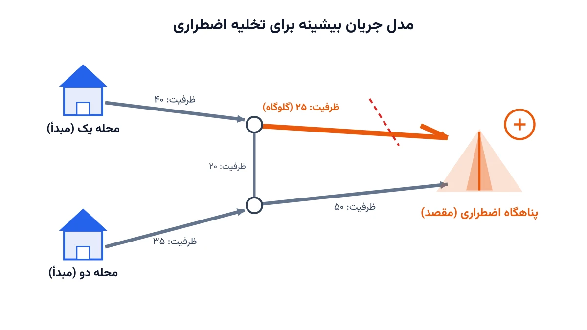
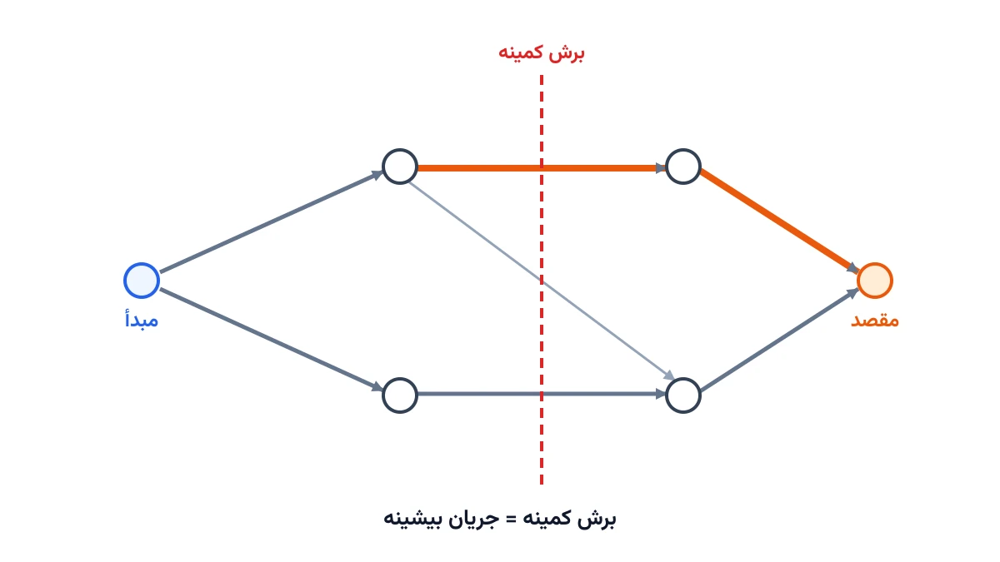

وقتی زلزله یا سیل یک شهر را تهدید می‌کند، سؤال اول مدیران بحران این نیست که «چند نفر باید تخلیه شوند؟». سؤال واقعی چیز دیگری است. جاده‌های موجود، در هر دقیقه، چند نفر را واقعاً می‌توانند از منطقه خطر خارج کنند؟ این دقیقاً همان سؤالی است که مسئله «جریان بیشینه» یا Max Flow به آن پاسخ می‌دهد.

## اهمیت این موضوع

ظرفیت جاده‌ها در زمان بحران، ثابت نیست. هر خیابان، هر پل و هر تقاطع یک سقف عبوری دارد. اگر این ظرفیت را نادیده بگیریم، برنامه تخلیه روی کاغذ زیبا اما در عمل فاجعه‌بار می‌شود. مدل جریان بیشینه دقیقاً همین ظرفیت‌ها را ورودی می‌گیرد. خروجی آن، بیشترین جمعیتی است که در واحد زمان از مبدأ به مقصد می‌رسد.

سازمان‌هایی شبیه صلیب سرخ آمریکا، در برنامه‌ریزی تخلیه مناطق سیل‌زده یا طوفان‌زده، دقیقاً با چنین چالشی روبه‌رو می‌شوند. آن‌ها باید پیش از وقوع بحران بدانند گلوگاه واقعی شبکه کجاست. این باید قبل از آن باشد که ترافیک در همان مسیر قفل شود. همین پیش‌بینی، تفاوت میان یک تخلیه منظم و یک بحران ثانویه در دل بحران اول است.

فراتر از تخلیه انسانی، همین مدل کاربرد گسترده‌تری دارد. در توزیع آب بین شهری، در انتقال برق اضطراری، و در مسیریابی داده روی شبکه‌های مخابراتی هم به کار می‌رود. هر جایی که «ظرفیت لوله یا مسیر» محدودکننده باشد، جریان بیشینه ابزار طبیعی تحلیل آن است.

## ظرفیت کار آکادمیک و پژوهشی

مسئله جریان بیشینه یکی از پایه‌ای‌ترین مسائل نظریه گراف است. با این حال، نسخه‌های واقعی آن هنوز فضای پژوهشی زیادی دارند. «جریان بیشینه پویا» یا Dynamic Max Flow یکی از همین نمونه‌هاست. در آن، زمان سفر روی هر یال ثابت نیست و خود تابعی از ازدحام است. این موضوع یکی از فعال‌ترین حوزه‌های تحقیق در برنامه‌ریزی تخلیه است.

موضوع دیگر، «جریان زودرس‌ترین» یا Earliest Arrival Flow است. هدف اینجا فقط بیشینه‌کردن جریان کل نیست. هدف این است که در هر لحظه از زمان، حداکثر جمعیت ممکن تا آن لحظه به مقصد رسیده باشد. این مسئله از نظر ریاضی پیچیده‌تر از جریان بیشینه ساده است و موضوع پایان‌نامه‌های زیادی بوده. ترکیب این مدل با عدم‌قطعیت در ظرفیت جاده‌ها، مثلاً ریزش ساختمان روی یک مسیر، هم زمینه‌ای باز برای پژوهش جدید است.

## فرمول‌بندی ریاضی مسئله

در مدل جریان بیشینه، شبکه را با یک گراف جهت‌دار نشان می‌دهیم. هر یال $(i,j)$ یک ظرفیت $u_{ij}$ دارد. این ظرفیت نشان می‌دهد چند واحد جریان، مثلاً نفر در دقیقه، می‌تواند از آن عبور کند. متغیر تصمیم $f_{ij}$ مقدار جریان واقعی روی همان یال است.

هدف، بیشینه‌کردن کل جریانی است که از مبدأ $s$ خارج می‌شود:

$$
\max \; \sum_{j:(s,j) \in E} f_{sj}
$$

دو دسته قید اصلی وجود دارد. اول، قید ظرفیت است. جریان هر یال نباید از ظرفیتش بیشتر شود:

$$
0 \le f_{ij} \le u_{ij} \qquad \forall (i,j) \in E
$$

دوم، قید بقای جریان است. در هر گره میانی، یعنی نه مبدأ و نه مقصد، جریان ورودی باید برابر جریان خروجی باشد. به زبان دیگر، جریان در هیچ گره‌ای تولید یا ناپدید نمی‌شود:

$$
\sum_{i:(i,j) \in E} f_{ij} = \sum_{k:(j,k) \in E} f_{jk} \qquad \forall j \ne s,t
$$

وقتی چند منطقه مسکونی هم‌زمان باید تخلیه شوند، یک «ابَرمبدأ» مجازی تعریف می‌کنیم. این ابَرمبدأ با یال‌هایی به ظرفیت نامحدود، به هر منطقه واقعی وصل می‌شود. این ترفند ساده، مسئله چندمبدأیی را به یک مسئله تک‌مبدأ استاندارد تبدیل می‌کند.

## یک مثال کامل: از شبکه تا جواب بهینه

شبکه زیر را در نظر بگیرید. دو محله مسکونی باید به یک پناهگاه اضطراری تخلیه شوند. محله یک از طریق یک جاده با ظرفیت ۴۰ نفر در دقیقه به یک تقاطع می‌رسد. محله دو هم با ظرفیت ۳۵ نفر در دقیقه به تقاطع دوم می‌رسد. یک جاده فرعی با ظرفیت ۲۰ نفر در دقیقه، این دو تقاطع را به هم وصل می‌کند. در نهایت، تقاطع اول با ظرفیت ۲۵ و تقاطع دوم با ظرفیت ۵۰ نفر در دقیقه، مستقیم به پناهگاه می‌رسند.



اگر فقط مسیرهای مستقیم را در نظر بگیریم، جریان مسیر اول برابر $\min(40,25)=25$ می‌شود. جریان مسیر دوم هم برابر $\min(35,50)=35$ است. جمع این دو، فقط ۶۰ نفر در دقیقه می‌شود. اما محله یک هنوز ۱۵ نفر در دقیقه ظرفیت استفاده‌نشده دارد، یعنی ۴۰ منهای ۲۵. این مازاد می‌تواند از جاده فرعی عبور کند. تقاطع دوم هم تا سقف ۵۰ واحد، ۱۵ واحد ظرفیت خالی دارد.

با افزودن همین یک مسیر جانبی، جریان کل به ۷۵ نفر در دقیقه می‌رسد. طبق قضیه جریان بیشینه-برش کمینه، این عدد باید برابر ظرفیت کوچک‌ترین برش جداکننده مبدأ از مقصد باشد. این‌جا هم همین‌طور است؛ دو جاده‌ای که مستقیم به پناهگاه می‌رسند، جمعاً ظرفیت ۲۵ به‌علاوه ۵۰ یعنی ۷۵ دارند. پس همین دو جاده، گلوگاه واقعی کل شبکه‌اند.

این مثال نشان می‌دهد چرا نباید مسیرها را یکی‌یکی و جدا از هم تحلیل کرد. یک سالور جریان بیشینه، تمام مسیرهای ممکن را هم‌زمان بررسی می‌کند. اگر مسیر جانبی‌ای برای افزایش جریان کل وجود داشته باشد، آن را پیدا می‌کند. این دقیقاً همان چیزی است که تحلیل دستی به‌سادگی از قلم می‌اندازد.



## پیاده‌سازی با پایتون

یکی از نکات مهم این مسئله این است که اصلاً نیازی به سالورهای تجاری گران‌قیمت ندارد. کتابخانه متن‌باز [OR-Tools](https://developers.google.com/optimization) گوگل، یک پیاده‌سازی بسیار سریع از الگوریتم جریان بیشینه دارد. این پیاده‌سازی در ماژول گراف همین کتابخانه قرار دارد، جدا از ماژول CP-SAT. برای شبکه‌های کوچک‌تر یا تحلیل اکتشافی سریع، کتابخانه [NetworkX](https://networkx.org/) هم جایگزین ساده‌ای است.

```python
from ortools.graph.python import max_flow

smf = max_flow.SimpleMaxFlow()

# گره‌ها: 0=مبدأ مجازی، 1=تقاطع یک، 2=تقاطع دو، 3=پناهگاه
smf.add_arc_with_capacity(0, 1, 40)
smf.add_arc_with_capacity(0, 2, 35)
smf.add_arc_with_capacity(1, 2, 20)
# ادامه یال‌ها (تقاطع به پناهگاه) و فراخوانی smf.solve به همین شیوه کامل می‌شود
```

بعد از فراخوانی `smf.solve(0, 3)`، سالور دو چیز را برمی‌گرداند. اول، مقدار جریان بیشینه کل شبکه. دوم، جریان دقیق روی هر یال. همین اطلاع دوم، برای تهیه برنامه عملیاتی تخلیه حیاتی است؛ یعنی اینکه هر گروه جمعیتی از کدام مسیر دقیقاً باید برود.

برای تحلیل حساسیت هم همین مدل کافی است. مثلاً اگر یک جاده در زلزله تخریب شود چه اتفاقی می‌افتد؟ کافی است ظرفیت همان یال را صفر کنید و مدل را دوباره حل کنید. این سرعت پاسخ‌گویی، دقیقاً همان چیزی است که در لحظه بحران واقعی ارزش دارد. یادداشت [تحلیل آسیب‌پذیری زیرساخت: کدام یال شبکه واقعاً حیاتی است؟](/notes/network-interdiction-problem/) زاویه نزدیکی به همین موضوع دارد.

## سوالات متداول

<h3>تفاوت جریان بیشینه با مسیریابی وسایل نقلیه (VRP) چیست؟</h3>
<p>در VRP، مسئله پیداکردن بهترین مسیر برای چند خودرو با ظرفیت محدود است. در جریان بیشینه، فرض بر این است که جمعیت یا کالا به‌صورت پیوسته و موازی، از چندین مسیر هم‌زمان عبور می‌کند. دوره <a href="/courses/vrp-python/" style="color:#2563EB; font-weight:bold;">مسیریابی وسایل نقلیه با پایتون</a> این دو نگاه را در کنار هم آموزش می‌دهد.</p>

<h3>آیا این مدل فقط برای تخلیه انسانی کاربرد دارد؟</h3>
<p>خیر. همین فرمول‌بندی برای توزیع آب، انتقال برق اضطراری، مسیریابی داده در شبکه، و حتی زمان‌بندی خطوط تولید با ظرفیت محدود هم به کار می‌رود. هر جا یال‌ها ظرفیت محدود داشته باشند، مدل یکسان می‌ماند.</p>

<h3>برای پیاده‌سازی این مدل روی داده واقعی شهر خودم چه کنم؟</h3>
<p>اگر داده واقعی جاده‌ها و ظرفیت‌ها را در اختیار دارید، می‌توان مدل را دقیقاً مطابق نیاز شما شخصی‌سازی کرد. برای این موارد، گرفتن <a href="/consultation/" style="color:#2563EB; font-weight:bold;">مشاوره</a> تخصصی مسیر سریع‌تری نسبت به آزمون‌وخطای تنهایی است.</p>

## جمع‌بندی

مسئله جریان بیشینه، یک مسیر مستقیم از ظرفیت فیزیکی جاده‌ها به یک عدد قابل‌اتکا برای برنامه‌ریزی بحران می‌سازد. دیدیم که هر یال یک ظرفیت دارد و جریان در گره‌های میانی حفظ می‌شود. جواب بهینه همیشه برابر ظرفیت کوچک‌ترین برش جداکننده مبدأ از مقصد است. مثال دو-محله‌ای نشان داد که نادیده‌گرفتن مسیرهای جانبی، می‌تواند ظرفیت واقعی شبکه را به‌شدت دست‌کم بگیرد.

اگر می‌خواهید این نوع مدل‌سازی شبکه را یاد بگیرید، یک گزینه خوب پیش روی شماست. دوره [مسیریابی وسایل نقلیه با پایتون](/courses/vrp-python/) این موضوع را در کنار مسائل مسیریابی و لجستیکی دیگر پوشش می‌دهد.
