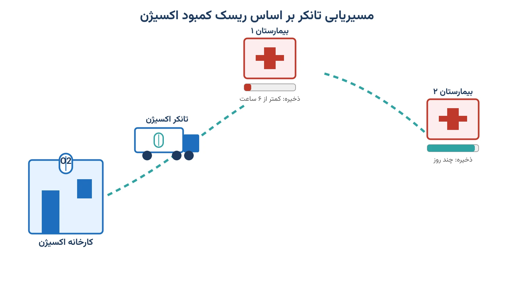

تصویر یک بیمارستان در اوج یک موج شدید بیماری تنفسی را تصور کنید. مخزن اکسیژن مرکزی هر ساعت خالی‌تر می‌شود. مدیر بیمارستان باید بداند دقیقاً کِی تانکر بعدی باید برسد. اگر دیر برسد، بیماران روی ونتیلاتور در خطر جدی قرار می‌گیرند. اگر زود و بیش از نیاز برسد، ظرفیت محدود تانکرهای شهر هدر می‌رود.

حالا همین تصمیم را برای ده‌ها بیمارستان یک شهر، در یک روز واحد، تصور کنید. هر بیمارستان نرخ مصرف، ظرفیت مخزن و فاصله‌ی متفاوتی از کارخانه تولید اکسیژن دارد. ناوگان محدودی از تانکرها باید تصمیم بگیرد اول کدام بیمارستان را سر بزند. این دقیقاً همان مسئله‌ای است که در پژوهش عملیاتی «مسیریابی-موجودی» یا Inventory Routing نامیده می‌شود. اما با یک تفاوت حیاتی: اینجا کمبود کالا فقط هزینه نیست، بلکه ریسک جان بیماران است.

### چرا این مسئله با مسیریابی-موجودی معمولی فرق دارد؟

در مسئله‌ی کلاسیک مسیریابی-موجودی، هدف معمول کمینه‌کردن هزینه‌ی حمل و نگهداری است. فرض پایه این است که اگر موجودی به‌موقع نرسد، فقط یک سفارش عقب می‌افتد. در توزیع اکسیژن بیمارستانی این فرض درست نیست. کمبود اکسیژن یعنی خطر مستقیم برای بیمارانی که روی دستگاه تنفس مصنوعی هستند. این شباهت با مدیریت موجودی کالای فسادپذیر در بانک خون هم دیده می‌شود، اما یک تفاوت مهم دارد. در یادداشت [مدیریت موجودی بانک خون](/notes/blood-bank-inventory-management/)، عمر محصول را یک تقویم ثابت تعیین می‌کند. اما عمر «مفید» اکسیژن یک بیمارستان را سرعت مصرف بیماران تعیین می‌کند، نه یک تاریخ ثابت. و این سرعت در اوج بحران می‌تواند در عرض چند ساعت چند برابر شود.

پس مدل تصمیم باید دو کار را هم‌زمان انجام دهد. اول، باید حدس بزند هر بیمارستان چند ساعت دیگر ذخیره‌اش را از دست می‌دهد. دوم، باید تصمیم بگیرد ناوگان محدود تانکرها را با چه اولویتی بین بیمارستان‌ها تقسیم کند. این دقیقاً همان چیزی است که آن را از یک مسئله‌ی حمل‌ونقل ساده به یک مسئله‌ی «ریسک‌محور» تبدیل می‌کند.

### فرمول‌بندی ریاضی

فرض کنید مجموعه‌ی بیمارستان‌های تحت پوشش را با $h \in H$ و روزهای افق برنامه‌ریزی را با $t=1,\dots,T$ نشان دهیم. هر بیمارستان $h$ در ابتدای دوره موجودی $I_{h,0}$ دارد و با نرخ روزانه‌ی $d_{h,t}$ اکسیژن مصرف می‌کند. ظرفیت مخزن آن برابر $C_h$ و ظرفیت هر تانکر برابر $Q$ است. متغیر دودویی $x_{h,t}$ نشان می‌دهد آیا در روز $t$ تانکری به بیمارستان $h$ سر می‌زند یا نه. متغیر $q_{h,t}\ge 0$ هم مقدار اکسیژن تحویلی در همان بازدید را نشان می‌دهد.

موجودی هر بیمارستان در پایان هر روز از رابطه‌ی زیر به دست می‌آید، جایی که $s_{h,t}\ge 0$ کمبود رخ‌داده را نشان می‌دهد:

$$
I_{h,t} = I_{h,t-1} + q_{h,t} - d_{h,t} + s_{h,t}, \qquad I_{h,t} \ge 0
$$

وقتی تحویل کافی نباشد، تنها راه ارضای این رابطه افزایش $s_{h,t}$ است. همین متغیر در تابع هدف با یک جریمه‌ی سنگین ضرب می‌شود تا سالور تا حد ممکن از آن دوری کند:

$$
\min \; \sum_{t=1}^{T}\sum_{h\in H} c_h\, x_{h,t} \;+\; \sum_{t=1}^{T}\sum_{h\in H} w_h\, s_{h,t}
$$

در این رابطه، $c_h$ هزینه‌ی اعزام تانکر به بیمارستان $h$ است. وزن $w_h$ را می‌توان بر اساس تعداد بیماران متصل به ونتیلاتور در هر بیمارستان تنظیم کرد. این دقیقاً همان منطق عدالتی است که در تخصیص منصفانه‌ی امداد بحران هم دیده می‌شود. ظرفیت روزانه‌ی ناوگان و پیوند تحویل به بازدید هم با دو قید زیر تضمین می‌شود:

$$
\sum_{h\in H} q_{h,t} \le Q, \qquad q_{h,t} \le C_h \, x_{h,t} \quad \forall h,t
$$

وقتی یک تانکر در یک سفر چند بیمارستان را پشت سر هم سرویس می‌دهد، هزینه‌ی $c_h$ دیگر کافی نیست. آنجا مسئله به یک مسیریابی-موجودی کامل با ترتیب بازدید تبدیل می‌شود، نه فقط یک تخصیص ساده.

### اهمیت این موضوع در دنیای واقعی

بحران کمبود اکسیژن پزشکی یک سناریوی فرضی نیست. در موج‌های شدید بیماری‌های تنفسی، تقاضای اکسیژن بیمارستانی می‌تواند در چند هفته چندبرابر شود. بسیاری از سیستم‌های سلامت دنیا در چنین شرایطی با محدودیت هم‌زمان ظرفیت تولید، ظرفیت حمل و ظرفیت پر کردن سیلندر مواجه شدند. در چنین شرایطی، مسیریابی هوشمند تانکرها می‌تواند تفاوت بین یک بیمارستان پرظرفیت و یک بیمارستان در آستانه‌ی بحران باشد.

شرکتی مثل ایر لیکید (Air Liquide)، از بزرگ‌ترین تأمین‌کنندگان گاز پزشکی در جهان، دقیقاً با این نوع چالش لجستیکی روبه‌رو است. این‌گونه شرکت‌ها باید هم‌زمان کارخانه‌های تولید اکسیژن، ناوگان تانکر و صدها مشتری بیمارستانی را هماهنگ کنند. یک تصمیم مسیریابی ضعیف می‌تواند به معنای رسیدن دیرهنگام تانکر به بیمارستانی در آستانه‌ی اتمام ذخیره باشد. به همین دلیل، ابزارهای بهینه‌سازی ریاضی در این صنعت از یک «مزیت رقابتی» به یک «ضرورت عملیاتی» تبدیل شده‌اند.

### ظرفیت کار آکادمیک و پژوهشی

این حوزه ظرفیت پژوهشی قابل‌توجهی دارد و هنوز به‌طور کامل کاویده نشده است. یک مسیر پژوهشی، ترکیب مسیریابی-موجودی کلاسیک با عدم‌قطعیت نرخ مصرف در شرایط بحرانی است. چون نرخ مصرف اکسیژن به‌شدت به موج بیماری وابسته است، نه یک میانگین تاریخی ساده. مسیر دیگر، مدل‌سازی چندهدفه است که هم‌زمان هزینه‌ی حمل، ریسک کمبود و عدالت بین بیمارستان‌ها را در نظر بگیرد.

یک جهت پژوهشی جذاب دیگر، یکپارچه‌سازی این مدل با تصمیم‌های بالادستی تولید است. یعنی هم‌زمان تصمیم بگیریم کدام کارخانه چقدر تولید کند و کدام بیمارستان را چه زمانی سر بزند. این‌گونه مدل‌های دوسطحی در ادبیات زنجیره تأمین سلامت هنوز نسبتاً کم‌کار هستند و فرصت خوبی برای پایان‌نامه یا مقاله‌اند.

### پیاده‌سازی با پایتون

خبر خوب این است که این مدل نیازی به نرم‌افزار گران‌قیمت تجاری ندارد. نسخه‌ی اصلی مدل، یک برنامه‌ریزی عدد صحیح مختلط با متغیرهای دودویی و پیوسته است. این مدل را می‌توان با [OR-Tools](https://developers.google.com/optimization) گوگل، از طریق رابط CP-SAT یا رابط برنامه‌ریزی خطی آن، نوشت. برای مقیاس‌های بزرگ‌تر، سالورهای متن‌باز مانند [CBC](https://github.com/coin-or/Cbc) یا [HiGHS](https://highs.dev/) از طریق [PuLP](https://coin-or.github.io/pulp/) هم گزینه‌ی مناسبی هستند.

وقتی چند بیمارستان در یک سفر توسط یک تانکر سرویس داده می‌شوند، مسئله به یک مسیریابی-موجودی کامل تبدیل می‌شود. در آن حالت، ترکیب [OR-Tools](https://developers.google.com/optimization) Routing و [NetworkX](https://networkx.org/) برای محاسبه‌ی توالی بهینه‌ی بازدید هم مفید است. دوره [بهینه‌سازی سیستم‌های سلامت با پایتون](/courses/health-opt/) دقیقاً همین نوع مسائل تخصیص منابع بحرانی را پوشش می‌دهد. از تخصیص تخت و پرستار تا دارو و لجستیک، همه با [OR-Tools](https://developers.google.com/optimization) و CP-SAT پروژه‌محور آموزش داده می‌شود.

داده‌های ورودی این مدل را می‌توان از یک فایل اکسل یا CSV خواند. این فایل باید ستون‌های نام بیمارستان، نرخ مصرف روزانه، ظرفیت مخزن و فاصله تا کارخانه را داشته باشد. پیش از اجرای واقعی، بهتر است مدل را روی چند هفته داده‌ی تاریخی آزمایش کنیم. این کار نشان می‌دهد سیاست پیشنهادی چقدر نرخ کمبود واقعی را نسبت به روش فعلی کاهش می‌دهد.

### سوالات متداول

<h3>آیا این مدل فقط در بحران‌های بزرگ مثل پاندمی کاربرد دارد؟</h3>

نه. نسخه‌ی کوچک‌تر همین مدل برای هماهنگی روزانه‌ی توزیع اکسیژن بین چند بیمارستان یک شهر هم مفید است. حتی در شرایط عادی هم نرخ مصرف و فاصله‌ی بیمارستان‌ها متفاوت است و مسیریابی هوشمند هزینه را کاهش می‌دهد.

<h3>این نوع مسائل بهینه‌سازی سلامت را کجا می‌توان به‌صورت عملی و پروژه‌محور یاد گرفت؟</h3>

دوره <a href="/courses/health-opt/" style="color:#2563EB; font-weight:bold;">بهینه‌سازی سیستم‌های سلامت با پایتون</a> همین نوع مسائل تخصیص منابع بحرانی را پوشش می‌دهد. از تخت و پرستار تا دارو و لجستیک، همه با OR-Tools و CP-SAT پروژه‌محور تدریس می‌شود.

<h3>اگر بخواهیم همین مدل را برای شبکه‌ی واقعی بیمارستان‌های خودمان پیاده‌سازی کنیم؟</h3>

هر شبکه‌ی بیمارستانی نرخ مصرف، ظرفیت تانکر و الگوی بحران خاص خودش را دارد. بهتر است این کار به‌صورت اختصاصی و با بررسی داده‌های واقعی انجام شود. برای این منظور می‌توانید از طریق <a href="/consultation/" style="color:#2563EB; font-weight:bold;">مشاوره</a> جزئیات پروژه خود را مطرح کنید.

