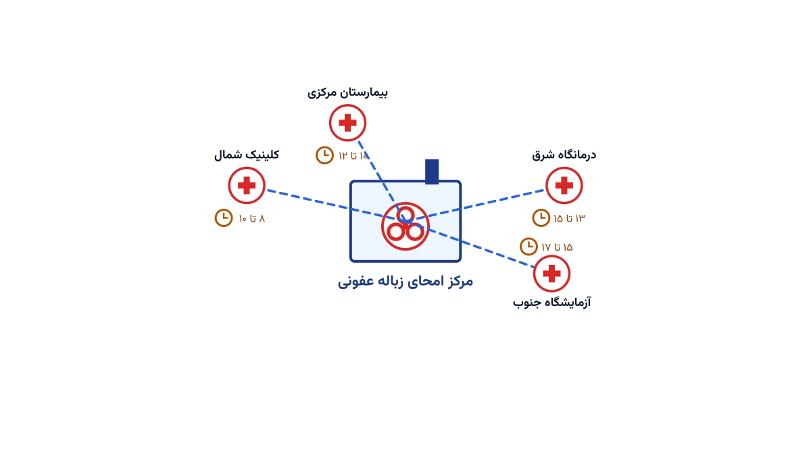

هر بیمارستان، درمانگاه و آزمایشگاه، روزانه حجمی زباله تولید می‌کند که با زباله‌ی خانگی فرق دارد. سرنگ مصرف‌شده، باند آغشته به خون، باقی‌مانده‌ی دارو و نمونه‌های آزمایشگاهی، همگی زباله‌ی عفونی یا خطرناک به‌شمار می‌روند. این زباله را نمی‌توان مثل زباله‌ی شهری، هر چند روز یک‌بار جمع کرد. قانون در اغلب کشورها، برای جمع‌آوری آن بازه‌ی زمانی مشخصی تعیین می‌کند. همین قید ساده، مسیریابی کامیون جمع‌آوری را از یک مسئله‌ی معمولی مسیریابی وسایل نقلیه بسیار سخت‌تر می‌کند.

## مسئله واقعی چیست؟

یک کامیون ویژه، هر روز باید از چند ده بیمارستان، کلینیک و آزمایشگاه بازدید کند. هر مرکز، یک بازه‌ی زمانی مجاز برای تحویل زباله دارد؛ مثلاً فقط بین ساعت هشت تا ده صبح. دلیلش گاهی ترافیک ورودی اورژانس است، گاهی هم مقررات بهداشتی شهرداری. کامیون باید زباله‌های مختلف را از هم جدا نگه دارد. زباله‌ی تیز و برنده در یک محفظه می‌رود، زباله‌ی عفونی عمومی در محفظه‌ای دیگر. ظرفیت وزنی کامیون محدود است و وقتی پر شود، باید به مرکز امحا یا سوزاندن زباله برود. اگر ظرفیت کافی نباشد، چند بار رفت‌وبرگشت در یک روز لازم است.

تأخیر در جمع‌آوری، فقط یک مشکل زمان‌بندی نیست. زباله‌ی عفونی هرچه بیشتر در محل بماند، ریسک آلودگی و شکایت بیشتر می‌شود. از طرفی، بازرسان بهداشت معمولاً برای تأخیر در جمع‌آوری جریمه در نظر می‌گیرند. به همین دلیل، شرکت‌های حمل‌ونقل زباله‌ی پزشکی باید مسیر هر کامیون را با دقت بچینند. هدف این است که هم بازه‌های زمانی رعایت شود، هم مسافت و هزینه‌ی سوخت کمینه بماند. این دقیقاً همان مسئله‌ای است که در ادبیات بهینه‌سازی، مسیریابی وسایل نقلیه با بازه‌ی زمانی نامیده می‌شود، با چند قید ایمنی اضافه.

## اهمیت این موضوع

حجم زباله‌ی پزشکی در دنیا پیوسته در حال افزایش است. رشد جمعیت، گسترش بیمارستان‌ها و همه‌گیری کووید-۱۹، هر سه این حجم را چند برابر کرده‌اند. در بسیاری از کشورها، مقررات زیست‌محیطی هم هر سال سخت‌گیرانه‌تر می‌شود. شرکتی مثل Stericycle در آمریکای شمالی، روزانه از هزاران بیمارستان، کلینیک و مطب دندان‌پزشکی زباله‌ی عفونی جمع‌آوری و امحا می‌کند. چنین شرکت‌هایی دقیقاً با همین چالش روبه‌رو هستند. با تعداد محدودی کامیون، باید بازه‌های زمانی همه‌ی مشتریان رعایت شود. هم‌زمان، هزینه‌ی سوخت و نیروی انسانی هم باید پایین بماند.

برای یک شرکت متوسط با چند ده کامیون، حتی کاهش ده درصدی مسافت، صرفه‌جویی قابل‌توجهی دارد. این صرفه‌جویی هم در سوخت است، هم در ساعت کاری راننده. از طرف دیگر، نقض بازه‌ی زمانی مجاز می‌تواند به لغو مجوز فعالیت شرکت منجر شود. پس این مسئله هم بعد اقتصادی دارد و هم بعد قانونی و سلامت عمومی. دقیقاً به همین دلیل، سرمایه‌گذاری روی یک مدل بهینه‌سازی درست، بازگشت سرمایه‌ی سریعی دارد.



## فرمول‌بندی ریاضی مسئله

این مسئله را می‌توان نسخه‌ای از مسیریابی وسایل نقلیه با بازه‌ی زمانی و چند نوع بار دانست. فرض کنید مجموعه‌ی $N$ شامل همه‌ی بیمارستان‌ها و کلینیک‌هاست، و گره‌ی $0$ نشان‌دهنده‌ی مرکز امحا یا انتقال است. ناوگان شامل $K$ کامیون با ظرفیت وزنی $Q$ است. هر مشتری $i$، تقاضای وزنی $d_i$ و بازه‌ی زمانی مجاز $[a_i, b_i]$ دارد. زمان حرکت بین دو گره $i$ و $j$ را با $t_{ij}$ نشان می‌دهیم.

متغیر دودویی $x_{ijk}$ برابر یک است اگر کامیون $k$ مستقیماً از گره $i$ به گره $j$ برود. متغیر پیوسته‌ی $\tau_i$ نیز زمان رسیدن به گره $i$ را نشان می‌دهد. تابع هدف، کمینه‌کردن مجموع فاصله‌ی طی‌شده توسط همه‌ی کامیون‌هاست:

$$
\min \sum_{k=1}^{K} \sum_{i \in N \cup \{0\}} \sum_{j \in N \cup \{0\}} c_{ij} \, x_{ijk}
$$

هر مرکز باید دقیقاً یک‌بار و توسط یک کامیون ویزیت شود:

$$
\sum_{k=1}^{K} \sum_{j \in N \cup \{0\}} x_{ijk} = 1 \quad \forall i \in N
$$

ظرفیت وزنی هر کامیون در طول مسیرش نباید نقض شود:

$$
\sum_{i \in N} d_i \sum_{j \in N \cup \{0\}} x_{ijk} \le Q \quad \forall k
$$

بازه‌ی زمانی مجاز هر مرکز، با قیدی روی زمان رسیدن اعمال می‌شود؛ کامیون می‌تواند زودتر برسد و منتظر بماند، اما نمی‌تواند دیرتر برسد:

$$
a_i \le \tau_i \le b_i \quad \forall i \in N
$$

در نهایت، یک قید انتشار زمان هم لازم است. این قید تضمین می‌کند اگر کامیون از $i$ به $j$ برود، زمان رسیدن به $j$ با زمان خدمت در $i$ سازگار بماند. این دقیقاً همان ساختاری است که در [مسئله مسیریابی وابسته به زمان](/notes/time-dependent-vrp/) هم دیدیم. تفاوت در این است که اینجا بازه‌ی زمانی روی مقصد است، نه روی سرعت حرکت.

## ظرفیت کار آکادمیک و پژوهشی

این مسئله زمینه‌ی پژوهشی غنی‌ای دارد، چون چند قید واقعی را هم‌زمان ترکیب می‌کند. یک جهت جذاب، مسیریابی چندمحفظه‌ای است؛ یعنی هر کامیون باید چند نوع زباله را در محفظه‌های جدا حمل کند. این نسخه، پیچیده‌تر از مسیریابی تک‌محموله‌ی معمول است و مقاله‌های نسبتاً کمی به آن پرداخته‌اند. جهت دیگر، مدل‌سازی تصادفی حجم زباله‌ی تولیدی است؛ چون حجم زباله‌ی هر بیمارستان روز به روز تغییر می‌کند و قطعی نیست.

جهت سوم، هدف چندگانه است. به‌جای کمینه‌کردن فقط مسافت، می‌توان ریسک ماندگاری زباله‌ی عفونی در مسیر را هم هدف دوم گرفت. مکان‌یابی مراکز انتقال یا امحا هم می‌تواند همراه با مسیریابی حل شود. این ترکیب شبیه مسئله‌ی مکان‌یابی تسهیلات کلاسیک است، با یک قید ایمنی زیستی اضافه. برای مسائل بزرگ‌مقیاس با صدها مشتری، روش‌های فراابتکاری و جست‌وجوی همسایگی بزرگ، گزینه‌ی عملی‌تری نسبت به حل دقیق‌اند.

## پیاده‌سازی با پایتون

خبر خوب این است که برای حل این مسئله، نیازی به نرم‌افزار مسیریابی تجاری و گران‌قیمت نیست. کتابخانه‌ی متن‌باز [OR-Tools](https://developers.google.com/optimization) گوگل، یک سالور مسیریابی اختصاصی دارد که دقیقاً برای همین نوع مسئله طراحی شده است. این سالور از قیدهای ظرفیت و بازه‌ی زمانی به‌صورت بومی پشتیبانی می‌کند و برای صدها گره هم در زمان معقول جواب می‌دهد. جایگزین دیگر، مدل‌سازی مستقیم با سالور [CP-SAT](https://developers.google.com/optimization/cp) است، که برای قیدهای منطقی پیچیده‌تر، انعطاف بیشتری می‌دهد.

ساخت مدل معمولاً با تعریف ماتریس فاصله و زمان شروع می‌شود. سپس بُعد زمان و بُعد ظرفیت به مدل اضافه می‌شوند. قطعه‌کد زیر، فقط اسکلت اولیه‌ی این مدل را نشان می‌دهد:

```python
from ortools.constraint_solver import routing_enums_pb2, pywrapcp

manager = pywrapcp.RoutingIndexManager(len(distance_matrix), num_vehicles, depot_index)
routing = pywrapcp.RoutingModel(manager)

def time_callback(from_index, to_index):
    from_node = manager.IndexToNode(from_index)
    to_node = manager.IndexToNode(to_index)
    return travel_time[from_node][to_node]

transit_callback_index = routing.RegisterTransitCallback(time_callback)
routing.AddDimension(transit_callback_index, slack_max=30, capacity=600,
                      fix_start_cumul_to_zero=False, name="Time")
time_dimension = routing.GetDimensionOrDie("Time")
# ادامه‌ی قیود بازه‌ی زمانی، ظرفیت وزنی و تابع هدف به همین شیوه تعریف می‌شوند.
```

داده‌ی ورودی این مدل، معمولاً یک فایل اکسل یا CSV ساده است. این فایل شامل مختصات هر مرکز، بازه‌ی زمانی مجاز، و وزن تقریبی زباله‌ی روزانه است. اگر با مفهوم مدل‌سازی ریاضی پیش از رفتن سراغ کد آشنا نیستید، نگران نباشید. دوره‌ی [مسیریابی وسایل نقلیه با پایتون](/courses/vrp-python/) از همان مثال‌های ساده شروع می‌کند و قدم‌به‌قدم به چنین مسائلی می‌رسد.

## سوالات متداول

<h3>آیا این مسئله با مسیریابی زباله‌ی شهری معمولی فرق دارد؟</h3>
<p>بله. زباله‌ی شهری معمولاً هیچ بازه‌ی زمانی سخت‌گیرانه‌ای ندارد و همه‌ی بارش از یک جنس است. زباله‌ی پزشکی هم بازه‌ی زمانی قانونی دارد، هم باید بر اساس نوع خطر، در محفظه‌های جدا حمل شود.</p>

<h3>چرا نمی‌توان این مسئله را با نرم‌افزارهای مسیریابی عمومی مثل نقشه‌های آنلاین حل کرد؟</h3>
<p>چون این ابزارها قید بازه‌ی زمانی چندگانه، ظرفیت وزنی و تفکیک نوع بار را به‌صورت هم‌زمان در نظر نمی‌گیرند. برای چنین مسائلی به یک مدل بهینه‌سازی اختصاصی نیاز است. دوره‌ی <a href="/courses/vrp-python/" style="color:#2563EB; font-weight:bold;">مسیریابی وسایل نقلیه با پایتون</a> دقیقاً همین نوع مدل‌سازی را آموزش می‌دهد.</p>

<h3>آیا می‌توان چنین مدلی را برای شرکت یا بیمارستان خودمان پیاده‌سازی کرد؟</h3>
<p>بله، هر شرکت با توجه به تعداد مشتری، نوع ناوگان و مقررات محلی‌اش، به مدل‌سازی اختصاصی نیاز دارد. برای این‌کار می‌توانید درخواست <a href="/consultation/" style="color:#2563EB; font-weight:bold;">مشاوره</a> بدهید.</p>
