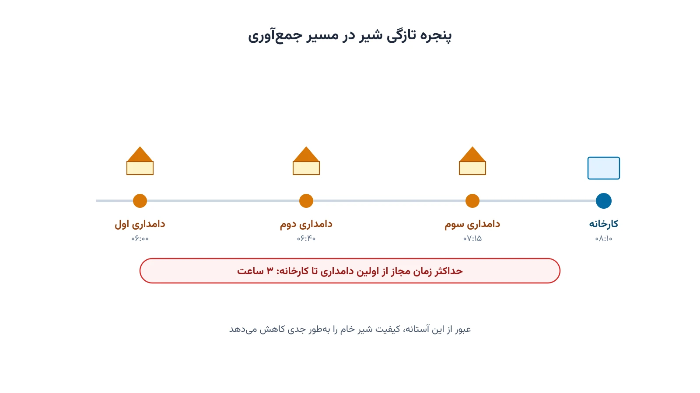

هر روز صبح زود، پیش از طلوع آفتاب، یک تانکر فلزی در جاده‌های روستایی حرکت می‌کند. این تانکر به دامداری‌ها سر می‌زند، اما نه برای تحویل‌دادن؛ برای برداشتن. راننده شیر تازه‌دوشیده هر دامداری را در مخزن خنک تانکر می‌ریزد. بار تانکر در طول مسیر کم نمی‌شود؛ برعکس، مدام افزایش می‌یابد. همین تفاوت ساده، این مسئله را از بیشتر مسائل کلاسیک مسیریابی جدا می‌کند.

شیر خام کالایی فسادپذیر است. از لحظه دوشیدن تا رسیدن به خط پاستوریزاسیون، ساعت‌شماری آغاز می‌شود. اگر این بازه طولانی شود، بار باکتریایی شیر بالا می‌رود و کیفیت افت می‌کند. به همین دلیل، مسیر تانکر فقط نباید کوتاه‌ترین مسافت را طی کند؛ باید در یک سقف زمانی مشخص هم تمام شود. در ادبیات پژوهشی، به این دسته می‌گویند مسیریابی جمع‌آوری شیر یا Milk Collection Vehicle Routing Problem.

این مسئله چند لایه پیچیدگی اضافه هم دارد. برخی دامداری‌ها شیر ارگانیک تولید می‌کنند که نباید با شیر معمولی مخلوط شود. تانکرهای چندمخزنه دقیقاً برای همین منظور طراحی شده‌اند. برخی دامداری‌ها هم فقط یک روز در میان جمع‌آوری می‌شوند، نه هر روز. این الگو، مسئله را به یک مسیریابی دوره‌ای یا Periodic Vehicle Routing Problem نزدیک می‌کند.

## اهمیت این موضوع در دنیای واقعی

این مسئله فقط یک تمرین دانشگاهی نیست. تعاونی‌هایی مثل فونترا در نیوزیلند، روزانه شیر خام هزاران دامداری عضو را جمع‌آوری می‌کنند. حتی کاهش چندکیلومتری در هر مسیر، در مقیاس کل ناوگان، صرفه‌جویی چشمگیری در سوخت ایجاد می‌کند. دیررسیدن به کارخانه هم می‌تواند یک محموله کامل شیر را غیرقابل‌مصرف کند. چنین زیانی مستقیماً روی درآمد دامدار و تعاونی اثر می‌گذارد.

کاهش مسافت طی‌شده، اثر زیست‌محیطی هم دارد؛ سوخت کمتر یعنی انتشار کربن کمتر در یک صنعت پرتردد. دوره [بهینه‌سازی زنجیره تأمین و حمل‌ونقل با پایتون](/courses/vrp-python/) دقیقاً همین نوع مسائل مسیریابی با محدودیت ظرفیت و زمان را پوشش می‌دهد.



## فرمول‌بندی ریاضی مسئله

فرض کنید $F$ مجموعه دامداری‌ها و گره $0$ کارخانه پاستوریزاسیون باشد. هر دامداری $i$ حجم شیر $q_i$ تولید می‌کند. تانکر ظرفیت $Q$ دارد و باید هر دامداری را دقیقاً یک‌بار بردارد. متغیر دودویی $x_{ij}$ برابر یک است اگر تانکر مستقیماً از $i$ به $j$ برود.

$$ \min \sum_{i} \sum_{j} c_{ij}\, x_{ij} $$

این تابع هدف، مجموع مسافت طی‌شده را کمینه می‌کند. دو قید بعدی تضمین می‌کنند هر دامداری دقیقاً یک ورودی و یک خروجی داشته باشد.

$$ \sum_{j} x_{ij} = 1 \qquad \forall i \in F $$

بار تانکر، برخلاف مسائل تحویل معمول، در طول مسیر افزایش می‌یابد. متغیر $u_i$ بار تانکر را بلافاصله بعد از ترک دامداری $i$ نشان می‌دهد.

$$ u_j \ge u_i + q_j - Q\,(1-x_{ij}) \qquad \forall i,j \in F $$

این قید هم زیرتور را حذف می‌کند و هم سقف ظرفیت $Q$ را رعایت می‌کند. محدودیت تازگی شیر هم به همین مدل اضافه می‌شود. کافی است زمان سپری‌شده از اولین دامداری تا رسیدن به کارخانه، از یک سقف $L$ بیشتر نشود. این سقف در عمل معمولاً بین دو تا چهار ساعت تعیین می‌شود.

## ظرفیت کار آکادمیک و پژوهشی

این حوزه هنوز مسیرهای پژوهشی باز زیادی دارد. ترکیب مسیریابی دوره‌ای با محدودیت تازگی، یکی از جذاب‌ترین آن‌هاست. مدل‌سازی تانکرهای چندمخزنه برای شیر ارگانیک و معمولی هم کمتر بررسی شده است. عدم‌قطعیت حجم تولید روزانه هر دامداری، به‌خاطر فصل و آب‌وهوا، بُعد دیگری به مسئله اضافه می‌کند.

پژوهش‌های میدانی روی تعاونی‌های لبنیات ایرلند و نیوزیلند، داده‌های واقعی خوبی برای اعتبارسنجی مدل فراهم کرده‌اند. ارتباط این مسئله با [مسیریابی وسایل نقلیه تعمیم‌یافته](/notes/generalized-vehicle-routing-problem/) و مسائل مسیریابی وابسته به زمان، فضای پژوهشی را گسترده‌تر می‌کند. این زمینه می‌تواند موضوع مناسبی برای پایان‌نامه ارشد یا مقاله علمی باشد.

## پیاده‌سازی با پایتون

خبر خوب این است که حل این مدل، نیاز به نرم‌افزار گران‌قیمت ندارد. کتابخانه متن‌باز [OR-Tools](https://developers.google.com/optimization) گوگل، ماژول اختصاصی برای مسائل برداشت و تحویل دارد. همین ماژول، محدودیت ظرفیت تانکر و محدودیت زمانی تازگی را هم‌زمان پشتیبانی می‌کند. برای مدل‌سازی دقیق‌تر با رویکرد برنامه‌ریزی محدودیت، ماژول CP-SAT همین کتابخانه هم گزینه مناسبی است.

```python
from ortools.constraint_solver import pywrapcp

# حجم شیر هر دامداری به لیتر؛ گره صفر کارخانه پاستوریزاسیون است
milk_volume = [0, 180, 220, 150, 90]
tanker_capacity = 600
max_route_minutes = 180  # سقف مجاز برای حفظ تازگی شیر

manager = pywrapcp.RoutingIndexManager(len(milk_volume), 1, 0)
routing = pywrapcp.RoutingModel(manager)

def distance_callback(from_index, to_index):
    i, j = manager.IndexToNode(from_index), manager.IndexToNode(to_index)
    return distance_matrix[i][j]

transit_index = routing.RegisterTransitCallback(distance_callback)
routing.SetArcCostEvaluatorOfAllVehicles(transit_index)

def demand_callback(from_index):
    return milk_volume[manager.IndexToNode(from_index)]

demand_index = routing.RegisterUnaryTransitCallback(demand_callback)
routing.AddDimensionWithVehicleCapacity(demand_index, 0, [tanker_capacity], True, "Capacity")
routing.AddDimension(transit_index, 0, max_route_minutes, True, "Freshness")

search_params = pywrapcp.DefaultRoutingSearchParameters()
solution = routing.SolveWithParameters(search_params)
```

بعد از حل، ترتیب دقیق بازدید دامداری‌ها و مسیر کامل تانکر مشخص می‌شود. داده هر دامداری، شامل مختصات و حجم تولید روزانه، را می‌توان از یک فایل اکسل یا CSV خواند. برای شبکه‌های کوچک‌تر، سالورهای متن‌باز مثل [CBC](https://github.com/coin-or/Cbc) یا [HiGHS](https://highs.dev/) هم می‌توانند مدل دقیق MILP را حل کنند. کتابخانه [NetworkX](https://networkx.org/) هم برای تحلیل و رسم شبکه جاده‌ای میان دامداری‌ها مفید است.

## سوالات متداول

<h3>آیا این مدل فقط برای تعاونی‌های بزرگ لبنیات کاربرد دارد؟</h3>
<p>نه. حتی یک کارخانه کوچک با چند ده دامداری هم از بهینه‌سازی مسیر جمع‌آوری سود می‌برد. کاهش مسافت و رعایت بهتر پنجره تازگی، در هر مقیاسی ارزشمند است.</p>

<h3>چه دوره‌ای برای یادگیری عمیق‌تر این نوع مسائل مناسب است؟</h3>
<p>دوره <a href="/courses/vrp-python/" style="color:#2563EB; font-weight:bold;">بهینه‌سازی زنجیره تأمین و حمل‌ونقل با پایتون</a> دقیقاً مسائل مسیریابی با محدودیت ظرفیت و زمان مشابه این مقاله را آموزش می‌دهد.</p>

<h3>آیا امکان طراحی اختصاصی این مدل برای یک کارخانه یا تعاونی خاص وجود دارد؟</h3>
<p>بله. برای تنظیم مدل بر اساس داده واقعی دامداری‌ها و ناوگان شما، می‌توانید از <a href="/consultation/" style="color:#2563EB; font-weight:bold;">مشاوره</a> استفاده کنید.</p>
