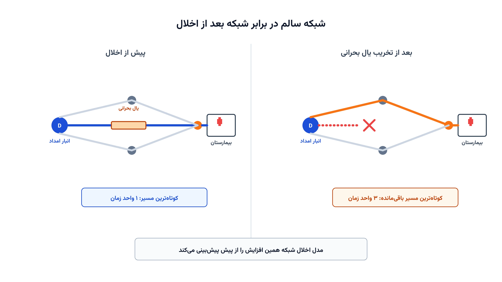

فرض کنید یک زلزله یا سیل در راه است، اما هنوز اتفاق نیفتاده. شبکه‌ی جاده‌ها، خطوط برق یا لوله‌های آب هنوز کاملاً سالم‌اند. سوال این است: کدام یال از این شبکه، اگر از بین برود، بیشترین آسیب را به توان رساندن کمک می‌زند؟ این پرسش درست برعکس چیزی است که در بیشتر مطالب مدیریت بحران می‌خوانیم.

بیشتر مدل‌های لجستیک بحران، بعد از وقوع فاجعه وارد عمل می‌شوند. مدل بازسازی شبکه مثلاً تعیین می‌کند کدام جاده‌ی آسیب‌دیده را اول تعمیر کنیم. اما مسئله‌ای که اینجا بررسی می‌کنیم، پیش از فاجعه اجرا می‌شود. هدف این است که از پیش بفهمیم کدام نقطه‌ی شبکه واقعاً حیاتی است. به این مسئله در ادبیات بهینه‌سازی می‌گویند «مسئله‌ی اخلال شبکه» یا Network Interdiction.

## چرا این موضوع اهمیت دارد

بودجه‌ی تقویت زیرساخت همیشه محدود است. نمی‌توان همه‌ی پل‌ها و جاده‌ها را هم‌زمان تقویت کرد. مدیران بحران باید دقیقاً بدانند کدام یال شبکه، اگر از کار بیفتد، بیشترین هزینه را تحمیل می‌کند. بدون این تحلیل، تصمیم‌ها معمولاً بر پایه‌ی حدس یا تجربه‌ی شخصی گرفته می‌شوند.

شرکت بیمه‌ای مثل زوریخ (Zurich Insurance)، از طریق ائتلاف تاب‌آوری در برابر سیل خودش، سال‌هاست روی همین سوال کار می‌کند. این ائتلاف بررسی می‌کند کدام سرمایه‌گذاری زیرساختی، بیشترین کاهش ریسک سیل را برای یک جامعه به همراه دارد. چنین تحلیلی دقیقاً به ساختار ریاضی مسئله‌ی اخلال شبکه نیاز دارد. بدون شناسایی نقاط حیاتی، هر سرمایه‌گذاری تاب‌آوری ممکن است در جای اشتباه هزینه شود.

این مدل فقط به جاده محدود نیست. همان منطق برای خطوط انتقال برق، لوله‌های آب یا شبکه‌ی ارتباطات هم کار می‌کند. هر جایی که قطع یک یال، جریان چیزی حیاتی را متوقف کند، این مدل کاربرد دارد.

## فرمول‌بندی ریاضی مسئله

شبکه را به‌صورت یک گراف جهت‌دار در نظر بگیرید. گره‌ها تقاطع‌ها یا نقاط مهم‌اند و یال‌ها جاده، خط برق یا لوله هستند. یک گره را مبدأ کمک $s$ و یک گره را مقصد حیاتی $t$ می‌نامیم، مثلاً انبار امداد و بیمارستان. هر یال $(i,j)$ طول یا زمان عبور $\ell_{ij}$ دارد. یک عامل مخرب، مثل بلا یا حمله، می‌تواند حداکثر $K$ یال را از کار بیندازد.

اگر هیچ یالی از کار نیفتد، کوتاه‌ترین مسیر بین $s$ و $t$ از یک مسئله‌ی برنامه‌ریزی خطی معمولی به دست می‌آید. این مسئله یک دوگان ساده دارد که با متغیرهای پتانسیل گره، یعنی $\pi_i$، بیان می‌شود. مسئله‌ی اخلال شبکه درست از همین دوگان استفاده می‌کند. هدف این است که با از کار انداختن حداکثر $K$ یال، طول کوتاه‌ترین مسیر را تا حد ممکن افزایش دهیم.

$$\max_{x,\,\pi} \quad \pi_t - \pi_s$$

در این فرمول، $x_{ij}$ متغیری دودویی است و نشان می‌دهد آیا یال $(i,j)$ از کار افتاده یا نه. $\pi_i$ هم پتانسیل گره $i$ در مسئله‌ی دوگان کوتاه‌ترین مسیر است. این تابع هدف، بیشینه‌کردن فاصله‌ی باقی‌مانده بین مبدأ و مقصد را دنبال می‌کند.

$$\pi_j - \pi_i \le \ell_{ij} + M_{ij}\, x_{ij} \qquad \forall (i,j) \in A$$

این قید همان رابطه‌ی دوگان کوتاه‌ترین مسیر است. وقتی یال از کار نیفتد، یعنی $x_{ij}=0$، قید معمولی مسیر برقرار می‌ماند. وقتی یال از کار بیفتد، عدد بزرگ $M_{ij}$ عملاً این قید را بی‌اثر می‌کند. به این ترتیب، آن یال از مسیر حذف می‌شود.

$$\sum_{(i,j)\in A} x_{ij} \le K, \qquad x_{ij}\in\{0,1\},\ \pi_i \in \mathbb{R},\ \pi_s = 0$$

قید اول بودجه‌ی اخلال را محدود می‌کند؛ عامل مخرب فقط $K$ یال را می‌تواند نابود کند. گره‌ی مبدأ هم به‌عنوان مرجع، پتانسیل صفر می‌گیرد. حل این مدل، همان $K$ یالی را مشخص می‌کند که نبودشان بیشترین آسیب را می‌زند. همین یال‌ها اولویت اول سرمایه‌گذاری تقویت خواهند بود.

## ظرفیت کار آکادمیک و پژوهشی

مسئله‌ی اخلال شبکه از دهه‌ی ۱۹۹۰ در ادبیات تحقیق در عملیات مطرح است. با این حال، در حوزه‌ی مدیریت بحران هنوز به‌اندازه‌ی مسیریابی امداد کاوش نشده است. همین خلأ، آن را به فرصت خوبی برای پایان‌نامه یا مقاله تبدیل می‌کند.

یک مسیر پژوهشی، تعمیم مدل به چند مقصد حیاتی هم‌زمان است؛ مثلاً چند بیمارستان با وزن اهمیت متفاوت. مسیر دیگر، مدل‌سازی عدم‌قطعیت در طول یال یا در توان واقعی عامل مخرب است. می‌توان مسئله را به‌صورت یک بازی دومرحله‌ای بین مدافع و مهاجم هم فرمول‌بندی کرد. در این بازی، مدافع ابتدا بودجه‌ی تقویت را تخصیص می‌دهد و بعد مهاجم بهترین حمله را انتخاب می‌کند. این نسخه را در مقالات «مسئله‌ی حفاظت از شبکه» یا defender-attacker-defender می‌نامند.

می‌توان این مدل را با مسئله‌ی [پاکسازی آوار و بازگشایی مسیر پس از بلایا](/notes/debris-clearance-arc-routing/) هم ترکیب کرد. در این حالت، نتیجه‌ی تحلیل آسیب‌پذیری مستقیماً ورودی برنامه‌ی تعمیر می‌شود. این ترکیب هنوز در مقالات کمی بررسی شده و ظرفیت انتشار خوبی دارد.

## پیاده‌سازی با پایتون

خبر خوب این است که این مدل را می‌توان کاملاً با ابزارهای متن‌باز پایتون حل کرد. نیازی به نرم‌افزار یا سالور تجاری گران‌قیمت نیست. کتابخانه‌ی [NetworkX](https://networkx.org/) برای ساخت گراف و بررسی اولیه‌ی کوتاه‌ترین مسیر مناسب است.

چون متغیرهای پتانسیل گره در این مدل پیوسته‌اند، ماژول CP-SAT کمی دست‌وپاگیر می‌شود. برای همین از ماژول خطی [OR-Tools](https://developers.google.com/optimization) یعنی MPSolver استفاده می‌کنیم. این ماژول از سالورهای متن‌باز مثل [CBC](https://github.com/coin-or/Cbc) یا [HiGHS](https://highs.dev/) در پس‌زمینه بهره می‌برد. هر دوی این سالورها کاملاً رایگان هستند و برای این اندازه از مسئله به‌خوبی کار می‌کنند.

داده‌های ورودی را می‌توان از یک فایل اکسل یا CSV ساده خواند. این فایل باید شامل گره‌ی مبدأ، گره‌ی مقصد و طول هر یال باشد. بودجه‌ی اخلال $K$ هم می‌تواند جداگانه در کد تنظیم شود. با pandas این داده‌ها به‌سادگی به دیکشنری تبدیل می‌شوند و وارد مدل OR-Tools می‌شوند.

ساخت مدل در MPSolver چند خط بیشتر طول نمی‌کشد. یک متغیر باینری برای هر یال و یک متغیر پیوسته برای پتانسیل هر گره کافی است. قید بزرگ $M$ هم برای هر یال نوشته می‌شود. دوره‌ی [بهینه‌سازی زنجیره تأمین و حمل‌ونقل با پایتون](/courses/vrp-python/) دقیقاً همین نوع مدل‌سازی گراف‌محور را با مثال‌های عملی آموزش می‌دهد.

برای شبکه‌هایی با چند صد یال، این مدل معمولاً در کسری از ثانیه تا چند دقیقه حل می‌شود. بزرگ‌ترین چالش عملی، انتخاب درست عدد $M$ است. اگر $M$ خیلی کوچک باشد، مدل جواب اشتباه می‌دهد؛ اگر خیلی بزرگ باشد، سالور کندتر عمل می‌کند. انتخاب $M$ کمی بزرگ‌تر از طولانی‌ترین مسیر ممکن در شبکه، معمولاً انتخاب امنی است.

## سوالات متداول

<h3>تفاوت این مدل با مسئله‌ی بازسازی شبکه پس از بلا چیست؟</h3>

مسئله‌ی بازسازی، بعد از وقوع آسیب اجرا می‌شود و ترتیب تعمیر را تعیین می‌کند. مسئله‌ی اخلال شبکه اما پیش از فاجعه اجرا می‌شود و نقاط حیاتی را از قبل شناسایی می‌کند. این دو مدل مکمل هم هستند، نه رقیب هم.

<h3>برای یادگیری عملی مدل‌سازی گراف‌محور از کجا شروع کنم؟</h3>

دوره‌ی <a href="/courses/vrp-python/" style="color:#2563EB; font-weight:bold;">بهینه‌سازی زنجیره تأمین و حمل‌ونقل با پایتون</a> پایه‌ی خوبی برای این نوع مدل‌سازی گراف و شبکه با پایتون است. مفاهیم NetworkX و OR-Tools در همین دوره به‌صورت پروژه‌محور آموزش داده می‌شود.

<h3>آیا این مدل را می‌توان برای شبکه‌ی برق یا آب خودمان پیاده‌سازی کرد؟</h3>

بله، ساختار ریاضی مدل مستقل از نوع شبکه است و فقط داده‌های ورودی تغییر می‌کند. برای تطبیق مدل با داده‌های واقعی سازمان یا پروژه‌ی پژوهشی‌تان، می‌توانید از <a href="/consultation/" style="color:#2563EB; font-weight:bold;">مشاوره</a> کمک بگیرید.

