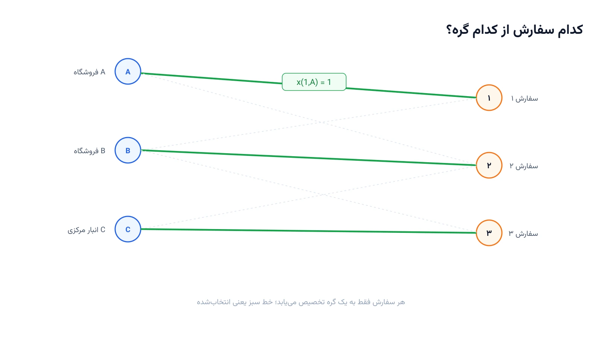

یک مشتری در تهران یک کفش ورزشی را آنلاین سفارش می‌دهد. انبار مرکزی شرکت این کالا را دارد. اما فروشگاه فیزیکی نزدیک خانه‌ی مشتری هم همان جنس را روی قفسه دارد. کدام یکی باید این سفارش را ارسال کند؟

این سؤال ساده، امروز یکی از پیچیده‌ترین تصمیم‌های روزانه‌ی خرده‌فروشی بزرگ است. شرکت‌هایی که هم فروشگاه فیزیکی دارند و هم فروشگاه آنلاین، به این مدل کسب‌وکار چندکاناله می‌گویند. هر سفارش آنلاین باید از یکی از ده‌ها یا صدها نقطه‌ی موجودی ارسال شود. این نقاط شامل انبار مرکزی، انبارهای منطقه‌ای و حتی خود فروشگاه‌های فیزیکی‌اند. به فرستادن کالا از قفسه‌ی فروشگاه به‌جای انبار، اصطلاحاً «ارسال از فروشگاه» یا Ship-from-Store می‌گویند.

تصمیم به‌ظاهر ساده است: نزدیک‌ترین نقطه را انتخاب کن. اما واقعیت پیچیده‌تر است. اگر موجودی فروشگاه نزدیک برای مشتریان حضوری رزرو نشود، شاید وقتی مشتری واقعی وارد فروشگاه شود، جنس تمام شده باشد. اگر هر سفارش را از انبار مرکزی بفرستیم، هزینه حمل و زمان تحویل بالا می‌رود. اگر الگوریتم به‌جای یک تصمیم ساده، همه‌ی این‌ها را هم‌زمان ببیند، نتیجه بسیار بهتر می‌شود. این دقیقاً همان مسئله‌ای است که در ادبیات زنجیره تأمین به آن تخصیص سفارش چندکاناله یا Omnichannel Order Fulfillment Allocation می‌گویند.

### اهمیت این موضوع

خرده‌فروشان بزرگ دنیا سال‌هاست روی همین مسئله سرمایه‌گذاری می‌کنند. شرکتی مثل والمارت هزاران فروشگاه فیزیکی‌اش را هم‌زمان به‌عنوان نقطه‌ی فروش حضوری و نقطه‌ی ارسال سفارش آنلاین به کار می‌گیرد. این کار هزینه‌ی حمل را کاهش می‌دهد و سرعت تحویل را بالا می‌برد. شرکتی مثل زارا هم بخشی از سفارش‌های آنلاین اروپایی‌اش را از فروشگاه‌های نزدیک مشتری ارسال می‌کند، نه از انبار مرکزی.

ارزش این تصمیم فقط در صرفه‌جویی هزینه حمل نیست. وقتی سفارش از فروشگاه نزدیک ارسال شود، معمولاً سریع‌تر هم به دست مشتری می‌رسد. این یعنی رضایت مشتری بالاتر می‌رود. از طرف دیگر، اگر مدل تخصیص بد طراحی شود، فروشگاه‌ها ممکن است موجودی حضوری خود را از دست بدهند. این دقیقاً همان نقطه‌ای است که بهینه‌سازی ریاضی وارد می‌شود. باید هم‌زمان هزینه، سرعت و ریسک کمبود موجودی را در یک مدل واحد در نظر گرفت.

این مسئله برای صنایعی مثل پوشاک، لوازم‌خانگی، لوازم الکترونیک و حتی زنجیره‌های داروخانه هم صدق می‌کند. هر کسب‌وکاری که هم‌زمان فروشگاه فیزیکی و فروش آنلاین دارد، دیر یا زود با همین تصمیم روبه‌رو می‌شود. دوره [مسیریابی و زنجیره تأمین با پایتون](/courses/vrp-python/) دقیقاً همین دسته از مسائل تخصیص و توزیع را پوشش می‌دهد.

### فرمول‌بندی ریاضی مسئله

برای ساده‌سازی، فرض کنید مجموعه‌ای از سفارش‌های آنلاین و مجموعه‌ای از گره‌های تأمین (فروشگاه یا انبار) داریم. هر گره یک موجودی مشخص از کالا دارد. هدف، تخصیص هر سفارش به یک گره است.

متغیر تصمیم به این صورت تعریف می‌شود:

$$x_{ij} \in \{0, 1\} \quad \forall i \in \text{سفارش‌ها}, \ j \in \text{گره‌ها}$$

اگر سفارش $i$ از گره $j$ ارسال شود، $x_{ij}$ برابر یک است. تابع هدف، کمینه‌کردن هزینه کل ارسال است:

$$\min \sum_{i} \sum_{j} c_{ij} \, x_{ij}$$

در این رابطه $c_{ij}$ هزینه حمل به‌علاوه جریمه‌ی احتمالی تأخیر تحویل سفارش $i$ از گره $j$ است. هر سفارش باید دقیقاً از یک گره ارسال شود:

$$\sum_{j} x_{ij} = 1 \quad \forall i$$

موجودی هر گره محدود است و بخشی از آن هم باید برای مشتریان حضوری فروشگاه رزرو بماند:

$$\sum_{i} q_i \, x_{ij} \le I_j - S_j \quad \forall j$$

در این رابطه، $q_i$ مقدار سفارش $i$ و $I_j$ موجودی فعلی گره $j$ است. $S_j$ هم سطح موجودی ایمنی رزروشده برای فروش حضوری همان گره را نشان می‌دهد. می‌توان یک قید دیگر هم اضافه کرد. سفارش فقط به گره‌هایی تخصیص یابد که فاصله یا زمان تحویلشان از یک سقف مشخص بیشتر نشود.

این مدل در ساده‌ترین حالت، یک مسئله حمل‌ونقل کلاسیک است. اما با اضافه‌شدن قید موجودی ایمنی و سقف زمان تحویل، به یک مسئله برنامه‌ریزی عدد صحیح واقعی تبدیل می‌شود.

### ظرفیت کار آکادمیک و پژوهشی

این حوزه هنوز جای کار پژوهشی زیادی دارد. اغلب مقالات موجود، مسئله را به‌صورت ایستا و برای یک دوره زمانی کوتاه حل می‌کنند. اما در عمل، سفارش‌ها پشت سر هم و به‌صورت جریانی می‌رسند. این یعنی مدل باید به‌صورت آنلاین و پویا تصمیم بگیرد، نه یک‌بار برای کل روز.

یک مسیر پژوهشی جذاب، ترکیب این مسئله با پیش‌بینی تقاضا و عدم‌قطعیت فروش حضوری است. چه مقدار موجودی باید برای فروش حضوری آینده رزرو شود، وقتی تقاضای آن هم نامعلوم است؟ مسیر دیگر، ترکیب تخصیص سفارش با مسیریابی وسیله نقلیه است. این‌طوری تصمیم می‌شود که کدام فروشگاه ارسال کند و کدام وسیله آن را به دست مشتری برساند.

این زمینه برای پایان‌نامه‌ی کارشناسی ارشد یا مقاله علمی بسیار مناسب است. هم داده‌ی واقعی در دسترس صنعت خرده‌فروشی فراوان است و هم مدل‌های ریاضی آن هنوز به بلوغ کامل نرسیده‌اند.

### پیاده‌سازی با پایتون

خبر خوب این است که این مسئله را می‌توان بدون هیچ سالور تجاری گرانی حل کرد. ابزارهای متن‌باز پایتون برای این کار کاملاً کافی‌اند. [OR-Tools](https://developers.google.com/optimization) گوگل، به‌خصوص ماژول CP-SAT آن، یکی از بهترین گزینه‌ها برای این نوع مسئله تخصیص است. این مدل در مقیاس چند صد سفارش و چند ده گره، در کسری از ثانیه حل می‌شود.

داده‌ها را می‌توان از یک فایل اکسل یا CSV خواند. این فایل باید شامل ستون‌هایی برای شناسه سفارش، مقدار سفارش و موقعیت مشتری باشد. برای هر گره تأمین هم باید موجودی فعلی و موجودی ایمنی رزروشده ثبت شود. سپس با یک حلقه ساده، ماتریس هزینه حمل بین هر سفارش و هر گره محاسبه می‌شود.

کد پایتون این مدل در CP-SAT، حدوداً این شکل است: برای هر جفت سفارش و گره، یک متغیر بولی تعریف می‌شود. قید تخصیص دقیق، قید ظرفیت موجودی، و در صورت نیاز قید سقف فاصله، به مدل اضافه می‌شوند. سپس تابع هدف کمینه‌سازی هزینه تعریف و سالور فراخوانی می‌شود. اگر مقیاس مسئله خیلی بزرگ‌تر شود، [PuLP](https://coin-or.github.io/pulp/) همراه با سالور [CBC](https://github.com/coin-or/Cbc) هم گزینه‌ی سبک و رایگان دیگری است.

نکته مهم این است که همین مدل ساده، روی داده واقعی یک زنجیره فروشگاهی اثر محسوس دارد. می‌تواند هزینه حمل را به‌طور قابل‌توجهی کاهش دهد. این کار بدون نیاز به هیچ نرم‌افزار گران‌قیمتی ممکن است.

### سوالات متداول

<h3>آیا این مدل فقط برای فروشگاه‌های پوشاک کاربرد دارد؟</h3>

خیر. هر کسب‌وکاری که هم‌زمان فروشگاه فیزیکی و فروش آنلاین دارد، با این تصمیم روبه‌رو می‌شود. از لوازم‌خانگی و الکترونیک گرفته تا داروخانه‌های زنجیره‌ای، همه با آن مواجه‌اند. دوره <a href="/courses/vrp-python/" style="color:#2563EB; font-weight:bold;">مسیریابی و زنجیره تأمین با پایتون</a> نمونه‌های بیشتری از این دست مسائل را پوشش می‌دهد.

<h3>آیا می‌شود این مدل را با موجودی واقعی و متغیر زمان اجرا کرد؟</h3>

بله. در عمل مدل باید هر چند دقیقه یک‌بار با آخرین موجودی اجرا شود، نه یک‌بار در روز. این یعنی سرعت حل مدل اهمیت زیادی دارد؛ دقیقاً همان دلیلی که سالورهای سریع مثل CP-SAT برای این کار مناسب‌اند.

<h3>برای پیاده‌سازی این مدل روی داده واقعی شرکتم چه کار کنم؟</h3>

اگر می‌خواهید این مدل را دقیقاً مطابق شبکه فروشگاه‌ها و انبارهای خودتان پیاده‌سازی کنید، بهترین مسیر گرفتن <a href="/consultation/" style="color:#2563EB; font-weight:bold;">مشاوره</a> تخصصی است. این‌طوری داده و محدودیت‌های واقعی کسب‌وکارتان در مدل لحاظ می‌شود.

